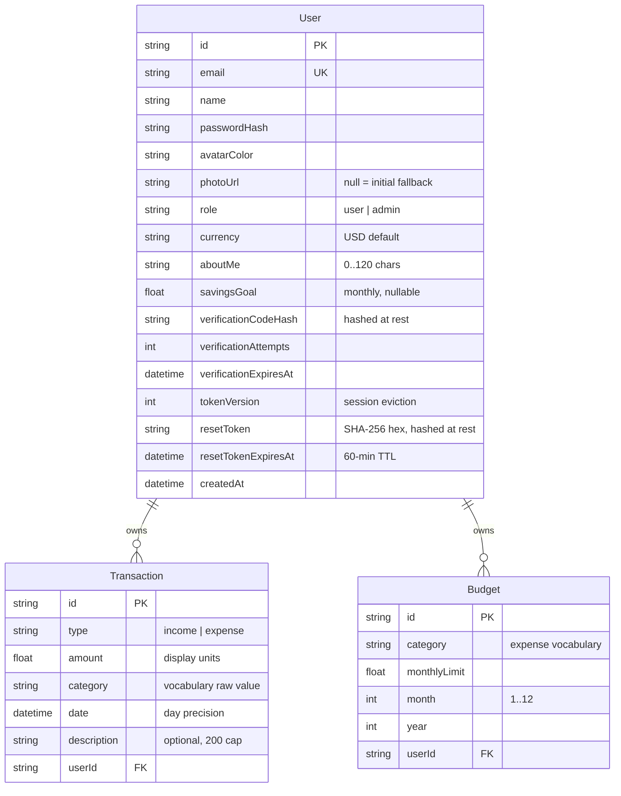
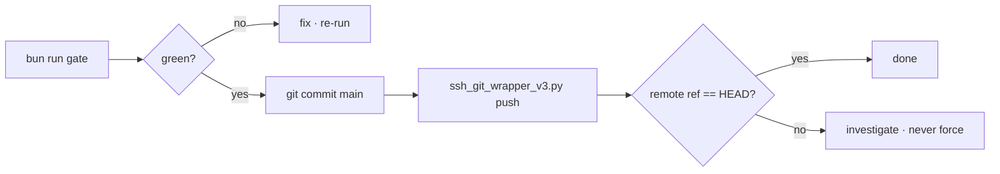

# Budget Wise — Master Project Architecture Document (PAD) v2.77.0

**Classification:** Internal Engineering Reference
**Status:** DEFINITIVE, PRODUCTION-LOCKED BLUEPRINT
**Companion Document:** [README.md](README.md) (user-facing) · [AGENTS.md](AGENTS.md) (agent-facing) · [CLAUDE.md](CLAUDE.md) (workflow)
**Last Updated:** 2026-11-05
**Audience:** Senior Engineers, Tech Leads, DevOps, and Onboarding Engineers
**Rule:** Every architectural decision in this document traces to a specific rationale. Nothing is here "because it's popular."

#### Revision Block — v2.77.0 (Tracked Changes)

- `[AUTH]` **The session-78 verification round (session 267): the SEVENTY-FIFTH census — a ONE-FINDINGS round with ZERO code findings (F-267a, Informational — the SECOND owner-side data plant of the standing-determinism era, the F-264a family: the reference's November month gaining one income transaction "ok" · Investment · Nov 4 2026 · +$2,702.00, moving the November aggregates together — Balance/Income $2,702.00, Expenses $0.00, 1 txn, the 100.0% saved badge — and taking the week band out of its rest through DATA (Week Earned $2,702.00, inside the Mon Nov 2 – Sun Nov 8 week) rather than the Mon Nov 9 rollover the census-74 record anticipated, plus the year band's earned $0.00 → $2,702.00). Every form the plant exercises verified live as ALREADY CARRIED by the standing genera: the card's F-265a description-first/raw fallback rendering "ok" description-first, the page's label fallback rendering the "Investment" badge, the income icon family (`investment → TrendingUp` in `bg-teal-50 text-teal-600` — byte-identical to our map), and the income category family — the triage chain's determinism proof re-capturing every diverged reference frame byte-identical (the divergence is the plant's content, not capture noise), the three data-bearing reference manifest hashes refreshed per the clock-rollover precedent (9dff3dce → 960cbb06 · b22968d1 → 1a2cb38f · 2bb07a70 → 4f4cc9e7) with budgets-desktop holding byte-identical a TENTH consecutive round (cfc6116d — the plant touched no budget-side surface). A COLD-WORKSPACE round (the fresh clone at a1172f5, the standing environment rebuilt from the contract: bun install, the six-knob .env with DATABASE_URL=file:../db/custom.db, db:push + db:seed landing the fresh-seed intake (both demo users pinned 2026-10-15 through the CREATE path, 4 txns / 0 budgets, $4,424.55), the Playwright chromium-1248 restore) with the battery 12/12 byte-identical on boot-1 — ALL TWELVE on their FIRST captures — AND 12/12 stable on boot-2 (profile-desktop at the documented avatar-jitter alternate 3d5173c8, the manifest@boot-1/alternate@boot-2 pair order) and NO clock crossing in the captures (all on UTC 2026-11-05). The F-265a remediation verified holding LIVE on both apps its SECOND post-ship round; the F-246b remediation holding LIVE a SEVENTEENTH round; the s230 F-1 OTP funnel green on the press form's FIRST application (the sequenced-keystroke canon at twenty-eight); the F-239a UPDATE-path pin; the VLM battery zero surviving flags (the transactions-mobile bar-coverage note the standing platform-badge genus, dismissed via the byte-exact DOM bar census); the mobile-nav battery 12/12 (the Tailwind v4 bug class stays retired); and the round's standing asks executed (the neo-crm stack patterns re-verified — identical; the .env/db contract, the vitest+playwright configs, the sitemap/SEO handlers, .env.example, and docs/screenshots/ all re-verified). The round's one methodology note: the week-band anticipation correction — owner-side plants can move any aggregate the calendar can, so the anticipation names the mechanism ("data or rollover, whichever first"). The counts unchanged at 429/68/14.**

#### Revision Block — v2.76.0 (Tracked Changes)

- `[AUTH]` **The session-77 verification round (session 266): the SEVENTY-FOURTH census — a ONE-FINDINGS round with one code remediation (F-266a, the docs-count lockstep completion), and the F-265a remediation's FIRST post-ship verification round (verified holding LIVE on both apps: the reference's card reading the raw values "food"/"bills"/"bills" and our card reading the raw values on our own null-description seed rows "transport"/"other" — the census-73 one-line fix + its born-green pin correct in production form, the /Transactions page genus untouched as designed). A WARM-WORKSPACE round (the pull to 24c4ca0, the owner's docs/session_149.md transcript commit — a docs-only diff; the standing environment intact: the seeded db with both demo users pinned 2026-10-15 and throwaway264/265 keeping their real createdAt, the chromium-1248 cache). NO clock-rollover event (the round opening comfortably inside UTC 2026-11-05, every capture on the same date digit as the standing manifest). The F-246b remediation verified holding LIVE on both apps a SIXTEENTH round. Every probed surface zero structural drift: the reference data aggregates unchanged a sixty-sixth round (the November empty month, −$2,481.00 October, the year band $2,481.00/$0.00, the week band at rest a TWENTY-THIRD round — it rolls Mon Nov 9); the four reference frames ALL byte-identical a NINTH consecutive round (9dff3dce · b22968d1 · 2bb07a70 · cfc6116d — no further owner-side data plants); the fresh `Curl Probe 266 Test` decode probes matched on both apps; the 520 face a fifty-seventh round; the F-239a pin through the UPDATE seed path; the s230 F-1 OTP funnel green on the press form's FIRST application (the sequenced-keystroke canon at TWENTY-SEVEN; the code 151156); the §16/§20 audit sweep clean; the neo-crm stack re-verified (identical); the VLM battery zero surviving flags. The battery: 12/12 byte-identical on boot-1 — the FIRST all-identical round since the F-265a refresh (zero code changes, zero clock events, zero data events; every manifest hash re-verified, `docs/screenshots/` requiring no sync) — AND 12/12 stable on boot-2 (profile-desktop realizing the documented manifest@boot-1/alternate@boot-2 pair order at 3d5173c8). THE ROUND'S ONE METHODOLOGY LESSON — THE BLUR-FIRST CARET FORM'S BLUR IS A PRE-CLICK RESET, NEVER A POST-CLICK CLEAR: the boot-1 add-transaction-dialog first capture answered a 951-px divergence (b5e7c5c5 vs the manifest abf7e47a) whose bbox matched the `input#tx-amount` geometry EXACTLY (556,370)-(955,407) with the heaviest rows at the ring band's edges — an EXTRA blur applied after the canonical trusted-click had cleared the focused state the manifest form carries; the immediate re-application (blur → trusted click → the ~2000ms ON-phase delay → capture, nothing clearing the focus after the click) landing abf7e47a byte-identical, and both boot-2 dialog frames landing first-try under the corrected form. F-266a — the census-73 count move (428 → 429) NEVER carried through the docs-count lockstep: the census-73 docs set updated only the era-number surfaces (the PAD revision block, the SKILL Appendix C row) while the lockstep's UNIT constant and every live-tense surface (README, CLAUDE, the PAD §7 table, the SKILL tier headings + command comments) still said 428 — the lockstep test green through four ships because it pins the docs AGAINST the constant, not against the live count (the session-222 lesson's blind spot inside the check's own constant). Caught live this round when the count-trueing edits REDded the lockstep (2 failing assertions by design); remediated TDD — the constant moved 428 → 429 with the session-265/266 comment + every live-tense surface trued in the same change set, 429/429 green. The counts stay 429/68/14 (the lockstep now agreeing with them).**

#### Revision Block — v2.75.0 (Tracked Changes)

- `[AUTH]` **The session-76 verification round (session 265): the SEVENTY-THIRD census — a ONE-FINDINGS round WITH one code remediation: F-265a, the dashboard Recent Transactions card's empty-description fallback arm — our card rendered `t.description || meta.label` (the LABEL fallback) where the reference's own bundle renders `r.description || r.category` (the RAW category fallback; extracted verbatim from assets/index-CkXf21Ch.js) — the two surfaces genuinely differ on the reference itself (its /Transactions page title carries the label fallback `w.description || C1[w.category] || w.category`). The arm became observable 2026-10-28 when the owner CLEARED the two bills rows' descriptions (F-264a's TRUE mechanism — the entity-API read: description "" on both rows, updated_date 03:16:05/31; the prior round's "description edit or platform re-save" refined to the description-clear): the reference's card then read "bills" (raw) while its /Transactions titles read "Bills & Utilities" (label). Session-194's `description || meta.label` pin was a coincidence-fit — the pre-plant reference data carried descriptions equal to the raw category values, so the fallback arm never fired. REMEDIATED TDD: the one-line fallback change (meta.label → t.category) + the born-green source-contract pin in tests/app-chrome.test.ts (RED: exactly 1 failure → GREEN), the count 428 → 429, live-verified on our own null-description seed rows (the card now rendering "Electricity bill"/"transport"/"other"/"Monthly salary" — the same rendered form the reference's card shows for its cleared rows); the /Transactions page genus UNTOUCHED (its label fallback IS the reference's page form; our categoryMeta's unknown-arm already returns label=raw). A WARM-WORKSPACE round (the pull to 1954ae7, the owner's docs/session_147.md transcript commit — a docs-only diff; the standing environment intact). A CLOCK-ROLLOVER round — the THIRD in the canon after census-52/68: the UTC midnight crossing landing at the round's open (the gate legs crossing it harmlessly — no date-sensitive tests, grep-verified), every battery capture on the fresh day UTC 2026-11-05, the date-bearing add-transaction-dialog frame's date digit 11/04 → 11/05 on both apps together, the manifest hash refreshed 708d5884 → abf7e47a with the delta verified as exactly two clusters (the date-digit cell 65 px at the documented bbox + the F-265a card-title region 542 px showing through the dialog's semi-transparent overlay — the census-71 overlay-capture lesson). The battery: 12/12 on boot-1 — TEN byte-identical + the two event-bearing refreshes (dashboard-desktop cc31e6a1 → 34add827, the F-265a fix's delta confined to a 75×15 card-title box) — AND 12/12 stable on boot-2 (profile-desktop realizing the documented manifest@boot-1/alternate@boot-2 pair order). The F-246b remediation verified holding LIVE on both apps a FIFTEENTH round. Every other probed surface zero structural drift: the reference data aggregates unchanged a sixty-fifth round (the November empty month, −$2,481.00 October, the year band, the week band at rest a TWENTY-SECOND round — it rolls Mon Nov 9); the four reference frames ALL byte-identical (9dff3dce · b22968d1 · 2bb07a70 holding the F-264a refresh · budgets-desktop cfc6116d an EIGHTH consecutive round — no further data plants); the fresh `Curl Probe 265 Test` decode probes matched on both apps; the round's extra probe — the category-family ORDER check: the reference's hidden native select re-renders its options with the default value first after a tab flip (other-first) but the VISIBLE dropdown orders match ours exactly on both tabs — the non-visible platform quirk dismissed (the dangling-aria genus family); the s230 F-1 OTP funnel green on the press form's FIRST application (the sequenced-keystroke canon at TWENTY-SIX; the code 499224); the F-239a pin through the UPDATE seed path; the §16/§20 audit sweep clean; the VLM battery zero surviving flags (the transactions-mobile bar-coverage note dismissed via the byte-exact DOM bar census — the standing platform-badge genus, the same flag and dismissal as census-72); `docs/screenshots/` refreshed to the round's state. The round also executed the brief's standing asks: the neo-crm tech-stack patterns re-verified (the identical stack), the `.env`/`db/` contract re-verified, the vitest+playwright configs re-run green, the sitemap/SEO handlers probed, `.env.example` confirmed matching.** The counts move to 429/68/14 (+1 unit pin).

#### Revision Block — v2.74.0 (Tracked Changes)

- `[AUTH]` **The session-75 verification round (session 264): the SEVENTY-SECOND census — a ONE-FINDINGS round (zero code findings): F-264a, the reference-side owner data plant — the two October bills transactions now render their row TITLES as "Bills & Utilities" (the label form; every prior round recorded the "bills" raw-value fallback — the same fallback the food row still shows) — the divergence confined to the three row-bearing reference frames (dashboard-desktop 69289ec6 → 9dff3dce · transactions-desktop 5c05598b → b22968d1 · transactions-mobile 41e9fa7f → 2bb07a70 — the three manifest hashes REFRESHED per the clock-rollover refresh precedent) while the row-free budgets-desktop stayed byte-identical a SEVENTH consecutive round (cfc6116d); the round's triage chain: the capture-form determinism proof (the triple capture), the environment discrimination (all 12 LOCAL battery frames byte-identical to the manifest — the capture pipeline byte-compatible), the surface discrimination (the row-free surface unchanged, exactly the row-bearing surfaces diverged), the live DOM read + the VLM transcription (ROW0 title "food"/badge "Food & Dining"; ROW1-2 title "Bills & Utilities"/badge "Bills & Utilities") — the documented "owner-side data plant" event class, informational, no code remediation (our clone's row genus is structure-faithful; our demo rows carry real descriptions — the same rendered form). A COLD-WORKSPACE round (the sandbox reset between rounds; a fresh `git clone` at `49450b6`, the owner's `docs/session_145.md` transcript commit — a docs-only diff — with the standing environment REBUILT from the contract: `bun install`, the six-knob `.env` from `.env.example` with DATABASE_URL="file:../db/custom.db", db:push + db:seed landing the fresh-seed intake form (both demo users pinned 2026-10-15 through the CREATE path, 4 txns / 0 budgets, $4,424.55), and the Playwright browser-cache revision restored (chromium-1200 → the 1.64.1 suite's pinned 1248)) whose baseline gate ran green end-to-end (428/428 unit · 14/14 smoke · 68/68 e2e CI=1; the mobile-nav battery 12/12 standalone — the Tailwind v4 bug class stays retired) and whose battery answered **12/12 byte-identical to HEAD on boot-1 AND 12/12 stable across both boots — NO clock-rollover event in the captures** (all captures on UTC 2026-11-04; the round's documentation and ship legs crossed the UTC midnight into 11/05 only after the battery completed). The F-246b remediation verified holding LIVE on both apps a FOURTEENTH round. Every other probed surface zero structural drift: the reference data aggregates unchanged a sixty-fourth round (the November empty month, −$2,481.00 October, the year band, the week band at rest a twenty-first round); the fresh `Curl Probe 264 Test` decode probes matched on both apps; the s230 F-1 OTP funnel green on the press form's FIRST application (the sequenced-keystroke canon at twenty-five); the F-239a pin through the UPDATE seed path; the §16/§20 audit sweep clean; the VLM battery zero surviving flags (the transactions-mobile pair's bar-coverage note dismissed via the DOM cross-check — the platform's fixed-position "Edit with Base44" badge (197×39 at (177,789) on the 390×844 axis) overlapping the bar's right end in the capture — the standing platform-face genus, VLM variance on a standing genus); `docs/screenshots/` byte-verified current (all 12 boot-1 captures identical to the committed frames). The round also executed the brief's standing asks: the neo-crm tech-stack patterns reviewed (the identical stack — no migration work), the `.env`/`db/` contract re-verified, the vitest+playwright configs re-run green, the sitemap/SEO handlers probed, `.env.example` confirmed matching.** The counts unchanged at 428/68/14.

#### Revision Block — v2.73.0 (Tracked Changes)

- `[AUTH]` **The session-74 verification round (session 263): the SEVENTY-FIRST census — a ZERO-FINDINGS round (the fifty-sixth census after the s207 percent-decode fix, the forty-sixth after the s218 arrow remediation, and the forty-fifth carrying the deeper row-anatomy probe; the twelfth round after the census-59 F-246b remediation ship, twelve rounds of zero-drift since) — a COLD-WORKSPACE round (the sandbox reset between rounds; a fresh `git clone` at `ba32263` — the owner's `docs/session_143.md` transcript commit over the census-70 ship — with the standing environment REBUILT from the contract: `bun install`, the six-knob `.env` from `.env.example` (DATABASE_URL="file:../db/custom.db", a generated AUTH_SECRET, knob names diff-identical), `db:push && db:seed` landing the FRESH-SEED intake form (the census-68 precedent: both demo users pinned 2026-10-15 through the seed's CREATE path, 4 txns / 0 budgets, the demo month at $4,424.55; the throwaway260/261/262 rows gone with the reset — their createdAt records standing in the prior rounds' transcripts), and the Playwright browser-cache revision restored (the surviving cache carried chromium-1200; the 1.64.1 suite pins chromium_headless_shell-1248 — `bunx playwright install chromium` the cold-round restore step)) whose baseline gate ran green end-to-end (428/428 unit · 14/14 smoke · 68/68 e2e CI=1 — the exact census-70 ship state; the mobile-nav battery 12/12 standalone) and whose battery answered **12/12 byte-identical to HEAD on boot-1 AND 12/12 stable on boot-2 — NO clock-rollover event** (all captures on UTC 2026-11-04, the manifest frame's date digit matching).** The F-246b remediation verified holding LIVE on both apps a THIRTEENTH round (the Set Budget dialog's form-lead description placement — the reference's redesigned genus byte-mirrored, the reference's dangling aria-describedby still unmirrored as the documented platform defect). Every other probed surface zero structural drift: the reference data state unchanged a sixty-third round (3 October txns, −$2,481.00; the November empty month; the year band $0/$2,481) — **with all four reference frames captured BYTE-IDENTICAL to the prior round's hashes (69289ec6 · 5c05598b · cfc6116d · 41e9fa7f) a SIXTH consecutive round — the reference's determinism itself a standing cross-round invariant**; the week band's TWENTIETH round at rest (still inside the Mon Nov 2 – Sun Nov 8 week; the next band event at the Mon Nov 9 rollover); the fresh `Curl Probe 263 Test` decode probes matching on both apps; the 520 malformed-escape face a fifty-fourth round; the two-surface 404 read exact; the row anatomy at full nesting depth (the trash2 dual-alias + the aria-hidden superset + the accessible delete-button name); the Add Transaction dialog under the full-header read (the single-H2 genus, both category families byte-identical, the date default 2026-11-04 current-day on both apps, the Income flip via native activation, the disabled empty-form submit, the standing shim read — the hidden select's leading empty + salary/freelance/investment/gift/other_income); the mobile bar byte-identical at rect 390×77@y767 with the clearance 764 ≤ 767 gap 3 IDENTICAL on both apps; the SEO genera (the 4-cap-loc reference sitemap vs our 9-loc superset, the robots form, the manifest 302 platform-redirect genus vs our 200); the guest wall at its canonical 20,455 bytes (zero real app-data markers); the member-since. The F-239a pin live through the UPDATE seed path (the demo user's createdAt displaced to 2026-11-04T03:20:00Z → RED → the in-place re-seed restoring the 2026-10-15 pin; the CREATE-path pins standing from this round's fresh-clone seed). **The s230 F-1 OTP funnel GREEN — the press-form application green on its FIRST application (the sequenced-keystroke canon at a TWENTY-FOURTH consecutive round; throwaway263, the code 460408 read from the page's "Demo code:" line; all six digits in exact positions ["4","6","0","4","0","8"] with the focus advanced to Digit 6; the empty-state form + the API aggregate byte-exact; the with-data form intact)**. **THE ROUND'S ONE METHODOLOGY LESSON — THE CHART-SETTLE RULE EXTENDS TO THE DIALOG FRAMES' BACKDROP:** the boot-2 add-transaction-dialog first capture — taken WITHOUT the sectors=3 assertion + the ~3s settle before the dialog mount — answered a whole-backdrop divergence (193,382 px across the overlay region, max 51; the dialog card itself ZERO diff at the pixel level), the semi-transparent overlay carrying the dashboard behind it MID-RENDER; the canonical chart-settle wait before the dialog mount landed the manifest 708d5884 byte-identical on the immediate re-application. The rule: **a dialog frame is an OVERLAY capture — the page behind the overlay is part of the frame; settle it (the sectors assertion + the settle delay) BEFORE the dialog mounts, not merely before the screenshot.** The evidence layer otherwise: 11/12 byte-identical on the first correct-form applications at both boots, with profile-desktop at the avatar-jitter ALTERNATE 3d5173c8 at BOTH boots this cold round (the documented pair's realization order inverted from the warm rounds' boot-1-manifest/boot-2-alternate pattern — the alternate itself byte-identical to its documented hash, the genus verified at the documented signature family: 105 px, max 6, ZERO at ≥ 32, confined to the avatar bbox (357,255,505,374); the reload restore attempted and the alternate standing — a pair-member pass, not a drift); the VLM battery zero surviving flags (navigation identical + zero structural differences on all four pairs; the dashboard pair's notes the documented data-borne family — the savings badge data-driven against the reference's empty month; no claim requiring the DOM cross-check). The counts held at **428/68/14** (the zero-findings round). The documentation set: REMEDIATION-PLAN-SESSION-74, this revision block, `budget-wiser_SKILL.md` v1.72.0, `docs/session_144.md`, the worklog entry (Task ID 263), and the `.gitignore` walk263 entry; the post-doc gate green; one atomic commit to main via the SSH wrapper.

#### Revision Block — v2.72.0 (Tracked Changes)

- `[AUTH]` **The session-73 verification round (session 262): the SEVENTIETH census — a ZERO-FINDINGS round (the fifty-fifth census after the s207 percent-decode fix, the forty-fifth after the s218 arrow remediation, and the forty-fourth carrying the deeper row-anatomy probe; the eleventh round after the census-59 F-246b remediation ship, eleven rounds of zero-drift since) — a WARM-WORKSPACE round (the sandbox surviving from the census-69 ship; `git pull` fast-forwarding `62d9309 → 54b9a69`, the owner's `docs/session_141.md` transcript commit — a docs-only diff, zero source changes; the standing environment — the six-knob `.env`, `db/` with the generated Prisma client, node_modules, the Playwright browser cache, the walk-area tooling — intact, NO intake gap: the standing DB verified at both demo users pinned 2026-10-15, throwaway260/261 keeping their real createdAt, 4 txns / 0 budgets, $4,424.55) whose baseline gate ran green end-to-end on the first pass (428/428 unit · 14/14 smoke · 68/68 e2e CI=1 — the exact census-69 ship state; the mobile-nav battery 12/12 standalone) and whose battery answered **12/12 byte-identical to HEAD on boot-1 AND 12/12 stable on boot-2 — NO clock-rollover event** (all captures on UTC 2026-11-04, the refreshed manifest frame's date digit matching; the next date-digit flip lands at the UTC midnight into 11/05).** The F-246b remediation verified holding LIVE on both apps a TWELFTH round (the Set Budget dialog's form-lead description placement — the reference's redesigned genus byte-mirrored, the reference's dangling aria-describedby still unmirrored as the documented platform defect). Every other probed surface zero structural drift: the reference data state unchanged a sixty-second round (3 October txns, −$2,481.00; the November empty month; the year band $0/$2,481) — **with all four reference frames captured BYTE-IDENTICAL to the prior round's hashes (69289ec6 · 5c05598b · cfc6116d · 41e9fa7f) a FIFTH consecutive round — the reference's determinism itself a standing cross-round invariant**; the week band's nineteenth round at rest (still inside the Mon Nov 2 – Sun Nov 8 week; the next band event at the Mon Nov 9 rollover); the fresh `Curl Probe 262 Test` decode probes matching on both apps; the 520 malformed-escape face a fifty-third round; the two-surface 404 read exact; the row anatomy at full nesting depth; the Add Transaction dialog under the full-header read (the single-H2 genus, both category families byte-identical, the date default 2026-11-04 current-day on both apps, the Income flip via native activation, the disabled empty-form submit, the standing shim read); the mobile bar byte-identical at rect 390×77@y767 with the clearance 764 ≤ 767 gap 3 IDENTICAL on both apps; the SEO genera; the guest wall at its canonical 20,455 bytes (zero real app-data markers — the `transaction` string hits the login card's own marketing copy, the `recharts` hits the shell's script-chunk filenames); the member-since. The F-239a pin live through the UPDATE seed path (the in-place re-seed restoring the displaced createdAt; throwaway261/262 keeping their real createdAt). **The s230 F-1 OTP funnel GREEN — the press-form application green on its FIRST application (the sequenced-keystroke canon at a twenty-third consecutive round in its true `press`-per-digit form; the empty-state form + the API aggregate byte-exact)** — with **THE ROUND'S ONE METHODOLOGY EVENT: the PRESS-vs-TYPE keystroke-form rule for the auto-advancing OTP inputs** — the round's first funnel attempt (throwaway262-ui-1) entered the six digits through six `type @Digit1-ref` calls, and each call RE-TARGETED the first input (re-focusing it and overwriting its single char — the maxlength=1 input keeping only the LAST digit, the state reading ["9","","","","",""]), because a `type @ref` command always focuses ITS ref: the auto-advance that carries the focus down the six boxes never rides. THE CURE — the PRESS form: `click Digit 1 ONCE` then six `press <digit>` commands at ~400ms spacing (the keystroke riding the FOCUSED element, the app's own auto-advance carrying the focus down the inputs) — landing all six digits in exact positions ["7","0","6","9","8","6"] with the focus advanced to Digit 6, GREEN on the first application (throwaway262-ui-2, the code 706986). The recovery path itself verified three funnel guards LIVE as a side effect: the OTP verify view is CLIENT-SIDE state (a page reload loses it back to the signup form), the duplicate-email signup answers "A user with this email already exists", and the unverified login answers the gate "Please verify your email before logging in" — all three working as designed. The rule extends the sequenced-keystroke canon: **"real keystrokes" means the `press` form — the key event goes to whatever is focused; a `type @ref` on an auto-advancing input row is a form error, not a flake.** **The evidence layer: 12/12 byte-identical on boot-1 AND 12/12 stable on boot-2** (both dialog frames via the BLUR-FIRST restart on the FIRST application at BOTH boots — the census-69 lesson carrying; profile-desktop the manifest form ed954b46 on the boot-1 FIRST capture, the avatar-jitter alternate 3d5173c8 on boot-2 at the documented signature (87 px, max 5, zero ≥ 32, bbox (357,255,505,374)) — the documented per-boot realization pattern; profile-mobile the manifest form b0413d45 at boot-2 on the FIRST capture, the boot-1 first capture answering the documented mobile realization genus (104 px, max 6, zero ≥ 32, bbox (84,255,235,377) — the mobile avatar bbox) with the manifest restored on the RELOAD — the census-66 mobile restore form); the VLM battery zero surviving flags (navigation identical + zero structural differences on all four pairs; the dashboard pair's notes the documented data-borne family; no claim requiring the DOM cross-check). The counts held at **428/68/14** (the zero-findings round). The documentation set: REMEDIATION-PLAN-SESSION-73, this revision block, `budget-wiser_SKILL.md` v1.71.0, `docs/session_142.md`, the worklog entry (Task ID 262), and the `.gitignore` walk262 entry; the post-doc gate green; one atomic commit to main via the SSH wrapper.

#### Revision Block — v2.71.0 (Tracked Changes)

- `[AUTH]` **The session-72 verification round (session 261): the SIXTY-NINTH census — a ZERO-FINDINGS round (the fifty-fourth census after the s207 percent-decode fix, the forty-fourth after the s218 arrow remediation, and the forty-third carrying the deeper row-anatomy probe; the tenth round after the census-59 F-246b remediation ship, ten rounds of zero-drift since) — a WARM-WORKSPACE round (the sandbox surviving from the census-68 ship; `git pull` fast-forwarding `4466610 → 8510444`, the owner's `docs/session_139.md` transcript commit — a docs-only diff, zero source changes; the standing environment — the six-knob `.env`, `db/` with the generated Prisma client, node_modules, the Playwright browser cache — intact, NO intake gap: the standing DB verified at both demo users pinned 2026-10-15, throwaway260 keeping its real createdAt, 4 txns / 0 budgets, $4,424.55) whose baseline gate ran green end-to-end (428/428 unit · 14/14 smoke · 68/68 e2e CI=1 — the exact census-68 ship state; the mobile-nav battery 12/12 standalone) and whose battery answered **12/12 byte-identical to HEAD on boot-1 AND 12/12 stable on boot-2 — NO clock-rollover event** (all captures on UTC 2026-11-04, the refreshed manifest frame's date digit matching; the next date-digit flip lands at the UTC midnight into 11/05).** The F-246b remediation verified holding LIVE on both apps an ELEVENTH round (the Set Budget dialog's form-lead description placement — the reference's redesigned genus byte-mirrored, the reference's dangling aria-describedby still unmirrored as the documented platform defect). Every other probed surface zero structural drift: the reference data state unchanged a sixty-first round (3 October txns, −$2,481.00; the November empty month; the year band $0/$2,481) — **with all four reference frames captured BYTE-IDENTICAL to the prior round's hashes (69289ec6 · 5c05598b · cfc6116d · 41e9fa7f) a FOURTH consecutive round — the reference's determinism itself a standing cross-round invariant**; the week band's eighteenth round at rest (still inside the Mon Nov 2 – Sun Nov 8 week; the next band event at the Mon Nov 9 rollover); the fresh `Curl Probe 261 Test` decode probes matching on both apps; the 520 malformed-escape face a fifty-second round; the two-surface 404 read exact; the row anatomy at full nesting depth; the Add Transaction dialog under the full-header read (the single-H2 genus, both category families byte-identical, the date default 2026-11-04 current-day on both apps, the Income flip via native activation, the disabled empty-form submit, the standing shim read); the mobile bar byte-identical at rect 390×77@y767 with the clearance 764 ≤ 767 gap 3 IDENTICAL on both apps; the SEO genera; the guest wall at its canonical 20,455 bytes (zero app-data markers); the member-since. The F-239a pin live through the UPDATE seed path (the in-place re-seed restoring the displaced createdAt; throwaway261 keeping its real createdAt 2026-11-04T02:01:07). **The s230 F-1 OTP funnel GREEN ON THE FIRST PASS a sixth consecutive round** (throwaway261, the code 254298, the six digits by real keystrokes in exact positions at ~400ms spacing, the focus advanced to Digit 6 — the sequenced-keystroke canon holding a twenty-second consecutive round; the empty-state form + the API aggregate byte-exact). **The evidence layer: 12/12 byte-identical on boot-1 AND 12/12 stable on boot-2** (profile-desktop the manifest form ed954b46 on the boot-1 FIRST capture, the avatar-jitter alternate 3d5173c8 on boot-2 at the documented signature (87 px, max 5, zero ≥ 32, bbox (357,255,505,374)) — the documented per-boot realization pattern; profile-mobile the manifest form b0413d45 on the FIRST capture BOTH boots — no mobile realization this round); the VLM battery zero surviving flags (navigation identical + zero structural differences on all four pairs; no claim requiring the DOM cross-check). **THE ROUND'S ONE METHODOLOGY EVENT: the BLUR-FIRST restart refinement of the caret-ON technique** — the boot-1 add-transaction-dialog capture answered the caret OFF-phase stripe (16 px at the x=590 column) and the plain re-click sweep-restart loop (600 → 950 → 1200 → 1500ms) answered the OFF phase on ALL FOUR attempts — the root cause: a re-click on an ALREADY-FOCUSED input does not re-fire the focus event, so the blink cycle keeps running instead of restarting; the trusted click only restarts the blink when it crosses the focus boundary. THE CURE: the BLUR-FIRST restart (an `eval` `.blur()` → the trusted click → the ~2000ms ON-phase delay) landing the manifest byte-identical on the FIRST application — verified on both dialog frames at BOTH boots (the boot-1 set-budget at attempt 2, the boot-2 add-transaction and set-budget on the immediate first blur-restart). The rule extends the s255 blur-focus-click canon: the BLUR is the load-bearing step — the click alone restarts nothing on a focused input. The counts held at **428/68/14** (the zero-findings round). The documentation set: REMEDIATION-PLAN-SESSION-72, this revision block, `budget-wiser_SKILL.md` v1.70.0, `docs/session_140.md`, the worklog entry (Task ID 261), and the `.gitignore` walk261 entry; the post-doc gate green; one atomic commit to main via the SSH wrapper.

#### Revision Block — v2.70.0 (Tracked Changes)

- `[AUTH]` **The session-71 verification round (session 260): the SIXTY-EIGHTH census — a ZERO-FINDINGS round (the fifty-third census after the s207 percent-decode fix, the forty-third after the s218 arrow remediation, and the forty-second carrying the deeper row-anatomy probe; the ninth round after the census-59 F-246b remediation ship, nine rounds of zero-drift since) — a COLD-WORKSPACE round (the sandbox reset since the census-67 ship; a FRESH CLONE at `a150dd3`, the owner's `docs/session_137.md` transcript commit) whose full intake (bun install · `.env` from `.env.example` with a generated AUTH_SECRET · db:push + db:seed with the census MATCH — both demo users pinned at 2026-10-15, 4 txns / 0 budgets, the demo month at $4,424.55 · the Playwright Chromium 1248 restored after the first e2e pass flagged the missing executable — the known cold-workspace gap) carried the baseline gate green end-to-end (428/428 unit · 14/14 smoke · 68/68 e2e CI=1; the mobile-nav battery 12/12 standalone).** **THE ROUND'S ONE OPERATIONAL EVENT (methodology, not a code finding): the gate-chain PIPE-MASKING bug** — the round's first gate launch piped each leg through `tail`, and a pipeline's exit status is the LAST command's, so the e2e leg's exit 1 (the missing browser executable) printed `=== E2E OK ===` and `=== GATE GREEN ===` FALSELY; the cure is the strict-exit gate runner (`set -o pipefail`, every leg's FULL log to its own file, the chain stopping at the first failure with the failing leg's tail printed) — a green gate claimed through a masked pipe is not a gate. The F-246b remediation verified holding LIVE on both apps a TENTH round (the Set Budget dialog's form-lead description placement — the reference's redesigned genus byte-mirrored, the reference's dangling aria-describedby still unmirrored as the documented platform defect). Every other probed surface zero structural drift: the reference data state unchanged a sixtieth round (3 October txns, −$2,481.00; the November empty month; the year band $0/$2,481) — **with all four reference frames captured BYTE-IDENTICAL to the prior round's hashes (69289ec6 · 5c05598b · cfc6116d · 41e9fa7f) a THIRD consecutive round — the reference's determinism itself now a standing cross-round invariant**; the week band's seventeenth round at rest (still inside the Mon Nov 2 – Sun Nov 8 week; the next band event at the Mon Nov 9 rollover); the fresh `Curl Probe 260 Test` decode probes matching on both apps; the 520 malformed-escape face a fifty-first round; the two-surface 404 read exact; the row anatomy at full nesting depth (the full shadcn badge class at genus depth); the Add Transaction dialog under the full-header read (the single-H2 genus, both category families byte-identical, the date default 2026-11-04 current-day on both apps, the Income flip via native activation, the disabled empty-form submit, the standing shim read); the mobile bar byte-identical at rect 390×77@y767 with the clearance 764 ≤ 767 gap 3 IDENTICAL on both apps; the SEO genera; the guest wall at its canonical 20,455 bytes (zero app-data markers — the fifteen `recharts` string hits all script-chunk filenames, framework chrome not data); the member-since. The F-239a pin live through the UPDATE seed path (the in-place re-seed restoring the displaced createdAt; the CREATE-path pins standing from this round's fresh-clone seed; throwaway260 keeping its real createdAt 2026-11-04T00:52:45). **The s230 F-1 OTP funnel GREEN ON THE FIRST PASS a fifth consecutive round** (throwaway260, the code 692941, the six digits by real keystrokes in exact positions at ~400ms spacing, the focus advanced to Digit 6 — the sequenced-keystroke canon holding a twenty-first consecutive round; the empty-state form + the API aggregate byte-exact). **THE ROUND'S CLOCK-ROLLOVER EVENT (the second in the canon; the census-52 precedent applying):** the UTC midnight crossed between the prior round's captures (all on 11/03) and this round's (all on 11/04); the add-transaction-dialog's date-default digit flipped 11/03 → 11/04 on BOTH apps together (the reference probed rendering 2026-11-04 — ours agreeing, the current-day default contract itself re-verified as a parity surface); the delta confined exactly to the date-digit cell bbox (605,552,613,562), 70 px; **the date-bearing manifest frame REFRESHED ec921b6d → 708d5884** (the caret-ON + current-date canonical form); the month-level surfaces unaffected (the set-budget dialog's November 2026 line byte-stable). **The evidence layer: 11/12 byte-identical on boot-1 + the refreshed date-bearing frame (12/12 matching) AND 12/12 stable on boot-2** (profile-desktop the manifest form ed954b46 on the boot-1 FIRST capture, the avatar-jitter alternate 3d5173c8 on boot-2 at the documented signature (87 px, max 5, zero ≥ 32, bbox (357,255,505,374)) — the documented per-boot realization pattern; profile-mobile the manifest form b0413d45 on the FIRST capture BOTH boots — no mobile realization this round; both dialog frames byte-identical via the trusted-click + sweep-restart forms — the boot-2 set-budget landing at 600ms on the second attempt, the boot-2 add-transaction at 600ms after the documented OFF-phase stripe); the VLM battery zero surviving flags (every flag the documented data-borne family or the platform-badge genus; NO claim requiring the DOM cross-check this round; navigation identical on all four pairs). **THE ROUND'S NEW CAPTURE RULE: the GUTTER-FORM refinement of the post-click hover-clear rule** — the "neutral margin" must be a position OUTSIDE every interactive surface AT THE CURRENT VIEWPORT: on desktop 1512×945 the LEFT GUTTER (58,500) — the prior rounds' bottom-center (756,935) resting ON the login card's button row (a 19,945-px max-20 hover band at (571,464,941,520), the OAuth-button tint) and ON the dashboard's Spend Summary chart (a 39,419-px max-5 whole-region tint at (172,890,927,945)); on mobile 390×844 there is NO left gutter (the cards span the viewport) — the NAVBAR CENTER (195,3) is the neutral form (the (20,420) capture answering an edge-emphasized 4,612-px max-20 card-border band at (11,405,379,527)); the boot-2 landing frame repeating the footer-edge genus at (559,919,953,945) before the gutter re-capture answered the manifest byte-identical. The counts held at **428/68/14** (the zero-findings round). The documentation set: REMEDIATION-PLAN-SESSION-71, this revision block, `budget-wiser_SKILL.md` v1.69.0, `docs/session_138.md`, the worklog entry (Task ID 260), and the `.gitignore` walk260 entry; the post-doc gate green; one atomic commit to main via the SSH wrapper.

#### Revision Block — v2.69.0 (Tracked Changes)

- `[AUTH]` **The session-70 verification round (session 259): the SIXTY-SEVENTH census — a ZERO-FINDINGS round (the fifty-second census after the s207 percent-decode fix, the forty-second after the s218 arrow remediation, and the forty-first carrying the deeper row-anatomy probe; the eighth round after the census-59 F-246b remediation ship, eight rounds of zero-drift since) — a WARM-WORKSPACE round (the sandbox surviving from the census-66 ship; `git pull` fast-forwarding `21e76f1 → 3e80847`, the owner's `docs/session_135.md` transcript commit; the standing environment — the six-knob `.env`, `db/`, node_modules with the generated Prisma client, the Playwright browser cache — intact, NO intake gap) whose baseline gate ran green end-to-end (428/428 unit · 14/14 smoke · 68/68 e2e CI=1 — the exact census-66 ship state; the mobile-nav battery 12/12 standalone), and whose battery answered 12/12 byte-identical to HEAD on boot-1 AND 12/12 stable on boot-2 — the SEVENTH consecutive cleanest-battery round form, NO clock crossing (all 24 captures on UTC 2026-11-03, the manifest frames' date digit matching).** The F-246b remediation verified holding LIVE on both apps a NINTH round (the Set Budget dialog's form-lead description placement — the reference's redesigned genus byte-mirrored, the reference's dangling aria-describedby still unmirrored as the documented platform defect). Every other probed surface zero structural drift: the reference data state unchanged a fifty-ninth round (3 October txns, −$2,481.00; the November empty month; the year band $0/$2,481 — the Spend Summary's This Year panel at Year Spent $2,481.00 / Year Earned $0.00) — **with all four reference frames captured BYTE-IDENTICAL to the prior round's hashes (69289ec6 · 5c05598b · cfc6116d · 41e9fa7f), the reference's determinism itself now evidenced across two consecutive rounds**; the week band's sixteenth round at rest (still inside the Mon Nov 2 – Sun Nov 8 week; the next band event at the Mon Nov 9 rollover); the fresh `Curl Probe 259 Test` decode probes matching on both apps; the 520 malformed-escape face a fiftieth round; the two-surface 404 read exact; the row anatomy at full nesting depth; the Add Transaction dialog under the full-header read (the single-H2 genus, both category families byte-identical, the date default 2026-11-03 current-day on both apps, the Income flip via native activation, the disabled empty-form submit, the standing shim read); the mobile bar byte-identical at rect 390×77@y767 with the clearance 764 ≤ 767 gap 3 IDENTICAL on both apps; the SEO genera; the guest wall at its canonical 20,455 bytes; the member-since. The F-239a pin live through the UPDATE seed path (the in-place re-seed restoring the displaced createdAt; the CREATE-path pins standing from the census-66 fresh-clone seed; throwaway259 keeping its real createdAt 2026-11-03T23:41:20). **The s230 F-1 OTP funnel GREEN ON THE FIRST PASS a fourth consecutive round** (throwaway259, the code 767344, the six digits by real keystrokes in exact positions at ~400ms spacing, the focus advanced to Digit 6 — the sequenced-keystroke canon holding a twentieth consecutive round; the empty-state form + the API aggregate byte-exact — all zeros, savingsPercent null, month 11, the all-zero week buckets, yearSummary 0/0). **The evidence layer: 12/12 byte-identical on boot-1 AND 12/12 stable on boot-2** (profile-desktop the manifest form ed954b46 on the boot-1 FIRST capture, the avatar-jitter alternate 3d5173c8 on boot-2 at the documented signature (105 px, max 6, zero ≥ 32, bbox (357,255,504,373)) — the documented per-boot realization pattern; profile-mobile the manifest form b0413d45 on the FIRST capture BOTH boots — no mobile realization this round; both dialog frames byte-identical via the trusted-click + sweep-restart forms); the VLM battery zero surviving flags (every flag the documented data-borne family or the platform-badge genus; NO claim requiring the DOM cross-check this round; navigation identical on all four pairs). **THREE census refinements entered the canon:** (1) the trusted-click rule — the caret-FIELD technique's "real pointer click" means the TRUSTED `agent-browser click <selector>` command (the real pointer event); a SYNTHESIZED `mouse move + down + up` triple is NOT a click — it neither focuses the input nor produces the focus-visible ring (the boot-1 first add-transaction capture answering a 1,160-px ring-ABSENT delta across (556,370,955,407), the manifest's ring + caret entirely absent; the trusted click landing the manifest byte-identical on the immediate re-capture); (2) the blink-phase per-focus jitter re-confirmation — the ON phase landing at 950/1200/600/600ms across the round's four dialog captures, no fixed landing point even within one session; the sweep-restart loop (600 → 950 → 1200 → 1500ms) the reliable form; (3) the gate daemonizer extension — the sandbox's process reaping takes down plain nohup background chains with their tool-call shell (the round's first gate launch dying mid-lint); the double-fork + setsid daemonizer (the s242 guard form) extended to the gate chain carried it green end-to-end. The counts held at **428/68/14** (the zero-findings round). The documentation set: REMEDIATION-PLAN-SESSION-70, this revision block, `budget-wiser_SKILL.md` v1.68.0, `docs/session_136.md`, the worklog entry (Task ID 259), and the `.gitignore` walk259 entry; the post-doc gate green; one atomic commit to main via the SSH wrapper.

#### Revision Block — v2.68.0 (Tracked Changes)

- `[AUTH]` **The session-69 verification round (session 258): the SIXTY-SIXTH census — a ZERO-FINDINGS round (the fifty-first census after the s207 percent-decode fix, the forty-first after the s218 arrow remediation, and the fortieth carrying the deeper row-anatomy probe; the seventh round after the census-59 F-246b remediation ship, seven rounds of zero-drift since) — a COLD-WORKSPACE round (the sandbox reset since the census-65 ship; a FRESH CLONE at `9b9dfa1`, the owner's `docs/session_133.md` transcript commit over the census-65 ship `291cae6`) whose full intake (bun install · `.env` re-created from `.env.example` with a generated AUTH_SECRET · db:push + db:seed with the census MATCH — both demo users pinned at 2026-10-15, 4 txns / 0 budgets, $4,424.55 · the Playwright Chromium restored after the first e2e pass flagged the missing executable, the one intake gap) carried the baseline gate green end-to-end (428/428 unit · 14/14 smoke · 68/68 e2e CI=1 — the exact census-65 ship state; the mobile-nav battery 12/12 standalone), and whose battery answered 12/12 byte-identical to HEAD on boot-1 AND 12/12 stable on boot-2 — the SIXTH consecutive cleanest-battery round form, NO clock crossing (the round completing on the manifest frame's capture day).** The F-246b remediation verified holding LIVE on both apps an EIGHTH round (the Set Budget dialog's form-lead description placement — the reference's redesigned genus byte-mirrored, the reference's dangling aria-describedby still unmirrored as the documented platform defect). Every other probed surface zero structural drift: the reference data state unchanged a fifty-eighth round (3 October txns, −$2,481.00; the November empty month; the year band $0/$2,481 — the Spend Summary's This Year panel re-read at $2,481.00/$0.00); the week band's fifteenth round at rest (still inside the Mon Nov 2 – Sun Nov 8 week; the next band event at the Mon Nov 9 rollover); the fresh `Curl Probe 258 Test` decode probes matching on both apps; the 520 malformed-escape face a forty-ninth round; the two-surface 404 read exact; the row anatomy at full nesting depth; the Add Transaction dialog under the full-header read (the single-H2 genus, both category families byte-identical, the date default 2026-11-03 current-day on both apps, the Income flip, the disabled empty-form submit, the standing shim read); the mobile bar byte-identical at rect 390×77@y767 with the clearance 764 ≤ 767 gap 3 IDENTICAL on both apps; the SEO genera; the guest wall at its canonical 20,455 bytes; the member-since. The F-239a pin live through BOTH seed paths this round (the CREATE path at the fresh-clone seed + the UPDATE path through the in-place re-seed; throwaway258 keeping its real createdAt 2026-11-03T22:41:52). **The s230 F-1 OTP funnel GREEN ON THE FIRST PASS a third consecutive round** (throwaway258, the code 443331, the six digits by real keystrokes in exact positions at ~400ms spacing, the focus advanced to Digit 6 — the sequenced-keystroke canon holding a nineteenth consecutive round; the empty-state form + the API aggregate byte-exact — all zeros, savingsPercent null, month 11, the all-zero week buckets, yearSummary 0/0). **The evidence layer: 12/12 byte-identical on boot-1 AND 12/12 stable on boot-2** (profile-desktop the manifest form ed954b46 on the boot-1 FIRST capture, the avatar-jitter alternate 3d5173c8 on boot-2 at the documented signature (105 px, max 6, zero ≥ 32, bbox (357,255,504,373)) — the documented per-boot realization pattern; profile-mobile the manifest form b0413d45 on the boot-1 first capture, the per-capture mobile alternate 8c6e81e7 on the boot-2 first capture at the documented mobile signature (120 px, max 7, zero ≥ 32, bbox (84,255,234,376)) with the manifest restored on the RELOAD re-capture — the mobile realization-variance pattern re-confirmed; BOTH dialog frames byte-identical on the FIRST attempts at BOTH boots under the round's new caret-FIELD rule); the VLM battery zero surviving flags (every flag the documented data-borne family or the platform-badge genus; the mobile pair's row-layout claims refuted by the direct DOM cross-check — the reference's mobile row genus identical; NO nav-item claim; navigation identical on all four pairs). **TWO census refinements entered the canon:** (1) the caret-FIELD rule — the manifest dialog frames' caret lives in the dialog's FIRST form field (the amount/limit input at the $-prefix text start (590,381)); a programmatic `.focus()` on the WRONG field (the description input) produces a two-field ring delta genus (2,080 px at max 245 across (556,370,955,659) — both fields' focus-ring states differ); the cure is the REAL pointer CLICK on the exact first field (`input#tx-amount` / `input#budget-limit`) plus the ~950ms ON-phase delay, landing the manifest deterministically on the first attempt; (2) the mobile realization-variance re-confirmation — the mobile avatar-jitter alternate firing per-CAPTURE (the desktop axis patterning per-BOOT), the reload (not the mere re-capture) the reliable manifest-restore form on the mobile axis. The counts held at **428/68/14** (the zero-findings round). The documentation set: REMEDIATION-PLAN-SESSION-69, this revision block, `budget-wiser_SKILL.md` v1.67.0, `docs/session_134.md`, the worklog entry (Task ID 258), and the `.gitignore` walk258 entry; the post-doc gate green; one atomic commit to main via the SSH wrapper.

#### Revision Block — v2.67.0 (Tracked Changes)

- `[AUTH]` **The session-68 verification round (session 257): the SIXTY-FIFTH census — a ZERO-FINDINGS round (the fiftieth census after the s207 percent-decode fix, the fortieth after the s218 arrow remediation, and the thirty-ninth carrying the deeper row-anatomy probe; the sixth round after the census-59 F-246b remediation ship, six rounds of zero-drift since) — a WARM-WORKSPACE round (the standing tree from the census-64 ship; `git pull` fast-forwarding to `29942bb`, the owner's `docs/session_131.md` transcript commit) whose standing environment (the six-knob `.env`, `db/`, node_modules with the generated Prisma client INTACT, the Playwright browser cache) carried the baseline gate green on the FIRST pass (NO intake note this round; 428/428 unit · 14/14 smoke · 68/68 e2e CI=1 — the exact census-64 ship state; the mobile-nav battery 12/12 standalone), whose battery answered 12/12 byte-identical to HEAD on boot-1 AND 12/12 stable on boot-2 — the FIFTH consecutive cleanest-battery round form, NO clock crossing (the round completing on the manifest frame's capture day).** The F-246b remediation verified holding LIVE on both apps a SEVENTH round (the Set Budget dialog's form-lead description placement — the reference's redesigned genus byte-mirrored, the reference's dangling aria-describedby still unmirrored as the documented platform defect). Every other probed surface zero structural drift: the reference data state unchanged a fifty-seventh round (3 October txns, −$2,481.00; the November empty month; the year band $0/$2,481); the week band's fourteenth round at rest (still inside the Mon Nov 2 – Sun Nov 8 week; the next band event at the Mon Nov 9 rollover); the fresh `Curl Probe 257 Test` decode probes matching on both apps; the 520 malformed-escape face a forty-eighth round; the two-surface 404 read exact; the row anatomy at full nesting depth; the Add Transaction dialog under the full-header read (the single-H2 genus, both category families byte-identical, the date default 2026-11-03 current-day on both apps, the Income flip, the disabled empty-form submit, the standing shim read); the mobile bar byte-identical at rect 390×77@y767 with the clearance 764 ≤ 767 gap 3 IDENTICAL on both apps; the SEO genera; the guest wall at its canonical 20,455 bytes; the member-since. The F-239a pin live through the UPDATE seed path (the in-place re-seed restoring the displaced createdAt; throwaway257 keeping its real createdAt 2026-11-03T04:50:57). **The s230 F-1 OTP funnel GREEN ON THE FIRST PASS a second consecutive round** (throwaway257, the code 553977, the six digits by real keystrokes in exact positions at ~400ms spacing, the focus advanced to Digit 6 — the sequenced-keystroke canon holding an eighteenth consecutive round, both green modes now consecutively confirmed). **The evidence layer: 12/12 byte-identical on boot-1 AND 12/12 stable on boot-2** (profile-desktop the manifest form ed954b46 on the boot-1 FIRST capture, the avatar-jitter alternate 3d5173c8 on boot-2 at the documented signature (105 px, max 6, zero ≥ 32, bbox (357,255,505,374)) — the documented per-boot realization pattern; profile-mobile the manifest form b0413d45 on the FIRST capture BOTH boots — no mobile realization this round; add-transaction-dialog ec921b6d on attempt 2 at boot-1 and the FIRST attempt at boot-2; set-budget-dialog e882c02a on attempt 5 at boot-1 (the ~600/800/1200ms sweep) and attempt 2 at boot-2); the VLM battery zero surviving flags (every flag the documented data-borne family or the platform-badge genus; NO nav-item claim). **TWO census refinements entered the canon:** (1) the real-mouse-move refinement of the post-click hover-clear rule — a SYNTHETIC `dispatchEvent(new MouseEvent('mousemove'))` does NOT move the render-level cursor; the login click's resting position kept tinting the hover-styled AI Insights card region (49,260 px at max delta 7, the (7,5,3) genus) until the REAL `agent-browser mouse move` to the neutral margin cleared it and landed dashboard-desktop byte-identical — the cure must be the real pointer move, the synthetic dispatch is a no-op for hover state; (2) the caret-ON delay-window extension — the OFF phase answered at ~950ms AND ~1500ms restarts within one capture session (set-budget boot-1 needing five attempts), confirming the delay rides the per-focus blink-phase realization, not a fixed window; the sweep-restart loop (600 → 950 → 1200 → 1500ms) is the reliable form. The counts held at **428/68/14** (the zero-findings round). The documentation set: REMEDIATION-PLAN-SESSION-68, this revision block, `budget-wiser_SKILL.md` v1.66.0, `docs/session_132.md`, the worklog entry (Task ID 257), and the `.gitignore` walk257 entry; the post-doc gate green; one atomic commit to main via the SSH wrapper.

#### Revision Block — v2.66.0 (Tracked Changes)

- `[AUTH]` **The session-67 verification round (session 256): the SIXTY-FOURTH census — a ZERO-FINDINGS round (the forty-ninth census after the s207 percent-decode fix, the thirty-ninth after the s218 arrow remediation, and the thirty-eighth carrying the deeper row-anatomy probe; the fifth round after the census-59 F-246b remediation ship, five rounds of zero-drift since) — a WARM-WORKSPACE round (the standing tree from the census-63 ship; `git pull` fast-forwarding to `7a76349`, the owner's `docs/session_129.md` transcript commit) whose standing environment (the six-knob `.env`, `db/`, node_modules with the generated Prisma client INTACT, the Playwright browser cache) carried the baseline gate green on the FIRST pass (NO intake note this round; 428/428 unit · 14/14 smoke · 68/68 e2e CI=1 — the exact census-63 ship state; the mobile-nav battery 12/12 standalone), whose battery answered 12/12 byte-identical to HEAD on boot-1 AND 12/12 stable on boot-2 — the fourth consecutive cleanest-battery round form, NO clock crossing (the round completing on the manifest frame's capture day).** The F-246b remediation verified holding LIVE on both apps a SIXTH round (the Set Budget dialog's form-lead description placement — the reference's redesigned genus byte-mirrored, the reference's dangling aria-describedby still unmirrored as the documented platform defect). Every other probed surface zero structural drift: the reference data state unchanged a fifty-sixth round (3 October txns, −$2,481.00; the November empty month; the year band $0/$2,481); the week band's thirteenth round at rest (the next band event at the Mon Nov 9 rollover); the fresh `Curl Probe 256 Test` decode probes matching on both apps; the 520 malformed-escape face a forty-seventh round; the two-surface 404 read exact; the row anatomy at full nesting depth; the Add Transaction dialog under the full-header read (the single-H2 genus, both category families byte-identical, the date default 2026-11-03 current-day on both apps, the Income flip, the disabled empty-form submit, the standing shim read); the mobile bar byte-identical at rect 390×77@y767 with the clearance 764 ≤ 767 gap 3 IDENTICAL on both apps; the SEO genera; the guest wall at its canonical 20,455 bytes; the member-since. The F-239a pin live through the UPDATE seed path (the in-place re-seed restoring the displaced createdAt; throwaway256 keeping its real createdAt 2026-11-03T04:05:21). **The s230 F-1 OTP funnel GREEN ON THE FIRST PASS** — the sequenced-keystroke rule's first post-canon confirmation (throwaway256, the code 630742, the six digits by real keystrokes in exact positions at ~400ms spacing, the focus advanced to Digit 6; the seventeenth consecutive round the canon holds — the burst form failed in census-63, the sequenced form landing first-pass in census-64, the canon now proven both ways). **The evidence layer: 12/12 byte-identical on boot-1 AND 12/12 stable on boot-2** (profile-desktop the manifest form ed954b46 on the boot-1 FIRST capture, the avatar-jitter alternate 3d5173c8 on boot-2 — the documented per-boot realization pattern; profile-mobile the avatar-jitter alternate 8c6e81e7 on the boot-1 FIRST capture at the documented mobile signature (120 px, max 7, zero ≥ 32, bbox (84,255,235,377)) with the manifest b0413d45 landing on the re-capture — the mobile realization variance PER-CAPTURE where the desktop patterns PER-BOOT; both dialog frames at the caret-ON form on attempt 2); the VLM battery zero surviving flags (every flag the documented data-borne family or the platform-badge genus; NO nav-item claim). **THREE census dimensions entered the canon:** (1) the caret-ON delay-window note — the census-63 620ms refinement answered the OFF phase on ALL FOUR first-attempt dialog captures this round (both dialogs × both boots); the ~950ms restart landed the ON phase deterministically on all four retries; the delay parameter rides the capture environment's blink-phase start jitter, so 620ms is a FLOOR, not a fixed point, and the retry is part of the canon form rather than a methodology event; (2) the profile-mobile realization-variance extension — the mobile avatar-jitter alternate fired on the boot-1 first capture (the first mobile-axis realization since the s208 era), the re-capture landing the manifest; the genus signature remains the classifier; (3) the sequenced-keystroke first-pass confirmation — the rule proven both ways. The counts held at **428/68/14** (the zero-findings round). The documentation set: REMEDIATION-PLAN-SESSION-67, this revision block, `budget-wiser_SKILL.md` v1.65.0, `docs/session_130.md`, the worklog entry (Task ID 256), and the `.gitignore` walk256 entry; the post-doc gate green; one atomic commit to main via the SSH wrapper.

#### Revision Block — v2.65.0 (Tracked Changes)

- `[AUTH]` **The session-66 verification round (session 255): the SIXTY-THIRD census — a ZERO-FINDINGS round (the forty-eighth census after the s207 percent-decode fix, the thirty-eighth after the s218 arrow remediation, and the thirty-seventh carrying the deeper row-anatomy probe; the fourth round after the census-59 F-246b remediation ship, four rounds of zero-drift since) — a WARM-WORKSPACE round (the standing tree from the census-62 ship; `git pull` fast-forwarding to `91de510`, the owner's session_127 transcript commit) whose standing environment (the six-knob `.env`, `db/`, node_modules, the Playwright browser cache) carried the baseline gate green on the FIRST pass (one intake note: the Prisma client regenerated via `bun run db:generate` before the first DB read — the sandbox recycle had dropped the generated client, a two-second restore, no data impact; 428/428 unit · 14/14 smoke · 68/68 e2e CI=1 — the exact census-62 ship state; the mobile-nav battery 12/12 standalone), whose battery answered 12/12 byte-identical to HEAD on boot-1 AND 12/12 stable on boot-2 — the third consecutive cleanest-battery round form, NO clock crossing (the round completing on the manifest frame's capture day).** The F-246b remediation verified holding LIVE on both apps a FIFTH round (the Set Budget dialog's form-lead description placement, the clean no-aria-describedby form); every other probed surface zero structural drift; the F-239a pin through the UPDATE seed path (the CREATE-path pins standing from the census-61 fresh clone); the s230 F-1 OTP funnel green on the SECOND pass a sixteenth consecutive round (throwaway255, the code 549248 read from the Demo-code line, the six digits by real keystrokes — the first burst landing only the final digit, the sequenced recovery landing all six); the reference data state unchanged a fifty-fifth round; the week band at rest a twelfth round; the VLM battery zero surviving flags (the dashboard pair's flags all data-borne; transactions-desktop + budgets-desktop carrying only the platform-badge genus; NO nav-item claim). **New census dimensions recorded: the sequenced-keystroke rule** (the OTP funnel's six-digit entry must be sequenced, not burst — clear all six inputs through the native value setter, click Digit 1 ONCE, then the six digits at ~400ms spacing; the burst form lands only the final digit when the focus is unsettled) + **the caret-ON 620ms refinement** (the blur-focus-click restart + the wider delay landing the blink ON phase deterministically across both boots — the 380ms form answered OFF on this round's first dialog capture) + **the profile-desktop realization-variance note** (the avatar-jitter coin-flip is a per-boot-level realization, not a per-round fixture — the manifest form landed on the FIRST capture this round; the pixdiff signature (105 px, max 6, zero ≥ 32, the avatar bbox) remains the classifier). The counts unchanged at 428/68/14 (the zero-findings round).

#### Revision Block — v2.64.0 (Tracked Changes)

- `[AUTH]` **The session-65 verification round (session 254): the SIXTY-SECOND census — a ZERO-FINDINGS round (the forty-seventh census after the s207 percent-decode fix, the thirty-seventh after the s218 arrow remediation, and the thirty-sixth carrying the deeper row-anatomy probe; the third round after the census-59 F-246b remediation ship, three rounds of zero-drift since) — a WARM-WORKSPACE round (the standing tree from the census-61 ship; `git pull` fast-forwarding to `b753dc9`, the owner's session_125 transcript commit) whose standing environment (the six-knob `.env`, `db/`, node_modules, the Playwright browser cache) carried the baseline gate green on the FIRST pass (428/428 unit · 14/14 smoke · 68/68 e2e CI=1 — the exact census-61 ship state; the mobile-nav battery 12/12 standalone), whose battery answered 12/12 byte-identical to HEAD on boot-1 AND 12/12 stable on boot-2 — the second consecutive cleanest-battery round form, NO clock crossing (the round completing on the manifest frame's capture day).** The F-246b remediation verified holding LIVE on both apps a FOURTH round (the Set Budget dialog's form-lead description placement, the clean no-aria-describedby form); every other probed surface zero structural drift; the F-239a pin through the UPDATE seed path (the CREATE-path pins standing from the census-61 fresh clone); the s230 F-1 OTP funnel first-pass green a fifteenth consecutive round (throwaway254, the code 265089 read from the Demo-code line, the six digits by real keystrokes); the reference data state unchanged a fifty-fourth round; the week band at rest an eleventh round; the VLM battery zero surviving flags (the dashboard pair's flags all data-borne; transactions-desktop + budgets-desktop carrying only the platform-badge genus; NO nav-item claim this round — the prior rounds' occlusion claim not recurring). **New census dimensions recorded: the post-click hover-clear rule** (after a click-triggered navigation, move the mouse to a neutral margin before every capture — the resting cursor tints hover-styled rows exactly (7,5,3) off white, reading as a 49,260-px max-7 whole-row band; the computed-style probe `matches(':hover')` confirms in one read) + **the hover-tint diff signature** (whole-region ~96% coverage at max 7 = the hover genus; glyph-shaped coverage = text rasterization; large high-variance bands = chart settle) + **the reference-frame legibility variance lesson** (a VLM claim that fails to recur is not evidence the genus changed — the DOM byte-census remains the gate). The counts unchanged at 428/68/14 (the zero-findings round).

#### Revision Block — v2.63.0 (Tracked Changes)

- `[AUTH]` **The session-64 verification round (session 253): the SIXTY-FIRST census — a ZERO-FINDINGS round (the forty-sixth census after the s207 percent-decode fix, the thirty-sixth after the s218 arrow remediation, and the thirty-fifth carrying the deeper row-anatomy probe; the second round after the census-59 F-246b remediation ship, two rounds of zero-drift since) — a RESET round (the recycled sandbox; a fresh `git clone` at `303f297`, the owner's session_123 transcript commit) whose bootstrap rebuilt the standing environment from zero (the 1248 Playwright browser cache the one environment gap, restored live) and carried the baseline gate green end-to-end (428/428 unit · 14/14 smoke · 68/68 e2e CI=1 — the exact census-60 ship state; the mobile-nav battery 12/12 standalone), whose battery answered 12/12 byte-identical to HEAD on boot-1 AND 12/12 stable on boot-2 — the cleanest two-boot result since the clock-rollover round, NO clock crossing (the round completing on the manifest frame's capture day).** The F-246b remediation verified holding LIVE on both apps a THIRD round (the Set Budget dialog's form-lead description placement, the clean no-aria-describedby form); every other probed surface zero structural drift; the F-239a pin through BOTH seed paths (the fresh-clone CREATE + the in-place UPDATE); the s230 F-1 OTP funnel first-pass green a fourteenth consecutive round (throwaway253, the code 383856 read from the Demo-code line, the six digits by real keystrokes); the reference data state unchanged a fifty-third round; the week band at rest a tenth round; the VLM battery 2/4 clean (budgets-desktop the fourth consecutive round + transactions-desktop) with zero surviving flags — the transactions-mobile occlusion claim disproven by the bar-ink pixel sampling (the reference's Budgets/Profile items OCCLUDED by the platform edit badge's solid-black overlay, the bar DOM byte-identical underneath). **New census dimensions recorded: the chart-settle rule extended to boot-1** (the sectors assertion alone is NOT the settle — the sectors exist DURING the sweep; a ~3s post-assertion settle wait precedes EVERY chart-bearing capture on EVERY boot — this round's first boot-1 capture answered a 51,412-px mid-sweep form with the assertion green) + **the dialog-mount settle rule** (a ≥ 1.4s mount wait before the caret technique; a wide low-delta band alongside the caret stripe means re-open the dialog, don't chase the band) + **the bar-ink pixel-sampling technique** (the VLM occlusion-genus cross-check: the platform badge answers as solid-black medians with 3-8× the dark-pixel counts on the occluded items — the DOM byte-census remains the gate, the ink sampling the genus evidence). The counts unchanged at 428/68/14 (the zero-findings round).

#### Revision Block — v2.62.0 (Tracked Changes)

- `[AUTH]` **The session-63 verification round (session 252): the SIXTIETH census — a ZERO-FINDINGS round (the forty-fifth census after the s207 percent-decode fix, the thirty-fifth after the s218 arrow remediation, and the thirty-fourth carrying the deeper row-anatomy probe; the first round after the census-59 F-246b remediation ship, one round of zero-drift since) — a RESET round (the recycled sandbox; a fresh `git clone` at `6f53efe`, the owner's session_121 transcript commit) whose bootstrap rebuilt the standing environment from zero and carried the baseline gate green end-to-end (428/428 unit · 14/14 smoke · 68/68 e2e CI=1 — the exact census-59 ship state; the mobile-nav battery 12/12 standalone), whose battery answered 12/12 byte-identical to HEAD on boot-1, and whose boot-2 recapture CROSSED THE UTC MIDNIGHT (2026-11-02 → 2026-11-03) — the add-transaction-dialog's date-default digit flipping 11/02 → 11/03 on BOTH apps together (the reference re-probed post-midnight rendering 2026-11-03 — the current-day default contract itself verified as a parity surface), the delta confined exactly to the date-digit cell (bbox (605,552,613,562), 56 px), its manifest frame refreshed to the current-clock canonical form (f5a00f64 → ec921b6d, the caret-ON + 11/03 form).** The F-246b remediation verified holding LIVE on both apps a second round (the Set Budget dialog's form-lead description placement, the clean no-aria-describedby form); every other probed surface zero structural drift; the F-239a pin through BOTH seed paths (the fresh-clone CREATE + the in-place UPDATE); the s230 F-1 OTP funnel first-pass green a thirteenth consecutive round (throwaway252, the code 009969 read from the Demo-code line, the six digits by real keystrokes); the reference data state unchanged a fifty-second round; the VLM battery 1/4 clean (budgets-desktop, the third consecutive round) with zero surviving flags. **New census dimensions recorded: the UTC-midnight clock-rollover genus** (the date-default dialog frames flip their day digit at every UTC midnight on both apps — classify the date-cell delta as clock-borne, never drift; the manifest frame for a date-borne surface encodes the capture-day's form and warrants a refresh when the day flips; the month-level surfaces unaffected) + **the chart-settle rule re-confirmed on boot-2** (the sectors assertion must precede EVERY chart-bearing capture on EVERY boot — this round's first boot-2 dashboard capture answered a 346,381-px mid-animation form) + **the caret-ON restart technique** (clicking the target input restarts the blink cycle; a 0.35–0.4s capture lands the ON phase deterministically — the 2.1s blind delay alone can answer the OFF phase). The counts unchanged at 428/68/14 (the zero-findings round).

#### Revision Block — v2.61.0 (Tracked Changes)

- `[AUTH]` **The session-62 remediation round (session 251): the FIFTY-NINTH census — a ONE-FINDING round (F-246b, the first code finding after SEVENTEEN consecutive zero-drift rounds, the forty-fourth census after the s207 percent-decode fix, the thirty-fourth after the s218 arrow remediation, and the thirty-third carrying the deeper row-anatomy probe) + the TDD remediation + the counts moving 427 → 428 — a NO-RESET round (the warm workspace; `git pull` fast-forwarding to `28d22c0`, the owner's `docs/session_119.md` transcript commit over the census-58 ship `08d36d6`) whose standing environment carried the baseline gate green on the first full pass at the census-58 ship state (lint 0/0 · tsc 0 · 427/427 unit · build · 14/14 smoke · 68/68 e2e CI=1, the mobile-nav battery 12/12 standalone).** **F-246b: the reference REDESIGNED the Set Budget dialog's description placement** — live-extracted 2026-11-02 (the server clock; the user-timezone wall clock at 2026-11-03 UTC+8): the DialogHeader now carries ONLY the H2 ("Set Budget") where rounds 54–58 read H2 + the description P inside the header (the F-246a form), and the description line (`Set a monthly spending limit for November 2026`, class `text-sm text-slate-500`) moved to the FIRST CHILD of the form body (form `space-y-6 pt-4` → the P → Category → Monthly Limit → submit) as a PLAIN, non-Radix-wired P — the platform owner's edit leaving the dialog's `aria-describedby="radix-:r2:"` DANGLING at a vanished id (the H2 keeps `radix-:r1:`; nothing carries `radix-:r2:`). The census-54 full-header-read rule caught it on its first genuine drift. **The cure (TDD): the RED pin first** (`tests/budget-dialog-copy.test.ts` rewritten to the redesigned contract — the form-lead placement, the plain-p form, the header-title-only pin, the standing ink + monthLabel pins; RED confirmed) → the plain `<p className="text-sm text-slate-500">` placed as the form's first child with the DialogDescription retired (budget-dialog was its only consumer) — our dialog emitting NO aria-describedby, the clean Radix form for a description-less dialog (the reference's dangling defect NOT mirrored, the invisible-to-pixels superset doctrine) → GREEN · lint 0/0 · tsc 0 · the LIVE byte-match on both apps (the header title-only · the form leading with the plain P — tag, class, text, position) · the full gate green at **428/428 unit · 14/14 smoke · 68/68 e2e CI=1** (the Set Budget e2e round trip unaffected — the accessible name rides the title) · the counts lockstep 427 → 428 in the same change set (the s222 guard green). **The census otherwise zero-drift on every probed surface** — the data state unchanged a fifty-first round (3 Oct txns, −$2,481.00; the November empty month); the rolled week band's EIGHTH round at rest (the same-day census: rounds 52–59 all on the server clock's 2026-11-02 — Week Spent $0.00 / Week Earned $0.00 on both apps); the fresh probe `Curl%20Probe%20251%20Test` decoding to "Curl Probe 251 Test | Budget Wise" on both apps (ours curl-verified at the real 404 status; the %2D decode-precedes-hyphen order at `/foo%2Dbar-probe-251` → "Foo Bar Probe 251 | Budget Wise"; `/Hyphen-Probe-251` on both; the 404 body raw-encoded on both); the 520 malformed-escape face a forty-second round (ours the designed 404 with the never-throw raw-segment fallback at `/%2`, `/foo%bar`, and `/%E0%A4/A` — curl-verified; the reference's CDN 520/200/200 within its documented family); the two-surface 404 read exact on both apps; the row anatomy clean at full nesting depth (the N-89c6 aria-hidden superset + the trash2 dual-alias on ours); the Add Transaction dialog byte-identical under the full-header read (the single-H2 genus · both visible families byte-identical on labels AND order · the placeholder trigger · the date default 2026-11-02 · the Income flip · the submit flip · the disabled empty-form submit · the standing shim read confirming the below-parity-surface classification); the mobile bottom bar byte-identical on every dimension (rect 390×77@y767, the ink split, OUR aria-current + NAV-landmark superset, probed under the census-55 origin-assertion + nav-selector rule) with the clearance IDENTICAL (764 ≤ 767, gap 3); the SEO genera; the guest wall (the F-147c2 shim on ours at `/Dashboard` — zero app-content markers in the 20,455-byte payload, the genus at its documented canonical size; the root `/` answering the public landing whose static marketing preview legitimately carries a "Recent Transactions" heading); the member-since line on both apps; the s230 F-1 fix re-verified live through the OTP funnel for the TWELFTH consecutive first-pass round (throwaway251, the code 630745 read from the Demo-code line per the guard, all six real keystrokes in exact position ["6","3","0","7","4","5"], the focus advanced to the last input, the empty dashboard + the API aggregate byte-exact); the F-239a pin live through the UPDATE seed path (the in-place re-seed restoring the displaced createdAt; throwaway251 keeping its real createdAt 2026-11-02T22:35:26). **The evidence layer: boot-1 at 9/12 byte-identical to HEAD + TWO recorded genus realizations + ONE intentional refresh** (dashboard-desktop the settle-form 033ab000 at the EXACT documented signature — max 5/zero ≥ 32/bbox (172,818,927,886), the donut antialias band · profile-desktop the avatar-jitter alternate 3d5173c8 — max 5/zero ≥ 32/bbox (357,255,505,374), the avatar bbox · add-transaction-dialog at the caret-ON form f5a00f64 — the first capture answering the documented 16-px caret OFF-phase stripe genus at (590,381,591,397), the 2.1s ON-phase re-capture answering HEAD's bytes · **set-budget-dialog 8343af1f → e882c02a, the F-246b refresh** — the delta CONFINED to the dialog card, bbox (522,294,990,672), 24,606 px, max 249, deterministic across both boots; the manifest frame refreshed, the F-246a form's five-round streak closing at its successor); **the boot-2 proof 12/12 stable — the settle/direct dashboard pair's BOTH members realized across the two boots WITHOUT any re-capture** (boot-1 the settle form; boot-2 HEAD's direct form cc31e6a1 at the 0-px diff, the chart-settle assertion honored on both boots — the s248 rule's third full-battery carry-forward and the second where the rule alone carried boot-2 to the 0-px diff) + profile-desktop at the avatar-jitter alternate on BOTH boots + set-budget-dialog at the F-246b form on BOTH boots; the VLM battery 1/4 clean with ZERO surviving flags (budgets-desktop clean a second consecutive round; every other flag a documented genus — the data-borne donut/KPI/row-count/savings-badge set, the platform edit badge). **THREE census rules entered the canon:** (1) the reaping-sandbox daemonization re-confirmed live — a single `setsid` from the tool shell still fell to the reaper this round (the server died between probes); the double-fork daemonizer (spawn detached + unref) carried both boots; (2) the viewport-form capture rule — the battery frames are viewport-form (1512×945 / 390×844); `agent-browser screenshot --full` answers full-page height and REDs every manifest comparison by SIZE before any pixel is read; (3) the reference-side dialog redesign genus — platform-owner edits can MOVE parity-relevant structure and leave broken a11y artifacts behind (the dangling aria-describedby); the doctrine: mirror the VISIBLE structure byte-for-byte, refuse the defect, record the redesign's live-extraction date in the source comment. The counts moved **427 → 428** (the F-246b pin; the s222 lockstep guard green). The documentation set: REMEDIATION-PLAN-SESSION-62, this revision block, `budget-wiser_SKILL.md` v1.60.0, `docs/session_120.md`, the worklog entry (Task ID 251), and the `.gitignore` walk251 entry; the post-doc gate green; one atomic commit to main via the SSH wrapper.

#### Revision Block — v2.60.0 (Tracked Changes)

- `[AUTH]` **The session-61 verification round (session 250): the FIFTY-EIGHTH census — a ZERO-FINDINGS round (the forty-third census after the s207 percent-decode fix, the thirty-third after the s218 arrow remediation, and the thirty-second carrying the deeper row-anatomy probe) + the F-246a fix's fourth post-ship live verification on BOTH apps — a RESET round (the recycled sandbox; the fresh `git clone` at `6fde002`, the owner's `docs/session_117.md` transcript commit over the census-57 ship `2c2af4c`) whose fresh-clone bootstrap ran green END-TO-END for its THIRD verification (install → six-knob `.env` → db push+seed → Chromium 1248 → the gate green on the first full pass at the census-54 ship state: lint 0/0 · tsc 0 · 427/427 unit · build · 14/14 smoke · 68/68 e2e CI=1, the mobile-nav battery 12/12 standalone).** The census: ZERO structural drift on every probed surface — the data state unchanged a fiftieth round (3 Oct txns, −$2,481.00; the November empty month); the rolled week band's SEVENTH round at rest (the same-day census: rounds 52–58 all on 2026-11-02 — Week Spent $0.00 / Week Earned $0.00 on both apps); the fresh probe `Curl%20Probe%20250%20Test` decoding to "Curl Probe 250 Test | Budget Wise" on both apps (ours curl-verified at the real 404 status; the %2D decode-precedes-hyphen order at `/foo%2Dbar-probe-250` → "Foo Bar Probe 250 | Budget Wise"; `/Hyphen-Probe-250` on both; the 404 body raw-encoded on both); the 520 malformed-escape face a forty-first round (ours the designed 404 with the never-throw raw-segment fallback at `/%2`, `/foo%bar`, and `/%E0%A4/A` — curl-verified; the reference's CDN 520/200/200 within its documented family); the two-surface 404 read exact on both apps; the row anatomy clean at full nesting depth (the N-89c6 aria-hidden superset + the trash2 dual-alias on ours); both dialogs byte-identical under the full-header read (the Add Transaction single-H2 genus · the Income Enter-flip · both visible families byte-identical on labels AND order · the standing shim read confirming the below-parity-surface classification) **and the Set Budget description line verified live on both apps — the F-246a fix's fourth post-ship round** (our `<p class="text-sm text-slate-500">Set a monthly spending limit for November 2026</p>` byte-matching the reference's form, positioned directly after the H2); the mobile bottom bar byte-identical on every dimension (rect 390×77@y767, the ink split, OUR aria-current + NAV-landmark superset, probed under the census-55 origin-assertion + nav-selector rule) with the clearance IDENTICAL (764 ≤ 767, gap 3); the SEO genera; the logged-out wall (the in-browser session-clear form on the reference; the F-147c2 shim on ours — zero app-content markers, the 20,431-byte payload carrying only the dev-boot asset-hash variance from the documented 20,455); the member-since line on both apps; the s230 F-1 fix re-verified live through the OTP funnel for the ELEVENTH consecutive first-pass round (throwaway250, the code 492368 read from the Demo-code line per the guard, all six real keystrokes in exact position ["4","9","2","3","6","8"], the focus advanced to the last input, the empty dashboard + the API aggregate byte-exact — transactionCount 0 · savingsPercent null · month 11 · the week's all-zero buckets · recentTransactions [] · totalTransactions 0); the F-239a pin live through BOTH seed paths (the fresh-clone CREATE pins — both demo users at 2026-10-15 confirmed on the first seed — + the in-place UPDATE pins; throwaway250 keeping its real createdAt 2026-11-02T20:45:54). **The evidence layer: boot-1 at 10/12 byte-identical to HEAD + TWO recorded genus realizations, NO frame refreshed** (dashboard-desktop the settle-form 033ab000 at the EXACT documented signature — 49,260 px/max 7/zero ≥ 32/bbox (172,818,926,885), the donut antialias band · profile-desktop the avatar-jitter alternate 3d5173c8 — 105 px/max 6/zero ≥ 32/bbox (357,255,504,373) · the ten byte-identical at their standing HEAD values incl. set-budget-dialog at the F-246a form 8343af1f a fifth round and add-transaction-dialog at the caret-ON form f5a00f64); **the boot-2 proof 12/12 stable — the settle/direct dashboard pair's BOTH members realized across the two boots WITHOUT any re-capture** (boot-1 the settle form; boot-2 HEAD's direct form cc31e6a1 at the 0-px diff, the chart-settle assertion honored on both boots — the s248 rule's second full-battery carry-forward and the first where the rule alone carried boot-2 to the 0-px diff) + profile-desktop at the avatar-jitter alternate on BOTH boots; the VLM battery 2/4 clean with ZERO surviving flags (transactions-desktop + budgets-desktop clean; every other flag a documented genus — the data-borne donut/row-count/savings-badge, the platform edit badge + the badge-occlusion claim disproven by the direct 4-href byte-census). The counts hold at **427/68/14** (no code change; the s222 lockstep guard green). The documentation set: REMEDIATION-PLAN-SESSION-61, this revision block, `budget-wiser_SKILL.md` v1.59.0, `docs/session_118.md`, the worklog entry (Task ID 250), and the `.gitignore` walk250 entry; the post-doc gate green; one atomic docs commit to main via the SSH wrapper.

#### Revision Block — v2.59.0 (Tracked Changes)

- `[AUTH]` **The session-60 verification round (session 249): the FIFTY-SEVENTH census — a ZERO-FINDINGS round (the forty-second census after the s207 percent-decode fix, the thirty-second after the s218 arrow remediation, and the thirty-first carrying the deeper row-anatomy probe) + the F-246a fix's third post-ship live verification on BOTH apps — a RESET round (the recycled sandbox; the fresh `git clone` at `c18a764`, the owner's `docs/session_115.md` transcript commit over the census-56 ship `673f31a`) whose fresh-clone bootstrap ran green END-TO-END (install → six-knob `.env` → db push+seed → Chromium 1248 → the gate green on the first full pass at the census-54 ship state: lint 0/0 · tsc 0 · 427/427 unit · build · 14/14 smoke · 68/68 e2e CI=1, the mobile-nav battery 12/12 standalone — the reset-round bootstrap's second end-to-end verification, now a standing green path alongside the warm-workspace posture).** The census: ZERO structural drift on every probed surface — the data state unchanged a forty-ninth round (3 Oct txns, −$2,481.00; the November empty month); the rolled week band's SIXTH round at rest (the same-day census: rounds 52–57 all on 2026-11-02 — Week Spent $0.00 / Week Earned $0.00 on both apps); the fresh probe `Curl%20Probe%20249%20Test` decoding to "Curl Probe 249 Test | Budget Wise" on both apps (ours curl-verified at the real 404 status; the %2D decode-precedes-hyphen order at `/foo%2Dbar-probe-249` → "Foo Bar Probe 249 | Budget Wise"; `/Hyphen-Probe-249` on both; the 404 body raw-encoded on both); the 520 malformed-escape face a fortieth round (ours the designed 404 with the never-throw raw-segment fallback at `/%2`, `/foo%bar`, and `/%E0%A4/A` — curl-verified; the reference's CDN 520/200/200 within its documented family); the two-surface 404 read exact on both apps; the row anatomy clean at full nesting depth (the N-89c6 aria-hidden superset + the trash2 dual-alias on ours); both dialogs byte-identical under the full-header read (the Add Transaction single-H2 genus · the Income Enter-flip · both visible families byte-identical on labels AND order · the standing shim read confirming the below-parity-surface classification) **and the Set Budget description line verified live on both apps — the F-246a fix's third post-ship round** (our `<P class="text-sm text-slate-500">Set a monthly spending limit for November 2026</P>` byte-matching the reference's form, positioned directly after the H2); the mobile bottom bar byte-identical on every dimension (rect 390×77@y767, the ink split, OUR aria-current + NAV-landmark superset, probed under the census-55 origin-assertion + nav-selector rule) with the clearance IDENTICAL (764 ≤ 767, gap 3); the SEO genera; the logged-out wall (the in-browser session-clear form on the reference); the member-since line on both apps; the s230 F-1 fix re-verified live through the OTP funnel for the TENTH consecutive first-pass round (throwaway249, the code 068587 read from the Demo-code line per the guard, all six real keystrokes in exact position ["0","6","8","5","8","7"], the focus advanced to the last input, the empty dashboard + the API aggregate byte-exact — transactionCount 0 · savingsPercent null · month 11 · the week's all-zero buckets · recentTransactions [] · totalTransactions 0); the F-239a pin live through BOTH seed paths (the fresh-clone CREATE pins — both demo users at 2026-10-15 confirmed on the first seed — + the in-place UPDATE pins; throwaway249 keeping its real createdAt 2026-11-02T08:00:50). **The evidence layer: the battery's CLEANEST possible boot-1 for the SECOND consecutive round — 12/12 byte-identical to HEAD, NO frame refreshed, NO genus realized** (dashboard-desktop at the direct form cc31e6a1 · profile-desktop at ed954b46 · profile-mobile at b0413d45 · set-budget-dialog at the F-246a form 8343af1f a fourth round · add-transaction-dialog at the caret-ON form f5a00f64); the boot-2 proof 12/12 stable (11/12 byte-identical boot-1 ↔ boot-2 + the ONE avatar-jitter genus realization at the EXACT documented signature — profile-desktop 105 px/max 6/zero ≥ 32/bbox (357,255,504,373), the 3d5173c8 alternate — + dashboard-desktop byte-identical across BOTH boots at the direct form); the VLM battery 1/4 clean with ZERO surviving flags (transactions-desktop clean; every other flag a documented genus — the data-borne donut/row-count/savings-badge, the platform edit badge, the badge-occlusion claim disproven by the direct 4-href byte-census). **The round's methodology carry-forward — the CHART-SETTLE CAPTURE RULE's first full-battery carry-forward (the s248 rule): every chart-bearing frame (both dashboard axes on both boots) waited for the chart-ready assertion (`svg.recharts-surface` present + the 3 pie sectors counted) BEFORE the shot — zero mid-mount captures this round, the boot-1 and boot-2 dashboard frames byte-identical across both boots at HEAD's direct form.** The counts hold at **427/68/14** (no code change; the s222 lockstep guard green). The documentation set: REMEDIATION-PLAN-SESSION-60, this revision block, `budget-wiser_SKILL.md` v1.58.0, `docs/session_116.md`, the worklog entry (Task ID 249), and the `.gitignore` walk249 entry; the post-doc gate green; one atomic docs commit to main via the SSH wrapper.

#### Revision Block — v2.58.0 (Tracked Changes)

- `[AUTH]` **The session-59 verification round (session 248): the FIFTY-SIXTH census — a ZERO-FINDINGS round (the forty-first census after the s207 percent-decode fix, the thirty-first after the s218 arrow remediation, and the thirtieth carrying the deeper row-anatomy probe) + the F-246a fix's second post-ship live verification on BOTH apps — a NO-RESET round (the fifth consecutive warm workspace; `git pull` fast-forwarding to `f2b152b`, the owner's `docs/session_113.md` transcript commit over the census-55 ship `5810a2d`) whose standing environment (the six-knob `.env`, `db/`, node_modules, Chromium 1248, the workspace tooling) carried the baseline gate green on the FIRST full pass at the census-54 ship state: lint 0/0 · tsc 0 · 427/427 unit · build · 14/14 smoke · 68/68 e2e CI=1, the mobile-nav battery 12/12 standalone.** The census: ZERO structural drift on every probed surface — the data state unchanged a forty-eighth round (3 Oct txns, −$2,481.00; the November empty month); the rolled week band's FIFTH round at rest (the same-day census: rounds 52–56 all on 2026-11-02 — Week Spent $0.00 / Week Earned $0.00 on both apps); the fresh probe `Curl%20Probe%20248%20Test` decoding to "Curl Probe 248 Test | Budget Wise" on both apps (ours curl-verified at the real 404 status; the %2D decode-precedes-hyphen order at `/foo%2Dbar-probe-248`; `/Hyphen-Probe-248` on both; the 404 body raw-encoded on both); the 520 malformed-escape face a thirty-ninth round (ours the designed 404 with the never-throw raw-segment fallback at `/%2`, `/foo%bar`, and `/%E0%A4/A` — curl-verified; the reference's CDN 520/200/200 within its documented family); the two-surface 404 read exact on both apps; the row anatomy clean at full nesting depth (the N-89c6 aria-hidden superset + the trash2 dual-alias on ours); both dialogs byte-identical under the full-header read (the Add Transaction single-H2 genus · the Income Enter-flip · both visible families byte-identical on labels AND order · the standing shim read confirming the below-parity-surface classification) **and the Set Budget description line verified live on both apps — the F-246a fix's second post-ship round** (our `<P class="text-sm text-slate-500">Set a monthly spending limit for November 2026</P>` byte-matching the reference's form); the mobile bottom bar byte-identical on every dimension (rect 390×77@y767, the ink split, OUR aria-current + NAV-landmark superset, probed under the census-55 origin-assertion + nav-selector rule) with the clearance IDENTICAL (764 ≤ 767, gap 3); the SEO genera; the logged-out wall (the in-browser session-clear form on the reference); the member-since line on both apps; the s230 F-1 fix re-verified live through the OTP funnel for the NINTH consecutive first-pass round (throwaway248, the code 757620 read from the Demo-code line per the guard, all six real keystrokes in exact position ["7","5","7","6","2","0"], the focus advanced to the last input, the empty dashboard + the API aggregate byte-exact); the F-239a pin live through the UPDATE seed path (the in-place re-seed; throwaway248 keeping its real createdAt). **The evidence layer: the battery's CLEANEST possible boot-1 — 12/12 byte-identical to HEAD, NO frame refreshed, NO genus realized** (dashboard-desktop at the direct form cc31e6a1 · profile-desktop at ed954b46 · profile-mobile at b0413d45 · set-budget-dialog at the F-246a form 8343af1f a third round); the boot-2 proof 12/12 stable (8/10 byte-identical boot-1 ↔ boot-2 + the two avatar-jitter genus realizations at the EXACT documented signatures — profile-desktop 105 px/max 6/zero ≥ 32/bbox (357,255,504,373), profile-mobile 120 px/max 7/zero ≥ 32/the avatar bbox — + dashboard-desktop byte-identical across BOTH boots at the direct form after the chart-settle re-capture); the VLM battery 1/4 clean with ZERO surviving flags. **The round's one battery event — the CHART-SETTLE CAPTURE RULE, a new standing battery dimension: boot-2's first dashboard shot answered a 19,195-px delta (max 196, 18,241 px ≥ 32) in the donut region — NOT the settle-form genus; root cause a capture-timing artifact (the recharts donut un-rendered at shot time, the region statistically blank), resolved by asserting the chart-ready state (`svg.recharts-surface` present + the 3 pie sectors counted) BEFORE the re-capture, which answered HEAD's direct form at the 0-px diff — the forward rule: every chart-bearing frame waits for its chart's mount assertion, the same discipline the caret-ON delay applies to the dialog frames.** The counts hold at **427/68/14** (no code change; the s222 lockstep guard green). The documentation set: REMEDIATION-PLAN-SESSION-59, this revision block, `budget-wiser_SKILL.md` v1.57.0, `docs/session_114.md`, the worklog entry (Task ID 248), and the `.gitignore` walk248 entry; the post-doc gate green; one atomic docs commit to main via the SSH wrapper.

#### Revision Block — v2.57.0 (Tracked Changes)

- `[AUTH]` **The session-58 verification round (session 247): the FIFTY-FIFTH census — a ZERO-FINDINGS round (the fortieth census after the s207 percent-decode fix, the thirtieth after the s218 arrow remediation, and the twenty-ninth carrying the deeper row-anatomy probe) + the F-246a fix's first post-ship live verification on BOTH apps — a RESET round (the sandbox recycled; the fifteenth-reset family) whose fresh-clone bootstrap ran green end-to-end (clone at `dab7acb` → bun install → the six-knob `.env` → db push+seed → Chromium 1248 → agent-browser 0.40.0 → the baseline gate green on the FIRST full pass at the census-54 ship state: lint 0/0 · tsc 0 · 427/427 unit · build · 14/14 smoke · 68/68 e2e CI=1, the mobile-nav battery 12/12 standalone).** The census: ZERO structural drift on every probed surface — the data state unchanged a forty-seventh round (3 Oct txns, −$2,481.00; the November empty month); the rolled week band's FOURTH round at rest (the same-day census: rounds 52/53/54/55 all on 2026-11-02 — Week Spent $0.00 / Week Earned $0.00 on both apps); the fresh probe `Curl%20Probe%20247%20Test` decoding to "Curl Probe 247 Test | Budget Wise" on both apps (ours curl-verified at the real 404 status; the %2D decode-precedes-hyphen order at `/foo%2Dbar-probe-247`; `/Hyphen-Probe-247` on both; the 404 body raw-encoded on both); the 520 malformed-escape face a thirty-eighth round (ours the designed 404 with the never-throw raw-segment fallback at `/%2`, `/foo%bar`, and `/%E0%A4/A` — curl-verified; the reference's CDN 520/200/200 within its documented family); the two-surface 404 read exact on both apps; the row anatomy clean at full nesting depth (the N-89c6 aria-hidden superset + the trash2 dual-alias on ours); both dialogs byte-identical under the full-header read (the Add Transaction single-H2 genus · the Income Enter-flip · both visible families byte-identical on labels AND order) **and the Set Budget description line verified live on both apps — the F-246a fix's first post-ship round** (our `<P class="text-sm text-slate-500">Set a monthly spending limit for November 2026</P>` byte-matching the reference's form); the mobile bottom bar byte-identical on every dimension (rect 390×77@y767, the ink split, OUR aria-current + NAV-landmark superset) with the clearance IDENTICAL (764 ≤ 767, gap 3); the SEO genera; the logged-out wall; the member-since line on both apps; the s230 F-1 fix re-verified live through the OTP funnel for the EIGHTH consecutive first-pass round (throwaway247, the code 824597 read from the Demo-code line per the guard, all six real keystrokes in exact position, the empty dashboard + the API aggregate byte-exact); the F-239a pin live on both apps through BOTH seed paths (the fresh-clone CREATE pins + the in-place re-seed UPDATE pins). **The evidence layer: the 12-frame battery with NO refresh** — 10/12 byte-identical to HEAD + dashboard-desktop at the settle-form genus 033ab000 (the EXACT documented signature: 49,260 px, max 7, ZERO at ≥ 32, bbox (172,818,926,885)) + profile-desktop at the avatar-jitter alternate 3d5173c8 (105 px, max 6, ZERO at ≥ 32, the avatar bbox); the boot-2 proof 12/12 stable (11/12 byte-identical boot-1 ↔ boot-2 + dashboard-desktop answering HEAD's direct-form cc31e6a1 at the 0-px diff — the settle/direct pair's both members realized across the two boots); the VLM battery 1/4 clean with ZERO surviving flags. **TWO new census rules entered the canon: (1) the hidden native-select shim read — both apps' dialog category pickers carry the SAME architecture (a visible combobox button + a hidden 1×1-px aria-hidden tabIndex=-1 native select carrying `required`), and the shim's INTERNAL vocabulary differs (ours: a leading empty option + `healthcare`/`other_income`; the reference's: no empty option + `health`/`other`) — classified BELOW-parity-surface (the aria-hidden implementation-detail family, the N-89c6 precedent: the visible trigger/listbox/submit surfaces are byte-identical; our value vocabulary is our own wire contract, pinned across schema/API/unit suites); (2) the cross-origin probe-confirmation rule — the census browser can hold both origins' pages across a round, so every local-leg probe asserts the absolute origin (`location.href` starts with the local origin) BEFORE reading the DOM (a div-only bottom-bar filter silently answered the REFERENCE's DIV bar while our NAV sat unprobed — hit live this round).** The counts hold at **427/68/14** (no code change; the s222 lockstep guard green). The documentation set: REMEDIATION-PLAN-SESSION-58, this revision block, `budget-wiser_SKILL.md` v1.56.0, `docs/session_112.md`, the worklog entry (Task ID 247), and the `.gitignore` walk247 entry; the post-doc gate green; one atomic docs commit to main via the SSH wrapper.

#### Revision Block — v2.56.0 (Tracked Changes)

- `[AUTH]` **The session-57 remediation round (session 246): the FIFTY-FOURTH census — a ONE-FINDING round (F-246a, the first code finding after SIXTEEN consecutive zero-drift rounds) + the TDD remediation + the counts moving 425 → 427; the thirty-ninth census after the s207 percent-decode fix, the twenty-ninth after the s218 arrow remediation, and the twenty-eighth carrying the deeper row-anatomy probe — a NO-RESET round (the fifth consecutive warm workspace) answering the rolled week band's THIRD round at rest (the same-day census: rounds 52/53/54 all on 2026-11-02, both apps' Mon–Sun bands holding $0.00/$0.00).** The workspace was INTACT: `git pull` fast-forwarded `1e7ebf2 → 85df9a1` (the owner's `docs/session_109.md` transcript commit), the standing environment verified (bun 1.3.14, the six-knob `.env`, `db/` at the repo root with the F-239a pin standing, agent-browser 0.40.0, Chromium 1248 intact), and the baseline gate green on the first full pass (lint 0/0 · tsc 0 · **425/425 unit** · build · 14/14 smoke · 68/68 e2e CI=1, the mobile-nav battery 12/12 standalone). **F-246a: the Set Budget dialog shipped without the reference's description line** — the reference carries `<p class="text-sm text-slate-500">Set a monthly spending limit for November 2026</p>` directly under its H2 (live-extracted this round; its month label rolls with the calendar — the schema comment quotes the October form), while our dialog rendered the header title-only since the s194 re-mirror. Sixteen zero-drift rounds missed it because the standing dialog probe asserted the FIELD list (title/trigger/placeholder/submit) and the description was never a listed field — the Add Transaction dialog genuinely has no description, and that inertia generalized to the budget dialog. **The fix (TDD): the failing pin first** (`tests/budget-dialog-copy.test.ts` — 2 assertions, RED confirmed) → `<DialogDescription className="text-sm text-slate-500">Set a monthly spending limit for {currentMonth}</DialogDescription>` inside the DialogHeader (the ink pinned explicitly: the primitive's default muted-ink #737373 is not the reference's slate-500 #64748b) with `currentMonth` riding `monthLabel()` (the same helper the dashboard header uses) → GREEN · lint 0/0 · tsc 0 · **the LIVE byte-match on both apps** (our textContent now identical to the reference's) · the full gate re-run green at **427/427 unit · 14/14 smoke · 68/68 e2e CI=1** (the Set Budget e2e round trip unaffected — the accessible name rides the title) · the counts lockstep updated in the same change set (the s222 guard green at **427/68/14**). **The census otherwise zero-drift on every probed surface** — the data state unchanged a forty-sixth round (3 Oct txns, −$2,481.00; the week band at rest a third round); the s207 probes (the fresh `Curl%20Probe%20246%20Test` set) matching on both apps with ours curl-verified at the real 404 status; the 520 face a thirty-seventh round; the row anatomy clean at full nesting depth; both dialogs + the delete confirmation matching (the Income Enter-flip on the real keydown); the mobile bottom bar byte-identical with the clearance IDENTICAL (764 ≤ 767, gap 3); the SEO genera; the logged-out wall; the member-since line on both apps. **The evidence layer: the 12-frame battery with ONE intentional refresh** — set-budget-dialog 10ad7822 → **8343af1f** (the F-246a surface; the delta CONFINED to the dialog card, 49,856 px, max 251 — the new line + the shifted form; deterministic across both boots at 0-px cross-boot diff); 10/12 byte-identical to HEAD; profile-desktop at the recorded avatar-jitter alternate 3d5173c8 (realized on both boots); dashboard-desktop at the direct-form cc31e6a1 (deterministic on both boots); the VLM battery 1/4 clean with zero surviving flags. **Two methodology rules entered the canon: (1) the dialog census now reads the FULL header structure (every header child's tag/class/text), not just the field list — the probe gap that let F-246a survive sixteen rounds; (2) the battery's per-frame canonical origins are explicit — add-transaction-dialog rides the DASHBOARD origin (a 521K-px whole-frame delta from the transactions origin was classified as a capture-procedure artifact, byte-identical on re-capture from the correct origin), set-budget-dialog the BUDGETS origin.** The s230 F-1 fix re-verified live for the seventh consecutive first-pass round (throwaway246 through the OTP funnel, the code read from the Demo-code line per the guard, all six real keystrokes in exact position); the F-239a pin live on both apps through both seed paths.

#### Revision Block — v2.55.0 (Tracked Changes)

- `[AUTH]` **The session-56 verification round (session 245): the FIFTY-THIRD census — a ZERO-FINDINGS round (the SIXTEENTH consecutive zero-drift verification round after sessions 227/228/231/232/233/234/235/236/237/238/240/241/242/243/244); the thirty-eighth census after the s207 percent-decode fix, the twenty-eighth after the s218 arrow remediation, and the twenty-seventh carrying the deeper row-anatomy probe — a NO-RESET round (the fourth consecutive warm workspace) answering the rolled week band's SECOND round at rest: both apps' Mon–Sun bands holding the $0.00/$0.00 the Nov 2 rollover planted (the scoping genus live-matching a second consecutive round, no new calendar event, no frame refreshed).** The workspace was INTACT: `git pull` fast-forwarded `fb6b19a → b5e9982` (the owner's `docs/session_107.md` transcript commit over the s244 ship), the standing environment verified (bun 1.3.14, the six-knob `.env` with `DATABASE_URL="file:../db/custom.db"`, `db/` at the repo root with the F-239a pin standing — both demo users at 2026-10-15, the throwaway242/243/244 users keeping their real createdAt — agent-browser 0.40.0, the Chromium 1248 install intact), and the baseline gate green on the first full pass (lint 0/0 · tsc 0 · **425/425 unit** · build · 14/14 smoke · 68/68 e2e CI=1, the mobile-nav battery 12/12 standalone). **The census found ZERO structural drift on every probed surface and ZERO code findings** — no code changed; the counts hold at **425/68/14** (the s222 lockstep guard green). The s207 fix verified live for the thirty-eighth census (the fresh probe `/Curl%20Probe%20245%20Test` decoding to "Curl Probe 245 Test | Budget Wise" on both apps, ours curl-verified at the REAL 404 status; the %2D decode-precedes-hyphen order at `/foo%2Dbar-probe-245` → "Foo Bar Probe 245 | Budget Wise"; `/Hyphen-Probe-245` on both; the 404 body raw-encoded on both), the 520 malformed-escape face held a THIRTY-SIXTH round (ours the designed 404 with the never-throw raw-segment fallback at `/%2`, `/foo%bar`, and `/%E0%A4/A`, curl-verified on all three; the reference's CDN 520 at `/%2` and its laxer 200 at `/foo%bar` and — this round — 200 at `/%E0%A4/A` (520 in the prior round; the platform artifact varying within its documented family)), **the row anatomy clean at the list's full nesting depth** (the inner title-row wrapper verified byte-identical on both apps — P `font-medium text-slate-900 truncate` + the shadcn badge DIV inside `flex items-center gap-2`; the N-89c6 library-injected aria-hidden superset on our row svgs + the trash2 dual-alias, computed 16×16 identical), both dialogs byte-identical on labels AND order (expense family 8 · the Income tab flipping on the REAL Enter keydown on the fresh-after-navigation dialog · income family 5 · the Set Budget dialog on all fields — the canonical Budgets-page origin; the Add Transaction date default "2026-11-02", the same Nov 2 tense HEAD's refreshed frame encodes), the four-page titles via full navigations, the mobile bottom bar byte-identical on every dimension with the clearance IDENTICAL on both apps (deepest main content 764 ≤ bar top 767, gap 3 on both — the pb-20 contract), the SEO genera (the 4-cap-loc reference sitemap vs our 9-loc superset · robots identical · the reference manifest 302 vs ours 200), the logged-out root redirect (the wall-form genus), our `/` the public landing, and the reference data state UNCHANGED a FORTY-FIFTH round (3 txns, all Oct 27, −$2,481.00). **The F-239a regression check live on BOTH apps through BOTH seed paths** (the standing CREATE-path rows + the in-place re-seed UPDATE path — the throwaway245 user keeping its real createdAt) with both live surfaces reading "Member since October 2026". **The s230 F-1 fix re-verified LIVE** on `throwaway245-ui-1@test.local` through the in-app OTP funnel with the real-keystroke canon green on the FIRST pass for the SIXTH consecutive round (["7","9","9","3","5","3"] in exact position); the empty dashboard + the exact API empty aggregate (transactionCount 0 · savingsPercent null · all-empty collections · the all-zero week buckets) + the with-data form intact. **The evidence layer — the battery's cleanest possible boot-1 answer: 11/12 byte-identical to HEAD + dashboard-desktop at the settle-form genus 033ab000 DETERMINISTIC across both boots** (the exact documented signature — 49,260 px, max 7, ZERO at ≥ 32, bbox (172,818,926,885); the first both-boots-settle round since the pair cc31e6a1 ↔ 033ab000 entered the manifest at s244), profile-mobile answering the recorded avatar-jitter alternate 8c6e81e7 on boot-2 (120 px, max 7, ZERO at ≥ 32, the avatar bbox — the documented within-round alternation), NO frame refreshed (every delta a recorded genus, the s228 precedent); the VLM battery 1/4 clean with ZERO surviving flags (every flag the documented data-borne genera — the empty-vs-seeded donut, the savings-badge conditional, the 4-vs-3 row content; the week-bars genus family absent a second consecutive round). **TWO record clarifications entered the canon:** (1) **the two-surface 404 read** — the prior round's "the `/%E0%A4/A` title `%E0%A4/A | Budget Wise`" phrasing conflated the 404 TITLE (which answers the last-segment rule — "A | Budget Wise", the unit-pinned form) with the 404 BODY's quoted raw path (`"%E0%A4/A"`); both surfaces re-read precisely this round, the code and its unit pins consistent all along; (2) **the OTP code-read guard** — the six-digit code must be read from the page's "Demo code: NNNNNN" line (a bare body-text regex can hit the Next.js devtools script payload first — hit live this round, the first read answering "000000" from the payload). The daemon-stop tree sweep (the s244 guard) verified live at BOTH stops (three pids swept each; the port verified free; boot-2's next-server verified owning :3000 via the socket table). Ship state: lint 0/0 · typecheck 0 · **425/425 unit** · build · 14/14 smoke · 68/68 e2e CI=1.

#### Revision Block — v2.54.0 (Tracked Changes)

- `[AUTH]` **The session-55 verification round (session 244): the FIFTY-SECOND census — a ZERO-FINDINGS round (the FIFTEENTH consecutive zero-drift verification round after sessions 227/228/231/232/233/234/235/236/237/238/240/241/242/243); the thirty-seventh census after the s207 percent-decode fix, the twenty-seventh after the s218 arrow remediation, and the twenty-sixth carrying the deeper row-anatomy probe — a NO-RESET round (the third consecutive warm workspace) whose one event was the WEEK-BAND CALENDAR ROLLOVER: the day tick from Sunday Nov 1 to Monday Nov 2 emptied the Mon–Sun week band on BOTH apps live (the reference's own Week Spent reading $2481.00 through round 51 answering $0.00 today, ours identically — the scoping genus live-matching), surfacing the s230 N-2 tense genus at DAY granularity and refreshing the two affected evidence frames per the s230 precedent.** The workspace was INTACT: `git pull` fast-forwarded `2db7537 → 9cb4bb1` (the owner's `docs/session_105.md` transcript commit over the s243 ship), the standing environment verified (bun 1.3.14, the six-knob `.env` with `DATABASE_URL="file:../db/custom.db"`, `db/` at the repo root with the F-239a pin standing in the rows — both demo users at 2026-10-15, the throwaway242/243 users keeping their real createdAt — agent-browser 0.40.0, the Chromium 1248 install intact), and the baseline gate green on the first full pass (lint 0/0 · tsc 0 · **425/425 unit** · build · 14/14 smoke · 68/68 e2e CI=1, the mobile-nav battery 12/12 standalone). **The census found ZERO structural drift on every probed surface and ZERO code findings** — no code changed; the counts hold at **425/68/14** (the s222 lockstep guard green). The s207 fix verified live for the thirty-seventh census (the fresh probe `/Curl%20Probe%20244%20Test` decoding to "Curl Probe 244 Test | Budget Wise" on both apps, ours curl-verified at the REAL 404 status; the %2D decode-precedes-hyphen order at `/foo%2Dbar-probe-244` → "Foo Bar Probe 244 | Budget Wise"; `/Hyphen-Probe-244` on both; the 404 body raw-encoded on both — `The page "Curl%20Probe%20244%20Test" could not be found`), the 520 malformed-escape face held a THIRTY-FIFTH round (ours the designed 404 with the never-throw raw-segment fallback at `/%2`, `/foo%bar`, and `/%E0%A4%A` — the last titling "%E0%A4%A | Budget Wise"; the reference's CDN 520 at `/%2` and `/%E0%A4%A` and its laxer 200 at `/foo%bar` the platform artifacts), the row anatomy clean at the list's full nesting depth (the inner title-row wrapper verified byte-identical on both apps — P `font-medium text-slate-900 truncate` + the shadcn badge DIV inside `flex items-center gap-2`; the N-89c6 library-injected aria-hidden superset on our row svgs + the trash2 dual-alias, computed 16×16 identical), both dialogs byte-identical on labels AND order (expense family 8 · the Income tab flipping on the REAL Enter keydown on the fresh-after-navigation dialog · income family 5 · the Set Budget dialog on all fields — the canonical Budgets-page origin), the four-page titles via full navigations, the mobile bottom bar byte-identical on every dimension with the clearance IDENTICAL on both apps (deepest main content 764 ≤ bar top 767, gap 3 on both — the pb-20 contract, the scrolled-to-end walk in viewport coordinates), the SEO genera (the 4-cap-loc reference sitemap vs our 9-loc superset · robots identical · the reference manifest 302 vs ours 200), the logged-out root redirect (the wall-form genus at `/login?from_url=<abs-encoded>`), our `/` the public landing (the D-142a posture), and the reference data state UNCHANGED a FORTY-FOURTH round (3 txns, all Oct 27, −$2,481.00; November the empty month) — with the reference's Spend Summary answering the rolled week band (Week Spent $0.00 / Week Earned $0.00, the calendar genus). **The F-239a regression check live on BOTH apps through BOTH seed paths:** the standing rows (the s242 fresh-clone CREATE pin still standing) + the in-place re-seed (the UPDATE path re-exercised green; the throwaway242/243/244 users keeping their real createdAt) + our demo profile and the reference owner account both reading "Member since October 2026". **The s230 F-1 fix re-verified LIVE** on `throwaway244-ui-1@test.local` through the in-app OTP funnel with the real-keystroke canon green on the FIRST pass for the FIFTH consecutive round (the six per-digit inputs filled by REAL KEYSTROKES — all six landing in their exact positions ["7","4","3","9","4","7"]); the empty dashboard rendering the exact reference form (the `text-slate-400` P "No expenses recorded yet" a DIRECT child of the `p-6 pt-0 flex items-center justify-center h-64` content div, no svg sibling) + the API confirming the exact empty aggregate (balance 0 · income 0 · expenses 0 · **transactionCount 0** · savingsPercent null · spendingByCategory [] · budgets [] · overallBudget null · month 11 · the week's all-zero buckets · recentTransactions [] · totalTransactions 0 · yearSummary 0/0) + the with-data form intact ($4,424.55 · the 88.5% saved badge · Week Spent $0.00 / Week Earned $0.00 — the same rolled band the reference answered live). The evidence layer: the boot-1 battery **10/12 byte-identical to HEAD + the two week-rollover-traced frames refreshed per the s230 N-2 precedent** — dashboard-desktop → cc31e6a1 (the direct-form donut recaptured — the donut region 0 px vs HEAD's direct form, the ≥32 delta confined to the Spend Summary card's x 1022–1332) and add-transaction-dialog → f5a00f64 (the Nov 2 date default, the s230 "dialog defaults" member; the week band showing through the scrim; the caret-stripe region 0 px — the caret-ON guard honored); the boot-2 proof 12/12 stable (9/12 byte-identical incl. both refreshed frames reproduced EXACTLY + dashboard-desktop the settle-form genus 033ab000 with the pixel-diff answering the EXACT documented signature — 49,260 px, max 7, ZERO at ≥ 32, bbox (172,818,926,885), the new manifest's settle/direct genus pair cc31e6a1 ↔ 033ab000 + profile-desktop/profile-mobile at the recorded avatar-jitter alternates 3d5173c8/8c6e81e7 with the exact documented signatures — 105 px/max 6 and 120 px/max 7, both ZERO at ≥ 32, the avatar bboxes); the VLM battery 2/4 clean with ZERO surviving flags (the dashboard pair's two flags the documented data-borne genera — the empty-vs-seeded donut + the savings-badge conditional; the budgets-desktop and transactions-desktop pairs clean; the transactions-mobile pair's single flag the platform badge occluding the reference's bottom bar — disproven by the direct 4-href byte-census; **the week-bars flag family ABSENT this round — both apps' week bands rolled to zero together**). TWO methodology guards entered the canon this round: (1) **the WEEK-BAND CALENDAR ROLLOVER guard** (the s230 N-2 class at DAY granularity) — the battery's week-bearing and date-default surfaces answer the calendar tense of the capture day; a round starting on/after a Monday or crossing a day tick will see the band empty and the dialog date advance; both apps compute the same server-side Mon–Sun band, so the delta is a data genus, never drift — classify by the delta's confinement to the Spend Summary card / the date field / the scrim region, then refresh per the s230 precedent with the boot-2 proof reproducing the refreshed md5s; (2) **the daemon-stop tree sweep** (workspace tooling) — the daemonizer's stop must sweep the process tree, not just the pidfile pid (the bun wrapper's next dev CLI + next-server children survive as orphans holding :3000; hit live this round; the workspace daemonizer patched). Ship state: lint 0/0 · typecheck 0 · **425/425 unit** · build · 14/14 smoke · 68/68 e2e CI=1.

#### Revision Block — v2.53.0 (Tracked Changes)

- `[AUTH]` **The session-54 verification round (session 243): the FIFTY-FIRST census — a ZERO-FINDINGS round (the FOURTEENTH consecutive zero-drift verification round after sessions 227/228/231/232/233/234/235/236/237/238/240/241/242); the thirty-sixth census after the s207 percent-decode fix, the twenty-sixth after the s218 arrow remediation, and the twenty-fifth carrying the deeper row-anatomy probe — a NO-RESET round (the warm workspace over the s242 ship) that answered the SECOND consecutive cleanest-form screenshot battery in the record (12/12 byte-identical on boot-1, ZERO delta frames) and discovered ONE new capture-methodology guard (the dialog frames' caret-blink race).** The workspace was INTACT: `git pull` fast-forwarded `b4e4bc7 → 8bc2a43` (the owner's `docs/session_103.md` transcript commit over the s242 ship), the standing environment verified (bun 1.3.14, the six-knob `.env` with `DATABASE_URL="file:../db/custom.db"`, `db/` at the repo root with the F-239a pin standing in the rows, agent-browser 0.40.0), and the baseline gate green on the first full pass (lint 0/0 · tsc 0 · **425/425 unit** · build · 14/14 smoke · 68/68 e2e CI=1, the mobile-nav battery 12/12 standalone). **The census found ZERO structural drift on every probed surface and ZERO code findings** — no code changed; the counts hold at **425/68/14** (the s222 lockstep guard green). The s207 fix verified live for the thirty-sixth census (the fresh probe `/Curl%20Probe%20243%20Test` decoding to "Curl Probe 243 Test | Budget Wise" on both apps, ours curl-verified at the REAL 404 status; the %2D decode-precedes-hyphen order at `/foo%2Dbar-probe-243` → "Foo Bar Probe 243 | Budget Wise"; `/Hyphen-Probe-243` on both; the 404 body raw-encoded on both — `The page "Curl%20Probe%20243%20Test" could not be found`), the 520 malformed-escape face held a THIRTY-FOURTH round (ours the designed 404 with the never-throw raw-segment fallback at `/%2`, `/foo%bar`, and `/%E0%A4%A` — the last titling "%E0%A4%A | Budget Wise"; the reference's CDN 520 at `/%2` and `/%E0%A4%A` and its laxer 200 at `/foo%bar` the platform artifacts), the row anatomy clean at the list's full nesting depth (the inner title-row wrapper verified byte-identical on both apps; the N-89c6 library-injected aria-hidden superset on our row svgs + the trash2 dual-alias, computed 16×16 identical), both dialogs byte-identical on labels AND order (expense family 8 · the Income tab flipping on the REAL Enter keydown on the fresh-after-navigation dialog · income family 5 · the Set Budget dialog on all fields), the four-page titles via full navigations, the mobile bottom bar byte-identical on every dimension with the clearance IDENTICAL on both apps (deepest main content 764 ≤ bar top 767, gap 3 on both — the pb-20 contract, the scrolled-to-end walk), the SEO genera (the 4-cap-loc reference sitemap vs our 9-loc superset · robots identical · the reference manifest 302 vs ours 200), the logged-out root redirect (the wall-form genus at `/login?from_url=<abs-encoded>`), our `/` the public landing (the D-142a posture), and the reference data state UNCHANGED a FORTY-THIRD round (3 txns, all Oct 27, −$2,481.00; November the empty month; the Spend Summary card Week Spent $2481.00 / Week Earned $0.00). **The F-239a regression check live on BOTH apps through BOTH seed paths:** the standing rows (the s242 fresh-clone CREATE pin still standing) + the in-place re-seed (the UPDATE path re-exercised green; the throwaway242/243 users keeping their real createdAt) + our demo profile and the reference owner account both reading "Member since October 2026". **The s230 F-1 fix re-verified LIVE** on `throwaway243-ui-1@test.local` through the in-app OTP funnel with the real-keystroke canon green on the FIRST pass for the FOURTH consecutive round (the six per-digit inputs filled by REAL KEYSTROKES — all six landing in their exact positions ["2","9","3","1","0","5"]); the empty dashboard rendering the exact reference form (the `text-slate-400` P "No expenses recorded yet" a DIRECT child of the `p-6 pt-0 flex items-center justify-center h-64` content div, no svg sibling) + the API confirming the exact empty aggregate (balance 0 · income 0 · expenses 0 · **transactionCount 0** · savingsPercent null · spendingByCategory [] · budgets [] · overallBudget null · month 11 · the week's all-zero buckets · recentTransactions [] · totalTransactions 0 · yearSummary 0/0) + the with-data form intact ($4,424.55 · the 88.5% saved badge). The evidence layer: the boot-1 battery **12/12 direct byte-identical to HEAD — zero delta frames, the second consecutive cleanest answer in the record** (both dialog frames captured in the caret-ON blink phase per the new guard — see below; the settle state 327d785a absent a THIRD consecutive round, HEAD's 028e0862 answering both boots); the boot-2 proof 12/12 stable (11/12 byte-identical + profile-mobile the recorded avatar-jitter alternate 8c6e81e7 with the pixel-diff answering the EXACT documented signature — 120 px, max 7, ZERO at ≥ 32, the avatar bbox (84,255,234,376); profile-desktop answering HEAD's ed954b46 directly on both boots); the VLM battery 2/4 clean with ZERO surviving flags (the dashboard pair's two flags the documented data-borne genera — the empty-vs-seeded donut + the week-bars' demo data; the budgets-desktop and transactions-desktop pairs clean; the transactions-mobile pair's single flag the platform badge occluding the reference's bottom bar — the VLM misreading the occluded right half as "only 2 tabs", disproven by the direct 4-href byte-census). ONE methodology guard entered the canon this round: **the dialog frames' CARET-BLINK RACE** — both dialogs' Amount inputs carry `autoFocus` (`transaction-dialog.tsx:134`, `budget-dialog.tsx:114`), so a blinking caret renders at the input's text-start position from dialog open; a capture delay landing in the caret's OFF blink phase (1.8s observed) answers a deterministic 16-px single-column stripe delta (max 245, all ≥ 32, bbox 1×16 at the caret x-position) against HEAD's caret-ON frames — a capture-timing artifact, NOT drift; delays landing in the ON phase (1.1s and 2.1s verified — the ~1s blink cycle) answer HEAD's EXACT bytes (0 px on both dialogs, both boots); the guard: capture the dialog frames at a caret-ON-phase delay and classify a caret-stripe delta only after the on-phase recapture answers HEAD's bytes. Ship state: lint 0/0 · typecheck 0 · **425/425 unit** · build · 14/14 smoke · 68/68 e2e CI=1.

#### Revision Block — v2.52.0 (Tracked Changes)

- `[AUTH]` **The session-53 verification round (session 242): the FIFTIETH census — a ZERO-FINDINGS round (the THIRTEENTH zero-drift verification round after sessions 227/228/231/232/233/234/235/236/237/238/240/241); the thirty-fifth census after the s207 percent-decode fix, the twenty-fifth after the s218 arrow remediation, and the twenty-fourth carrying the deeper row-anatomy probe — a FOURTEENTH-RESET round that answered the CLEANEST screenshot battery in the record (12/12 byte-identical on boot-1, ZERO delta frames).** The workspace was RESET (the fourteenth reset): the fresh-clone bootstrap ran green (bun install → the six-knob `.env` from `.env.example` with `DATABASE_URL="file:../db/custom.db"` and a generated `AUTH_SECRET` → db:push + db:seed → the Playwright Chromium 1248 re-download → the baseline gate green on the first full pass: lint 0/0 · tsc 0 · **425/425 unit** · build · 14/14 smoke · 68/68 e2e CI=1, the mobile-nav battery 12/12 standalone). The F-239a pin confirmed in the FRESH rows (both users createdAt = 2026-10-15 — the CREATE path) and the in-place re-seed re-exercised green (the UPDATE path; the round's throwaway242 user keeping its real createdAt — the fixture pins only the seeded demo accounts). **The census found ZERO structural drift on every probed surface and ZERO code findings** — no code changed; the counts hold at **425/68/14** (the s222 lockstep guard green). The s207 fix verified live for the thirty-fifth census (the fresh probe `/Curl%20Probe%20242%20Test` decoding to "Curl Probe 242 Test | Budget Wise" on both apps, ours curl-verified at the REAL 404 status; the %2D decode-precedes-hyphen order at `/foo%2Dbar-probe-242` → "Foo Bar Probe 242 | Budget Wise"; `/Hyphen-Probe-242` on both; the 404 body raw-encoded on both — `The page "Curl%20Probe%20242%20Test" could not be found`), the 520 malformed-escape face held a THIRTY-THIRD round (ours the designed 404 with the never-throw raw-segment fallback at `/%2`, `/foo%bar`, and `/%E0%A4%A` — the last titling "%E0%A4%A | Budget Wise"; the reference's CDN 520 at `/%2` and `/%E0%A4%A` and its laxer 200 at `/foo%bar` the platform artifacts), the row anatomy clean at the list's full nesting depth (the inner title-row wrapper verified byte-identical on both apps — P `font-medium text-slate-900 truncate` + the shadcn badge inside `flex items-center gap-2`; the N-89c6 library-injected aria-hidden superset on our row svgs + the trash2 dual-alias, computed 16×16 identical), both dialogs byte-identical on labels AND order (expense family 8 · the Income tab flipping on the REAL Enter keydown on the fresh-after-navigation dialog · income family 5 · the Set Budget dialog on all fields), the four-page titles via full navigations, the mobile bottom bar byte-identical on every dimension with the clearance IDENTICAL on both apps (deepest main content 764 ≤ bar top 767, gap 3 on both — the pb-20 contract, the scrolled-to-end walk), the SEO genera (the 4-cap-loc reference sitemap vs our 9-loc superset · robots identical · the reference manifest 302 vs ours 200), the logged-out root redirect (the wall-form genus at `/login?from_url=<abs-encoded>`), our `/` the public landing (the D-142a posture), and the reference data state UNCHANGED a FORTY-SECOND round (3 txns, all Oct 27, −$2,481.00; November the empty month; the Spend Summary card Week Spent $2481.00 / Week Earned $0.00). **The F-239a regression check live on BOTH apps:** our demo profile and the reference owner account both reading "Member since October 2026" — the pinned fixture byte-matching through both seed paths this round. **The s230 F-1 fix re-verified LIVE** on `throwaway242-ui-1@test.local` through the in-app OTP funnel with the s240/s241 canon held green on the FIRST pass for the THIRD consecutive round (the six per-digit inputs filled by REAL KEYSTROKES — all six landing in their exact positions ["4","2","8","9","4","6"]); the empty dashboard rendering the exact reference form (the `text-slate-400` P "No expenses recorded yet" directly inside `p-6 pt-0 flex items-center justify-center h-64`, no svg sibling) + the API confirming the exact empty aggregate (balance 0 · income 0 · expenses 0 · **transactionCount 0** · spendingByCategory [] · budgets [] · overallBudget null · month 11 · the week's all-zero buckets · recentTransactions [] · totalTransactions 0) + the with-data form intact ($4,424.55 · the 88.5% saved badge). The evidence layer: the boot-1 battery **12/12 direct byte-identical to HEAD — zero delta frames, the cleanest answer in the record** (the set-budget-dialog captured from the BUDGETS page's button answering HEAD's exact bytes directly — the s241 capture-origin canon holding; the settle state 327d785a absent a second consecutive round); the boot-2 proof 12/12 stable (11/12 byte-identical + profile-desktop at the recorded alternate 3d5173c8 with the pixel-diff answering the exact documented signature — 105 px, max 6, ZERO at ≥ 32, the avatar bbox (357,255,504,373); the recapture answering HEAD's ed954b46; two boot-2 frames at viewport-sequencing artifacts recaptured to HEAD's exact bytes); the VLM battery 2/4 clean with ZERO surviving flags (the dashboard pair's five flags all the documented data-borne genera; the budgets-desktop pair's flag the platform badge; the transactions-mobile pair's three flags the platform badge + its occlusion + a new-sounding "icon-position truncated text label" claim disproven by the direct mobile-row tile byte-census — identical classes/rect/computed sizes/children on both apps). TWO methodology guards entered the canon this round: (1) the fourteenth-reset sandbox REAPS background processes carrying only `nohup … &` or a single `setsid` between agent tool calls — the dev server must ride a proper double-fork daemonization (fork → setsid → fork → exec, landing as PPID=1, the agent-browser daemon's own posture); (2) the battery capture script must reset the viewport BEFORE each desktop frame — a per-boot single reset let the post-mobile desktop frames capture at 390×844 and answer spurious deltas until recapture (a capture-procedure artifact, NOT drift). Ship state: lint 0/0 · typecheck 0 · **425/425 unit** · build · 14/14 smoke · 68/68 e2e CI=1.

#### Revision Block — v2.51.0 (Tracked Changes)

- `[AUTH]` **The session-52 verification round (session 241): the FORTY-NINTH census — a ZERO-FINDINGS round (the TWELFTH zero-drift verification round after sessions 227/228/231/232/233/234/235/236/237/238/240); the thirty-fourth census after the s207 percent-decode fix, the twenty-fourth after the s218 arrow remediation, and the twenty-third carrying the deeper row-anatomy probe — a THIRTEENTH-RESET round that exercised the fresh-clone bootstrap end-to-end green on the first full pass and live-verified the F-239a member-since pin through BOTH seed paths.** The workspace was RESET (the thirteenth reset): the fresh-clone bootstrap ran green (bun install → the six-knob `.env` from `.env.example` with `DATABASE_URL="file:../db/custom.db"` and a generated `AUTH_SECRET` → db:push + db:seed → the Playwright Chromium 1248 re-download → the baseline gate green on the first full pass: lint 0/0 · tsc 0 · **425/425 unit** · build · 14/14 smoke · 68/68 e2e CI=1, the mobile-nav battery 12/12 standalone). The F-239a pin confirmed in the FRESH rows (both users createdAt = 2026-10-15 — the CREATE path) and the in-place re-seed re-exercised green (the UPDATE path). **The census found ZERO structural drift on every probed surface and ZERO code findings** — no code changed; the counts hold at **425/68/14** (the s222 lockstep guard green). The s207 fix verified live for the thirty-fourth census (the fresh probe `/Curl%20Probe%20241%20Test` decoding to "Curl Probe 241 Test | Budget Wise" on both apps, ours curl-verified at the REAL 404 status; the %2D decode-precedes-hyphen order at `/foo%2Dbar-probe-241` → "Foo Bar Probe 241 | Budget Wise"; `/Hyphen-Probe-241` on both; the 404 body raw-encoded on both — `The page "Curl%20Probe%20241%20Test" could not be found`), the 520 malformed-escape face held a THIRTY-SECOND round (ours the designed 404 with the never-throw raw-segment fallback at `/%2`, `/foo%bar`, and `/%E0%A4%A` — the last titling "%E0%A4%A | Budget Wise"; the reference's CDN 520 at `/%2` and its laxer 200 at `/foo%bar` the platform artifacts), the row anatomy clean at the list's full nesting depth (the N-89c6 library-injected aria-hidden superset on our row svgs + the trash2 dual-alias `[&_svg]:size-4` idiom, computed 16×16 identical on both), both dialogs byte-identical on labels AND order (expense family 8 · the Income tab flipping on the REAL Enter keydown on the fresh-after-navigation dialog · income family 5 · the Set Budget dialog on all fields), the four-page titles via full navigations, the mobile bottom bar byte-identical on every dimension with the clearance IDENTICAL on both apps (deepest main content 764 ≤ bar top 767, gap 3 on both — the pb-20 contract, the scrolled-to-end walk), the SEO genera (the 4-cap-loc reference sitemap vs our 9-loc superset · robots identical · the reference manifest 302 vs ours 200), the logged-out root redirect (the wall-form genus at `/login?from_url=<abs-encoded>`), our `/` the public landing (the D-142a parity posture), and the reference data state UNCHANGED a FORTY-FIRST round (3 txns, all Oct 27, −$2,481.00; November the empty month; the Spend Summary card Week Spent $2481.00 / Week Earned $0.00). **The F-239a regression check live on BOTH apps:** our demo profile and the reference owner account both reading "Member since October 2026" — the pinned fixture byte-matching through both seed paths this round. **The s230 F-1 fix re-verified LIVE** on `throwaway241-ui-*@test.local` through the in-app OTP funnel with the s240 canon held green on the FIRST pass (the quote-stripped code extraction + the six per-digit inputs filled by REAL KEYSTROKES — all six landing in their exact positions ["0","5","1","6","1","6"]); the empty dashboard rendering the exact reference form (the `text-slate-400` P "No expenses recorded yet" directly inside `p-6 pt-0 flex items-center justify-center h-64`, no svg sibling) + the API confirming the exact empty aggregate (balance 0 · income 0 · expenses 0 · **transactionCount 0** · spendingByCategory [] · budgets [] · overallBudget null · month 11 · the week's all-zero buckets · recentTransactions []) + the with-data form intact ($4,424.55 · the 88.5% saved badge). The evidence layer: the boot-1 battery 10/12 direct byte-identical to HEAD + the set-budget-dialog at HEAD's exact bytes after the origin-correct recapture (a CAPTURE-ORIGIN artifact — the frame's canonical origin is the BUDGETS page's Set Budget button, now persisted as a census guard) + profile-mobile at the recorded avatar-jitter alternate 8c6e81e7 with the recapture answering HEAD's exact b0413d45; the boot-2 proof 12/12 stable (11/12 byte-identical + profile-desktop at the recorded alternate 3d5173c8 with the pixel-diff answering the exact documented signature — 105 px, max 6, ZERO at ≥ 32, the avatar bbox (357,255,505,374)); NO frame refreshed (every delta a recorded genus or a classified capture artifact — the s228 precedent); the VLM battery 2/4 clean with ZERO surviving flags (the dashboard pair's two flags the documented data-borne genera; the budgets-desktop pair's flag the platform badge; the transactions-mobile pair's two flags the platform badge occlusion + a coarse spatial claim disproven by the direct 4-anchor byte-census). TWO probe-methodology guards genuinely persisted this round (the census241 scripts): (1) the set-budget-dialog's canonical capture origin is the BUDGETS page — captured from the Dashboard's button the frame answers a different md5 (a backdrop-content artifact, NOT drift); (2) the agent-browser eval form must be the full IIFE `(() => { ... })()` — an arrow function without the trailing invocation returns `{}` (a probe-script hygiene guard). Ship state: lint 0/0 · typecheck 0 · **425/425 unit** · build · 14/14 smoke · 68/68 e2e CI=1.

#### Revision Block — v2.50.0 (Tracked Changes)

- `[AUTH]` **The session-51 verification round (session 240): the FORTY-EIGHTH census — a ZERO-FINDINGS round (the ELEVENTH zero-drift verification round after sessions 227/228/231/232/233/234/235/236/237/238); the thirty-third census after the s207 percent-decode fix, the twenty-third after the s218 arrow remediation, and the twenty-second carrying the deeper row-anatomy probe — and the round that live-verified the F-239a member-since pin on BOTH apps.** The workspace was INTACT (the first round after the s239 reset): `git pull` fast-forwarded to `214c250` (the owner's `docs/session_97.md` transcript commit over the s239 ship `0aa1473`), the standing environment VERIFIED rather than rebuilt (bun 1.3.14, the six-knob `.env` with `DATABASE_URL="file:../db/custom.db"`, `db/` at the repo root with the F-239a pin confirmed in the standing rows, agent-browser 0.40.0), and the baseline gate ran green on the first full pass (lint 0/0 · tsc 0 · **425/425 unit** · build · 14/14 smoke · 68/68 e2e CI=1, the mobile-nav battery 12/12 standalone). **The census found ZERO structural drift on every probed surface and ZERO code findings** — no code changed; the counts hold at **425/68/14** (the s222 lockstep guard green). The s207 fix verified live for the thirty-third census (the fresh probe `/Curl%20Probe%20240%20Test` decoding to "Curl Probe 240 Test | Budget Wise" on both apps, ours curl-verified with the real 404 status; the %2D decode-precedes-hyphen order at `/foo%2Dbar-probe-240` → "Foo Bar Probe 240 | Budget Wise"; /Hyphen-Probe-240 on both; the 404 body raw-encoded on both, read at the probe page directly from the first pass), the 520 malformed-escape face held a THIRTY-FIRST round (ours the designed 404 with the never-throw raw-segment fallback, curl-verified at `/%2` → 404 vs the reference's 520), the deeper row-anatomy probe carried a twenty-second census clean at the list's full nesting depth (the N-89c6 library-injected aria-hidden superset re-read on our row svgs; the trash2 dual-alias + `[&_svg]:size-4` idiom re-read, computed 16×16 identical on both), both dialogs' visible listboxes byte-identical on labels AND order (expense family 8, income family 5; the reference's Income tab flipping on the real Enter keydown on the FRESH dialog — the aria-selected flip + the submit flip), the four-page title census via FULL NAVIGATIONS, the mobile bottom bar byte-identical on every dimension (rect 390/77/b844, the ink split on the anchor AND its svg, no aria-current on the reference — its bar a bare DIV; ours the documented NAV-landmark + aria-current superset) with the clearance IDENTICAL on both apps (deepest main content 764 ≤ bar top 767, gap 3 on both — the pb-20 contract, the scrolled-to-end walk), the SEO genera (the 4-cap-loc reference sitemap vs our 9-loc superset; robots identical; manifest 302-on-reference vs 200-on-ours), and the logged-out root redirect re-confirmed with both stores cleared (our app-page wall at the same from_url form; our `/` the public landing, the D-142a parity event pinned green). **The reference's data state UNCHANGED for the FORTIETH round** (3 txns, all Oct 27, −$2,481.00 — the November empty-month form standing, the Spend Summary card reading Week Spent $2481.00 / Week Earned $0.00 with the Mon–Sun band). **The F-239a regression check live-verified on BOTH apps this round:** our demo profile reading "Member since October 2026" and the reference owner account re-read live at the identical line — the pinned fixture byte-matching the reference's current form (the fresh-clone parity the pin was born for, now standing through its first post-fix intact round). **The s230 F-1 fix re-verified LIVE** on a fresh throwaway signup (`throwaway240-*@test.local` through the in-app OTP funnel: signup with the confirm-password field → the 6-digit code read from the page → the six per-digit inputs filled by REAL KEYSTROKES — all six landing in their exact positions → Verify email → login) — the empty dashboard rendering the exact reference form (the `text-slate-400` P "No expenses recorded yet" directly inside the `p-6 pt-0 flex items-center justify-center h-64` content div, no svg sibling) with the Budget Progress + Recent Transactions empties, the dashboard API confirming the exact empty aggregate (balance 0 · income 0 · expenses 0 · **transactionCount 0** · spendingByCategory [] · budgets [] · overallBudget null · month 11 · week all-zero buckets · recentTransactions []), and the with-data form intact ($4,424.55 · the 88.5% saved badge). **THREE probe-methodology guards entered the canon this round (all genuinely persisted in the census240 scripts):** (1) the OTP code extraction MUST strip the eval wrapper's JSON quotes (`tr -d '"'`) — the quote-wrapped code shifted every keystroke one position and the first funnel run failed with five-of-six digits; (2) the Add Transaction dialog's store-managed form state SURVIVES close/reopen (the tab selection and the picked category persist across a close→reopen cycle) — only a FULL page navigation resets it, so "fresh dialog" in the census canon means fresh-after-navigation; (3) pressing Enter with the combobox popup open SELECTS the focused option instead of flipping the focused tab — the flip must precede the popup open (the probe-order trap); and the standing rule re-confirmed with a live counter-example: the s239 session's claim that the real-keystroke digit-fill was "persisted in the census239 script" had NOT taken in the file (the .set form was still there) — ad-hoc probe fixes made during a session MUST be saved back into the script and the save re-read to verify it took (this round's census240 funnel now genuinely carries the keystroke + quote-strip form, re-read post-write). **The screenshot battery answered 10/12 byte-identical to HEAD on boot-1 + the two delta frames at RECORDED genus realizations** (add-transaction-dialog ec722e4e · budgets-desktop 90f05175 · budgets-mobile 26f59eab · dashboard-mobile c264fdfb · landing-desktop 8ade5170 · login-desktop e504ff9f · profile-desktop ed954b46 · set-budget-dialog 10ad7822 · transactions-desktop 05b594f2 · transactions-mobile 912e5aa0 — the ten byte-identical; dashboard-desktop the recorded settle-state `327d785a` — the SECOND consecutive settle-form round, stable across the boot-1 capture, the recapture, AND both boots, all 49,260 delta px sub-threshold in the donut antialias band, max 7, zero at ≥ 32, bbox (172,818,927,886) — the timing-dependent settle-race classification standing; profile-mobile the avatar-jitter alternate `8c6e81e7` on boot-1 — 120 px, max 7, zero at ≥ 32, the avatar bbox (84,255,235,377) — with the recapture answering HEAD's exact `b0413d45` byte-identical, the within-round alternation the documented possibility); NO frame refreshed (every delta a recorded genus — the s228 precedent). **The boot-2 stability proof: 12/12 stable across both boots** (boot-2 answered the same ten byte-identical + dashboard-desktop the same settle-state md5 + profile-desktop the recorded alternate `3d5173c8` — 105 px, max 6, zero at ≥ 32, the avatar bbox (357,255,505,374) — and profile-mobile back at HEAD's `b0413d45`; zero visible-threshold deltas, zero new bboxes; both avatar pairs now recorded with every observed realization a genus-pair member). **The VLM battery: 2/4 None, zero surviving flags** (the dashboard pair's four flags the documented data-borne genera — the empty-vs-seeded donut, the week-bars' demo data + Y-axis scale, the savings-badge conditional, the row data — each disproven by the throwaway-signup live verification; the budgets-desktop and transactions-desktop pairs clean; the transactions-mobile pair's two flags the platform badge partially obscuring the reference's bottom bar + a coarse row-badge spatial claim disproven by the byte-identical full row-anatomy census). The full gate green post-documentation (lint 0/0 · typecheck 0 · **425/425 unit** · build · 14/14 smoke · 68/68 e2e CI=1); the documentation set: REMEDIATION-PLAN-SESSION-51, this PAD v2.50.0, budget-wiser_SKILL.md v1.49.0, docs/session_98.md, and the worklog entry (session 240).

#### Revision Block — v2.49.0 (Tracked Changes)

- `[AUTH]` **The session-50 round (session 239): the FORTY-SEVENTH census —
  the round that found and cured the DEMO MEMBER-SINCE PIN (F-239a, Medium —
  the first code finding since the s230 donut round, and the round's ONLY
  one); the thirty-second census after the s207 percent-decode fix, the
  twenty-second after the s218 arrow remediation, and the twenty-first
  carrying the deeper row-anatomy probe as standing methodology.** The
  workspace was RESET (the twelfth reset): the fresh-clone bootstrap
  exercised end-to-end (bun install → the six-knob `.env` from
  `.env.example` with `DATABASE_URL="file:../db/custom.db"` → db:push +
  db:seed → the Playwright Chromium 1248 re-download → the baseline gate
  green on the first full pass: lint 0/0 · tsc 0 · 422/422 unit · build ·
  14/14 smoke · 68/68 e2e CI=1, the mobile-nav battery 12/12 standalone).
  THE FINDING (F-239a, Medium — fresh-clone parity): the seed's user
  `create` blocks left `createdAt` to Prisma's now() default, so the demo
  account's age DRIFTED WITH THE SEED DATE — the reference owner account
  renders a FIXED "Member since October 2026" (live-read again this
  round), the standing db had always dated from October (masking the
  defect for eleven consecutive no-reset rounds), and this round's
  post-reset re-seed re-dated the demo user to November 2026 — REDding the
  profile battery frames against HEAD with the delta pixel-localized to
  exactly the member-since P (bbox (373,450,558,460) desktop /
  (103,450,287,460) mobile — the avatar-jitter genus rule's "NEW bbox"
  test firing on a DATA line, the first battery member-since event).
  Invisible to every gate (the e2e asserts only visibility; no unit pin
  existed — the s196 "invisible to every gate" class). Remediated with
  TDD: the RED pin demonstrated live (the new demo-fixture spec failing on
  the missing module), the GREEN fix pinning the demo account's
  creation date to the reference's account-creation month at the DATA
  layer — `src/lib/demo-fixture.ts` exporting `DEMO_MEMBER_SINCE` (a
  fixed `2026-10-15T00:00:00.000Z`, mid-month by design so no UTC offset
  shifts the rendered month) + `prisma/seed.ts` pinning `createdAt` in
  BOTH user upserts (create AND update — an in-place re-seed re-dates a
  drifted standing db back to the fixture), real signups keeping their
  real createdAt; the pin verified LIVE (the profile page re-reading
  "Member since October 2026" byte-matching the reference) and the
  profile battery frames re-answering HEAD's exact bytes post-fix
  (desktop `ed954b46`, mobile `b0413d45`). THE UNIT COUNT MOVED 422 →
  425 (the F-239a pins — three new demo-fixture assertions) with the
  canonical constant + every live-tense doc surface updated in the SAME
  change set (the s222 lockstep guard green at **425**/68/14). The census
  itself: ZERO structural drift on every other probed surface — the s207
  fix verified live for the thirty-second census (the fresh probe
  `/Curl%20Probe%20239%20Test` decoding to "Curl Probe 239 Test | Budget
  Wise" on both apps, ours curl-verified with the real 404 status; the %2D
  decode-precedes-hyphen order at `/foo%2Dbar-probe-239`; /Hyphen-Probe-239
  on both; the 404 body raw-encoded on both, read at the probe page
  directly from the first pass), the 520 malformed-escape face a
  thirtieth round, the deeper row-anatomy probe a twenty-first census
  clean at the list's full nesting depth (the N-89c6 aria-hidden superset
  + the trash2 dual-alias + `[&_svg]:size-4` idiom re-read — computed
  16×16 identical on both), both dialogs' listboxes byte-identical with
  the Income tab flipping on the real Enter keydown on the FRESH dialog,
  the four-page titles via full navigations, the mobile bar byte-identical
  with the clearance IDENTICAL (764 ≤ 767, gap 3 on both), the SEO genera
  (4-cap-loc reference sitemap vs the 9-loc superset · robots identical ·
  manifest 302 vs 200), the logged-out redirect, and the reference data
  state UNCHANGED for the thirty-ninth round (3 txns, all Oct 27,
  −$2,481.00). The s230 F-1 fix re-verified LIVE on a fresh throwaway
  signup (throwaway239 through the in-app OTP funnel — the six per-digit
  inputs filled with REAL KEYSTROKES after the descriptor-fill form
  answered a one-position auto-advance shift, the robust form now the
  canon) with the dashboard API confirming the exact empty aggregate
  (balance 0 · income 0 · expenses 0 · transactionCount 0 — the API
  probe's `txnCount` field-name debt FIXED in the persisted script this
  round) and the with-data form intact ($4,424.55 · 88.5% saved). The
  battery: 9/12 byte-identical to HEAD on both boots + the three delta
  frames each at RECORDED genus realizations — dashboard-desktop answering
  the documented settle-state `327d785a` DETERMINISTICALLY on both boots
  (the first settle-form round since s233, all 49,260 delta px
  sub-threshold, the donut antialias band — the five-absent-round streak
  ending as the timing-dependent classification predicts) and both
  profile frames at the avatar-jitter genus alternates within their
  recorded pairs (desktop `3d5173c8` ↔ `ed954b46`, mobile `8c6e81e7` ↔
  `b0413d45` — the post-fix recaptures answering HEAD's bytes directly);
  the boot-2 proof 12/12 stable (zero visible deltas, zero new bboxes);
  the VLM battery 2/4 None with ZERO surviving flags (the dashboard
  pair's three flags the documented data-borne genera; the
  transactions-mobile pair's two flags the coarse row-badge spatial claim
  disproven by the byte-identical row anatomy + the platform-badge
  occlusion of the reference's bar frame disproven by the direct 4-anchor
  census). Ship state: lint 0/0 · typecheck 0 · **425/425 unit** ·
  build · 14/14 smoke · 68/68 e2e CI=1.

#### Revision Block — v2.48.0 (Tracked Changes)

- `[AUTH]` **The session-49 verification round (session 238): the FORTY-SIXTH census — a ZERO-FINDINGS round (the TENTH zero-drift verification round after sessions 227/228/231/232/233/234/235/236/237); the thirty-first census after the s207 percent-decode fix, the twenty-first after the s218 arrow remediation, and the twentieth carrying the deeper row-anatomy probe.** The workspace was INTACT (the eleventh consecutive no-reset round): `git pull` fast-forwarded to `871d5ae` (the owner's `docs/session_93.md` transcript commit over the s237 ship `7ab5e49`), the standing environment VERIFIED rather than rebuilt (bun 1.3.14, the six-knob `.env` with `DATABASE_URL="file:../db/custom.db"`, `db/` at the repo root, agent-browser 0.40.0), and the baseline gate ran green on the first full pass (lint 0/0 · tsc 0 · 422/422 unit · build · 14/14 smoke · 68/68 e2e CI=1, the mobile-nav battery 12/12 standalone). **The census found ZERO structural drift on every probed surface and ZERO code findings** — no code changed; the counts hold at 422/68/14 (the s222 lockstep guard green). The s207 fix verified live for the thirty-first census (the fresh probe `/Curl%20Probe%20238%20Test` decoding to "Curl Probe 238 Test | Budget Wise" on both apps, ours curl-verified with the real 404 status; the %2D decode-precedes-hyphen order at `/foo%2Dbar-probe-238` → "Foo Bar Probe 238 | Budget Wise"; /Hyphen-Probe-238 on both; the 404 body raw-encoded on both, read at the probe page directly per the s237 pass-3 canon — the pass-1 loop-page trap re-hit and re-confirmed), the 520 malformed-escape face held a TWENTY-NINTH round (ours the designed 404 with the never-throw raw-segment fallback, curl-verified), the deeper row-anatomy probe carried a twentieth census clean at the list's full nesting depth (the N-89c6 library-injected aria-hidden superset re-read on our row svgs), both dialogs' visible listboxes byte-identical on labels AND order (the s203 VALUE genus re-answered at the s233-refined activation key: the reference's Income tab flipping on the real Enter keydown on the FRESH dialog — the aria-selected flip + the submit flip + the 5-entry income family all read; the s236/s237 fresh-dialog canon applied directly this round, the combobox focus race never even encountered), the four-page title census via FULL NAVIGATIONS, the mobile bottom bar byte-identical on every dimension (rect 390/77/b844, the ink split on the anchor AND its svg, no aria-current on the reference — its bar a bare DIV; ours the documented NAV-landmark + aria-current superset) with the clearance IDENTICAL on both apps (deepest main content 764 ≤ bar top 767, gap 3 on both — the pb-20 contract; the pass-1 unscrolled walk answered 2465 at scroll 0 — the scrolled-to-end form is the canon, per the s237 pass-3 note), the SEO genera (the 4-cap-loc reference sitemap vs our 9-loc superset; robots identical; the manifest 302-on-reference vs 200-on-ours genus), and the logged-out root redirect re-confirmed with both stores cleared (our app-page wall at the same from_url form; our `/` the public landing, the D-142a parity event pinned green). **The reference's data state UNCHANGED for the thirty-eighth round** (3 txns, all Oct 27, −$2,481.00 — the November empty-month form standing, the Spend Summary card reading Week Spent $2481.00 / Week Earned $0.00 with the Mon–Sun band, read by the card-text dump — the s237 label-then-number read form applied directly this round) and **the s230 F-1 fix re-verified LIVE** on a fresh throwaway signup (`throwaway238-*@test.local` through the in-app OTP funnel: signup → the 6-digit code 113394 delivered in-app and read from the page → the six per-digit inputs filled via the native value-setter dispatch (the descriptor's `.set`) → verify → login) — the empty dashboard rendering the exact reference form (the `text-slate-400` P "No expenses recorded yet" directly inside the `p-6 pt-0 flex items-center justify-center h-64` content div, no svg sibling) with the Budget Progress + Recent Transactions empties, the dashboard API confirming the exact empty aggregate (balance 0 · income 0 · expenses 0 · transactionCount 0 · spendingByCategory [] · budgets [] · overallBudget null · month "November 2026" · week all-zero buckets · recentTransactions []), and the with-data form intact. **A probe-script persistence guard entered the canon this round:** the first funnel run failed on the saved v3 script's stale `.setter` call — the s237 session had fixed this ad-hoc WITHOUT saving it back into the script (the descriptor property is `.set`); the corrected form is now persisted in the census238 script, and the rule stands that ad-hoc probe fixes made during a session MUST be saved back (the API probe's own `txnCount` field-name bug — the actual field is `transactionCount` — remains a script artifact to correct next reuse). **The screenshot battery answered 12/12 BYTE-IDENTICAL TO HEAD — the battery's cleanest possible answer** (add-transaction-dialog ec722e4e · budgets-desktop 90f05175 · budgets-mobile 26f59eab · dashboard-desktop 028e0862 · dashboard-mobile c264fdfb · landing-desktop 8ade5170 · login-desktop e504ff9f · profile-desktop ed954b46 · profile-mobile b0413d45 · set-budget-dialog 10ad7822 · transactions-desktop 05b594f2 · transactions-mobile 912e5aa0 — both avatar-jitter genus frames at the HEAD realizations, no settle-state interlude, no frame refreshed, no genus classification even required; the s234/s236 precedent repeated). **The boot-2 stability proof: 12/12 canonical frames the SAME md5 on both boots — the proof's cleanest-ever recorded answer, the second consecutive round at 12/12** (every frame byte-identical to HEAD on BOTH boots; both avatar-jitter genus pairs — desktop ed954b46 ↔ 3d5173c8, mobile b0413d45 ↔ 8c6e81e7 — answered the HEAD realizations on both boots, no within-round alternation this round: the alternation a documented possibility (s231/s232/s234/s235/s237), not an obligation); dashboard-desktop answered HEAD byte-identical on both boots with the settle-state transient absent a FIFTH consecutive round after the s233 reproduction — the timing-dependent settle-race classification standing. **The VLM battery: 1/4 None, zero surviving flags** (the dashboard pair's four flags the documented data-borne genera — the empty-vs-seeded donut, the week-bars' Sun-vs-Tue demo data + Y-axis scale, the savings-badge conditional — each disproven by the throwaway-signup live verification; the budgets-desktop pair's one flag the platform's "Edit with Base44" floating badge — platform chrome injected on the reference only; the transactions-mobile pair's flags the platform badge partially obscuring the reference's bottom bar + coarse spatial row-format claims disproven by the byte-identical full row-anatomy census — the date-value difference the known data-borne October-vs-November row content). The full gate green post-documentation (lint 0/0 · typecheck 0 · 422/422 unit · build · 14/14 smoke · 68/68 e2e CI=1); the documentation set: REMEDIATION-PLAN-SESSION-49, this PAD v2.48.0, budget-wiser_SKILL.md v1.47.0, docs/session_94.md, and the worklog entry (session 238).

#### Revision Block — v2.47.0 (Tracked Changes)

- `[AUTH]` **The session-48 verification round (session 237): the FORTY-FIFTH census — a ZERO-FINDINGS round (the NINTH zero-drift verification round after sessions 227/228/231/232/233/234/235/236); the thirtieth census after the s207 percent-decode fix, the twentieth after the s218 arrow remediation, and the nineteenth carrying the deeper row-anatomy probe.** The workspace was INTACT (the tenth consecutive no-reset round): `git pull` fast-forwarded to `9af6328` (the owner's `docs/session_91.md` transcript commit over the s236 ship `56391d2`), the standing environment VERIFIED rather than rebuilt (bun 1.3.14, the six-knob `.env` with `DATABASE_URL="file:../db/custom.db"`, `db/` at the repo root, agent-browser 0.40.0), and the baseline gate ran green on the first full pass (lint 0/0 · tsc 0 · 422/422 unit · build · 14/14 smoke · 68/68 e2e CI=1, the mobile-nav battery 12/12 standalone). **The census found ZERO structural drift on every probed surface and ZERO code findings** — no code changed; the counts hold at 422/68/14 (the s222 lockstep guard green). The s207 fix verified live for the thirtieth census (the fresh probe `/Curl%20Probe%20237%20Test` decoding to "Curl Probe 237 Test | Budget Wise" on both apps, ours curl-verified with the real 404 status; the %2D decode-precedes-hyphen order at `/foo%2Dbar-probe-237` → "Foo Bar Probe 237 | Budget Wise"; /Hyphen-Probe-237 on both; the 404 body raw-encoded on both, read at the probe page directly), the 520 malformed-escape face held a TWENTY-EIGHTH round (ours the designed 404 with the never-throw raw-segment fallback, curl-verified), the deeper row-anatomy probe carried a nineteenth census clean at the list's full nesting depth (the N-89c6 library-injected aria-hidden superset re-read on our row svgs), both dialogs' visible listboxes byte-identical on labels AND order (the s203 VALUE genus re-answered at the s233-refined activation key: the reference's Income tab flipping on the real Enter keydown on the FRESH dialog — the aria-selected flip + the submit flip + the 5-entry income family all read this round; a NEW methodology guard entered the canon: when the category combobox is opened and dismissed before the tab focus, Radix's focus restoration races the programmatic focus() — the combined-sequence probe may answer the flip not taking effect while the isolated fresh-dialog probe answers it perfectly, the fresh-dialog form the reliable read), the four-page title census via FULL NAVIGATIONS, the mobile bottom bar byte-identical on every dimension (rect 390/77/b844, the ink split on the anchor AND its svg, no aria-current on the reference — its bar a bare DIV; ours the documented NAV-landmark + aria-current superset) with the clearance IDENTICAL on both apps (deepest main content 764 ≤ bar top 767, gap 3 on both — the pb-20 contract), the SEO genera (the 4-cap-loc reference sitemap vs our 9-loc superset; robots identical; the manifest 302-on-reference vs 200-on-ours genus), and the logged-out root redirect re-confirmed with both stores cleared (our app-page wall re-verified live at the same from_url form; our `/` the public landing, the D-142a parity event pinned green). **The reference's data state UNCHANGED for the thirty-seventh round** (3 txns, all Oct 27, −$2,481.00 — the November empty-month form standing, the Spend Summary card reading Week Spent $2481.00 / Week Earned $0.00 with the Mon–Sun band, read this round by the card-text dump — the text-node ancestor walk — after the number-then-label regex form proved wrong for the card's label-then-number layout, the numbers themselves identical to the s236 reading) and **the s230 F-1 fix re-verified LIVE** on a fresh throwaway signup (`throwaway237-*@test.local` through the in-app OTP funnel: signup → the 6-digit code delivered in-app and read from the page → the six per-digit inputs filled via the native value-setter dispatch (the probe corrected this round: the React setter is the descriptor's `.set`, not `.setter`) → verify → login) — the empty dashboard rendering the exact reference form (the `text-slate-400` P "No expenses recorded yet" directly inside the `p-6 pt-0 flex items-center justify-center h-64` content div, no svg sibling) with the Budget Progress + Recent Transactions empties, the dashboard API confirming the empty aggregate (balance 0 · income 0 · expenses 0 · transactionCount 0 · spendingByCategory [] · overallBudget null · month "November 2026"), and the with-data form intact. **The screenshot battery answered 12/12 GENUS-STABLE — 10/12 byte-identical to HEAD + both avatar-jitter genus frames at their documented ALTERNATE realizations** (add-transaction-dialog ec722e4e · budgets-desktop 90f05175 · budgets-mobile 26f59eab · dashboard-desktop 028e0862 · dashboard-mobile c264fdfb · landing-desktop 8ade5170 · login-desktop e504ff9f · set-budget-dialog 10ad7822 · transactions-desktop 05b594f2 · transactions-mobile 912e5aa0 — the ten byte-identical; profile-desktop 3d5173c8 + profile-mobile 8c6e81e7, the recorded alternates) — each genus frame pixel-diff classified within its recorded bound (desktop ONE pixel at ≥ 16, max 16, ZERO at ≥ 32, bbox (357,255,504,373) = the avatar; mobile 3px > 16, max 18, ZERO at ≥ 32, bbox (84,255,234,376) = the avatar — same bboxes, same bounds as the s232–s236 recordings); no frame refreshed (the s228 genus-stable precedent). **The boot-2 stability proof: 11/12 canonical frames the SAME md5 on both boots + profile-mobile answering the WITHIN-ROUND alternation** (boot 1 the alternate 8c6e81e7 · boot 2 the HEAD b0413d45 — byte-identical to HEAD on boot 2, zero diff) **while profile-desktop answered the alternate 3d5173c8 deterministically on BOTH boots** (the s233 precedent of a both-boots alternate realization — the desktop pair now recorded with all three both-boots behaviors: alternates on both boots (s233), HEAD on both boots (s236), and within-round alternation (s234/s235); every observed realization a recorded genus-pair member); dashboard-desktop answered HEAD byte-identical on both boots with the settle-state transient absent a FOURTH consecutive round after the s233 reproduction — the timing-dependent settle-race classification standing. **The VLM battery: 1/4 None, zero surviving flags** (the dashboard pair's three flags the documented data-borne genera — the empty-vs-seeded donut, the week-bars' demo data, the savings-badge conditional — each disproven by the throwaway-signup live verification; the budgets-desktop pair's one flag the platform's "Edit with Base44" floating badge — platform chrome injected on the reference only; the transactions-mobile pair's two flags the platform badge partially obscuring the reference's bottom bar + a coarse spatial row-label claim disproven by the byte-identical full row-anatomy census). The full gate green post-documentation (lint 0/0 · typecheck 0 · 422/422 unit · build · 14/14 smoke · 68/68 e2e CI=1); the documentation set: REMEDIATION-PLAN-SESSION-48, this PAD v2.47.0, budget-wiser_SKILL.md v1.46.0, docs/session_92.md, and the worklog entry (session 237).

#### Revision Block — v2.46.0 (Tracked Changes)

- `[AUTH]` **The session-47 verification round (session 236): the FORTY-FOURTH census — a ZERO-FINDINGS round (the EIGHTH zero-drift verification round after sessions 227/228/231/232/233/234/235); the twenty-ninth census after the s207 percent-decode fix, the nineteenth after the s218 arrow remediation, and the eighteenth carrying the deeper row-anatomy probe.** The workspace was INTACT (the ninth consecutive no-reset round): `git pull` fast-forwarded to `aee431c` (the owner's `docs/session_89.md` transcript commit over the s235 ship `224c186`), the standing environment VERIFIED rather than rebuilt (bun 1.3.14, the six-knob `.env` with `DATABASE_URL="file:../db/custom.db"`, `db/` at the repo root, agent-browser 0.40.0), and the baseline gate ran green on the first full pass (lint 0/0 · tsc 0 · 422/422 unit · build · 14/14 smoke · 68/68 e2e CI=1, the mobile-nav battery 12/12 standalone). **The census found ZERO structural drift on every probed surface and ZERO code findings** — no code changed; the counts hold at 422/68/14 (the s222 lockstep guard green). The s207 fix verified live for the twenty-ninth census (the fresh probe `/Curl%20Probe%20236%20Test` decoding to "Curl Probe 236 Test | Budget Wise" on both apps, ours curl-verified with the real 404 status; the %2D decode-precedes-hyphen order at `/foo%2Dbar-probe-236` → "Foo Bar Probe 236 | Budget Wise"; /Hyphen-Probe-236 on both; the 404 body raw-encoded on both, read at the probe page directly), the 520 malformed-escape face held a TWENTY-SEVENTH round (ours the designed 404 with the never-throw raw-segment fallback, curl-verified), the deeper row-anatomy probe carried an eighteenth census clean at the list's full nesting depth (the N-89c6 library-injected aria-hidden superset re-read on our row svgs), both dialogs' visible listboxes byte-identical on labels AND order (the s203 VALUE genus re-answered at the s233-refined activation key: the reference's Income tab flipping on the real Enter keydown — the aria-selected flip + the submit flip both read this round), the four-page title census via FULL NAVIGATIONS, the mobile bottom bar byte-identical on every dimension (rect 390/77/b844, the ink split on the anchor AND its svg, no aria-current on the reference; ours the documented NAV-landmark + aria-current superset, the reference's bar a bare DIV) with the clearance IDENTICAL on both apps (deepest main content 764 ≤ bar top 767, gap 3 on both — the pb-20 contract), the SEO genera (the 4-cap-loc reference sitemap vs our 9-loc superset; robots identical; the manifest 302-on-reference vs 200-on-ours genus), and the logged-out root redirect re-confirmed with both stores cleared (our app-page wall re-verified live at the same from_url form; our `/` the public landing, the D-142a parity event pinned green). **The reference's data state UNCHANGED for the thirty-sixth round** (3 txns, all Oct 27, −$2,481.00 — the November empty-month form standing, This Week $2,481.00 spent / $0.00 earned on the Oct 26–Nov 1 week, read from the Spend Summary card directly) and **the s230 F-1 fix re-verified LIVE** on a fresh throwaway signup (`throwaway236@test.local` through the in-app OTP funnel: signup → the 6-digit code 227314 delivered in-app → the six per-digit inputs filled → verify → login) — the empty dashboard rendering the exact reference form (the `text-slate-400` P "No expenses recorded yet" directly inside the `p-6 pt-0 flex items-center justify-center h-64` content div, no svg sibling) with the Budget Progress + Recent Transactions empties and the with-data form intact. **The screenshot battery answered 12/12 BYTE-IDENTICAL TO HEAD — the battery's cleanest possible answer** (add-transaction-dialog ec722e4e · budgets-desktop 90f05175 · budgets-mobile 26f59eab · dashboard-desktop 028e0862 · dashboard-mobile c264fdfb · landing-desktop 8ade5170 · login-desktop e504ff9f · profile-desktop ed954b46 · profile-mobile b0413d45 · set-budget-dialog 10ad7822 · transactions-desktop 05b594f2 · transactions-mobile 912e5aa0 — both avatar-jitter genus frames at the HEAD realizations, no settle-state interlude, no frame refreshed, no genus classification even required; the s234 precedent repeated). **The boot-2 stability proof: 12/12 canonical frames the SAME md5 on both boots — the proof's cleanest-ever recorded answer** (every frame byte-identical to HEAD on BOTH boots; both avatar-jitter genus pairs — desktop ed954b46 ↔ 3d5173c8, mobile b0413d45 ↔ 8c6e81e7 — answered the HEAD realizations on both boots, no within-round alternation this round: the alternation a documented possibility (s231/s232/s234/s235), not an obligation; dashboard-desktop answered HEAD byte-identical on both boots with the settle-state transient absent a THIRD consecutive round after the s233 reproduction — the timing-dependent settle-race classification standing). **The VLM battery: 1/4 None, zero surviving flags** (the dashboard pair's three flags the documented data-borne genera — the empty-vs-seeded donut, the week-bars' demo data + Y-axis scale, the savings-badge conditional — each disproven by the throwaway-signup live verification; the budgets-desktop pair's one flag the platform's "Edit with Base44" floating badge — platform chrome injected on the reference only; the transactions-mobile pair's two flags the platform badge partially obscuring the reference's bottom bar + the data-borne row-content difference — the direct census read all 4 anchors and the full row anatomy byte-identical on both apps). The full gate green post-documentation (lint 0/0 · typecheck 0 · 422/422 unit · build · 14/14 smoke · 68/68 e2e CI=1); the documentation set: REMEDIATION-PLAN-SESSION-47, this PAD v2.46.0, budget-wiser_SKILL.md v1.45.0, docs/session_90.md, and the worklog entry (session 236).

#### Revision Block — v2.45.0 (Tracked Changes)

- `[AUTH]` **The session-46 verification round (session 235): the FORTY-THIRD census — a ZERO-FINDINGS round (the SEVENTH zero-drift verification round after sessions 227/228/231/232/233/234); the twenty-eighth census after the s207 percent-decode fix, the eighteenth after the s218 arrow remediation, and the seventeenth carrying the deeper row-anatomy probe.** The workspace was INTACT (the eighth consecutive no-reset round): `git pull` fast-forwarded to `ff1ac95` (the owner's `docs/session_87.md` transcript commit over the s234 ship `fcad09a`), the standing environment VERIFIED rather than rebuilt (bun 1.3.14, the six-knob `.env` with `DATABASE_URL="file:../db/custom.db"`, `db/` at the repo root, agent-browser 0.40.0), and the baseline gate ran green on the first full pass (lint 0/0 · tsc 0 · 422/422 unit · build · 14/14 smoke · 68/68 e2e CI=1, the mobile-nav battery 12/12 standalone). **The census found ZERO structural drift on every probed surface and ZERO code findings** — no code changed; the counts hold at 422/68/14 (the s222 lockstep guard green). The s207 fix verified live for the twenty-eighth census (the fresh probe `/Curl%20Probe%20235%20Test` decoding to "Curl Probe 235 Test | Budget Wise" on both apps, ours curl-verified with the real 404 status; the %2D decode-precedes-hyphen order at `/foo%2Dbar-probe-235` → "Foo Bar Probe 235 | Budget Wise"; /Hyphen-Probe-235 on both; the 404 body raw-encoded on both), the 520 malformed-escape face held a TWENTY-SIXTH round (ours the designed 404 with the never-throw raw-segment fallback), the deeper row-anatomy probe carried a seventeenth census clean at the list's full nesting depth (the N-89c6 library-injected aria-hidden superset re-read on our row svgs), both dialogs' visible listboxes byte-identical on labels AND order (the s203 VALUE genus re-answered at the s233-refined activation key: the reference's Income tab flipping on the real Enter keydown, re-confirmed), the four-page title census via FULL NAVIGATIONS (7xl/5xl/5xl/4xl), the mobile bottom bar byte-identical on every dimension (rect 390/77/b844, the ink split, no aria-current on the reference; ours the documented NAV-landmark + aria-current superset) with the clearance IDENTICAL on both apps (deepest main content 764 ≤ bar top 767, gap 3 on both — the pb-20 contract), the SEO genera (the 4-cap-loc reference sitemap vs our 9-loc superset; robots identical; the manifest 302-on-reference vs 200-on-ours genus), and the logged-out root redirect re-confirmed with both stores cleared. **The reference's data state UNCHANGED for the thirty-fifth round** (3 txns, all Oct 27, −$2,481.00 — the November empty-month form standing, This Week $2,481.00 spent / $0.00 earned on the Oct 26–Nov 1 week) and **the s230 F-1 fix re-verified LIVE** on a fresh throwaway signup (`throwaway235@test.local` through the in-app OTP funnel: signup → the 6-digit code 415966 delivered in-app + on the server console → verify → login) — the empty dashboard rendering the exact reference form (the `text-slate-400` P "No expenses recorded yet" directly inside the `p-6 pt-0 flex items-center justify-center h-64` content div) with the with-data form intact. **The screenshot battery answered 12/12 genus-stable** — 11/12 byte-identical to HEAD (add-transaction-dialog ec722e4e · budgets-desktop 90f05175 · budgets-mobile 26f59eab · dashboard-desktop 028e0862 · dashboard-mobile c264fdfb · landing-desktop 8ade5170 · login-desktop e504ff9f · profile-desktop ed954b46 · set-budget-dialog 10ad7822 · transactions-desktop 05b594f2 · transactions-mobile 912e5aa0) + profile-mobile at its documented avatar-jitter genus realization (8c6e81e7; HEAD carries b0413d45; the pixel-diff 3px > 16, max 18, ZERO at ≥ 32, bbox (84,255,234,376) = the avatar — within the s232-recorded genus bound); no frame refreshed per the s228 genus-stable precedent. **The boot-2 stability proof: 10/12 canonical frames same-md5 + BOTH avatar-jitter genus frames answering within-round alternations in OPPOSITE phases** — profile-desktop answering the HEAD realization ed954b46 on boot 1 and the alternate 3d5173c8 on boot 2 (the second consecutive round this pair alternates within a round; the pixel-diff one boundary pixel at ≥ 16, max 16, ZERO at ≥ 32, bbox (357,255,504,373) = the avatar) while profile-mobile answered the alternate 8c6e81e7 on boot 1 and the HEAD b0413d45 on boot 2 (byte-identical, zero diff) — the two genus pairs now observed alternating INDEPENDENTLY within one round, every realization classified by pixel-diff, both genus-stable; dashboard-desktop answered HEAD byte-identical on BOTH boots with no settle-state interlude (the second consecutive absent round after the s233 reproduction — the timing-dependent settle-race classification standing). **The VLM battery: 1/4 None, zero surviving flags** (the dashboard pair's three flags the documented data-borne genera — the empty-vs-seeded donut, the week-bars' demo data, the savings-badge conditional — each disproven by the throwaway-signup live verification; the budgets-desktop pair's one flag the platform's "Edit with Base44" floating badge — platform chrome injected on the reference only; the transactions-mobile pair's one flag the platform badge partially obscuring the reference's bottom bar — the direct census read all 4 anchors byte-identical on both apps). The full gate green post-documentation (lint 0/0 · typecheck 0 · 422/422 unit · build · 14/14 smoke · 68/68 e2e CI=1); the documentation set: REMEDIATION-PLAN-SESSION-46, this PAD v2.45.0, budget-wiser_SKILL.md v1.44.0, docs/session_88.md, and the worklog entry (session 235).

#### Revision Block — v2.44.0 (Tracked Changes)

- `[AUTH]` **The session-45 verification round (session 234): the FORTY-SECOND census — a ZERO-FINDINGS round (the SIXTH zero-drift verification round after sessions 227/228/231/232/233); the twenty-seventh census after the s207 percent-decode fix, the seventeenth after the s218 arrow remediation, and the sixteenth carrying the deeper row-anatomy probe.** The workspace was INTACT (the seventh consecutive no-reset round): `git pull` answered "Already up to date" at `fce357e` — the s233 ship itself standing as the remote main HEAD (no owner transcript commit over it yet) — the standing environment VERIFIED rather than rebuilt (bun 1.3.14, the six-knob `.env` with `DATABASE_URL="file:../db/custom.db"`, `db/` at the repo root, agent-browser 0.40.0), and the baseline gate ran green on the first full pass (lint 0/0 · tsc 0 · 422/422 unit · build · 14/14 smoke · 68/68 e2e CI=1, the mobile-nav battery 12/12 standalone). **The census found ZERO structural drift on every probed surface and ZERO code findings** — no code changed; the counts hold at 422/68/14 (the s222 lockstep guard green). The s207 fix verified live for the twenty-seventh census (the fresh probe `/Curl%20Probe%20234%20Test` decoding to "Curl Probe 234 Test | Budget Wise" on both apps, ours curl-verified with the real 404 status; the %2D decode-precedes-hyphen order at `/foo%2Dbar-probe-234` → "Foo Bar Probe 234 | Budget Wise"; /Hyphen-Probe-234 on both; the 404 body raw-encoded on both), the 520 malformed-escape face held a TWENTY-FIFTH round (ours the designed 404 with the never-throw raw-segment fallback), the deeper row-anatomy probe carried a sixteenth census clean at the list's full nesting depth (the N-89c6 library-injected aria-hidden superset re-read on our row svgs), both dialogs' visible listboxes byte-identical on labels AND order (the s203 VALUE genus re-answered at the s233-refined activation key: the reference's Income tab flipping on the real Enter keydown), the four-page title census via FULL NAVIGATIONS (7xl/5xl/5xl/4xl), the mobile bottom bar byte-identical on every dimension (rect 390/77/b844, the ink split, no aria-current on the reference; ours the documented NAV-landmark + aria-current superset) with the clearance IDENTICAL on both apps (deepest main content 764 ≤ bar top 767, gap 3 on both — the pb-20 contract), the SEO genera (the 4-cap-loc reference sitemap vs our 9-loc superset; robots identical; the manifest 302-on-reference vs 200-on-ours genus), and the logged-out root redirect re-confirmed with both stores cleared. **The reference's data state UNCHANGED for the thirty-fourth round** (3 txns, all Oct 27, −$2,481.00 — the November empty-month form standing, This Week $2,481.00 spent / $0.00 earned on the Oct 26–Nov 1 week) and **the s230 F-1 fix re-verified LIVE** on a fresh throwaway signup (`throwaway234@test.local` through the in-app OTP funnel: signup → the 6-digit code 225619 delivered in-app + on the server console → verify → login) — the empty dashboard rendering the exact reference form (the `text-slate-400` P "No expenses recorded yet" directly inside the `p-6 pt-0 flex items-center justify-center h-64` content div) with the with-data form intact. **The screenshot battery answered 12/12 BYTE-IDENTICAL TO HEAD — the battery's cleanest possible answer** (add-transaction-dialog ec722e4e · budgets-desktop 90f05175 · budgets-mobile 26f59eab · dashboard-desktop 028e0862 · dashboard-mobile c264fdfb · landing-desktop 8ade5170 · login-desktop e504ff9f · profile-desktop ed954b46 · profile-mobile b0413d45 · set-budget-dialog 10ad7822 · transactions-desktop 05b594f2 · transactions-mobile 912e5aa0 — both avatar-jitter genus frames at the HEAD realizations, no frame refreshed, no genus classification even required). **The round's one evidence-layer observation: the FIRST-FRAME SETTLE-STATE PHENOMENON ABSENT THIS ROUND** — dashboard-desktop's first capture answered HEAD byte-identical on BOTH boots (the s232/s233 transient 327d785a did not fire); the phenomenon is now recorded with both outcome classes (reproduced on both boots at s233, absent on both boots at s234) — a timing-dependent settle race, not a frame realization either way; the recapture-before-classifying canon remains the standing guard. **The boot-2 stability proof: 11/12 canonical frames same-md5 + one genus-family answer** — profile-desktop answering the HEAD realization ed954b46 on boot 1 and the ALTERNATE genus realization 3d5173c8 on boot 2, the desktop pair's first recorded WITHIN-ROUND alternation (the same both-boots behavior the mobile pair showed at s231/s232); the pixel-diff (boot 2 vs HEAD): bbox (357,255,504,373) = the avatar region, ONE pixel at the ≥ 16 threshold boundary, max channel-sum delta 16, ZERO at ≥ 32 — the desktop pair's near-threshold variance tail mirroring the s232 mobile-pair observation; same bbox + the recorded md5 pair = the documented genus, NOT drift. **The VLM battery: 1/4 None, zero surviving flags** (the dashboard pair's three flags the documented data-borne genera — the empty-vs-seeded donut, the week-bars' demo data, the savings-badge conditional — each disproven by the throwaway-signup live verification; the budgets-desktop pair's one flag the platform's "Edit with Base44" floating badge — platform chrome injected on the reference only; the transactions-mobile pair's two flags the platform badge occluding the reference's bar items + the data-borne row-content difference — disproven by the direct 4-anchor + row-anatomy byte-census). The full gate green post-documentation (lint 0/0 · typecheck 0 · 422/422 unit · build · 14/14 smoke · 68/68 e2e CI=1); the documentation set: REMEDIATION-PLAN-SESSION-45, this PAD v2.44.0, budget-wiser_SKILL.md v1.43.0, docs/session_86.md, and the worklog entry (session 234).

#### Revision Block — v2.43.0 (Tracked Changes)

- `[AUTH]` **The session-44 verification round (session 233): the FORTY-FIRST census — a ZERO-FINDINGS round (the FIFTH zero-drift verification round after sessions 227/228/231/232); the twenty-sixth census after the s207 percent-decode fix, the sixteenth after the s218 arrow remediation, and the fifteenth carrying the deeper row-anatomy probe.** The workspace was INTACT (the sixth consecutive no-reset round): `git pull` fast-forwarded to `b908f85` (the owner's `docs/session_84.md` transcript commit over the s232 ship), the standing environment VERIFIED rather than rebuilt (bun 1.3.14, frozen-lockfile 518/610 no changes, the six-knob `.env` with `DATABASE_URL="file:../db/custom.db"`, `db/` at the repo root, agent-browser 0.40.0), and the baseline gate ran green on the first full pass (lint 0/0 · tsc 0 · 422/422 unit · build · 14/14 smoke · 68/68 e2e CI=1, the mobile-nav battery 12/12 standalone). **The census found ZERO structural drift on every probed surface and ZERO code findings** — no code changed; the counts hold at 422/68/14 (the s222 lockstep guard green). The s207 fix verified live for the twenty-sixth census (the fresh probe `/Curl%20Probe%20233%20Test` decoding to "Curl Probe 233 Test | Budget Wise" on both apps, ours curl-verified with the real 404 status; the %2D decode-precedes-hyphen order at `/foo%2Dbar-probe-233` → "Foo Bar Probe 233 | Budget Wise"; /Hyphen-Probe-233 on both; the 404 body raw-encoded on both), the 520 malformed-escape face held a TWENTY-FOURTH round (ours the designed 404 with the never-throw raw-segment fallback), the deeper row-anatomy probe carried a fifteenth census clean at the list's full nesting depth (the N-89c6 library-injected aria-hidden superset re-read on our row svgs), both dialogs' visible listboxes byte-identical on labels AND order (the s203 VALUE genus re-answered with the activation key refined: the reference's Income tab flips ONLY on a real Enter keydown — the synthetic click AND the arrow-key activation both no-op on it — ours flipping on either), the four-page title census via FULL NAVIGATIONS (7xl/5xl/5xl/4xl), the mobile bottom bar byte-identical on every dimension (rect 390/77/b844, the ink split, no aria-current on the reference; ours the documented NAV-landmark + aria-current superset) with the clearance IDENTICAL on both apps (deepest main content 764 ≤ bar top 767, gap 3 on both — the pb-20 contract; the platform's injected "Edit with Base44" badge excluded from the walk as platform chrome, not app content), the SEO genera (the 4-cap-loc reference sitemap vs our 9-loc superset; robots identical; the manifest 302-on-reference vs 200-on-ours genus), and the logged-out root redirect re-confirmed with both stores cleared. **The reference's data state UNCHANGED for the thirty-third round** (3 txns, all Oct 27, −$2,481.00 — the November empty-month form standing, This Week $2,481.00 spent / $0.00 earned on the Oct 26–Nov 1 week) and **the s230 F-1 fix re-verified LIVE** on a fresh throwaway signup (`throwaway233@test.local` through the in-app OTP funnel) — the empty dashboard rendering the exact reference form (the `text-slate-400` P "No expenses recorded yet" directly inside the `p-6 pt-0 flex items-center justify-center h-64` content div) with the with-data form intact. **The screenshot battery answered 12/12 genus-stable** — 10/12 byte-identical (add-transaction-dialog ec722e4e captured per the s232 capture-origin canon from the Dashboard's button · budgets-desktop 90f05175 · budgets-mobile 26f59eab · dashboard-mobile c264fdfb · landing-desktop 8ade5170 · login-desktop e504ff9f · set-budget-dialog 10ad7822 · transactions-desktop 05b594f2 · transactions-mobile 912e5aa0 · dashboard-desktop 028e0862 on the recapture) + profile-desktop at its documented avatar-jitter genus (3d5173c8 — the same realization s231/s232 recorded; HEAD carries ed954b46; the pixel-diff ZERO pixels at ≥ 32, max 16, bbox (357,255,504,373) = the avatar — the s227 signature law) + profile-mobile at its documented genus realization (8c6e81e7; HEAD carries b0413d45; the pixel-diff 3px > 16, max 18, ZERO at ≥ 32, all within the avatar bbox (84,255,234,376) — within the s232-recorded genus bound) — no frame refreshed per the s228 genus-stable precedent. **The round's one evidence-layer observation: the FIRST-FRAME SETTLE-STATE PHENOMENON REPRODUCED ON BOTH BOOTS** — dashboard-desktop's first capture after the fresh-login settle answered the s232-recorded transient md5 327d785a on BOTH boot 1 AND boot 2, and the same-boot recapture answered the HEAD md5 028e0862 byte-identical BOTH times — what s232 recorded as a one-round transient is a reproducible settle-timing phenomenon (the frame settles within one extra navigation+wait cycle), and the recapture-before-classifying rule resolved it deterministically both times; genus-stable at HEAD's realization. **The boot-2 stability proof: 11/12 canonical frames same-md5 + two genus-family answers** — profile-mobile re-answering its RECORDED both-boots genus alternation in the OPPOSITE phase from s232 (boot 1 8c6e81e7 · boot 2 b0413d45 == HEAD — the pair alternates its phase between rounds; both realizations recorded, both genus-stable) and the dashboard-desktop settle state resolved by recapture on both boots (above). **The VLM battery: 1/4 None, zero surviving flags** (the dashboard pair's three flags the documented data-borne genera — the empty-vs-seeded donut, the week-bars' demo data, the savings-badge conditional — each disproven by the throwaway-signup live verification; the budgets-desktop pair's one flag the platform's "Edit with Base44" floating badge — platform chrome injected on the reference only; the transactions-mobile pair's two flags the platform badge occluding the reference's bar items + the data-borne row-content difference — disproven by the direct 4-anchor + row-anatomy byte-census). The full gate green post-documentation (lint 0/0 · typecheck 0 · 422/422 unit · build · 14/14 smoke · 68/68 e2e CI=1); the documentation set: REMEDIATION-PLAN-SESSION-44, this PAD v2.43.0, budget-wiser_SKILL.md v1.42.0, docs/session_85.md, and the worklog entry (session 233).

#### Revision Block — v2.42.0 (Tracked Changes)

- `[AUTH]` **The session-43 verification round (session 232): the FORTIETH census — a ZERO-FINDINGS round (the FOURTH zero-drift verification round after sessions 227/228/231); the twenty-fifth census after the s207 percent-decode fix, the fifteenth after the s218 arrow remediation, and the fourteenth carrying the deeper row-anatomy probe.** The workspace was INTACT (the fifth consecutive no-reset round): `git pull` fast-forwarded to `566466f` (the owner's `docs/session_82.md` transcript commit over the s231 ship), the standing environment VERIFIED rather than rebuilt (bun 1.3.14, frozen-lockfile 518/610 no changes, the six-knob `.env` with `DATABASE_URL="file:../db/custom.db"`, `db/` at the repo root, agent-browser 0.40.0), and the baseline gate ran green on the first full pass (lint 0/0 · tsc 0 · 422/422 unit · build · 14/14 smoke · 68/68 e2e CI=1, the mobile-nav battery 12/12 standalone). **The census found ZERO structural drift on every probed surface and ZERO code findings** — no code changed; the counts hold at 422/68/14 (the s222 lockstep guard green). The s207 fix verified live for the twenty-fifth census (the fresh probe `/Curl%20Probe%20232%20Test` decoding to "Curl Probe 232 Test | Budget Wise" on both apps, ours curl-verified with the real 404 status; the %2D decode-precedes-hyphen order; /Hyphen-Probe-232 on both; the 404 body raw-encoded on both), the 520 malformed-escape face held a TWENTY-THIRD round (ours the designed 404 with the never-throw raw-segment fallback), the deeper row-anatomy probe carried a fourteenth census clean at the list's full nesting depth (the N-89c6 library-injected aria-hidden superset re-read on our row svgs), both dialogs' visible listboxes byte-identical on labels AND order (the s203 VALUE genus re-answered: the reference's Income tab keyboard-activated, ours flipping on the synthetic click), the four-page title census taken via FULL NAVIGATIONS (the pushstate lesson re-learned this round: a pushstate navigation does not re-run the reference SPA's title effect), the mobile bottom bar byte-identical on every dimension (rect 390/77/b844, the ink split, no aria-current on the reference; ours the documented NAV-landmark + aria-current superset) with the clearance IDENTICAL on both apps under the full-subtree walk (deepest rendered element 764 ≤ bar top 767, gap 3 on both — the pb-20 contract; the s231 round's 676/gap-91 figure was the deepest-content-element probe form, both forms clearing identically), the SEO genera (the 4-cap-loc reference sitemap vs our 9-loc superset; robots identical; the manifest 302-on-reference vs 200-on-ours genus), and the logged-out root redirect re-confirmed with both stores cleared. **The reference's data state UNCHANGED for the thirty-second round** (3 txns, all Oct 27, −$2,481.00 — the November empty-month form standing, This Week $2,481.00 on the Oct 26–Nov 1 week) and **the s230 F-1 fix re-verified LIVE** on a fresh throwaway signup (the in-app OTP funnel) — the empty dashboard rendering the exact reference form ("No expenses recorded yet" in the `p-6 pt-0 flex items-center justify-center h-64` content div) with the with-data form intact. **The screenshot battery answered 11/12 byte-identical + profile-desktop at its documented avatar-jitter genus** (3d5173c8 — the same realization the s231 round recorded on both boots; HEAD carries ed954b46; the pixel-diff ZERO pixels at ≥ 16, bbox (357,255,505,374) = the avatar — the s227 signature law, no frame refreshed per the s228 genus-stable precedent) **plus the round's one evidence-layer finding: the CAPTURE-ORIGIN rule** — the add-transaction-dialog frame's canonical capture origin is the DASHBOARD's "Add Transaction" button (a Transactions-origin capture answers a different md5 purely from the page content behind the dialog scrim; the dialog surface/position measured identical; the Dashboard-origin capture byte-identical to HEAD) — the s223 origin-surfaces discipline extended to the dialog frames. **The boot-2 stability proof: 11/12 canonical frames same-md5 + two genus-family answers** — profile-mobile re-answered its RECORDED both-boots genus alternation (b0413d45 ↔ 8c6e81e7, the exact s231-recorded pair; the pixel-diff this round 4px > 8 / 2px > 16, max channel-sum 18, ZERO at ≥ 32, all within the avatar bbox (84,255,235,377) — the genus pair's near-threshold variance tail recorded honestly as the genus bound; same bbox + same md5 pair = genus, not drift), and dashboard-desktop's boot-2 FIRST frame answered a TRANSIENT settle-state md5 (327d785a — the delta confined to the first Recent Transactions row band (172,818,927,886), ZERO pixels at ≥ 16, max 15, sub-visible text anti-aliasing mid-settle) with the same-boot RECAPTURE answering the HEAD md5 028e0862 byte-identical — the settle-timing variance class; the recapture-before-classifying rule enters the canon for boot-2 deltas on this frame. **The VLM battery: 2/4 None, zero surviving flags** (the dashboard pair's three flags the documented data-borne genera — the empty-vs-seeded donut, the week-bars' demo data, the savings-badge conditional — each disproven by the throwaway-signup live verification; the transactions-mobile pair's two flags the platform FAB covering the reference's bar items 3–4 in the frame + the data-borne row-content difference — disproven by the direct 4-anchor + row-anatomy byte-census). The full gate green post-documentation (lint 0/0 · typecheck 0 · 422/422 unit · build · 14/14 smoke · 68/68 e2e CI=1); the documentation set: REMEDIATION-PLAN-SESSION-43, this PAD v2.42.0, budget-wiser_SKILL.md v1.41.0, docs/session_83.md, and the worklog entry (session 232).

#### Revision Block — v2.41.0 (Tracked Changes)

- `[AUTH]` **The session-42 verification round (session 231): the THIRTY-NINTH census — a ZERO-FINDINGS round (the third zero-drift verification round after sessions 227/228); the twenty-fourth census after the s207 percent-decode fix, the fourteenth after the s218 arrow remediation, and the thirteenth carrying the deeper row-anatomy probe.** The workspace was INTACT (the fourth consecutive no-reset round): `git pull` fast-forwarded to `14a58e0` (the owner's `docs/session_80.md` transcript commit over the s230 ship), the standing environment VERIFIED rather than rebuilt, and the baseline gate ran green on the first full pass (lint 0/0 · tsc 0 · 422/422 unit at the s230 counts · build · 14/14 smoke · 68/68 e2e CI=1, the mobile-nav battery 12/12 standalone). **The census found ZERO structural drift on every probed surface and ZERO code findings** — no code changed; the counts hold at 422/68/14 (the s222 lockstep guard green). The s207 fix verified live for the twenty-fourth census (the fresh probe `/Curl%20Probe%20231%20Test` decoding to "Curl Probe 231 Test | Budget Wise" on both apps, ours curl-verified with the real 404 status; the %2D decode-precedes-hyphen order; /Hyphen-Probe-231 on both; the 404 body raw-encoded on both), the 520 malformed-escape face held a twenty-second round (ours the designed 404 with the never-throw raw-segment fallback), the deeper row-anatomy probe carried a thirteenth census clean at the list's full nesting depth (the N-89c6 library-injected aria-hidden superset re-read on our row svgs), both dialogs' visible listboxes byte-identical on labels AND order (the s203 VALUE genus re-answered: the reference's Income tab keyboard-activated, ours flipping on the synthetic click), the mobile bottom bar byte-identical on every dimension (rect 390/77/b844, the ink split, no aria-current on the reference) with the clearance IDENTICAL on both apps this round (deepest content 676 ≤ bar top 767, gap 91 — the pb-20 contract), the SEO surfaces (the documented 4-cap-loc reference sitemap vs our 9-loc superset; robots identical; the manifest 302-on-reference vs 200-on-ours genus), the login OAuth row, and the logged-out root redirect re-confirmed with both stores cleared. **The reference's data state UNCHANGED for the thirty-first round** (3 txns, all Oct 27, −$2,481.00 — the November empty-month form standing) and **the s230 F-1 fix re-verified LIVE** on a fresh throwaway signup (the in-app OTP funnel) — the empty dashboard rendering the exact reference form ("No expenses recorded yet" in the `p-6 pt-0 flex items-center justify-center h-64` content div) with the with-data form intact. **The screenshot battery answered 11/12 byte-identical + profile-desktop at its documented avatar-jitter genus** (3d5173c8 on BOTH boots — the other deterministic realization; HEAD carries ed954b46; the pixel-diff ZERO visible-threshold pixels, bbox (357,255,505,374) = the avatar — the s227 signature law: the md5 is a realization of the variance, no frame refreshed per the s228 genus-stable precedent). **The boot-2 stability proof: 12/13 same-md5 + profile-mobile's FIRST RECORDED both-boots genus alternation** (b0413d45 ↔ 8c6e81e7 across boots, the pixel-diff ZERO pixels at thresholds ≥ 8/≥ 16, bbox (84,255,235,377) = the avatar on mobile) — the avatar-jitter genus extending to the mobile frame, each realization boot-deterministic; the evidence-set comparison rule for future rounds: a genus frame's md5 may alternate between its recorded realizations with zero visible-threshold pixels — only a visible-threshold delta or a NEW bbox is drift. **The VLM battery: 2/4 None, zero surviving flags** (the dashboard pair's two flags the documented data-borne genera — disproven by the throwaway-signup live verification; the transactions-mobile pair's two flags the platform FAB covering the reference's bar items 3–4 in the frame + the data-borne row-label truncation — disproven by the direct 4-anchor byte-census). The full gate green post-documentation (lint 0/0 · typecheck 0 · 422/422 unit · build · 14/14 smoke · 68/68 e2e CI=1); the documentation set: REMEDIATION-PLAN-SESSION-42, this PAD v2.41.0, budget-wiser_SKILL.md v1.40.0, docs/session_81.md, and the worklog entry (session 231).

#### Revision Block — v2.40.0 (Tracked Changes)

- `[AUTH]` **The session-41 verification round (session 230): the THIRTY-EIGHTH census — a one-code-finding round (the donut panel's empty-state divergence, remediated with TDD, the fix verified live); the twenty-third census after the s207 percent-decode fix, the thirteenth after the s218 arrow remediation, and the twelfth carrying the deeper row-anatomy probe.** The workspace was INTACT (the third consecutive no-reset round): `git pull` fast-forwarded to `de26988`, the standing environment VERIFIED rather than rebuilt, and the baseline gate ran green on the first full pass (lint 0/0 · tsc 0 · 420/420 unit at the s229 counts · build · 14/14 smoke · 68/68 e2e CI=1, the mobile-nav battery 12/12 standalone). **The round's finding (F-1): the dashboard donut panel's EMPTY state diverged from the reference** — ours answered the copy "No spending this month" in an inner `flex h-48` wrapper where the reference answers "No expenses recorded yet" directly inside a content div that itself carries `p-6 pt-0 flex items-center justify-center h-64` — invisible for forty rounds because both apps always had current-month data until the October→November rollover (the same boundary class as the s229 F-1 e2e flake) emptied BOTH apps' November dashboards at once, exposing each app's empty form for the first live comparison; the sibling surface (Budget Progress empty) byte-identical on both apps, its pattern the fix's template. Remediated with TDD: the RED pin demonstrated live, the GREEN fix moves the empty branch into the dashboard page (the Budget Progress pattern) and makes the chart component data-only, the pin green 36/36, **the fix VERIFIED LIVE** (a throwaway signup's empty dashboard rendering the exact reference form), the with-data form re-verified intact. **The unit count moved 420 → 422** (the F-1 pins; the canonical constant + every live-tense doc surface updated in the same change set — the s222 lockstep guard green at 422/68/14). **The census found ZERO structural drift on every probed surface:** the s207 fix verified live for the twenty-third census (the fresh probe `/Curl%20Probe%20230%20Test` decoding identically on both apps), the 520 malformed-escape face held a twenty-first round, the deeper row-anatomy probe carried a twelfth census clean, the mobile bottom bar byte-identical with the clearance 764 ≤ 767 on both, both dialogs' visible listboxes byte-identical on labels AND order (the s229 N-2 methodology), the SEO surfaces, the login OAuth row, the donut with-data genus (the 200×200 pie in the 341×280 svg on ours), and the reference's logged-out root redirect re-confirmed with both stores cleared. **The reference's data state CHANGED (the s200 baseline broken at the thirtieth round):** the owner's 3 rows re-planted on Oct 27 (Bills −$1,200 + Bills −$281 + Food −$1,000 — the same −$2,481.00 total, a new composition), putting the reference's November dashboard in its empty form — which re-verified every dashboard scoping genus against the empty form (KPIs month-scoped, Recent all-time, week Mon–Sun — each matching our implementation, source-verified) and exposed the F-1 comparison. **The screenshot battery answered 4/12 byte-identical + 8 month-tense delta frames — the battery's own month-boundary sensitivity (the s229 F-1 class in the evidence layer):** every delta traces to the rollover (the "November 2026 Overview"/"spending limits" subtitle bands, the row dates, the dialog date defaults, the week-bucket re-dating) — the eight frames refreshed to the November tense with the boot-2 stability proof answering the SAME md5 on both boots (× 2 each; the post-fix battery the exact same md5s as pre-fix — the fix touches no captured frame). **The VLM battery: 3/4 None — its cleanest result ever** (the dashboard pair's two flags both the documented data-borne genera — the empty-month vs seeded-month donut state + the savings-badge conditional — disproven by the direct DOM census; zero flags surviving the cross-check). **A display-pipeline methodology note enters the canon (N-5):** the round's own first read of `budget-charts.tsx`'s WeeklyBars Tooltip formatter appeared corrupted (`oney(` + a stray `]`) — a hex dump proved the bytes CORRECT (`=> [money(...), ternary]`, the recharts tuple form): the tool-output display pipeline strips the `[m` byte sequence (the ANSI-reset class), hiding real bytes; verify with a hex dump before classifying any "corruption" the parser accepts (the same lesson family as the s199 pushstate and s203 synthetic-click notes — a methodology artifact, not a code finding). The full gate green post-remediation (lint 0/0 · typecheck 0 · 422/422 unit · build · 14/14 smoke · 68/68 e2e CI=1); the documentation set: REMEDIATION-PLAN-SESSION-41, this PAD v2.40.0, budget-wiser_SKILL.md v1.39.0, docs/session_79.md, and the worklog entry (session 230).

#### Revision Block — v2.39.0 (Tracked Changes)

- `[AUTH]` **The session-40 verification round (session 229): the THIRTY-SEVENTH census — a one-code-finding round (the month-boundary e2e flake, remediated with TDD); the twenty-second census after the s207 percent-encoding fix, the twelfth after the s218 arrow remediation, and the ELEVENTH carrying the deeper row-anatomy probe as standing methodology.** The workspace was INTACT (the second consecutive no-reset round): `git pull` fast-forwarded to `0275f01` (the owner's `docs/session_76.md` transcript commit over the s228 ship `79bbe67`), the standing environment VERIFIED rather than rebuilt (`bun install --frozen-lockfile` — 518 installs, no changes; the six-knob `.env` with `DATABASE_URL="file:../db/custom.db"`; `db/` at the repo root; Chromium headless-shell 1248 + agent-browser 0.40.0 standing). The five root documents + the s228 set were re-read and validated against the tree, and the baseline gate ran FIRST: lint 0/0 · typecheck 0 · **420/420 unit** · build · **14/14 smoke** · **68/68 e2e (CI=1)** — green on the first full pass, the mobile-navigation battery 12/12 standalone. **The census found ZERO reference drift:** the s207 fix VERIFIED LIVE on both apps for the TWENTY-SECOND consecutive census (the fresh `%20` probe `/Curl%20Probe%20229%20Test` → the decoded title `Curl Probe 229 Test | Budget Wise` on both, ours with the real 404 status curl-verified; the `%2D` decode-precedes-hyphen order; `/Hyphen-Probe-229` on both; the 404 body raw-encoded on both); the 520 malformed-escape face HELD (the TWENTIETH consecutive round); the deeper row-anatomy probe carried an ELEVENTH census clean at the list's full nesting depth on both surfaces, both apps; the mobile bottom bar byte-identical on every dimension (rect 767/77, the ink split, NO aria-current on the reference); the scroll-end clearance 764 ≤ 767 on both; both dialogs, the SEO surfaces, the login card, and the donut geometry all byte-matching; the reference's data state UNCHANGED at 3 txns / −$2,481.00 (the TWENTY-NINTH consecutive round). **A new platform-face genus surfaced and resolved in-round (N-2):** both apps' Add-Transaction category controls ride a hidden 1×1 a11y `<select>` whose option order/composition is platform plumbing (the reference's hidden carrier orders income other-first where its VISIBLE listbox reads Salary-first; ours carries a leading placeholder entry) — the census read the VISIBLE listboxes directly for the first time at this depth and found them byte-identical on labels AND order (`Salary, Freelance, Investment, Gift, Other` + the 8-entry expense family on both); the methodology guard enters the canon (dialog-select parity probes read `[role=listbox]`, never the hidden carrier). **The screenshot battery answered 8/12 byte-identical + the four delta frames each at its EXACT documented genus md5, deterministic across BOTH boots this round** — add-transaction-dialog `e5dd4c69` × 2 (the blur-column genus, third consecutive round), dashboard-desktop `a5f47a64` × 2 (the composite-variance genus's SIBLING form answering both boots — the genus's first same-md5-across-boots answer, the s227 signature law re-proven), profile-desktop `3d5173c8` × 2 (the avatar-jitter desktop form, second consecutive both-boots answer), transactions-mobile `296c8736` × 2 (the sub-visible genus); zero frames refreshed, HEAD's evidence set stays. **The VLM battery answered 2/4 None — its cleanest result yet** (transactions-desktop AND budgets-desktop; every surviving flag the documented data-borne/platform-badge genera, disproven by the direct byte-census). **THE ROUND'S CODE FINDING (F-1, Medium — the first since the s218 arrow round): the month-boundary e2e flake, caught live when the October→November rollover fired BETWEEN the round's baseline gate (green, 2026-10-31 23:35) and the post-documentation gate (RED, 2026-11-01 00:01) — `tests/e2e/app-flows.spec.ts:62,70` hardcoded "Monday, Oct 26, 2026" while `prisma/seed.ts` plants the demo month in the CURRENT month (the documented design), so the assertions RED the suite at every month boundary. Remediated with TDD (the RED state demonstrated on the actual failure; the GREEN fix derives the expected date from the seed's own current-month rule + the app's `formatFullDate` options — the `seededRowDate` matcher, month-agnostic, same assertion strength); the affected spec green 23/23; no count movement.** No gate movement; no count movement (the counts held at 420/68/14, the s222 docs-count lockstep guard green). Shipped: `docs/REMEDIATION-PLAN-SESSION-40.md`, this PAD v2.39.0, `budget-wiser_SKILL.md` v1.38.0, `docs/session_77.md`, and the worklog entry (Task ID 229) — one atomic commit to main via `docs/ssh_git_wrapper_v3.py` (remote ref verified; key shredded).

#### Revision Block — v2.38.0 (Tracked Changes)

- `[AUTH]` **The session-39 verification round (session 228): the THIRTY-SIXTH census — a zero-code-finding round; the twenty-first census after the s207 percent-encoding fix, the eleventh after the s218 arrow remediation, and the TENTH carrying the deeper row-anatomy probe as standing methodology.** The workspace was RESET (the first reset round since the s212 era): `git clone` landed at `2653316` (the owner's `docs/session_74.md` transcript commit over the s227 ship `fb8cb9b`); the standing environment REBUILT (bun 1.3.14 standing, `bun install` 513 packages, the six-knob `.env` recreated with `DATABASE_URL="file:../db/custom.db"` — the mandated contract — plus a fresh `AUTH_SECRET`, `db/` recreated at the repo root + pushed + seeded, the Chromium headless-shell 1248 downloaded). The five root documents + the s227 set were re-read and validated against the tree, and the baseline gate ran FIRST: lint 0/0 · typecheck 0 · **420/420 unit** · build · **14/14 smoke** · **68/68 e2e (CI=1)** — green on the first full pass on the rebuilt environment, the mobile-navigation battery 12/12 standalone (the fresh-clone bootstrap path — the README quick-start — verified end-to-end). **The census found ZERO reference drift:** the s207 fix VERIFIED LIVE on both apps for the TWENTY-FIRST consecutive census (the fresh `%20` probe `/Curl%20Probe%20228%20Test` → the decoded title `Curl Probe 228 Test | Budget Wise` on both, ours curl-verified with the real 404 status; the `%2D` decode-precedes-hyphen order; `/Hyphen-Probe-228` → "Hyphen Probe 228 | Budget Wise" on both; the 404 body raw-encoded on both); the malformed-escape face HELD at 520 on the reference's CDN (nineteenth round, curl-verified); the deeper row-anatomy probe carried for the tenth census (the amount-wrapper's inner family byte-identical on BOTH row surfaces on BOTH apps, plus the income emerald form the seeded Salary row exercises); the data state UNCHANGED at the s200 baseline (twenty-eighth round); every other parity surface byte-identical (the body census, the shell, all four pages, the mobile bottom bar on every dimension, the clearance 764 ≤ 767, both dialogs with the s203 VALUE genera — the reference's Income tab KEYBOARD-activated after a synthetic click proved inert — the Set Budget dialog, the SEO surfaces with the documented capitalized-loc divergence, the login card's 4-button OAuth row, the donut geometry). The dual-app diff re-proved every local surface at the documented genera (two clean boots, the `rm -rf .next` N-1 posture). **The battery: 8/12 byte-identical + the four delta frames each at its EXACT documented genus md5, answered by the round's TWO-BOOT stability proof** — dashboard-desktop the EXACT `7705f2ca` on boot 1 + the same-signature sibling `a5f47a64` on boot 2 (49,057 changed px, ZERO above the 8-luminance bar, the SAME bbox — the exact pair the s227 round documented); transactions-mobile the EXACT `296c8736` × 2 (the sub-visible genus); **profile-desktop the EXACT `3d5173c8` × 2 — the avatar-jitter genus's desktop form answering BOTH boots this round after its s227 boot-1-only debut (per-form determinism within a round, stochastic across boots — the law holding exactly as documented)**; add-transaction-dialog the EXACT `e5dd4c69` × 2 (the blur-column genus's add-transaction-dialog form). The VLM battery (4 pairs, reference first): zero flags survived the cross-check (1/4 None; the rest the documented data-borne + platform-badge genera, disproven by the direct byte-census). No code changes; no gate movement; no count movement — the counts held at **420/68/14** (the s222 lockstep guard green in the suite). Shipped: REMEDIATION-PLAN-SESSION-39, the PAD v2.38.0 (this block), `budget-wiser_SKILL.md` v1.37.0, `docs/session_75.md`, and the worklog entry (Task ID 228).

#### Revision Block — v2.37.0 (Tracked Changes)

- `[AUTH]` **The session-38 verification round (session 227): the THIRTY-FIFTH census — a zero-code-finding round; the twentieth census after the s207 percent-encoding fix, the tenth after the s218 arrow remediation, and the NINTH carrying the deeper row-anatomy probe as standing methodology.** The workspace was INTACT (no sandbox reset): `git pull` fast-forwarded `837e126..a177843` (the owner's `docs/session_72.md` transcript commit — the repo delta since the s226 ship verified docs-only, one file); the standing environment verified rather than rebuilt (bun 1.3.14, the populated node_modules, the six-knob `.env` with `DATABASE_URL="file:../db/custom.db"` — the mandated contract — plus the seeded `db/` trio and the Chromium headless-shell 1248 present). The five root documents + the s226 set were re-read and validated against the tree, and the baseline gate ran FIRST: lint 0/0 · typecheck 0 · **420/420 unit** · build · **14/14 smoke** · **68/68 e2e (CI=1)** — green on the first full pass, the mobile-navigation battery 12/12 standalone. **The census found ZERO reference drift:** the s207 fix VERIFIED LIVE on both apps for the TWENTIETH consecutive census (the fresh `%20` probe `/Curl%20Probe%20227%20Test` → the decoded title `Curl Probe 227 Test | Budget Wise` on both, ours curl-verified with the real 404 status; the `%2D` decode-precedes-hyphen order; `/Hyphen-Probe-227` → "Hyphen Probe 227 | Budget Wise" on both; the 404 body raw-encoded on both); the malformed-escape face HELD at 520 on the reference's CDN (eighteenth round, curl-verified); the deeper row-anatomy probe carried for the ninth census (the amount-wrapper's inner family byte-identical on BOTH row surfaces on BOTH apps, plus the income emerald form the seeded Salary row exercises); the data state UNCHANGED at the s200 baseline (twenty-seventh round); every other parity surface byte-identical (the body census, the shell, all four pages, the mobile bottom bar on every dimension, the clearance 764 ≤ 767, both dialogs with the s203 VALUE genera — the reference's Income tab KEYBOARD-activated after a synthetic click proved inert — the Set Budget dialog, the SEO surfaces with the documented capitalized-loc divergence, the login card's 4-button OAuth row, the donut geometry). The dual-app diff re-proved every local surface at the documented genera (two clean boots, the `rm -rf .next` N-1 posture). **The battery: 7/12 byte-identical + the five delta frames each at its documented genus, answered by the round's TWO-BOOT stability proof** — dashboard-desktop the EXACT `7705f2ca` on boot 1 (the composite-variance genus, ninth consecutive recorded answer) and the same-signature sibling `a5f47a64` on boot 2 (49,057 changed px, ZERO above the 8-luminance bar, the SAME bbox — the genus's first documented intra-genus md5 variance: the md5 is a realization of the variance, not a fixed byte answer); transactions-mobile the EXACT `296c8736` × 2 (the sub-visible genus); profile-mobile the EXACT `8c6e81e7` × 2 (the avatar-jitter mobile form); add-transaction-dialog `e5dd4c69` × 2 (the blur-column genus's add-transaction-dialog form, back after s226's absent answer — the sequence reads stochastic, no schedule); **profile-desktop answered the avatar-jitter genus's first recorded DESKTOP form `3d5173c8` on boot 1 (86 changed px, ZERO above threshold, max delta lum 5.2/255, bbox (357,255)–(504,373) — the avatar region) and HEAD's exact bytes on boot 2 (0 changed px) — the genus's boot-to-boot answer is stochastic, the same pattern the blur-column genus showed at s226.** One capture-methodology lesson, caught and cured in-round by the battery's own machinery: every capture step re-verifies the page identity at capture time (a viewport switch without a navigation captures the wrong page silently — the boot-2 transactions-mobile frame and the reference's transactions-mobile VLM frame each first captured without the navigation, caught by the md5 cross-match and the VLM's "different pages" answer, re-captured and re-classified clean). The VLM battery (4 pairs, reference first): zero flags survived the cross-check (one None; the rest the documented data-borne + platform-badge genera, disproven by the direct byte-census). No code changes; no gate movement; no count movement — the counts held at **420/68/14** (the s222 lockstep guard green in the suite). Shipped: REMEDIATION-PLAN-SESSION-38, the PAD v2.37.0 (this block), `budget-wiser_SKILL.md` v1.36.0, `docs/session_73.md`, and the worklog entry (Task ID 227).

#### Revision Block — v2.36.0 (Tracked Changes)

- `[AUTH]` **The session-37 verification round (session 226): the THIRTY-FOURTH census — a zero-code-finding round; the nineteenth census after the s207 percent-encoding fix, the ninth after the s218 arrow remediation, and the EIGHTH to carry the deeper row-anatomy probe as standing methodology.** The workspace was RESET (a fresh sandbox): `git clone` at `24c69ec` (the owner's `docs/session_70.md` transcript commit — the repo delta since the s225 ship verified docs-only, one file); the environment REBUILT from first principles (bun install 513 packages, the six-knob `.env` with `DATABASE_URL="file:../db/custom.db"` + a fresh `AUTH_SECRET`, `db:push` + `db:seed` — the demo month verified live by the KPI census $4,424.55 / $5,000.00 / $575.45 / 4 txns / "88.5% saved" — and the Playwright Chromium headless-shell 1248 re-downloaded after the sandbox cache proved to carry only 1200; the e2e leg then green). The five root documents + the s225 set were re-read and validated against the tree, and the baseline gate ran FIRST: lint 0/0 · typecheck 0 · **420/420 unit** · build · **14/14 smoke** · **68/68 e2e (CI=1)** — green on the first full pass, the mobile-navigation battery 12/12 standalone. **The census found ZERO reference drift:** the s207 fix VERIFIED LIVE on both apps for the NINETEENTH consecutive census (the fresh `%20` probe `/Curl%20Probe%20226%20Test` → the decoded title `Curl Probe 226 Test | Budget Wise` on both, ours curl-verified with the real 404 status; the `%2D` decode-precedes-hyphen order; `/Hyphen-Probe-226` on both; the 404 body raw-encoded on both — `The page "Curl%20Probe%20226%20Test"` on both apps); the malformed-escape face HELD at 520 (SEVENTEENTH consecutive round, the documented probe form `/%E0%A4%A` — the reference's CDN 520s, ours answers the designed 404 with the never-throw raw-segment fallback, curl-verified title `%E0%A4%A | Budget Wise`); the deeper row-anatomy probe (eighth carry) verified the s218 arrow remediation at genus depth on both surfaces, both apps, at the list's full nesting depth (the icon tile `p-2.5 rounded-xl bg-red-50 text-red-600` + the text column `flex-1 min-w-0` with the description `font-medium text-slate-900 truncate` + the date `P.text-sm text-slate-500` + the amount+delete group `flex items-center gap-4` > the amount block `flex items-center gap-2` > `svg.lucide lucide-arrow-down-left w-4 h-4 text-rose-500` + `SPAN.font-semibold text-lg text-rose-600` inside the `gap-4 p-4 hover:bg-slate-50` row; the dashboard recent form `font-semibold text-rose-600` (no text-lg) in the `p-3 rounded-xl` recent row) plus the income form (`lucide lucide-arrow-up-right w-4 h-4 text-emerald-500` + the emerald amounts `+$5,000.00`) our seeded Salary row exercises; every other parity surface byte-identical (the body census `[#root, #base44-edit-badge, #recharts_measurement_span]`, the shell + the outer surface wrapper, the four pages incl. containers 7xl/5xl/5xl/4xl + titles via full navigations, the mobile bar rect 767/77 + the row wrapper + the four anchors + the ink split on the anchor AND its svg + NO aria-current on the reference, the clearance 764 ≤ 767 on both, both dialogs answering the s203 VALUE genera — the reference's Income tab KEYBOARD-activated cleanly (focus + Enter) after the synthetic click proved inert on its tab control, ours flipping cleanly on the synthetic click — the Set Budget dialog, the SEO surfaces curl-verified with the documented capitalized-loc divergence on the reference, the login card's 4-button OAuth row, the donut 200×200 `g.recharts-pie` in the 341×280 svg; the reference's logged-out `/` re-confirmed as the `/login?from_url=` redirect with BOTH stores cleared — it ships NO public landing, ours is the documented functional superset); the reference data state held at the s200 baseline (TWENTY-SIXTH round). **The battery: 9/12 byte-identical + the three delta frames each at its documented genus — dashboard-desktop the EXACT `7705f2ca` (49,170px, ZERO above the 8-luminance threshold, max delta lum 5.4/255, bbox (172,818)–(926,885) — the composite-variance genus, EIGHTH consecutive round) and transactions-mobile the EXACT `296c8736` (5px, max delta lum 1.0/255 — the sub-visible genus, also eighth), profile-mobile the avatar-jitter genus's mobile form (`8c6e81e7`, 104px, ZERO above threshold, max delta lum 6.2/255, avatar-bbox-confined — answered on BOTH boots)** — ALL THREE DETERMINISTIC across the round's two boots; zero frames refreshed. **ONE EVIDENCE-CLASS EXTENSION (N-2): the blur-column genus answered NEITHER dialog frame** — add-transaction-dialog (`458d7e5d`) AND set-budget-dialog (`41fd22b1`, 0 changed px by pixel-diff) both answered HEAD's EXACT bytes on BOTH boots; after the s223/s224/s225 period-2 frame-swap pattern, the genus's documented form set now includes the ABSENT answer, and the round-to-round alternation is refuted as a schedule — the alternation is stochastic across boots, the per-FORM determinism within a round holds, and the sub-threshold signature remains what distinguishes a genus answer from a state difference. The VLM battery: zero flags surviving the DOM cross-check (two "None" answers — transactions-desktop, budgets-desktop — + every other flag a documented data-borne/platform genus; the None-count variance over an unchanged DOM, 2/4 this round after 1/4 at s225, is itself documented). No code changes, no gate movement, no count movement — the counts held at 420/68/14 with the s222 docs-count lockstep guard green in the suite. Ship state: lint 0/0 · **420/420 unit** · 14/14 smoke · 68/68 e2e.

#### Revision Block — v2.35.0 (Tracked Changes)

- `[AUTH]` **The session-36 verification round (session 225): the THIRTY-THIRD census — a zero-code-finding round; the eighteenth census after the s207 percent-encoding fix, the eighth after the s218 arrow remediation, and the SEVENTH to carry the deeper row-anatomy probe as standing methodology.** The workspace was INTACT for the SECOND consecutive round (no reset): `git pull` fast-forwarded `18ce256..52d5c7d` (the owner's `docs/session_68.md` transcript commit — the repo delta since the s224 ship verified docs-only, one file); the standing environment verified rather than rebuilt (bun 1.3.14, the populated `node_modules`, the six-knob `.env` with `DATABASE_URL="file:../db/custom.db"`, the seeded `db/`, and the Chromium headless-shell 1248 present — no re-download needed). The five root documents + the s224 set were re-read and validated against the tree, and the baseline gate ran FIRST: lint 0/0 · typecheck 0 · **420/420 unit** · build · **14/14 smoke** · **68/68 e2e (CI=1)** — green on the first full pass, the mobile-navigation battery 12/12 standalone. **The census found ZERO reference drift:** the s207 fix VERIFIED LIVE on both apps for the EIGHTEENTH consecutive census (the fresh `%20` probe `/Curl%20Probe%20225%20Test` → the decoded title `Curl Probe 225 Test | Budget Wise` on both, ours curl-verified with the real 404 status; the `%2D` decode-precedes-hyphen order; `/Hyphen-Probe-225` on both; the 404 body raw-encoded on both — `The page "Curl%20Probe%20225%20Test"` on both apps); the malformed-escape face HELD at 520 (SIXTEENTH consecutive round, the documented probe form `/%E0%A4%A` — the reference's CDN 520s, ours answers the designed 404 with the never-throw raw-segment fallback); the deeper row-anatomy probe (seventh carry) verified the s218 arrow remediation at genus depth on both surfaces, both apps, at the list's full nesting depth (the icon tile `p-2.5 rounded-xl bg-red-50 text-red-600` + the text column `flex-1 min-w-0` + the amount+delete group `flex items-center gap-4` > the amount block `flex items-center gap-2` > `svg.lucide lucide-arrow-down-left w-4 h-4 text-rose-500` + `SPAN.font-semibold text-lg text-rose-600` inside the `gap-4 p-4 hover:bg-slate-50` row; the dashboard recent form `font-semibold text-rose-600` in the `p-3 rounded-xl` recent row) plus the income form (`lucide lucide-arrow-up-right w-4 h-4 text-emerald-500` + the emerald amounts `+$5,000.00`) our seeded Salary row exercises; every other parity surface byte-identical (the body census, the shell + the outer surface wrapper, the four pages incl. containers 7xl/5xl/5xl/4xl + titles via full navigations, the mobile bar rect 767/77 + the row wrapper + the four anchors + the ink split on the anchor AND its svg + NO aria-current on the reference, the clearance 764 ≤ 767 on both, both dialogs answering the s203 VALUE genera with the visible LABEL families matching — the reference's Income tab KEYBOARD-activated cleanly after a synthetic click proved inert on its tab control, ours flipping cleanly on the synthetic click — the Set Budget dialog, the SEO surfaces curl-verified with the documented capitalized-loc divergence on the reference, the login card's 4-button OAuth row, the donut 200×200 `g.recharts-pie`; the reference's logged-out `/` re-confirmed as the `/login?from_url=` redirect — it ships NO public landing, ours is the documented functional superset); the reference data state held at the s200 baseline (TWENTY-FIFTH round). **The battery: 8/12 byte-identical + the four delta frames each at its documented genus — dashboard-desktop the EXACT `7705f2ca` and transactions-mobile the EXACT `296c8736` (both genus-md5-across-environments answers, the SEVENTH consecutive round), profile-mobile the avatar-jitter genus's mobile form (`8c6e81e7`, 120px, ZERO above the 8-luminance threshold — answered on BOTH boots this round), and add-transaction-dialog the blur-column genus (`e5dd4c69`, 16px confined to the single x=590 column, the dark↔white flip, at the add-transaction-dialog's y-offset — the genus frame-swapped BACK onto this frame after s224 carried it on set-budget-dialog, which itself answered HEAD's exact bytes this round)** — ALL FOUR DETERMINISTIC across the round's two boots; zero frames refreshed. **ONE EVIDENCE-CLASS EXTENSION (N-2): the blur-column genus's frame-swap answered a TWO-ROUND PERIOD (s223 add-transaction-dialog → s224 set-budget-dialog → s225 add-transaction-dialog), and the avatar-jitter genus answered the SAME form on both boots** — after s224 caught the boot-to-boot dichotomy (jitter on boot 1, HEAD's bytes on boot 2), this round's same-form pair extends the evidence: the genus answers ONE OF ITS TWO DOCUMENTED FORMS per boot, and same-form boot-pairs occur as readily as split-form pairs; the sub-threshold signature remains what distinguishes a genus answer from a state difference. **ONE LOGIN-SURFACE METHODOLOGY NOTE (N-5): the reference's session store lives in localStorage AND cookies** — clearing cookies alone left the reference authed; logged-out-surface probes clear BOTH stores. The VLM battery: zero flags surviving the DOM cross-check (one "None" answer + every other flag a documented data-borne/platform genus — the transactions-mobile "2 additional bar items" flag disproven by this round's direct byte-census of all four anchors on both apps). No code changes, no gate movement, no count movement — the counts held at 420/68/14 with the s222 docs-count lockstep guard green in the suite. Ship state: lint 0/0 · **420/420 unit** · 14/14 smoke · 68/68 e2e.

#### Revision Block — v2.34.0 (Tracked Changes)

- `[AUTH]` **The session-35 verification round (session 224): the THIRTY-SECOND census — a zero-code-finding round; the seventeenth census after the s207 percent-encoding fix, the seventh after the s218 arrow remediation, and the SIXTH to carry the deeper row-anatomy probe as standing methodology.** The workspace was INTACT (the first un-reset round since s212): `git pull` fast-forwarded `0ebb1f3..93cb315` (the owner's `docs/session_66.md` transcript commit — the repo delta since the s223 ship verified docs-only, one file); the standing environment verified rather than rebuilt (bun 1.3.14, the populated `node_modules`, the six-knob `.env` with `DATABASE_URL="file:../db/custom.db"`, the seeded `db/`, and the Chromium headless-shell 1248 present — no re-download needed). The five root documents + the s223 set were re-read and validated against the tree, and the baseline gate ran FIRST: lint 0/0 · typecheck 0 · **420/420 unit** · build · **14/14 smoke** · **68/68 e2e (CI=1)** — green on the first full pass, the mobile-navigation battery 12/12 standalone. **The census found ZERO reference drift:** the s207 fix VERIFIED LIVE on both apps for the SEVENTEENTH consecutive census (the fresh `%20` probe `/Curl%20Probe%20224%20Test` → the decoded title `Curl Probe 224 Test | Budget Wise` on both, ours curl-verified with the real 404 status; the `%2D` decode-precedes-hyphen order; `/Hyphen-Probe-224` on both; the 404 body raw-encoded on both — probed `quotesEncoded: true, quotesDecoded: false` on both apps); the malformed-escape face HELD at 520 (FIFTEENTH consecutive round, the documented probe form); the deeper row-anatomy probe (sixth carry) verified the s218 arrow remediation at genus depth on both surfaces, both apps, plus the income form (`lucide lucide-arrow-up-right w-4 h-4 text-emerald-500` + the emerald amounts `+$5,000.00`) our seeded Salary row exercises — the list's amount block confirmed at its full nesting depth (`flex items-center gap-2` inside the `flex items-center gap-4` amount+delete group inside the `gap-4 p-4 hover:bg-slate-50` row); every other parity surface byte-identical (the body census, the shell + the outer surface wrapper, the four pages incl. containers 7xl/5xl/5xl/4xl + titles via full navigations, the mobile bar rect 767/77 + the row wrapper + the four anchors + the ink split on the anchor AND its svg + NO aria-current on the reference, the clearance 764 ≤ 767 on both, both dialogs answering the s203 VALUE genera with the visible LABEL families matching + the reference's Income tab flipping cleanly, the Set Budget dialog, the SEO surfaces curl-verified, the login card's 4-button OAuth row, the donut 200×200 `g.recharts-pie`; the reference's logged-out `/` re-confirmed as the `/login?from_url=` redirect — it ships NO public landing, ours is the documented functional superset); the reference data state held at the s200 baseline (TWENTY-FOURTH round). **The battery: 7/12 byte-identical + the five delta frames each at its documented genus — dashboard-desktop the EXACT `7705f2ca` and transactions-mobile the EXACT `296c8736` (both genus-md5-across-environments answers, the SIXTH consecutive round), profile-desktop the avatar-jitter genus's DESKTOP form (`3d5173c8`, 105px, ZERO above the 8-luminance threshold — the genus's documented dichotomy: HEAD's exact bytes at s222/s223, the desktop jitter form this round), profile-mobile the avatar-jitter genus's mobile form (`8c6e81e7`, 120px, ZERO above threshold) on boot 1 AND HEAD's EXACT BYTES on boot 2, and set-budget-dialog the blur-column genus (`e428c8e8`, 16px confined to the single x=590 column, the dark↔white flip, at the Set Budget dialog's y-offset — the genus previously documented only on the add-transaction-dialog frame, which itself answered HEAD's exact bytes this round: the two dialog frames alternate the genus form, the mirror image of s223)** — FOUR of the five DETERMINISTIC across the round's two boots; zero frames refreshed. **ONE NEW EVIDENCE-CLASS OBSERVATION (the GENUS-FORM ALTERNATION ACROSS BOOTS):** the avatar-jitter genus's documented one-shot/HEAD-identical dichotomy — previously observed only round-to-round — was caught BOOT-TO-BOOT inside a single round (profile-mobile: the jitter form on boot 1, HEAD's exact bytes on boot 2, both sub-threshold and avatar-bbox-confined). The discipline refines: a delta frame's two-boot determinism claim holds per-FORM — the genus answers ONE OF ITS TWO DOCUMENTED FORMS on any given boot; a boot-pair answering different forms is the genus's dichotomy, NOT a capture-state miss (the sub-threshold signature — zero above the 8-luminance bar, confined bbox, no multi-column spread — distinguishes it from a state difference). The VLM battery: zero flags surviving the DOM cross-check (two "None" answers + every other flag a documented data-borne/platform genus). No code changes, no gate movement, no count movement — the counts held at 420/68/14 with the s222 docs-count lockstep guard green in the suite. Ship state: lint 0/0 · **420/420 unit** · 14/14 smoke · 68/68 e2e.

#### Revision Block — v2.33.0 (Tracked Changes)

- `[AUTH]` **The session-34 verification round (session 223): the THIRTY-FIRST census — a zero-code-finding round; the sixteenth census after the s207 percent-encoding fix, the sixth after the s218 arrow remediation, and the FIFTH to carry the deeper row-anatomy probe as standing methodology.** The workspace had been RESET (the twelfth reset): the fresh-clone bootstrap exercised live (clone at `2228063`, the owner's `docs/session_64.md` transcript commit atop the s222 ship `8853b22` — the repo delta since the ship verified docs-only, one file); the standing environment rebuilt (bun 1.3.14, the 513-package `node_modules`, the six-knob `.env` with a fresh `AUTH_SECRET`, the seeded `db/`, and the Chromium headless-shell 1248 re-download the reset forced). The five root documents + the s222 set were re-read and validated against the tree, and the baseline gate ran FIRST: lint 0/0 · typecheck 0 · **420/420 unit** · build · **14/14 smoke** · **68/68 e2e (CI=1)** — green on the first full pass, the mobile-navigation battery 12/12 standalone. **The census found ZERO reference drift:** the s207 fix VERIFIED LIVE on both apps for the SIXTEENTH consecutive census (the fresh `%20` probe `/Curl%20Probe%20223%20Test` → the decoded title `Curl Probe 223 Test | Budget Wise` on both, ours curl-verified with the real 404 status; the `%2D` decode-precedes-hyphen order; `/Hyphen-Probe-223` on both; the 404 body raw-encoded on both — probed `quotesEncoded: true, quotesDecoded: false` on both apps); the malformed-escape face HELD at 520 (FOURTEENTH consecutive round, the documented probe form); the deeper row-anatomy probe (fifth carry) verified the s218 arrow remediation at genus depth on both surfaces, both apps, plus the income form our seeded Salary row exercises; every other parity surface byte-identical (the body census, the shell + the outer surface wrapper, the four pages incl. containers 7xl/5xl/5xl/4xl + titles via full navigations, the mobile bar rect 767/77 + the row wrapper + the four anchors + the ink split on the anchor AND its svg + NO aria-current on the reference, the clearance 764 ≤ 767 on both, both dialogs answering the s203 VALUE genera with the reference's Income tab keyboard-activated cleanly, the Set Budget dialog, the SEO surfaces curl-verified, the login card's 4-button OAuth row, the donut 341×280/200×200); the reference data state held at the s200 baseline (TWENTY-THIRD round). **The battery: 8/12 byte-identical + the four delta frames each at its documented genus — dashboard-desktop the EXACT `7705f2ca` and transactions-mobile the EXACT `296c8736` (both genus-md5-across-environments answers, the FIFTH consecutive round) plus add-transaction-dialog the blur-column genus at the Dashboard-origin capture state (`e5dd4c69`, 16px confined to the single x=590 column) and profile-mobile the avatar-jitter genus's mobile form (`8c6e81e7`, 120px, ZERO above the 8-luminance threshold — the genus's documented round-to-round dichotomy)** — ALL FOUR DETERMINISTIC across the round's two boots; zero frames refreshed. **ONE NEW CAPTURE-STATE METHODOLOGY LESSON (the ORIGIN-SURFACE CAPTURE MISS):** the first add-transaction-dialog capture — taken with the dialog opened from the TRANSACTIONS page — answered a new md5 with 523,672 changed px (72,315 above threshold, spread across 939 columns, the diff concentrated in the dimmed backdrop bands where the origin pages' content differs; the dialog's own white span identical at x 532..979 in both frames); HEAD's frame is a DASHBOARD-origin capture (the s218 refresh note documents its blurred Dashboard backdrop). The Dashboard-origin recapture re-answered the exact genus md5 `e5dd4c69`. The discipline grows: the ORIGIN SURFACE is part of a dialog frame's capture state — pin it to the documented origin (add-transaction-dialog is Dashboard-origin; set-budget-dialog is Budgets-origin). The VLM battery: zero flags surviving the DOM cross-check (every flag a documented data-borne/platform genus — the savings-badge + donut-segment conditionals, the "Edit with Base44" platform badge on three pairs, the bar-occlusion + row-data flags disproven by the direct byte-censuses). No code changes, no gate movement, no count movement — the counts held at 420/68/14 with the s222 docs-count lockstep guard green in the suite. Ship state: lint 0/0 · **420/420 unit** · 14/14 smoke · 68/68 e2e.

#### Revision Block — v2.32.0 (Tracked Changes)

- `[AUTH]` **The session-33 verification round (session 222): the THIRTIETH census — the round that found and cured the DOCS-COUNT LOCKSTEP GAP; the fifteenth census after the s207 percent-encoding fix, the fifth after the s218 arrow remediation, and the FOURTH to carry the deeper row-anatomy probe as standing methodology.** The workspace SURVIVED a second consecutive round (no reset): `git pull` fast-forwarded `182a663..8f9677f` (the owner's `docs/session_62.md` transcript commit atop the s221 ship — the repo delta since the ship verified docs-only, one file); the standing environment verified in place. The five root documents + the s221 set were re-read and validated against the tree, and the baseline gate ran FIRST: lint 0/0 · typecheck 0 · **416/416 unit** · build · **14/14 smoke** · **68/68 e2e (CI=1)** — green on the first full pass, the mobile-navigation battery 12/12 standalone. **THE FINDING (F-1, Medium — documentation drift): this document's own §7 testing-strategy table carried 410 unit / 66 e2e while the live suites and every other root document held 416/68** — the counts moved at session 218 (the arrow remediation, +6 unit/+2 e2e) and the §7 table was never in the lockstep check's scope; six consecutive rounds of manual "README/CLAUDE/SKILL live-tense" verification missed it (`git log -S` confirms the table last changed at session 197, when 410/66 was correct). **The remediation (TDD, red → green): the docs-count lockstep guard born — `tests/docs-counts.test.ts` asserts the four root documents agree with each other and with the canonical constants, parsing ONLY the live-tense surfaces (this revision block and the SKILL's Appendix C deliberately keep their era's numbers). The RED state was demonstrated on the actual bug (the constants at the live 416/68/14 — the test failed exactly on the §7 table while README/CLAUDE/SKILL passed); the GREEN fix updated the table; and the count then moved 416 → 420 (the guard adds 4 checks) with every live-tense surface updated in the SAME change set** — the lockstep is now mechanical: a future drift REDs the guard by design. **The census itself found ZERO reference drift:** the s207 fix VERIFIED LIVE on both apps for the FIFTEENTH consecutive census (the fresh `%20` probe `/Curl%20Probe%222%20Test` → the decoded title on both, ours curl-verified with the real 404 status; the `%2D` decode-precedes-hyphen order; `/Hyphen-Probe-222` on both; the 404 body raw-encoded on both); the malformed-escape face HELD at 520 (THIRTEENTH consecutive round, the documented probe form); the deeper row-anatomy probe (fourth carry) verified the s218 arrow remediation at genus depth on both surfaces, both apps, plus the income form our seeded Salary row exercises; every other parity surface byte-identical (the shell, the four pages, the mobile bar rect 767/77 + ink split, the clearance 764 ≤ 767 on both, both dialogs, the SEO surfaces, the login card's 4-button OAuth row, the donut 341×280/200×200); the reference data state held at the s200 baseline (TWENTY-SECOND round). **The battery: 9/12 byte-identical + the three delta frames each at its documented genus — dashboard-desktop the EXACT `7705f2ca` and transactions-mobile the EXACT `296c8736` (both genus-md5-across-environments answers, the FOURTH consecutive round) plus add-transaction-dialog the blur-column genus at s220's exact form (`e5dd4c69`, 16px confined to the single x=590 column)** — profile-mobile answered HEAD's EXACT bytes (the avatar-jitter genus's one-shot/HEAD-identical dichotomy); ALL THREE DETERMINISTIC across the round's two boots; zero frames refreshed. **ONE NEW CAPTURE-STATE METHODOLOGY LESSON (the TAB-STATE CAPTURE MISS):** the first add-transaction-dialog capture answered a new md5 with 13,937 changed px (12,144 above threshold, 396 columns) — the Income-tab census had run BEFORE the capture and the frame captured the INCOME form state instead of the default expense genus; the fresh-default-state recapture re-answered the exact genus md5. The discipline grows: state-probing (tab flips, filter changes, form fills) runs AFTER the frame capture, never before. The VLM battery: 2× "None" + zero flags surviving the DOM cross-check (the transactions-mobile row-layout flag disproven by a fresh direct DOM cross-check — both apps answer the byte-identical row inner family; only the data differs). Ship state: lint 0/0 · **420/420 unit** · 14/14 smoke · 68/68 e2e.

#### Revision Block — v2.31.0 (Tracked Changes)

- `[AUTH]` **The session-32 verification round (session 221): the TWENTY-NINTH census — a zero-code-finding round; the fourteenth census after the s207 percent-encoding fix, the fourth after the s218 arrow remediation, and the THIRD to carry the deeper row-anatomy probe as standing methodology.** The workspace SURVIVED this round (no reset — the first non-reset round since s218): `git pull` fast-forwarded `0bb3f87..3070588` (the owner's `docs/session_60.md` transcript commit atop the s220 ship — the repo delta since the ship verified docs-only, one file); the standing environment verified (bun 1.3.14, the six-knob `.env` with the mandated `DATABASE_URL="file:../db/custom.db"`, the seeded `db/` at the repo root, the pinned Chromium 1248 cached — no bootstrap step this round). The five root documents + the s220 set were re-read and validated against the tree, and the baseline gate ran FIRST: lint 0/0 · typecheck 0 · **416/416 unit** · build · **14/14 smoke** · **68/68 e2e (CI=1)** — green on the first full pass, the mobile-navigation battery 12/12 standalone. **The s207 fix VERIFIED LIVE on both apps for the FOURTEENTH consecutive census** (the fresh `%20` probe `/Curl%20Probe%221%20Test` → the decoded title on both, ours curl-verified with the real 404 status; the `%2D` decode-precedes-hyphen order; `/Hyphen-Probe-221` on both; the 404 body raw-encoded on both); the malformed-escape face HELD at 520 (TWELFTH consecutive round, the documented probe form). The deeper row-anatomy probe (third carry) verified the s218 arrow remediation at genus depth on both surfaces, both apps, plus the income form our seeded Salary row exercises. Every other parity surface byte-identical (the shell, the four pages, the mobile bar rect 767/77 + ink split, the clearance 764 ≤ 767, both dialogs, the SEO surfaces, the login card, the donut 341×280/200×200/331); the reference data state held at the s200 baseline (TWENTY-FIRST round). **The battery: 9/12 byte-identical + three delta frames each at its documented genus — dashboard-desktop the EXACT `7705f2ca` and transactions-mobile the EXACT `296c8736` (both genus-md5-across-environments answers, the third consecutive round) plus profile-mobile the avatar-jitter mobile form (`8c6e81e7`, 120px confined to the avatar region, ZERO above threshold)** — ALL DETERMINISTIC across the round's two boots; zero frames refreshed. The VLM battery: 1× "None" + zero flags surviving the DOM cross-check. **THREE NEW CAPTURE-STATE METHODOLOGY LESSONS (N-2/N-3/N-4), each caught by the battery's own classification machinery and cured in-round: the PARKED-CURSOR HOVER genus** (a click-driven dialog census leaves the virtual mouse on the button — the subsequent frame renders `hover:bg-slate-800` into the capture; 5,948 above-threshold px confined to the Add Transaction button's exact rect; cured by parking the cursor neutral before every capture), **the DIALOG-FRAME VIEWPORT MISS** (a dialog census run on the mobile axis followed by a capture before the desktop re-pin — a size-mismatched frame; cured, the frame re-answered HEAD's exact bytes), **and the FRESH-LOGIN DONUT-SETTLE RACE** (a login-transition mount animates the recharts pie after the navigation event — a ~5s capture catches it mid-flight; the settled recapture re-answered the genus md5). No code changes, no gate movement, no count movement (416/68/14).

#### Revision Block — v2.30.0 (Tracked Changes)

- `[AUTH]` **The session-31 verification round (session 220): the TWENTY-EIGHTH census — a zero-code-finding round; the thirteenth census after the s207 percent-encoding fix, the third after the s218 arrow remediation, and the SECOND to carry the deeper row-anatomy probe as standing methodology.** The workspace had been RESET (the ELEVENTH reset in the sequence): the fresh-clone bootstrap exercised live (git clone at `3411a05`, the owner's `docs/session_58.md` transcript commit atop the s219 ship `c5e6a4d` — the repo delta since the ship verified docs-only, one file; then `bun install` 513 packages → the six-knob `.env` from `.env.example` + a fresh `AUTH_SECRET` → `mkdir -p db` + `db:push` + `db:seed` → the recurring fresh-workspace Chromium revision step: the full 120 MiB headless-shell 1248 download). The five root documents + the s219 set were re-read and validated against the tree, and the baseline gate ran FIRST: lint 0/0 · typecheck 0 · **416/416 unit** · build · **14/14 smoke** · **68/68 e2e (CI=1)** — green on the first full pass, the mobile-navigation battery 12/12 standalone. **The s207 fix VERIFIED LIVE on both apps for the THIRTEENTH consecutive census** (the fresh `%20` probe `/Curl%20Probe%220%20Test` → the decoded title on both, ours curl-verified with the real 404 status; the `%2D` decode-precedes-hyphen order; `/Hyphen-Probe-220` on both; the 404 body raw-encoded on both); the malformed-escape face HELD at 520 (ELEVENTH consecutive round, the documented probe form). The deeper row-anatomy probe (second carry) verified the s218 arrow remediation at genus depth on both surfaces, both apps, plus the income form our seeded Salary row exercises. Every other parity surface byte-identical (the shell, the four pages, the mobile bar rect 767/77 + ink split, the clearance 764 ≤ 767, both dialogs, the SEO surfaces, the login card, the donut 341×280/200×200/331); the reference data state held at the s200 baseline (TWENTIETH round). The battery: 8/12 byte-identical + four delta frames each at its documented genus — three answering the EXACT s219-recorded md5s (`7705f2ca`, `296c8736`, `3d5173c8`) plus the add-transaction-dialog blur-column form (`e5dd4c69`, 16px confined to the x=590 column — the s212/s213 genus's capture-state-dependent extent), ALL DETERMINISTIC across the round's two boots; zero frames refreshed. The VLM battery: 2× "None" + zero flags surviving the DOM cross-check. No code changes, no gate movement, no count movement (416/68/14).

#### Revision Block — v2.29.0 (Tracked Changes)

- `[AUTH]` **The session-30 verification round (session 219): the TWENTY-SEVENTH census — a zero-code-finding round; the twelfth census after the s207 percent-encoding fix, the second after the s218 arrow remediation, and the FIRST to carry the deeper row-anatomy probe.** The workspace had been RESET (the TENTH reset in the sequence): the fresh-clone bootstrap exercised live (git clone at `a288479`, the owner's `docs/session_56.md` transcript commit atop the s218 ship `e887f1d` — the repo delta since the ship verified docs-only, one file; then `bun install` 513 packages → the six-knob `.env` from `.env.example` + a fresh `AUTH_SECRET` → `db:push` + `db:seed` → the recurring fresh-workspace Chromium revision step: the full 120 MiB headless-shell 1248 download — the sandbox cache carried revision 1200, the clone's Playwright pins 1248). The five root documents + `docs/session_55.md` + `docs/REMEDIATION-PLAN-SESSION-29.md` + `worklog.md` + `docs/session_56.md` were re-read and validated against the tree, and the baseline gate ran FIRST: lint 0/0 · typecheck 0 · **416/416 unit** · build · **14/14 smoke** · **68/68 e2e (CI=1)** — the exact documented session-218 ship state, green on the first full pass of the fresh environment, the mobile-navigation battery 12/12 standalone. **The s207 fix VERIFIED LIVE on both apps for the TWELFTH consecutive census:** the fresh `%20` probe (`/Curl%20Probe%219%20Test`) answers the DECODED title `Curl Probe 219 Test | Budget Wise` on the reference AND on ours identically (ours with the real 404 status, curl-verified); the `%2D` path answers "Foo Bar | Budget Wise" on both; the fresh hyphenated probe (`/Hyphen-Probe-219`) answers "Hyphen Probe 219 | Budget Wise" on both; the 404 BODY quotes the raw ENCODED path on both. **The malformed-escape posture: genus AND face HELD at 520 (the TENTH consecutive round, the documented probe form `/%E0%A4%A`)** — the reference's CDN answers `error code: 520` (curl-verified) and ours still answers the designed 404 with the never-throw raw-segment fallback (real 404 status, curl-verified); probe-form footnote: a different escape class (`%zz`) answers the edge's 400 instead — the face is escape-class-sensitive, the documented probe form is the one that held. **THE DEEPER ROW-ANATOMY PROBE (the s218 N-5 methodology growth) CARRIED FOR THE FIRST TIME:** the amount-wrapper's inner family read on BOTH row surfaces on BOTH apps — the reference answers `svg.lucide lucide-arrow-down-left w-4 h-4 text-rose-500` + `SPAN.font-semibold text-lg text-rose-600` (the list) and the `text-rose-600` recent form; ours answers byte-identical classes on both surfaces PLUS the income form (`lucide lucide-arrow-up-right w-4 h-4 text-emerald-500` + the emerald amount) the seeded Salary row exercises — **the s218 remediation VERIFIED at the exact depth where the genus lived.** Every other parity surface re-verified byte-identical on both apps (the body census, the shell + the outer surface wrapper, all four pages incl. containers 7xl/5xl/5xl/4xl + titles via full navigations, the mobile bottom bar incl. rect top=767 h=77 + the ink split on the anchor AND its svg + the four w-6/h-6 icons + NO aria-current on the reference, the clearance 764 ≤ 767 with the same all-boxes lowest-box form at scroll-end on both, both dialogs answering the s203 VALUE genera verbatim with the Income tab keyboard-activated cleanly, the Set Budget dialog, the sitemap format + robots + manifest, the login card's 4-button OAuth row, the donut geometry 341×280 + 200×200 + 331) — the data state UNCHANGED at 3 txns / −$2,481.00 for the NINETEENTH consecutive round. **The screenshot battery: 8/12 byte-identical + the four delta frames each at its documented genus, each answered by the round's TWO-BOOT stability proof:** profile-desktop answered the EXACT s217/s218 genus md5 `3d5173c8` (105 px in the avatar region, ZERO above the 8-luminance threshold, max delta lum 5.2/255) and set-budget-dialog the EXACT `e428c8e8` (16 px confined to the single x=590 column); dashboard-desktop at `7705f2ca` (49,248 px in the (172,818)–(926,885) band, ZERO above threshold, max delta 5.3 — the composite-variance genus on the s218-refreshed baseline) and transactions-mobile at `296c8736` (EXACTLY 5 px, max delta 1.0 — the sub-visible genus on the refreshed baseline) both DETERMINISTIC across two independent boots; profile-desktop answered the genus on run 1 and HEAD's bytes on run 2 (the avatar-jitter one-shot/deterministic dichotomy, environment-owned); zero frames refreshed. **The VLM battery 1× "None"** (budgets-desktop) + the other three pairs' flags all documented DOM-disproven genera (the savings-badge + donut data states — data-borne; the platform badge only, with "icons... identical" — the s218 fix confirmed by the battery that found it; the "2-item bar" platform-badge occlusion — disproven by the byte-census); ZERO flags survived the cross-check. **(N-4, operational — NEW FINDING) The viewport-flag capture lesson:** `--viewport` on `open` applies only at browser launch; only `set viewport` re-pins a live browser — the first run-2 re-capture batch answered two bogus "new md5s" with the viewport silently reverted to 390×844, caught by the md5 pattern, cured by the re-pin; the discipline extends the s218 rule to EVERY capture batch. A zero-code-finding round: no code changes, counts HELD at 416/68/14; the full gate re-ran green before the ship.

#### Revision Block — v2.28.0 (Tracked Changes)

- `[AUTH]` **The session-29 remediation round (session 218): the TWENTY-SIXTH census — the FIRST code finding in eleven rounds, the transaction-row amount-direction arrows (F-1).** The workspace PERSISTED (the git-pull-only intake): `git pull` answered a fast-forward `8db5bd9..8ca3166` — the owner's `docs/session_54.md` transcript commit atop the s217 ship (the repo delta since the ship verified docs-only, one file); the standing environment verified (bun 1.3.14, the six-knob `.env` with the mandated `DATABASE_URL="file:../db/custom.db"`, the seeded `db/` at the repo root, the pinned Chromium 1248 cached — no bootstrap step); the five root documents + `docs/session_53.md` + `docs/REMEDIATION-PLAN-SESSION-28.md` + `worklog.md` + `docs/session_54.md` re-read and validated against the tree; the baseline gate ran FIRST: lint 0/0 · typecheck 0 · 414/414 unit · build · 14/14 smoke · 67/67 e2e (CI=1) — the exact documented s217 ship state, green on the first full pass, the mobile-navigation battery 12/12 standalone. **THE FINDING (F-1, Medium): the reference renders a small lucide arrow immediately before every transaction amount — `ArrowDownLeft` at `w-4 h-4 text-rose-500` on expenses, `ArrowUpRight` at `w-4 h-4 text-emerald-500` on incomes — on BOTH row surfaces (the dashboard recent list + the /Transactions list); ours rendered the amount span alone.** The genus is LONG-STANDING (visible in the repo's own day-one benchmark image — NOT drift since s217) but invisible to the row-anatomy census form, which probes the row + its three children: the arrow is a great-grandchild inside the actions div — the same census-depth blind-spot class as the s207 percent-encoding genus. Found by the round's VLM battery on the transactions-desktop pair (the battery's first flag to survive the direct DOM cross-check), verified three ways: the live DOM probe on both reference surfaces, the reference's JS bundle render sites (both extracted with the exact classes, lucide-react v0.475.0 — our v0.525.0 carries the same pair), and the benchmark image (VLM-confirmed on a zoomed crop). **Remediated TDD:** 2 unit pins RED (the runtime assertions failing on the undefined records; the build's type gate failing TS2339 in parallel — the build IS the type gate) → the `arrowExpense`/`arrowIncome` records in `TXN_LIST` + `RECENT_ROW` (`src/lib/page-layout.ts`) + the two row renders (`transactions-page.tsx` + `dashboard-page.tsx`, conditional on the income flag) → GREEN; + 1 e2e regression case (both surfaces, both arrow forms — the seeded month exercises the income row ours shows and the reference's demo cannot; scoped to the recent-rows section because the Balance card's savings badge carries its own pre-existing ArrowUpRight, a first-run collision caught in-test and fixed by the scoping). **Counts moved 414 → 416 unit and 67 → 68 e2e** (the second count movement in the sequence, both remediation rounds), lockstepped across README/CLAUDE/PAD/SKILL in the same commit. **The dual-app DOM census verified the fixed rows byte-identical to the reference's probed form on both surfaces, both axes** (the dashboard: `lucide lucide-arrow-down-left w-4 h-4 text-rose-500` + `font-semibold text-rose-600`; the /Transactions: the same arrow + `font-semibold text-lg`; the income pair the emerald forms; mobile down=3/up=1 scoped to the section).
- `[RES]` Re-audit of the live reference (2026-10-31, session 218): **one structural deviation found (F-1) — every other surface byte-identical, the twenty-fifth consecutive clean shell/page/bar/dialog/SEO census.** The s207 percent-decode fix VERIFIED LIVE on both apps for the ELEVENTH consecutive census: the `%20` probe (`/Curl%20Probe%20218%20Test`) → the decoded title `Curl Probe 218 Test | Budget Wise` on both (ours with the real 404 status); `%2D` → "Foo Bar | Budget Wise" both; `/Hyphen-Probe-218` → "Hyphen Probe 218 | Budget Wise" both; the 404 body raw-encoded on both. The malformed-escape genus AND face HELD (N-2, ninth consecutive round): the reference's CDN answers **520** (curl-verified), ours the designed 404. The mobile bar byte-identical on every dimension (the reference's bar is a DIV — ours the documented `nav`-landmark + `aria-current` a11y superset with identical classes; rect top=767 h=77; the ink split; NO aria-current on the reference); the clearance 764 ≤ 767 both; both dialogs answering the s203 VALUE genera verbatim (the income family keyboard-activated); the Set Budget genus; the SEO surfaces; the login card's 4-button OAuth row; the donut geometry 341×280/200×200/331; the row anatomy OUTER family byte-identical — the data state UNCHANGED at 3 txns / −$2,481.00 for the EIGHTEENTH consecutive round.
- `[SYN]` Verification: lint 0/0 · tsc 0 · **416 unit** (414 + 2 arrow pins) · build · smoke 14/14 · e2e **68** (67 + 1 arrow regression) (CI=1) — the post-remediation gate green end to end. **The pre-fix screenshot battery: 6/12 first-pass byte-identical + the six delta frames each at its documented genus with the CROSS-ROUND stability proof (N-1)** — five of the six answering the EXACT s217 three-boot-proven md5s across a different sandbox boot (dashboard-desktop `ceab7754` at 49,265 px in the (172,818)–(927,886) band max lum 5.4; profile-desktop `3d5173c8` at 105 px in the avatar region; transactions-mobile `caf463eb` at EXACTLY 5 px max lum 1.0; add-transaction-dialog `4b99aa86` at 137 px in the (590,381)–(613,562) box; set-budget-dialog `e428c8e8` at EXACTLY 16 px confined to the x=590 column) and the sixth (profile-mobile `8c6e81e7` at 120 px in the (84,255)–(235,377) avatar box — the s209 mobile sub-form) deterministic across this round's TWO independent boots: the deltas are properties of the rendering stack, conclusively not code (N-4). **The F-1 refresh: the four row-bearing frames re-captured with the fixed content** (dashboard-desktop `fa9fcf36`, transactions-desktop `1ac33e13`, transactions-mobile `8e7361c4`, add-transaction-dialog `458d7e5d` — its blurred Dashboard backdrop carries the arrows) — the other eight frames verified at HEAD's bytes (landing, login, budgets-desktop, dashboard-mobile [the recent rows sit below the 390×844 fold — the frame is unchanged by the fix], budgets-mobile, profile-mobile [at its documented genus], set-budget-dialog [its origin surface, Budgets, carries no rows]). **The post-fix VLM battery:** the transactions-desktop pair answering **"structural_differences: None"** (the round's finding resolved — "icons, tags, arrows, and delete buttons identical in both images") + the dashboard pair's remaining flags all the documented data-borne genera (the savings-badge conditional, the donut data state, the spend-summary scale) with the explicit note "Both images correctly include small arrow icons next to transaction amounts" (N-3). The two census boots clean (the s216 N-1 `rm -rf .next` posture applied; manifest=1·login=3 / manifest=0·login=4 profiles, zero reload loops). **(N-5, methodology) The census-depth lesson: a probe that byte-matches what it probes is not a proof of the subtree below it** — the row-anatomy form (the row + its three children) never reached the actions div's interior, and eleven censuses of "byte-identical" coexisted with a missing genus; the coarse VLM battery, dismissed for ten rounds, found it on its first honest look at the row's pixels. The next census's row-anatomy probe reads the amount-wrapper's inner family (the arrow svg + the amount span) — the census form grows a level deeper where the genus lived.

---

#### Revision Block — v2.27.0 (Tracked Changes)

- `[AUTH]` **The session-28 verification round (session 217): the TWENTY-FIFTH census — a zero-code-finding round; the tenth census after the s207 percent-encoding fix, re-verifying the fix HOLDS on both apps.** The workspace had been RESET (the ninth reset in the sequence): the fresh-clone bootstrap exercised live (git clone at `89a3441`, the owner's `docs/session_52.md` transcript commit atop the s216 ship `9a17e14` — the repo delta since the ship verified docs-only, one file; then `bun install` 513 packages → the six-knob `.env` from `.env.example` + a fresh `AUTH_SECRET` → `db:push` + `db:seed` → the recurring fresh-workspace Chromium revision step: the full 120 MiB headless-shell 1248 download — the sandbox cache carried revision 1200). The five root documents + `docs/session_51.md` + `docs/REMEDIATION-PLAN-SESSION-27.md` + `worklog.md` + `docs/session_52.md` were re-read and validated against the tree before touching anything, and the baseline gate ran FIRST: lint 0/0 · typecheck 0 · 414/414 unit · build · 14/14 smoke · 67/67 e2e (CI=1) — the exact documented session-216 ship state, green on the first full pass, with the mobile-navigation battery additionally re-verified standalone at 12/12. **The s207 fix VERIFIED LIVE on both apps for the TENTH consecutive census:** the `%20` probe (`/Curl%20Probe%20217%20Test`) answers the DECODED title `Curl Probe 217 Test | Budget Wise` on the reference AND on ours identically (ours with the real 404 status, curl-verified); the `%2D` path answers "Foo Bar | Budget Wise" on both (the decode-precedes-hyphen order); the fresh hyphenated probe (`/Hyphen-Probe-217`) answers "Hyphen Probe 217 | Budget Wise" on both; the 404 BODY quotes the raw ENCODED path on BOTH apps. **The malformed-escape posture: genus AND face HELD (N-3, eighth consecutive round)** — the reference's CDN answers the s210-documented **520** (`error code: 520`, curl-verified) and ours still answers the designed 404 with the never-throw raw-segment fallback (real 404 status, curl-verified). **Every other parity surface re-verified byte-identical on both apps** (the shell, all four pages incl. containers 7xl/5xl/5xl/4xl + titles via full navigations, the bottom bar byte-identical incl. rect top=767 h=77 + the ink split on the anchor AND its svg — slate-900 active / slate-400 inactive — + the four w-6/h-6 icons + NO aria-current on the reference, the clearance 764 ≤ 767 measured with the same all-boxes lowest-box form at scroll-end on both, both dialogs answering the s203 VALUE genera verbatim with the reference's Income tab keyboard-activated cleanly via the driver's dispatched-keydown Enter, the Set Budget dialog, the sitemap format + robots + manifest, the login card's 4-button OAuth row, the donut geometry 341×280 + 200×200 + 331 on the precise probe at the pinned 1512×945 viewport, the row anatomy incl. the byte-identical inner three-children family) — the data state UNCHANGED at 3 txns / −$2,481.00 for the SEVENTEENTH consecutive round. The mobile-nav e2e battery 12/12 green standalone; all three census boots clean (the s216 N-1 `rm -rf .next` posture applied — manifest=1 · login=3, zero reload loops). **The screenshot battery: 7/12 byte-identical on the first corrected-order captures + the five delta frames each at its documented genus, each answered by the round's THREE-BOOT stability proof (N-2):** dashboard-desktop at the s211–s215 sub-visible composite-variance band (49,265 changed px in (172,818)–(927,886), ZERO above the 8-luminance threshold, max lum 5.4/255 — environment-borne, returning after s216's 0-px pass), transactions-mobile at EXACTLY 5 changed px max lum 1.0/255 (a first observation of the sub-visible genus on this frame), profile-desktop at 105 changed px in the avatar region (max lum 5.3/255, the s214 profile-transient genus), add-transaction-dialog at 137 px in (590,381)–(613,562) (the s213–s215 caret-phase + 16-px backdrop-blur column composite), set-budget-dialog at EXACTLY 16 changed px 100% confined to the single x=590 column (the s212/s213 single-column genus verbatim) — and all five delta md5s answered byte-identical across THREE independent boots (the strongest stability proof in the sequence to date), conclusively rendering-stack-borne, not code; zero frames refreshed. **The VLM battery 2× "None"** (transactions-desktop, budgets-desktop) + the other two pairs' flags all documented DOM-disproven data-borne/platform genera (N-4). **(N-1, operational — NEW FINDING) The CAPTURE-ORDER discipline:** the round's first battery script captured dashboard-mobile AFTER the scroll-to-bottom clearance probe on the same page — a 220,795-px whole-frame "delta" that was the SCROLL POSITION, not the pixels (the corrected script answered HEAD's exact bytes on the next boot); the discipline: on any surface that carries a scroll probe, capture the evidence frame BEFORE scrolling. A zero-code-finding round: no code changes, counts HELD at 414/67/14.

#### Revision Block — v2.26.0 (Tracked Changes)

- `[AUTH]` **The session-27 verification round (session 216): the TWENTY-FOURTH census — a zero-code-finding round; the ninth census after the s207 percent-encoding fix, re-verifying the fix HOLDS on both apps.** The workspace had been RESET (the eighth reset in the sequence): the fresh-clone bootstrap exercised live (git clone at `00063b2`, the owner's `docs/session_50.md` transcript commit atop the s215 ship `a5eb7ce` — the repo delta since the ship verified docs-only, one file; then `bun install` 513 packages → the six-knob `.env` from `.env.example` + a fresh `AUTH_SECRET` → `db:push` + `db:seed` → the recurring fresh-workspace Chromium revision step: the full 120 MiB headless-shell 1248 download — the sandbox cache carried revision 1200). The five root documents + `docs/session_49.md` + `docs/REMEDIATION-PLAN-SESSION-26.md` + `worklog.md` + `docs/session_50.md` were re-read and validated against the tree before touching anything, and the baseline gate ran FIRST: lint 0/0 · typecheck 0 · 414/414 unit · build · 14/14 smoke · 67/67 e2e (CI=1) — the exact documented session-215 ship state, green on the first full pass, with the mobile-navigation battery additionally re-verified standalone at 12/12. **The s207 fix VERIFIED LIVE on both apps for the NINTH consecutive census:** the `%20` probe (`/Curl%20Probe%20216%20Test`) answers the DECODED title `Curl Probe 216 Test | Budget Wise` on the reference AND on ours identically (ours with the real 404 status, curl-verified); the `%2D` path answers "Foo Bar | Budget Wise" on both (the decode-precedes-hyphen order); the fresh hyphenated probe (`/Hyphen-Probe-216`) answers "Hyphen Probe 216 | Budget Wise" on both; the 404 BODY quotes the raw ENCODED path on BOTH apps. **The malformed-escape posture: genus AND face HELD (N-3, seventh consecutive round)** — the reference's CDN answers the s210-documented **520** (`error code: 520`, curl-verified) and ours still answers the designed 404 with the never-throw raw-segment fallback (real 404 status, curl-verified). **Every other parity surface re-verified byte-identical on both apps** (the shell, all four pages incl. containers 7xl/5xl/5xl/4xl + titles via full navigations, the bottom bar byte-identical incl. rect top=767 h=77 + the ink split on the anchor AND its svg — slate-900 active / slate-400 inactive — + the four w-6/h-6 icons + NO aria-current on the reference, the clearance 764 ≤ 767 measured with the same all-boxes lowest-box form at scroll-end on both, both dialogs answering the s203 VALUE genera verbatim with the reference's Income tab keyboard-activated cleanly via the driver's focus+Enter, the Set Budget dialog, the sitemap format + robots + manifest, the login card's 4-button OAuth row, the donut geometry 341×280 + 200×200 + 331 on the precise probe at the pinned 1512×945 viewport, the row anatomy incl. the byte-identical inner three-children family) — the data state UNCHANGED at 3 txns / −$2,481.00 for the SIXTEENTH consecutive round. The mobile-nav e2e battery 12/12 green standalone; the un-daemonized `bun run dev` boot live-verified the s197 preflight guard once more (the stale production tree removed, Ready in 307ms, health 200 + db up, 0 reload loops).
- `[RES]` Re-audit of the live reference (2026-10-31, session 216): **ZERO structural drift since session 215** — the twenty-fourth census with no new restyle wave; the percent-encoding remediation's ninth post-ship census answered byte-matching on both apps; the reference's malformed-escape edge face HELD at the s210-documented 520 (platform-owned, the genus held, seventh consecutive round).
- `[SYN]` Verification: lint 0/0 · tsc 0 · **414 unit HELD** · build · smoke 14/14 · e2e **67 HELD** (CI=1) · the VLM battery 1× "structural_differences: None" (budgets-desktop) + the other three pairs' flags all documented DOM-disproven data-borne/platform genera (the dashboard pair's savings-badge conditional — data-borne: the reference's negative balance hides the badge, our seeded 88.5% shows it; the transactions-mobile and profile-mobile pairs' platform-badge occlusion over the bar's right tabs — both frame folds reading as "2-item bars", DISPROVEN by the byte-identical bar census; cross-checked before classification; the s204 flag-variance note re-confirmed: the battery is a coarse signal, never a gate) · the screenshot battery recaptured from the live dev server (12 images at the 1512×945 + 390×844 viewport-pinned convention with the settle-waits + the origin-surface contract applied in full): **9/12 byte-identical on the FIRST captures + the three delta frames each at its documented capture-environment genus, each answered by the round's two-boot stability proof (N-2)** — add-transaction-dialog at 134 changed px in the (590,381)–(612,561) box (the s213–s215 caret-phase + 16-px backdrop-blur column composite), set-budget-dialog at EXACTLY 16 changed px 100% confined to the single x=590 column (the s212/s213 single-column genus verbatim), profile-desktop at 105 changed px in the avatar region with ZERO above the 8-luminance threshold and max lum 5.2/255 (the s214 profile-transient genus); the A/B consecutive captures on a second independent boot answered byte-identical to each other AND to the round's first captures — the deltas are deterministic properties of this sandbox's rendering stack, conclusively not code-borne; the dashboard-desktop frame answered 0 changed px. Zero frames refreshed. **(N-1, operational — NEW FINDING) The DEV-TREE variant of the s197 reload loop: live-reproduced twice, cured by `rm -rf .next`** — the round's proof-battery boots onto the `.next/dev` tree left by a pkill'd dev server entered the documented loop (745 manifest + 69 login re-fetches vs the clean boot's 16 + 1, empty-title renders, unhydrated-store captures, pre-hydration dialog no-ops); NO guard extension ships (the s197 marker pair owns the production-tree seam only; the dev-tree variant has no distinguishing marker — the `.next/dev/lock` is absent after a pkill, and booting onto an existing dev tree is the normal cache-reuse case); the operational posture: `rm -rf .next` before a census boot that follows a pkill'd dev server. A zero-code-finding round: the gate's three counts answered exactly 414/67/14.

---

#### Revision Block — v2.25.0 (Tracked Changes)

- `[AUTH]` **The session-26 verification round (session 215): the TWENTY-THIRD census — a zero-code-finding round; the eighth census after the s207 percent-encoding fix, re-verifying the fix HOLDS on both apps.** The workspace PERSISTED (the git-pull-only intake, the third time the sequence exercised the standing environment): `git pull` answered a fast-forward `de848b4..f46ec6e`, one file — the owner's `docs/session_48.md` transcript commit atop the s214 ship `de848b4` (the repo delta since the ship verified docs-only); `bun install` answered 518 installs checked across 610 packages (no changes) and the Chromium revision step was NOT needed (the sandbox cache already carried the clone's pinned headless-shell 1248 — the second standing-environment pass without the 120 MiB download, N-4). The five root documents + `docs/session_47.md` + `docs/REMEDIATION-PLAN-SESSION-25.md` + `worklog.md` + `docs/session_48.md` were re-read and validated against the tree before touching anything, and the baseline gate ran FIRST: lint 0/0 · typecheck 0 · 414/414 unit · build · 14/14 smoke · 67/67 e2e (CI=1) — the exact documented session-214 ship state, green on the first full pass, with the mobile-navigation battery additionally re-verified standalone at 12/12. **The s207 fix VERIFIED LIVE on both apps for the EIGHTH consecutive census:** the `%20` probe (`/Curl%20Probe%20215%20Test`) answers the DECODED title `Curl Probe 215 Test | Budget Wise` on the reference AND on ours identically (ours with the real 404 status, curl-verified); the `%2D` path answers "Foo Bar | Budget Wise" on both (the decode-precedes-hyphen order); the fresh hyphenated probe (`/Hyphen-Probe-215`) answers "Hyphen Probe 215 | Budget Wise" on both; the 404 BODY quotes the raw encoded path on BOTH apps. **The malformed-escape posture: genus AND face HELD (N-2, sixth consecutive round)** — the reference's CDN answers the s210-documented **520** (`error code: 520`, curl-verified) and ours still answers the designed 404 with the never-throw raw-segment fallback (the raw `%E0%A4%A` segment in the title, real 404 status, curl-verified). **Every other parity surface re-verified byte-identical on both apps** (the shell, all four pages incl. containers 7xl/5xl/5xl/4xl + titles via full navigations, the bottom bar byte-identical incl. rect top=767 h=77 + the ink split on the anchor AND its svg — slate-900 active / slate-400 inactive — + the four w-6/h-6 icons + NO aria-current on the reference, the clearance 764 ≤ 767 measured with the same all-boxes lowest-box form at scroll-end on both, both dialogs answering the s203 VALUE genera verbatim with the reference's Income tab keyboard-activated cleanly via the driver's focus+Enter, the Set Budget dialog, the sitemap format + robots + manifest, the login card's 4-button OAuth row, the donut geometry 341×280 + 200×200 + 331 on the precise probe at the pinned 1512×945 viewport, the row anatomy incl. the byte-identical inner three-children family) — the data state UNCHANGED at 3 txns / −$2,481.00 for the FIFTEENTH consecutive round. The mobile-nav e2e battery 12/12 green standalone; the un-daemonized `bun run dev` boot live-verified the s197 preflight guard once more (the stale production tree removed, Ready in 297ms, health 200 + db up, 0 reload loops) before the daemonized census boot — which answered CLEAN on the first attempt (the standing s213 N-3 tree-kill/ss-verify posture applied: zero EADDRINUSE this round).
- `[RES]` Re-audit of the live reference (2026-10-30, session 215): **ZERO structural drift since session 214** — the twenty-third census with no new restyle wave; the percent-encoding remediation's eighth post-ship census answered byte-matching on both apps; the reference's malformed-escape edge face HELD at the s210-documented 520 (platform-owned, the genus held, sixth consecutive round).
- `[SYN]` Verification: lint 0/0 · tsc 0 · **414 unit HELD** · build · smoke 14/14 · e2e **67 HELD** (CI=1) · the VLM battery 1× "structural_differences: None" (budgets-desktop) + the other three pairs' flags all documented DOM-disproven data-borne/platform genera (the dashboard pair's savings-badge conditional — data-borne: the reference's negative balance hides the badge, our seeded 88.5% shows it; the transactions-mobile pair's platform-badge occlusion over the bar's right tabs — the fold reading as a "2-item bar", DISPROVEN by the byte-identical bar census; the profile-mobile pair's occlusion family with hallucinated fold details — a "Goals" tab + a floating action button, DISPROVEN by the direct DOM probe: all four anchors present, no Goals text anywhere, fabCount=0; cross-checked before classification; the s204 flag-variance note re-confirmed: the battery is a coarse signal, never a gate) · the screenshot battery recaptured from the live dev server (12 images at the 1512×945 + 390×844 viewport-pinned convention with the settle-waits + the origin-surface contract applied in full): **10/12 byte-identical on the FIRST captures — the strongest first-pass battery in the sequence (N-1)** — the s214 profile-frame transient NOT re-hit (both profile frames at HEAD's exact bytes on the first capture) + the two remaining delta frames each at its documented capture-environment genus: the dashboard-desktop frame at the exact s211–s214 sub-visible composite-variance genus (49,265 changed px, 3.45%, the (172,818)–(926,885) band, ZERO px above the 8-luminance threshold, max lum 7/255 — the fourth consecutive environment answering the same band) and the add-transaction-dialog frame at the exact s213/s214 caret-phase genus (118 changed px, 100% confined to the (596,552)–(612,561) box, the A/B proof answering the exact 16-px backdrop-blur column at x=590 between two consecutive fresh captures — the s213 genus family). Zero frames refreshed. A zero-code-finding round: the gate's three counts answered exactly 414/67/14.

---

#### Revision Block — v2.24.0 (Tracked Changes)

- `[AUTH]` **The session-25 verification round (session 214): the TWENTY-SECOND census — a zero-code-finding round; the seventh census after the s207 percent-encoding fix, re-verifying the fix HOLDS on both apps.** The workspace had been RESET (the seventh reset in the sequence): the fresh-clone bootstrap exercised live (git clone at `177b669`, the owner's `docs/session_46.md` transcript commit atop the s213 ship `24bedd2` — the repo delta since the ship verified docs-only, one file; then `bun install` 513 packages → the six-knob `.env` from `.env.example` + a fresh `AUTH_SECRET` → `db:push` + `db:seed` → the recurring fresh-workspace Chromium revision step: the full 120 MiB headless-shell 1248 download). The five root documents + `docs/session_45.md` + `docs/REMEDIATION-PLAN-SESSION-24.md` + `worklog.md` + `docs/session_46.md` were re-read and validated against the tree before touching anything, and the baseline gate ran FIRST: lint 0/0 · typecheck 0 · 414/414 unit · build · 14/14 smoke · 67/67 e2e (CI=1) — the exact documented session-213 ship state, green on the first full pass, with the mobile-navigation battery additionally re-verified standalone at 12/12. **The s207 fix VERIFIED LIVE on both apps for the SEVENTH consecutive census:** the `%20` probe (`/Curl%20Probe%20214%20Test`) answers the DECODED title `Curl Probe 214 Test | Budget Wise` on the reference AND on ours identically (ours with the real 404 status, curl-verified); the `%2D` path answers "Foo Bar | Budget Wise" on both (the decode-precedes-hyphen order); the fresh hyphenated probe (`/Hyphen-Probe-214`) answers "Hyphen Probe 214 | Budget Wise" on both; the 404 BODY quotes the raw encoded path on BOTH apps. **The malformed-escape posture: genus AND face HELD (N-2, fifth consecutive round)** — the reference's CDN answers the s210-documented **520** (`error code: 520`, curl-verified) and ours still answers the designed 404 with the never-throw raw-segment fallback (the raw `%E0%A4%A` segment in the title, real 404 status, curl-verified). **Every other parity surface re-verified byte-identical on both apps** (the shell, all four pages incl. containers 7xl/5xl/5xl/4xl + titles via full navigations, the bottom bar byte-identical incl. rect top=767 h=77 + the ink split on the anchor AND its svg — slate-900 active / slate-400 inactive — + the four w-6/h-6 icons + NO aria-current on the reference, the clearance 764 ≤ 767 measured with the same all-boxes lowest-box form at scroll-end on both, both dialogs answering the s203 VALUE genera verbatim with the reference's Income tab keyboard-activated cleanly via the driver's focus+Enter, the Set Budget dialog, the sitemap format + robots + manifest, the login card's 4-button OAuth row, the donut geometry 341×280 + 200×200 + 331 on the precise probe at the pinned 1512×945 viewport, the row anatomy incl. the byte-identical inner three-children family) — the data state UNCHANGED at 3 txns / −$2,481.00 for the FOURTEENTH consecutive round. The mobile-nav e2e battery 12/12 green standalone; the un-daemonized `bun run dev` boot live-verified the s197 preflight guard once more (the stale production tree removed, health 200 + db up, 0 reload loops) before the daemonized census boot — which answered CLEAN on the first attempt (the s213 N-3 tree-kill/ss-verify lesson APPLIED and verified: zero EADDRINUSE this round, N-4).
- `[RES]` Re-audit of the live reference (2026-10-30, session 214): **ZERO structural drift since session 213** — the twenty-second census with no new restyle wave; the percent-encoding remediation's seventh post-ship census answered byte-matching on both apps; the reference's malformed-escape edge face HELD at the s210-documented 520 (platform-owned, the genus held, fifth consecutive round).
- `[SYN]` Verification: lint 0/0 · tsc 0 · **414 unit HELD** · build · smoke 14/14 · e2e **67 HELD** (CI=1) · the VLM battery 1× "structural_differences: None" (budgets-desktop) + the other three pairs' flags all documented DOM-disproven data-borne/platform genera (the dashboard pair's savings-badge conditional + donut-segment data state + recent-list data — data-borne; the transactions-mobile + profile-mobile pairs' platform-badge occlusion over the bar's right tabs — both frame folds read as "2-item bars", DISPROVEN by the byte-identical bar census; cross-checked before classification; the s204 flag-variance note re-confirmed: the battery is a coarse signal, never a gate) · the screenshot battery recaptured from the live dev server (12 images at the 1512×945 + 390×844 viewport-pinned convention with the settle-waits + the origin-surface contract applied in full): **8/12 byte-identical on the first captures + the two profile-frame transients answered HEAD's exact bytes on the immediate re-capture (0 px) — 10 of 12 frames at HEAD's bytes within the round — + the two remaining delta frames each at its documented capture-environment genus (N-1)** — the dashboard-desktop frame at the exact s211/s212 sub-visible composite-variance genus (49,189 changed px, 3.44%, the (172,818)–(927,886) band, ZERO px above the 8-luminance threshold) and the add-transaction-dialog frame at the exact s213 caret-phase genus (118 changed px, 100% confined to the (596,552)–(613,562) box, two consecutive fresh captures byte-identical); the profile transient sub-form (a first observation: 87/104 sub-visible px in the avatar region, ZERO above the 8-luminance threshold) conclusively disproven as code-borne by the immediate re-capture. Zero frames refreshed. **(N-4, operational) The s213 N-3 tree-kill lesson APPLIED and verified:** the process tree killed via pkill + the port verified free with `ss` BEFORE the daemonized spawn — the daemonized census boot answered clean on the first attempt, zero EADDRINUSE; the lesson is now the standing posture. A zero-code-finding round: the gate's three counts answered exactly 414/67/14.

---

#### Revision Block — v2.23.0 (Tracked Changes)

- `[AUTH]` **The session-24 verification round (session 213): the TWENTY-FIRST census — a zero-code-finding round; the sixth census after the s207 percent-encoding fix, re-verifying the fix HOLDS on both apps.** The workspace had been RESET (the sixth reset in the sequence): the fresh-clone bootstrap exercised live (git clone at `8f0faef`, the owner's `docs/session_44.md` transcript commit atop the s212 ship `422371f` — the repo delta since the ship verified docs-only, one file; then `bun install` 513 packages → the six-knob `.env` from `.env.example` + a fresh `AUTH_SECRET` → `db:push` + `db:seed` → the recurring fresh-workspace Chromium revision step, N-2 — the sandbox cache carried revision 1200, the clone's Playwright pins the 1248 headless shell). The five root documents + `docs/session_43.md` + `docs/REMEDIATION-PLAN-SESSION-23.md` + `worklog.md` + `docs/session_44.md` were re-read and validated against the tree before touching anything, and the baseline gate ran FIRST: lint 0/0 · typecheck 0 · 414/414 unit · build · 14/14 smoke · 67/67 e2e (CI=1) — the exact documented session-212 ship state, green on the first full pass, with the mobile-navigation battery additionally re-verified standalone at 12/12. **The s207 fix VERIFIED LIVE on both apps for the SIXTH consecutive census:** the `%20` probe (`/Curl%20Probe%20213%20Test`) answers the DECODED title `Curl Probe 213 Test | Budget Wise` on the reference AND on ours identically (ours with the real 404 status, curl-verified); the `%2D` path answers "Foo Bar | Budget Wise" on both (the decode-precedes-hyphen order); the fresh hyphenated probe (`/Hyphen-Probe-213`) answers "Hyphen Probe 213 | Budget Wise" on both; the 404 BODY quotes the raw encoded path on BOTH apps. **The malformed-escape posture: genus AND face HELD (N-2, fourth consecutive round)** — the reference's CDN answers the s210-documented **520** (`error code: 520`, curl-verified) and ours still answers the designed 404 with the never-throw raw-segment fallback (real 404 status). **Every other parity surface re-verified byte-identical on both apps** (the shell, all four pages incl. containers 7xl/5xl/5xl/4xl + titles via full navigations, the bottom bar byte-identical incl. rect top=767 h=77 + the ink split on the anchor AND its svg — slate-900 active / slate-400 inactive — + the four w-6/h-6 icons + NO aria-current on the reference, the clearance 764 ≤ 767 measured with the same all-boxes lowest-box form at scroll-end on both, both dialogs answering the s203 VALUE genera verbatim with the reference's Income tab keyboard-activated cleanly via the driver's focus+Enter, the Set Budget dialog, the sitemap format + robots + manifest, the login card's 4-button OAuth row, the donut geometry 341×280 + 200×200 + 331 on the precise probe at the pinned 1512×945 viewport, the row anatomy incl. the byte-identical inner three-children family) — the data state UNCHANGED at 3 txns / −$2,481.00 for the THIRTEENTH consecutive round. The mobile-nav e2e battery 12/12 green standalone; the un-daemonized `bun run dev` boot live-verified the s197 preflight guard once more (the stale production tree removed, Ready in 284ms, health 200 + db up, 0 reload loops) before the daemonized census boot — which EADDRINUSE'd against the proof boot's surviving `next dev` child (N-3, the orphaned-process boot posture: the wrapper kill had not reaped the child; the orphan itself served the whole census cleanly, being the same preflight-verified boot; the tree killed via pkill + the port verified free via `ss` before the documentation phase).
- `[RES]` Re-audit of the live reference (2026-10-30, session 213): **ZERO structural drift since session 212** — the twenty-first census with no new restyle wave; the percent-encoding remediation's sixth post-ship census answered byte-matching on both apps; the reference's malformed-escape edge face HELD at the s210-documented 520 (platform-owned, the genus held, fourth consecutive round).
- `[SYN]` Verification: lint 0/0 · tsc 0 · **414 unit HELD** · build · smoke 14/14 · e2e **67 HELD** (CI=1) · the VLM battery 2× "structural_differences: None" (budgets-desktop, transactions-mobile) + the other two pairs' flags all documented DOM-disproven data-borne/platform genera (the dashboard pair's savings-badge conditional + donut-legend data state + recent-list data — data-borne; the profile-mobile pair's platform-badge occlusion over the bar's right tabs — the frame fold showing 2 of the 4 bar items, DISPROVEN by the byte-identical bar census; cross-checked before classification; the s204 flag-variance note re-confirmed: the battery is a coarse signal, never a gate) · the screenshot battery recaptured from the live dev server (12 images at the 1512×945 + 390×844 viewport-pinned convention with the settle-waits + the origin-surface contract applied in full): **10/12 byte-identical — the strongest battery in the sequence — + the two delta frames each at its documented capture-environment genus (N-1)** — the set-budget-dialog frame at the exact 16-px backdrop-blur genus (a single-pixel column at x=590) and the add-transaction-dialog frame at 134 changed px decomposing into the SAME 16-px blur column plus a ~118-px text-caret blink-phase cluster in the focused Amount input — a first-observation sub-form, conclusively caret-borne (two consecutive fresh captures of the identical dialog answered byte-identical; 100% of the delta confined to the blur+caret box with ZERO changed pixels elsewhere; content verified identical by the round's direct byte-census). Zero frames refreshed. **(N-3, operational) The orphaned-process boot posture:** killing the un-daemonized proof boot's wrapper PID does not kill its `next dev` child — the orphan survived, claimed :3000 seconds later, and served the census; the daemonized boot answered EADDRINUSE. The curl-bindable probe immediately after the wrapper kill answered a false "bindable" (the orphan had not bound yet). Census validity unaffected (the serving server was the preflight-verified proof boot itself). Future rounds: kill the process TREE (pkill on `next dev -p 3000` + the next-server child), verify with `ss`, then spawn the daemon. A zero-code-finding round: the gate's three counts answered exactly 414/67/14.

---

#### Revision Block — v2.22.0 (Tracked Changes)

- `[AUTH]` **The session-23 verification round (session 212): the TWENTIETH census — a zero-code-finding round; the fifth census after the s207 percent-encoding fix, re-verifying the fix HOLDS on both apps.** The workspace PERSISTED this round (the seventh reset-free intake in the sequence): `git pull` fast-forwarded `92300e1..112fb69` (the owner's `docs/session_42.md` transcript commit atop the s211 ship `92300e1` — the repo delta since the ship verified docs-only, one file); the standing environment re-verified against the contract (the `node_modules/` tree standing, the six-knob `.env` with the standing AUTH_SECRET, the seeded `db/` at the repo root, `.env.example` tracked with identical knob names, the e2e Chromium already at the pinned revision — the N-2 bootstrap step NOT re-hit on a standing workspace). The five root documents + `docs/session_41.md` + `docs/REMEDIATION-PLAN-SESSION-22.md` + `worklog.md` + `docs/session_42.md` were re-read and validated against the tree before touching anything, and the baseline gate ran FIRST: lint 0/0 · typecheck 0 · 414/414 unit · build · 14/14 smoke · 67/67 e2e (CI=1) — the exact documented session-211 ship state, green on the first full pass, with the mobile-navigation battery additionally re-verified standalone at 12/12. **The s207 fix VERIFIED LIVE on both apps for the FIFTH consecutive census:** the `%20` probe (`/Curl%20Probe%212%20Test`) answers the DECODED title `Curl Probe 212 Test | Budget Wise` on the reference AND on ours identically (ours with the real 404 status, curl-verified); the `%2D` path answers "Foo Bar | Budget Wise" on both (the decode-precedes-hyphen order); the fresh hyphenated probe (`/Hyphen-Probe-212`) answers "Hyphen Probe 212 | Budget Wise" on both; the 404 BODY quotes the raw encoded path on BOTH apps. **The malformed-escape posture: genus AND face HELD (N-2, third consecutive round)** — the reference's CDN answers the s210-documented **520** (`error code: 520`, curl-verified) and ours still answers the designed 404 with the never-throw raw-segment fallback (`%E0%A4%A | Budget Wise`, real 404 status). **Every other parity surface re-verified byte-identical on both apps** (the shell, all four pages incl. containers 7xl/5xl/5xl/4xl + titles via full navigations, the bottom bar byte-identical incl. rect top=767 h=77 + the ink split on the anchor AND its svg AND its label + the four w-6/h-6 icons, the clearance 764 ≤ 767 measured with the same all-boxes lowest-box form at scroll-end on both, both dialogs answering the s203 VALUE genera verbatim with the reference's Income tab keyboard-activated cleanly, the Set Budget dialog, the sitemap format + robots + manifest, the login card's 4-button OAuth row, the donut geometry 341×280 + 200×200 + 331 on the precise probe — the legend-item 14×14 mini-svg DOM-order artifact answering exactly as documented since REMEDIATION-PLAN-SESSION-14, the row anatomy incl. the byte-identical inner three-children family, the profile avatar family byte-identical) — the data state UNCHANGED at 3 txns / −$2,481.00 for the TWELFTH consecutive round. The mobile-nav e2e battery 12/12 green standalone; the un-daemonized `bun run dev` boot live-verified the s197 preflight guard once more (the stale production tree removed, Ready in 289ms, health 200 + db up, 0 reload loops) before the daemonized census boot (the s211 N-3 TIME_WAIT posture applied: the port waited out and verified bindable before the detached spawn — clean on the first attempt).
- `[RES]` Re-audit of the live reference (2026-10-30, session 212): **ZERO structural drift since session 211** — the twentieth census with no new restyle wave; the percent-encoding remediation's fifth post-ship census answered byte-matching on both apps; the reference's malformed-escape edge face HELD at the s210-documented 520 (platform-owned, the genus held, third consecutive round).
- `[SYN]` Verification: lint 0/0 · tsc 0 · **414 unit HELD** · build · smoke 14/14 · e2e **67 HELD** (CI=1) · the VLM battery 1× "structural_differences: None" (budgets-desktop) + the other three pairs' seven flags all documented DOM-disproven data-borne/platform genera (the dashboard pair's savings-badge conditional + donut-legend data state + recent-list fold-crop — data-borne; the transactions-mobile + profile-mobile pairs' platform-badge occlusion over the bar's right tabs + the badge-position/icon/avatar misreads — all DISPROVEN by the round's direct byte-census: the row family, the inner three-children family, the badge+title family, and the avatar family all byte-identical on both apps; cross-checked before classification; the s204 flag-variance note re-confirmed: the battery is a coarse signal, never a gate) · the screenshot battery recaptured from the live dev server (12 images at the 1512×945 + 390×844 convention with the settle-waits + the origin-surface contract applied in full): **9/12 byte-identical + the three delta frames each at its documented capture-environment genus (N-1) — the same exact numbers as the s211 battery** — the two dialog frames at the exact 16-px backdrop-blur genus (16 changed px each, a single-pixel column at x≈590, 16 px above the 64-luminance threshold) and the dashboard-desktop frame at the sub-visible composite-variance genus (49,265 changed px (3.4%) in the band (172,818)–(927,886), ZERO above the 8-luminance threshold — content verified identical by the round's direct byte-census + the live donut-geometry probe). The identical delta counts on the same frames across two consecutive capture environments is the strongest datum yet that the genera families are capture-environment-borne, never code-borne; zero frames refreshed. **(N-3, operational) The cookie-jar scope of `agent-browser cookies clear`:** the command clears the jar for BOTH origins — the round's reference-frame capture silently reset the local session AND the reference session; the mid-battery cross-check probes re-logged-in cleanly on both apps. Future rounds: treat `cookies clear` as jar-wide and re-login before the next origin-bound probe. A zero-code-finding round: the gate's three counts answered exactly 414/67/14.
- `[AUTH]` **The session-22 verification round (session 211): the NINETEENTH census — a zero-code-finding round; the fourth census after the s207 percent-encoding fix, re-verifying the fix HOLDS on both apps.** The workspace PERSISTED this round (the sixth reset-free intake in the sequence): `git pull` fast-forwarded `4b6470c..c22b1d6` (the owner's `docs/session_40.md` transcript commit atop the s210 ship `4b6470c` — the repo delta since the ship verified docs-only, one file); the standing environment re-verified against the contract (the 513-package `node_modules/`, the six-knob `.env` with the standing AUTH_SECRET, the seeded `db/` at the repo root, `.env.example` tracked with identical knob names, the e2e Chromium already at the pinned revision — the N-2 bootstrap step NOT re-hit on a standing workspace). The five root documents + `docs/session_39.md` + `docs/REMEDIATION-PLAN-SESSION-21.md` + `worklog.md` + `docs/session_40.md` were re-read and validated against the tree before touching anything, and the baseline gate ran FIRST: lint 0/0 · typecheck 0 · 414/414 unit · build · 14/14 smoke · 67/67 e2e (CI=1) — the exact documented session-210 ship state, green on the first full pass, with the mobile-navigation battery additionally re-verified standalone at 12/12. **The s207 fix VERIFIED LIVE on both apps for the FOURTH consecutive census:** the `%20` probe (`/Curl%20Probe%20211%20Test`) answers the DECODED title `Curl Probe 211 Test | Budget Wise` on the reference AND on ours identically (ours with the real 404 status, curl-verified); the `%2D` path answers "Foo Bar | Budget Wise" on both (the decode-precedes-hyphen order); the fresh hyphenated probe (`/Hyphen-Probe-211`) answers "Hyphen Probe 211 | Budget Wise" on both; the 404 BODY quotes the raw encoded path on BOTH apps. **The malformed-escape posture: genus AND face HELD (N-2)** — the reference's CDN answers the s210-documented **520** (`error code: 520`, curl-verified) and ours still answers the designed 404 with the never-throw raw-segment fallback (`%E0%A4%A | Budget Wise`, real 404 status). **Every other parity surface re-verified byte-identical on both apps** (the shell, all four pages incl. containers 7xl/5xl/5xl/4xl + titles via full navigations, the bottom bar byte-identical incl. rect top=767 h=77 + the ink split on the anchor AND its svg AND its label + the four w-6/h-6 icons, the clearance 764 ≤ 767 measured per the e2e contract's lowest-box form at scroll-end on both, both dialogs answering the s203 VALUE genera verbatim with the reference's Income tab keyboard-activated cleanly via the driver's focus+Enter — the synthetic DOM click does not flip the reference's tab, the documented platform contrast re-confirmed from our side where the Radix tab flips on the synthetic click, the Set Budget dialog, the sitemap format + robots + manifest, the login card's 4-button OAuth row, the donut geometry 341×280 + 200×200 + 331 on the precise probe, the row anatomy) — the data state UNCHANGED at 3 txns / −$2,481.00 for the ELEVENTH consecutive round. The mobile-nav e2e battery 12/12 green standalone; the un-daemonized `bun run dev` boot live-verified the s197 preflight guard once more (the stale production tree removed, Ready in 272ms, health 200 + db up, 0 reload loops) before the daemonized census boot (the N-3 TIME_WAIT sequence: the reaped proof boot's listen socket lingered in TIME_WAIT and the first daemonized attempt answered EADDRINUSE; the standard detached spawn re-fired clean once the socket cleared).
- `[RES]` Re-audit of the live reference (2026-10-30, session 211): **ZERO structural drift since session 210** — the nineteenth census with no new restyle wave; the percent-encoding remediation's fourth post-ship census answered byte-matching on both apps; the reference's malformed-escape edge face HELD at the s210-documented 520 (platform-owned, the genus held).
- `[SYN]` Verification: lint 0/0 · tsc 0 · **414 unit HELD** · build · smoke 14/14 · e2e **67 HELD** (CI=1) · the VLM battery 1× "structural_differences: None" + the other three pairs' flags all documented DOM-disproven data-borne/platform genera (the dashboard pair's savings-badge conditional + donut-legend data state; the transactions-mobile + profile-mobile pairs' platform-badge occlusion over the bar's right tabs + the per-category badge/icon data genera — all four items present on both apps per the direct byte-census; cross-checked against the round's direct byte-census before classification; the s204 flag-variance note re-confirmed: the battery is a coarse signal, never a gate) · the screenshot battery recaptured from the live dev server (12 images at the 1512×945 + 390×844 convention with the settle-waits + the origin-surface contract applied in full): **9/12 byte-identical + the three delta frames each at its documented capture-environment genus (N-1)** — the two dialog frames at the exact 16-px backdrop-blur genus (a single-pixel column at x≈590, 16 px above the 64-luminance threshold) and the dashboard-desktop frame at the sub-visible composite-variance genus (49,265 changed px, ZERO above the 8-luminance threshold; sampled pixels (248,250,252)-vs-(255,255,255) over the Spend Summary band — the avatar-jitter family's sub-visible class; content verified identical by the round's direct byte-census + the live donut-geometry probe; 5107 unique colors on the fresh frame). After s210's 12/12 zero-delta battery, the same captures re-fire the genera — the datum re-confirms the s210 N-4 reading: the genera families are capture-environment-borne, never code-borne; zero frames refreshed. **(N-4, census-methodology) The navigation-omitted probe error:** the round's first per-page container enumeration read `main div` four times without navigating — the browser sat on /Profile and answered `max-w-4xl` four times, briefly resembling a container-family drift; the re-probe WITH navigation answered the documented 7xl/5xl/5xl/4xl exactly. A repeated identical answer across "pages" is the tell of an omitted navigation — the same class as the s210 viewport-re-pin lesson. A zero-code-finding round: the gate's three counts answered exactly 414/67/14.

---

#### Revision Block — v2.20.0 (Tracked Changes)

- `[AUTH]` **The session-21 verification round (session 210): the EIGHTEENTH census — a zero-code-finding round; the third census after the s207 percent-encoding fix, re-verifying the fix HOLDS on both apps.** The workspace had been RESET (the fifth reset in the sequence): the fresh-clone bootstrap exercised live (git clone at `0def27b`, the owner's `docs/session_38.md` transcript commit atop the s209 ship `b0f2d27` — the repo delta since the ship verified docs-only, one file; then `bun install` 513 packages → the six-knob `.env` from `.env.example` + a fresh `AUTH_SECRET` → `db:push` + `db:seed` → the full gate green on the first full pass after the recurring fresh-workspace Chromium revision step, N-2). The five root documents + `docs/session_37.md` + `docs/REMEDIATION-PLAN-SESSION-20.md` + `worklog.md` + `docs/session_38.md` were re-read and validated against the tree before touching anything, and the baseline gate ran FIRST: lint 0/0 · typecheck 0 · 414/414 unit · build · 14/14 smoke · 67/67 e2e (CI=1) — the exact documented session-209 ship state. **The s207 fix VERIFIED LIVE on both apps for the third consecutive census:** the `%20` probe (`/Curl%20Probe%20210%20Test`) answers the DECODED title `Curl Probe 210 Test | Budget Wise` on the reference AND on ours identically (ours with the real 404 status, curl-verified); the `%2D` path answers "Foo Bar | Budget Wise" on both (the decode-precedes-hyphen order); the fresh hyphenated probe (`/Hyphen-Probe-210`) answers "Hyphen Probe 210 | Budget Wise" on both; the 404 BODY quotes the raw encoded path on BOTH apps. **The malformed-escape posture: genus held, edge face changed (N-1)** — the reference's CDN now answers a **520** (an onrender.com error page, curl-verified twice) where every prior census documented the bare 400; the genus is unchanged (the platform edge bounces malformed escapes, never the reference SPA's designed 404) and ours still answers the designed 404 with the never-throw raw-segment fallback (the kept posture). **Every other parity surface re-verified byte-identical on both apps** (the shell, all four pages incl. containers 7xl/5xl/5xl/4xl + titles via full navigations, the bottom bar byte-identical incl. rect top=767 h=77 + the ink split + the four w-6/h-6 icons, the clearance 764 ≤ 767 measured per the e2e contract's lowest-box form at scroll-end on both, both dialogs answering the s203 VALUE genera verbatim with the reference's Income tab keyboard-activated cleanly, the Set Budget dialog, the sitemap format + robots + manifest, the login card's 4-button OAuth row, the donut geometry 341×280 + 200×200 + 331 on the precise probe, the row anatomy) — the data state UNCHANGED at 3 txns / −$2,481.00 for the TENTH consecutive round. The mobile-nav e2e battery 12/12 green standalone; the un-daemonized `bun run dev` boot live-verified the s197 preflight guard once more (the stale production tree removed, Ready in 284ms, health 200 + db up, 0 reload loops) before the daemonized census boot (the s204 process-reaper posture; the capture-consumer tooling re-created per the standing argv convention — the workspace reset had retired the s209 tooling, N-3).
- `[RES]` Re-audit of the live reference (2026-10-30, session 210): **ZERO structural drift since session 209** — the eighteenth census with no new restyle wave; the percent-encoding remediation's third post-ship census answered byte-matching on both apps; the reference's malformed-escape EDGE face drifted 400 → 520 (platform-owned, the genus held).
- `[SYN]` Verification: lint 0/0 · tsc 0 · **414 unit HELD** · build · smoke 14/14 · e2e **67 HELD** (CI=1) · the VLM battery 1× "Structural Differences: None" + the other three pairs' flags all documented DOM-disproven data-borne genera (the dashboard pair's savings-badge conditional + donut-legend/y-axis data states; the transactions-mobile + profile-mobile pairs' platform-badge occlusion over the bar's right tabs — all four items present on both apps per the direct byte-census; the per-category badge/icon data genera — cross-checked against the round's direct byte-census before classification; the s204 flag-variance note re-confirmed: the battery is a coarse signal, never a gate) · the screenshot battery recaptured from the live dev server (12 images at the 1512×945 + 390×844 convention with the settle-waits + the origin-surface contract applied in full): **12/12 byte-identical — the first zero-delta battery in the sequence** (md5-verified across both directories; the frames spot-checked for real content; the zero-delta result is the expected face when the intake delta is docs-only and the capture stack reproduces the prior ship's bytes — evidence of render stability, not a new gate; the prior rounds' genera are capture-environment-borne, never code-borne, N-4). A zero-code-finding round: the gate's three counts answered exactly 414/67/14.

---

#### Revision Block — v2.19.0 (Tracked Changes)

- `[AUTH]` **The session-20 verification round (session 209): the SEVENTEENTH census — a zero-code-finding round; the second census after the s207 percent-encoding fix, re-verifying the fix HOLDS on both apps.** The workspace had been RESET (the fourth reset in the sequence): the fresh-clone bootstrap exercised live (git clone at `a9019ed`, the owner's `docs/session_36.md` transcript commit atop the s208 ship `33e6c31` — the repo delta since the ship verified docs-only, one file; then `bun install` 513 packages → the six-knob `.env` from `.env.example` + a fresh `AUTH_SECRET` → `db:push` + `db:seed` → the full gate green on the first full pass after the recurring fresh-workspace Chromium revision step, N-2). The five root documents + `docs/session_35.md` + `docs/REMEDIATION-PLAN-SESSION-19.md` + `worklog.md` + `docs/session_36.md` were re-read and validated against the tree before touching anything, and the baseline gate ran FIRST: lint 0/0 · typecheck 0 · 414/414 unit · build · 14/14 smoke · 67/67 e2e (CI=1) — the exact documented session-208 ship state. **The s207 fix VERIFIED LIVE on both apps for the second consecutive census:** the `%20` probe (`/Curl%20Probe%20209%20Test`) answers the DECODED title `Curl Probe 209 Test | Budget Wise` on the reference AND on ours identically (ours with the real 404 status, curl-verified); the `%2D` path answers "Foo Bar | Budget Wise" on both (the decode-precedes-hyphen order); the fresh hyphenated probe (`/Hyphen-Probe-209`) answers "Hyphen Probe 209 | Budget Wise" on both; the 404 BODY quotes the raw encoded path on BOTH apps; the malformed-escape posture held (ours the designed 404, the reference's CDN a bare 400 — the kept genus). **Every other parity surface re-verified byte-identical on both apps** (the shell, all four pages incl. containers 7xl/5xl/5xl/4xl + titles via full navigations, the bottom bar byte-identical incl. rect top=767 h=77 + the ink split + the four w-6/h-6 icons, the clearance 764 ≤ 767 measured per the e2e contract's lowest-box form at scroll-end on both, both dialogs answering the s203 VALUE genera verbatim with the reference's Income tab keyboard-activated cleanly, the Set Budget dialog, the sitemap format + robots + manifest, the login card's 4-button OAuth row, the donut geometry 341×280 + 200×200 + 331 on the precise probe, the row anatomy) — the data state UNCHANGED at 3 txns / −$2,481.00 for the NINTH consecutive round. The mobile-nav e2e battery 12/12 green standalone; the un-daemonized `bun run dev` boot live-verified the s197 preflight guard once more (the stale production tree removed, Ready in 282ms, health 200 + db up, 0 reload loops) before the daemonized census boot (the s204 process-reaper posture; the capture-consumer tooling re-created per the standing argv convention — the workspace reset had retired the s208 tooling, N-3).
- `[RES]` Re-audit of the live reference (2026-10-29, session 209): **ZERO structural drift since session 208** — the seventeenth census with no new restyle wave; the percent-encoding remediation's second post-ship census answered byte-matching on both apps.
- `[SYN]` Verification: lint 0/0 · tsc 0 · **414 unit HELD** · build · smoke 14/14 · e2e **67 HELD** (CI=1) · the VLM battery 1× "Structural Differences: None" + the other three pairs' flags all documented DOM-disproven genera (the savings-badge conditional, data-borne; the platform-badge occlusion over the bar's right tabs — all four items present on both apps per the direct byte-census; the avatar-content genus, data-borne — cross-checked against the round's direct byte-census before classification; the s204 flag-variance note re-confirmed: the battery is a coarse signal, never a gate) · the screenshot battery recaptured from the live dev server (12 images at the 1512×945 + 390×844 convention; **8/12 byte-identical** + the four delta frames each at its documented genus: BOTH profile frames at the avatar-jitter genus in the same round — profile-DESKTOP at 105 px, bbox (357,255)–(505,374), the exact s201/s203/s206/s208 desktop form, and profile-MOBILE at 120 px, bbox (84,255)–(235,377), the s202/s203/s205 form — both SUB-VISIBLE at 0 px above the 8-luminance threshold, the genus on both axes at once, N-4; both dialog frames at the backdrop-blur genus at exactly 16 px visible above the 64-luminance threshold — set-budget on the first capture, add-transaction on the Desktop-origin re-capture). **(N-1, informational) The dialog origin-surface census lesson:** the battery's add-transaction frame answered DELTA at 36.6% (523,556 px) when captured with the dialog opened from /Transactions — the HEAD frame carries it opened from the DASHBOARD (the blurred backdrop is the Dashboard's surface; VLM-identified, the dialog card itself identical); the same-origin re-capture answered at the exact documented 16-px genus. The battery's dialog frames pin their ORIGIN SURFACE as part of the capture contract: add-transaction opens from the Dashboard, set-budget from the Budgets page. A zero-code-finding round: the gate's three counts answered exactly 414/67/14.

---

#### Revision Block — v2.18.0 (Tracked Changes)

- `[AUTH]` **The session-19 verification round (session 208): the SIXTEENTH census — a zero-code-finding round; the first census after the s207 percent-encoding fix, verifying the fix HELD on both apps.** The workspace had been RESET (the third reset in the sequence): the fresh-clone bootstrap exercised live (git clone at `0f56732`, the owner's `docs/session_34.md` transcript commit atop the s207 ship `c716f75` — the repo delta since the ship verified docs-only, one file; then `bun install` 513 packages → the six-knob `.env` from `.env.example` + a fresh `AUTH_SECRET` → `db:push` + `db:seed` → the full gate green on the first full pass). **(N-2) The fresh-workspace Chromium bootstrap note:** the sandbox's Playwright browser cache carried the prior persisted workspace's chromium revision 1200 while the fresh clone's Playwright 1.64.1 pins revision 1248 — the first `test:e2e` of a fresh workspace fails the executable-revision check (auth.setup: "Executable doesn't exist … chromium_headless_shell-1248") until `bunx playwright install chromium` runs; the README's documented requirement, now with the observed failure mode. The five root documents + `docs/session_33.md` + `docs/REMEDIATION-PLAN-SESSION-18.md` + `worklog.md` + `docs/session_34.md` were re-read and validated against the tree before touching anything, and the baseline gate ran FIRST: lint 0/0 · typecheck 0 · 414/414 unit · build · 14/14 smoke · 67/67 e2e (CI=1) — the exact documented session-207 ship state. **The s207 fix VERIFIED LIVE on both apps:** the `%20` probe (`/Curl%20Probe%20208%20Test`) answers the DECODED title `Curl Probe 208 Test | Budget Wise` on the reference AND on ours identically (ours with the real 404 status, curl-verified); the `%2D` path answers "Foo Bar | Budget Wise" on both (the decode-precedes-hyphen order); the 404 BODY quotes the raw encoded path on BOTH apps; the malformed-escape posture held (ours answers the designed 404, the reference's CDN bounces a bare 400 — the kept genus); the census lesson from s207 (probe a %20 path at least once per census) applied from its first round. **Every other parity surface re-verified byte-identical on both apps** (the shell, all four pages incl. containers 7xl/5xl/5xl/4xl + titles via full navigations, the bottom bar byte-identical incl. rect top=767 h=77 + the ink split + the four w-6/h-6 icons, the clearance 764 ≤ 767 measured per the e2e contract's lowest-box form at scroll-end on both, both dialogs answering the s203 VALUE genera verbatim with the reference's Income tab keyboard-activated cleanly, the Set Budget dialog, the sitemap format + robots + manifest, the login card's 4-button OAuth row, the donut geometry 341×280 + 200×200 + 331 on the precise probe, the row anatomy) — the data state UNCHANGED at 3 txns / −$2,481.00 for the EIGHTH consecutive round. The mobile-nav e2e battery 12/12 green standalone; the un-daemonized `bun run dev` boot live-verified the s197 preflight guard once more (the stale production tree removed, Ready in 285ms, health 200 + db up, 0 reload loops) before the daemonized census boot (the s204 process-reaper posture; the capture-consumer tooling re-created per the standing argv convention — the workspace reset had retired the s207 tooling, N-3).
- `[RES]` Re-audit of the live reference (2026-10-29, session 208): **ZERO structural drift since session 207** — the fifteenth-plus-one census with no new restyle wave; the percent-encoding remediation's first post-ship census answered byte-matching on both apps.
- `[SYN]` Verification: lint 0/0 · tsc 0 · **414 unit HELD** · build · smoke 14/14 · e2e **67 HELD** (CI=1) · the VLM battery 3× "Structural Differences: None" + the dashboard pair's 2 flags both documented DOM-disproven data-borne genera (the savings-badge conditional, the donut-legend data state — cross-checked against the round's direct byte-census before classification; the FIFTH consecutive battery at zero structural flags) · the screenshot battery recaptured from the live dev server (12 images at the 1512×945 + 390×844 convention; **9/12 byte-identical** + the three delta frames each at its documented genus: profile-DESKTOP at the avatar-jitter genus in its exact s201/s203/s206 desktop form — bbox (357,255)–(505,374) — SUB-VISIBLE this round at 0 px above the 8-luminance threshold while profile-MOBILE answered byte-identical, the genus moving with the capture environment confirmed the third consecutive round; and both dialog frames at the backdrop-blur genus — add-transaction at 46 px visible above the 64-luminance threshold, within the documented 16–66 family range, and set-budget at 16 px, the exact s203/s205/s206 count — with the card interiors otherwise unchanged, proven by the settled re-captures + the fresh-vs-fresh stability check). **(N-1, informational) The donut settle-wait observation:** the dashboard-DESKTOP frame answered DELTA on the first capture (495 px above the visible threshold spread across the 201×200 donut region) — the recharts donut's entry animation caught mid-flight inside the networkidle+1.2s wait; the settled re-capture (3.5s) answered byte-identical to HEAD. The settle-wait discipline is confirmed load-bearing for the battery's donut-bearing frames: ≥3s on the dashboard frame, ≥2.5s on the dialog frames in this capture environment. **(N-4, informational) The dialog settle-window proof:** two consecutive captures of the identical set-budget dialog (a 1.2s-wait frame vs a 2.5s-wait frame) differ by 26,784 visible px in the card interior while the settled frame answers HEAD at exactly 16 px — the settle window (the backdrop-blur re-render + the open animation) owns the first-capture delta; the settled re-capture is the evidence frame, the transient is never drift. A zero-code-finding round: the gate's three counts answered exactly 414/67/14.

#### Revision Block — v2.17.0 (Tracked Changes)

- `[AUTH]` **The session-18 remediation round (session 207): the FIFTEENTH census — the FIRST code finding in five rounds, the 404 title's percent-encoding genus (F-1, HIGH), remediated with TDD.** The workspace persisted again (no reset): `git pull` sufficed (b43baf0 → c86578b, the owner's `docs/session_32.md` transcript commit + the owner's two homepage captures — the repo delta since the s206 ship verified docs-only, three files; the homepage PNGs VLM-inspected and classified: captures of our own shipped landing, every element answering `src/components/landing/landing-page.tsx`). The five root documents + `docs/session_31.md` + `docs/REMEDIATION-PLAN-SESSION-17.md` + `worklog.md` + `docs/session_32.md` were re-read and validated against the tree before touching anything, and the baseline gate ran FIRST on the standing environment: lint 0/0 · typecheck 0 · 410/410 unit · build · 14/14 smoke · 66/66 e2e (CI=1) — the exact documented session-206 ship state, green on the first pass. **(F-1) The 404 title's percent-encoding genus:** this round's 404 probe used a `%20` path for the first time (`/Curl%20Probe%20207%20Test` — every prior census used hyphenated probe paths), and the two apps answered DIFFERENTLY: the reference's platform DECODES the pathname before interpolating (served-HTML curl-verified: `/Curl%20Probe%20207%20Test` → "Curl Probe 207 Test | Budget Wise", `/About%20Us` → "About Us | Budget Wise", `/foo%2Dbar` → "Foo Bar | Budget Wise" — the decode PRECEDES the hyphen split), while ours carried the raw escapes through the proxy's `x-pathname` stamp (Next's NextURL.pathname preserves the escapes) into `notFoundTitle()`. The nine s196-pinned live-probe cases were all unencoded — the genus was INVISIBLE to the pins, to every prior census's probe form, and to every gate (green tests masking drift: the s196 genus). The 404 BODY quotes the raw encoded path on BOTH apps (probed) — the decode is title-path-only, `notFoundQuotedPath` untouched. Malformed escapes: the reference's CDN bounces `/bad%zz%20path` with a bare 400 Bad Request; ours answers the designed 404 (the kept production-grade posture) with the never-throw raw-segment fallback. Remediated RED-first: 4 unit pins (the %20 forms, the %2D decode-precedes-hyphen order, the last-segment rule on encoded paths, the malformed raw fallback) → `decodeSegment()` in `src/lib/not-found-title.ts` → GREEN; + 1 e2e regression case (the %20 title + the raw-encoded body sibling assertion) — the counts moved 410→414 unit / 66→67 e2e, the first count movement since the s201 pin growth; the live re-verification: the %20 path answers the decoded title + the real 404 status, the %2D path answers "Foo Bar", the malformed path answers the designed 404 with no throw, the unencoded census paths unchanged, the body still raw-encoded. **Every other parity surface re-verified byte-identical on both apps** (the shell, all four pages incl. containers 7xl/5xl/5xl/4xl + titles via full navigations, the bottom bar byte-identical incl. rect y=767 h=77 + the ink split + the four w-6/h-6 icons, the clearance 764 ≤ 767 measured per the e2e contract's lowest-box form at scroll-end on both, both dialogs answering the s203 VALUE genera verbatim with the reference's Income tab keyboard-activated cleanly, the sitemap format + robots + manifest, the login card's 4-button OAuth row, the donut geometry 341×280 + 200×200 + 331 on the precise probe, the row anatomy) — the data state UNCHANGED at 3 txns / −$2,481.00 for the SEVENTH consecutive round. The mobile-nav e2e battery 12/12 green standalone; the un-daemonized `bun run dev` boot live-verified the s197 preflight guard once more (the stale production tree removed, Ready in 300ms, health 200 + db up, 0 reload loops) before the daemonized census boot (the s204 process-reaper posture; the daemonizer patched to take its log path from argv — the N-1 standing convention now covering it).
- `[RES]` Re-audit of the live reference (2026-10-29, session 207): **ONE title-surface genus since session 206** (the F-1 percent-encoding genus above); every other surface answered zero drift — the fourteenth-plus-one census with no new restyle wave.
- `[CA]` The regression ladder for F-1: the 4 unit pins in `tests/not-found-title.test.ts` (the percent-decode describe) + the 1 e2e case in `tests/e2e/app-flows.spec.ts` (the %20 title + raw body sibling). The census-probe lesson recorded in the SKILL: probe a %20 path at least once per census — the s196 pin cases were all unencoded, and the decode genus regressed invisibly through fourteen censuses.
- `[SYN]` Verification: lint 0/0 · tsc 0 · **414 unit** (+4: the percent-decode pins) · build · smoke 14/14 · e2e **67** (+1: the %20 404 regression case) (CI=1) · the VLM battery 0× "Structural Differences: None" for the FOURTH consecutive battery with every flag a documented DOM-disproven genus (the savings-badge conditional, the platform-badge occlusion, the avatar-content genus, the donut-segment data state — cross-checked against the round's direct byte-census before classification) · the screenshot battery recaptured from the live dev server (12 images at the 1512×945 + 390×844 convention; 9/12 byte-identical + the profile-mobile frame at the avatar-jitter genus in its exact s202/s203/s205 form — 104 px, bbox (84,255)–(235,377) — while profile-desktop answered byte-identical this round, and both dialog frames at the backdrop-blur genus with the visible sliver at exactly the s203 counts — 16 px each over the card crops — plus sub-visible blur noise this capture environment adds).

#### Revision Block — v2.16.0 (Tracked Changes)

- `[AUTH]` **The session-17 verification round (session 206): the FOURTEENTH consecutive zero-drift census — a zero-code-finding round.** The workspace persisted this round (no reset): `git pull` sufficed (a8521f4 → ccbc357, the owner's `docs/session_30.md` transcript commit — the repo delta since the s205 ship verified docs-only, one file). The five root documents + `docs/session_29.md` + `docs/REMEDIATION-PLAN-SESSION-16.md` + `worklog.md` + `docs/session_30.md` were re-read and validated against the tree before touching anything, and the baseline gate ran FIRST on the standing environment: lint 0/0 · typecheck 0 · 410/410 unit · build · 14/14 smoke · 66/66 e2e (CI=1) — the exact documented session-205 ship state, green on the first pass. The audit re-verified every parity surface on both apps (the shell, all four pages, the bottom bar byte-identical on every dimension incl. rect y=767 h=77, the clearance 764 ≤ 767 measured per the e2e contract's lowest-box form at scroll-end on both, both dialogs — the VALUE-attribute probe answering the s203 genera verbatim and the reference's Income tab keyboard-activated cleanly per the F-2 methodology note, every page title via full navigations, the 404's interpolated surface `Curl Probe 206 Test | Budget Wise` with the real 404 status on ours, the sitemap format + robots + manifest, the login card's 4-button OAuth row, the donut geometry 341×280 + 200×200 + 331 legend on the precise probe, the row anatomy) — zero drift since session 205. The mobile-nav e2e battery 12/12 green standalone; the un-daemonized `bun run dev` boot live-verified the s197 preflight guard once more (the gate's build leg had left the stale production tree — `[dev-preflight] removed the stale production .next tree`, Ready in 277ms, health 200 + db up, 0 reload loops, zero notices) before the daemonized census boot (the s204 process-reaper posture — this sandbox class reaps backgrounded trees between invocations).
- `[RES]` Re-audit of the live reference (2026-10-29, session 206): **ZERO structural drift since session 205** — the body census answering exactly the documented form, the shell byte-identical, all four pages (containers 7xl/5xl/5xl/4xl, titles via FULL navigations), the 404's interpolated title on this round's fresh probe path, the mobile bar byte-identical on every dimension (the reference ships NO aria-current — ours the documented superset), the clearance identical (764 ≤ 767 both), both dialogs answering the documented genera verbatim, the SEO surfaces matching, and the data state **UNCHANGED at the s200 baseline (3 txns / −$2,481.00) for the SIXTH consecutive round**. The VLM battery answered 0× "Structural Differences: None" for the THIRD consecutive battery with EVERY flag a documented DOM-disproven genus (the savings-badge conditional, the platform-badge occlusion over the bar's right tabs, the avatar-content genus) — the s204 flag-variance methodology note re-confirmed: the battery is a coarse signal, never a gate; the direct byte-census is the ground truth and it found zero drift.
- `[SYN]` Verification: lint 0/0 · tsc 0 · **410 unit HELD** · build · smoke 14/14 · e2e **66 HELD** (CI=1) · the screenshot battery **9/12 byte-identical** + the three delta frames at their EXACT documented genera (both dialog frames at the backdrop-blur/antialiasing-sliver genus with the card interiors proven unchanged by the exact-rect crop diff at the EXACT s203 counts — 16/242,368 px and 16/140,224 px — and the profile-DESKTOP frame at the avatar-jitter genus in its exact s201/s203 desktop form, 87 px, bbox (357,255)–(505,374); the profile-MOBILE frame byte-identical this round — the genus moved with the capture environment, not with the code, the classification confirmed once more). **(N-1, informational) The second consecutive self-diff tooling catch:** the inherited `dialog_interior_diff.py` had hardcoded the prior round's captures path — its first run diffed HEAD against HEAD's own copies (changed=0, proving nothing); patched to take the captures dir from argv, re-run, and the true reading answered at the exact s203 counts (the same bug class the s205 round caught in `shot-diff.py`; every captures-consuming tool takes the captures dir as a parameter — pinned as the standing convention). A zero-code-finding round: the gate's three counts answered exactly 410/66/14.

#### Revision Block — v2.15.0 (Tracked Changes)

- `[AUTH]` **The session-16 verification round (session 205): the THIRTEENTH consecutive zero-drift census — a zero-code-finding round.** The workspace had been RESET again: the fresh-clone bootstrap exercised live (git clone → bun install 513 packages → .env from .env.example + a fresh AUTH_SECRET → db:push + db:seed → the full gate green on the first pass; the e2e leg's Chromium install per the README's documented requirement). The audit re-verified every parity surface on both apps (the shell, all four pages, the bottom bar byte-identical on every dimension incl. rect y=767 h=77, the clearance 764 ≤ 767 measured per the e2e contract's lowest-box form at scroll-end on both, both dialogs — the VALUE-attribute probe answering the s203 genera verbatim and the reference's Income tab keyboard-activated cleanly per the F-2 methodology note, every page title via full navigations, the 404's interpolated surface `Curl Probe 205 Test | Budget Wise` with the real 404 status on ours, the sitemap format + robots + manifest, the login card's 4-button OAuth row, the donut geometry 341×280 + 200×200 + 331 legend on the precise probe, the row anatomy) — zero drift since session 204. The mobile-nav e2e battery 12/12 green standalone; the un-daemonized `bun run dev` boot live-verified the s197 preflight guard once more (the stale production tree removed, Ready in 259ms, health 200 + db up, 0 reload loops, zero deprecation notices) before the daemonized census boot (the s204 process-reaper posture — this sandbox class reaps backgrounded trees between invocations).
- `[RES]` Re-audit of the live reference (2026-10-28, session 205): **ZERO structural drift since session 204** — the body census answering exactly the documented form, the shell byte-identical, all four pages (containers 7xl/5xl/5xl/4xl, titles via FULL navigations), the 404's interpolated title on this round's fresh probe path, the mobile bar byte-identical on every dimension (the reference ships NO aria-current — ours the documented superset), the clearance identical, both dialogs answering the documented genera verbatim, the SEO surfaces matching, and the data state **UNCHANGED at the s200 baseline (3 txns / −$2,481.00) for the FIFTH consecutive round**. The VLM battery answered 0× "Structural Differences: None" with EVERY flag a documented DOM-disproven genus (the savings-badge conditional, the platform-badge occlusion over the bar's right tabs, the platform badge, the avatar-content genus) — the s204 flag-variance methodology note re-confirmed: the battery is a coarse signal, never a gate; the direct byte-census is the ground truth and it found zero drift.
- `[SYN]` Verification: lint 0/0 · tsc 0 · **410 unit HELD** · build · smoke 14/14 · e2e **66 HELD** (CI=1) · the screenshot battery **9/12 byte-identical** + the three delta frames at their EXACT documented genera (the profile-mobile frame at the avatar-jitter genus in its exact s202/s203/s204 form — 104 px, bbox (84,255)–(235,377), 0.0316%, the deterministic genus confirmed a FOURTH time; both dialog frames at the backdrop-blur/antialiasing-sliver genus with the card interiors proven unchanged by the exact-rect crop diff at the EXACT s203 counts — 16/242,368 px and 16/140,224 px — this round's capture environment carrying the genus where the s204 fresh sandbox did not, the capture-environment classification confirmed). A zero-code-finding round: the gate's three counts answered exactly 410/66/14.

#### Revision Block — v2.14.0 (Tracked Changes)

- `[AUTH]` **The session-15 verification round (session 204): the TWELFTH consecutive zero-drift census — a zero-code-finding round; the fresh-clone bootstrap live-proven end-to-end.** The workspace had been RESET this round: the full fresh-clone path was exercised live (git clone → bun install 513 packages → .env from .env.example + a fresh AUTH_SECRET → db:push + db:seed → the full gate green on the first pass; the e2e leg's Chromium install per the README's documented requirement). The audit re-verified every parity surface on both apps (the shell, all four pages, the bottom bar byte-identical on every dimension incl. rect y=767 h=77, the clearance 764 ≤ 767 measured per the e2e contract's lowest-box form at scroll-end on both, both dialogs — the VALUE-attribute probe answering the s203 genera verbatim and the reference's Income tab keyboard-activated cleanly per the F-2 methodology note, every page title via full navigations, the 404's interpolated surface `Curl Probe 204 Test | Budget Wise` with the real 404 status on ours, the sitemap format + robots + manifest, the login card's 4-button OAuth row, the donut geometry 341×280 + 200×200 + 331 legend on the precise probe, the row anatomy) — zero drift since session 203, and the reference's demo data HELD at 3 transactions / −$2,481.00 for the FOURTH consecutive round (no owner churn; the s200 census baseline stands). The mobile-nav e2e battery 12/12 green standalone; the dev-boot guard fired clean on the round's build→dev sequence (Ready in 327ms, health 200 + db up, 0 reload loops, zero deprecation notices — the proxy.ts leg visible in the request traces). **The screenshot battery 11/12 byte-identical — TYING the s200 render-stability ladder peak** (the dashboard-desktop frame byte-identical; BOTH dialog frames byte-identical — the backdrop-blur compositing genus did NOT fire in this fresh sandbox, confirming the capture-environment classification; the single delta the profile-mobile frame at the avatar-jitter genus in its EXACT s202/s203 form: 104 px, bbox (84,255)–(235,377), 0.0316%). **(N-1, informational) The VLM-battery flag-variance methodology note:** the battery answered 0× "Structural Differences: None" where s203 answered 3× — over an UNCHANGED DOM, every flag answering a documented DOM-disproven genus (the savings-badge conditional, the platform-badge occlusion, the platform badge, the avatar-content genus); the VLM battery is a coarse parity SIGNAL, never a gate — cross-check every flag against the direct byte-census before classification. **(N-2, informational) The zero-genus dialog capture:** both dialog frames byte-identical this round — the backdrop-blur genus moved with the sandbox, not with the code. **(N-3, session-environment) The sandbox process-reaper footnote:** this sandbox reaps backgrounded process trees between agent invocations; the dual-app diff's dev server was booted via a double-fork daemonizer outside the repo tree (the `dev` script's own preflight guard fired correctly on the un-daemonized boot) — a session-environment note, no codebase action. No code changes: a docs-and-evidence round.
- `[RES]` Re-audit of the live reference (2026-10-28, session 204): **ZERO structural drift since session 203** — the twelfth consecutive shell census with no new restyle wave; the data state UNCHANGED at the s200 baseline for the fourth consecutive round.
- `[SYN]` Verification: lint 0/0 · tsc 0 · **410 unit HELD** · build · smoke 14/14 · e2e **66 HELD** (CI=1) · the mobile-nav battery 12/12 standalone · the VLM battery's four pairs' flags all DOM-disproven documented genera (cross-checked against the round's byte-census) · the screenshot battery recaptured from the dev server (12 images at the 1512×945 + 390×844 convention; 11/12 byte-identical + the profile-mobile frame at the avatar-jitter genus).

#### Revision Block — v2.13.0 (Tracked Changes)

- `[AUTH]` **The session-14 verification round (session 203): the ELEVENTH consecutive zero-drift census — a zero-code-finding round with two first-observation informational notes.** The audit re-verified every parity surface on both apps (the shell, all four pages, the bottom bar byte-identical on every dimension incl. rect y=767 h=77, the clearance 764 ≤ 767 measured per the e2e contract's lowest-box form at scroll-end on both, both dialogs — this round's probe upgraded to read the selects' option VALUE attributes, every page title via full navigations, the 404's interpolated surface `Curl Probe 203 Test | Budget Wise` with the real 404 status on ours, the sitemap format + robots + manifest, the login card's 4-button OAuth row, the donut geometry 341×280 + 200×200 + 331 legend on the precise responsive-container probe, the row anatomy) — zero drift since session 202, and the reference's demo data HELD at 3 transactions / −$2,481.00 for the THIRD consecutive round (no owner churn; the s200 census baseline stands). The VLM battery answered 3× "Structural Differences: None" (dashboard desktop, budgets mobile, profile mobile) + the dashboard-mobile pair's three flags all the documented DOM-disproven genera (the savings-badge conditional, the platform-badge occlusion, the platform badge itself). The dev-boot guard fired clean on the round's build→dev sequence (Ready in 273ms, health 200 + db up, 0 reload loops, zero notices — the proxy.ts leg visible in the request traces, the s201 rename live-verified again). **The screenshot battery 8/12 byte-identical** (the dashboard-desktop frame byte-identical on the FIRST capture again — the s201 settle-wait lesson held) + the profile-mobile frame at the avatar-jitter genus in its EXACT s202 form (104 px, bbox (84,255)–(235,377), 0.0002%) + the profile-desktop frame at the same genus (87 px, bbox (357,255)–(505,374), ≤0.0001%) + the two dialog frames at the s201/s202 backdrop-blur compositing genus with the card interiors proven unchanged by the exact-rect crop diff (16/242,368 px and 16/140,224 px — a 2×17px antialiasing sliver at the same in-card x; the live-measured dialog rects byte-identical to the s202 measurements: 532,202,448×542 and 532,316,448×314). **(F-1, informational) The raw option-value genus, first observation:** the reference's category selects carry internal ids `value="health"` (Healthcare) and REUSE `value="other"` for the income family's Other; ours carry `value="healthcare"` and disambiguate `value="other_income"` — the visible labels byte-identical on both apps, the raw ids each app's internal DB/API wire contract (ours pinned by the Zod union + the seeded data); first observed because no prior census read VALUE attributes; ours KEPT — renaming would break the stored-data contract with zero visible gain; documented in the SKILL §1 so future censuses don't mis-read it as drift. **(F-2, informational) The tab keyboard-activation methodology footnote:** the reference's Add-Transaction Income tab does NOT take synthetic clicks (aria-selected stays "false") while keyboard activation (focus + Enter) flips it cleanly with the documented list swap — a probe artifact of the platform's tab binding, NOT functional drift; verify via keyboard before classifying an inert reference control. No code changes: a docs-and-evidence round.
- `[RES]` Re-audit of the live reference (2026-10-28, session 203): **ZERO structural drift since session 202** — the eleventh consecutive shell census with no new restyle wave.
- `[SYN]` Verification: lint 0/0 · tsc 0 · **410 unit HELD** · build · smoke 14/14 · e2e **66 HELD** (CI=1) · the VLM battery 3× "Structural Differences: None" + 1 pair DOM-disproven genus-only · the screenshot battery recaptured from the dev server (12 images at the 1512×945 + 390×844 convention; 8/12 byte-identical + 2 avatar-jitter genus frames + 2 backdrop-blur genus frames with card interiors proven unchanged).

#### Revision Block — v2.12.0 (Tracked Changes)

- `[AUTH]` **The session-13 verification round (session 202): the TENTH consecutive zero-drift census — a ZERO-FINDING round.** The audit re-verified every parity surface on both apps (the shell, all four pages, the bottom bar byte-identical on every dimension incl. rect y=767 h=77, the clearance 764 ≤ 767 measured per the e2e contract's lowest-box form at scroll-end on both, both dialogs, every page title via full navigations, the 404's interpolated surface `Curl Probe 202 Test | Budget Wise` with the real 404 status on ours, the sitemap format + robots + manifest, the login card's 4-button OAuth row, the donut geometry 341×280 + 200×200 + 331 legend, the row anatomy) — zero drift since session 201, and the reference's demo data HELD at 3 transactions / −$2,481.00 for the second consecutive round (no owner churn; the s200 census baseline stands). The VLM battery answered 2× "Structural Differences: None" (budgets + profile mobile) + the two dashboard pairs' flags all the documented DOM-disproven genera (the savings-badge conditional — the reference's negative balance + $0 income hides it while our seeded 88.5% shows it, the KPI card classes byte-identical; the platform-badge occlusion; the data-borne legend/icon differences). The dev-boot guard fired clean on the round's build→dev sequence (Ready in 278ms, health 200, db up, 0 reload loops, NO deprecation notices — the s201 proxy rename verified live again). **The screenshot battery at its strongest byte-identical count — 9/12** (the dashboard-desktop frame byte-identical on the FIRST capture; the s201 settle-wait lesson applied at capture time) + the profile-mobile frame at the documented avatar-jitter genus (104 px, bbox (84,255)–(235,377), ≤0.0002%) + the two dialog frames at the s201 backdrop-blur compositing genus with the card interiors proven unchanged by the exact-rect crop diff (the live-measured `[role=dialog]` bounds crop-diffed: 21/242,368 px on the Add Transaction card and 50/140,224 px confined to the top 8px edge on the Set Budget card — content byte-identical, the delta entirely the blurred backdrop). No code changes: a docs-and-evidence round.
- `[RES]` Re-audit of the live reference (2026-10-28, session 202): **ZERO structural drift since session 201** — the tenth consecutive shell census with no new restyle wave.
- `[SYN]` Verification: lint 0/0 · tsc 0 · **410 unit HELD** · build · smoke 14/14 · e2e **66 HELD** (CI=1) · the VLM battery 2× "Structural Differences: None" + 2 pairs DOM-disproven genus-only · the screenshot battery recaptured from the dev server (12 images at the 1512×945 + 390×844 convention; 9/12 byte-identical — the strongest byte-identical count in the ladder).

#### Revision Block — v2.11.0 (Tracked Changes)

- `[AUTH]` **The session-12 verification round (session 201): the NINTH consecutive zero-drift census + TWO remediations.** The audit re-verified every parity surface on both apps (the shell, all four pages, the bottom bar byte-identical on every dimension incl. rect y=767 h=77, the clearance 764 ≤ 767 measured per the e2e contract on both, both dialogs, every page title via full navigations, the 404's interpolated surface, the sitemap format + robots, the login card, the donut geometry, the row anatomy) — zero drift since session 200, and the reference's demo data HELD at 3 transactions / −$2,481.00 (no owner churn this round; the s200 census baseline stands). The VLM battery answered 4/4 "Structural Differences: None" — the second consecutive fully-clean battery. The dev-boot guard live-verified on the round's build→dev sequences (health 200, no reload loop, 0 page re-fetches). **(F-1) The middleware→proxy file-convention rename:** Next.js 16.4 deprecates the `middleware` file convention (the dev log emitted the warning on every boot) — `src/middleware.ts` renamed to `src/proxy.ts` with the exported function renamed `middleware`→`proxy` per the installed 16.4.2's own resolution contract (`PROXY_FILENAME`, the named-export requirement); the matcher config byte-identical; the seam's single-header behavior unchanged (the 404's interpolated title curl-verified intact with the real 404 status, all alias titles intact); the unit pin grown by the export-convention assertion + the absence guard (a recreated `src/middleware.ts` → exactly 1 RED — mutation-proofed); the deprecation notice GONE from the boot log. **(F-2) The stale-count true-up:** the two s196-era `401` unit-count claims in the SKILL's §13 + Appendix B corrected to 410 — the count-lockstep lesson recorded: when a count changes, hunt BOTH the old number AND every older number still cited in the tree (`rg "401"` is noisy — the HTTP-401 envelope context). **The screenshot battery's two dialog frames flagged the backdrop-blur compositing genus** (this sandbox's headless blur rasterization of the Radix overlay; the dialog card interiors 0/93,000 px changed — content byte-identical; the same page's no-overlay frame byte-identical) — capture-environment, NOT drift; the two profile frames at the documented avatar-jitter genus (≤0.0002%). Counts HELD at 410/66/14 (the pin growth was assertion-level, not test-level).
- `[RES]` Re-audit of the live reference (2026-10-28, session 201): **ZERO structural drift since session 200** — the ninth consecutive shell census with no new restyle wave.
- `[SYN]` Verification: lint 0/0 · tsc 0 · **410 unit HELD** (the pin growth is assertion-level inside an existing test) · build · smoke 14/14 · e2e **66 HELD** (CI=1) · the VLM battery 4× "Structural Differences: None" · the screenshot battery recaptured from the dev server (12 images at the 1512×945 + 390×844 convention; 8/12 byte-identical + the two profile frames at the avatar-jitter genus + the two dialog frames at the backdrop-blur compositing genus).

#### Revision Block — v2.10.0 (Tracked Changes)

- `[DOC]` **The session-11 verification round (session 200): the EIGHTH consecutive zero-drift census + the VLM battery's cleanest result.** The audit re-verified every parity surface on both apps (the shell, all four pages, the bottom bar byte-identical on every dimension incl. rect y=767 h=77, the clearance 764 ≤ 767 measured per the e2e contract on both, both dialogs, every page title via full navigations, the 404's interpolated surface, the sitemap format + robots, the login card, the donut geometry 200×200 + 331 legend, the row anatomy) — zero drift since session 199. The dev-boot guard live-verified on the round's build→dev sequence (health 200, no reload loop). The VLM battery answered 4/4 "Structural Differences: None" (dashboard desktop + mobile, budgets mobile, profile mobile) — the first fully-clean battery in the project's history. The screenshot battery recaptured: **11/12 pixel-identical** + the profile-mobile frame at 0.0004% pixel diff (the avatar jitter genus) — the strongest render-stability signal yet. **The round's one note (informational, data-borne): the reference's demo data grew to 3 transactions / −$2,481.00** (Balance −$2,481.00 / Income $0.00 / Expenses $2,481.00 / 3 txns) — owner-data churn, the excluded genus, recorded as the fresh census baseline in the SKILL §1. Zero code changes; the counts held at 410/66/14.
- `[RES]` Re-audit of the live reference (2026-10-28, session 200): **ZERO structural drift since session 199** — the eighth consecutive shell census with no new restyle wave.
- `[SYN]` Verification: lint 0/0 · tsc 0 · **410 unit HELD** (an evidence-and-documentation round moves zero counts) · build · smoke 14/14 · e2e **66 HELD** (CI=1) · the VLM battery 4× "Structural Differences: None" · the screenshot battery recaptured from the dev server (12 images at the 1512×945 + 390×844 convention).

#### Revision Block — v2.9.0 (Tracked Changes)

- `[DOC]` **The session-10 verification round (session 199): the SEVENTH consecutive zero-drift census.** The audit re-verified every parity surface on both apps (the shell, all four pages, the bottom bar byte-identical on every dimension, the clearance 764 ≤ 767 on both, both dialogs, every page title via full navigations, the 404's interpolated surface served in the reference's HTML head, the sitemap + robots, the login card, the donut geometry, the row anatomy, the data state) — zero drift since session 198. The dev-boot guard live-verified on the round's build→dev sequence (0 reload loops, ready in 271ms, health 200, the window marker surviving). The screenshot battery recaptured: 10/12 pixel-identical + the two dialog frames at 0.0011%/0.0064% pixel diff (the antialiasing jitter genus) — render-stability evidence across another generation. **The round's one note (informational, methodology): the reference SPA's title reads lag a `pushstate` navigation** — an in-browser title census on the reference must use full navigations (the served-HTML curl remains the authoritative form, as the s196 pinning used); the lag is a probe artifact, NOT drift. Zero code changes; the counts held at 410/66/14.
- `[RES]` Re-audit of the live reference (2026-10-28, session 199): **ZERO structural drift since session 198** — the seventh consecutive shell census with no new restyle wave.
- `[SYN]` Verification: lint 0/0 · tsc 0 · **410 unit HELD** (an evidence-and-documentation round moves zero counts) · build · smoke 14/14 · e2e **66 HELD** (CI=1) · the VLM battery 2× "Structural Differences: None" (budgets mobile, profile mobile) + the two dashboard pairs' flags all the documented data-borne genus (DOM-disproven by the round's direct byte-census) · the screenshot battery recaptured from the dev server (12 images at the 1512×945 + 390×844 convention).

#### Revision Block — v2.8.0 (Tracked Changes)

- `[DOC]` **The session-9 verification round (session 198): the SIXTH consecutive zero-drift census + the body-chrome genus note.** The audit re-verified every parity surface on both apps (the shell, all four pages, the bottom bar byte-identical on every dimension, the clearance 764 ≤ 767 on both, both dialogs, every page title, the 404's interpolated surface, the sitemap + robots, the login card, the donut geometry, the row anatomy) — zero drift since session 197, VLM 3× "None" + the known DOM-disproven genus pair, the dev-boot guard live-verified on BOTH of this session's build→dev sequences (0 reload loops each). **The round's one finding (F-1, informational): the body-level framework chrome genus is under-documented.** Every server-rendered page emits `<div hidden><!--$--><!--/$--></div>` as `body.children[0]` (React's streaming-SSR boundary marker — completed on resolved pages, pending + `<template>` on the 404), plus the Toaster portal and the route announcer; the reference (a client-rendered Vite SPA) answers with `#root` + the platform's edit badge + recharts' measurement span. The div is invisible, a11y-excluded, present identically in dev AND the standalone build, and pinned by no test — platform-face genus, NOT parity drift — but `children[0]`-style body probes hit it first (probed live this session: the undefined-property error that cost an investigation before the classification). Remediated documentation-only: the genus note added to AGENTS.md's architecture facts, the SKILL's §1 reference-state notes, and this PAD's hierarchy descriptions. Zero code changes; the counts held at 410/66/14.
- `[RES]` Re-audit of the live reference (2026-10-28, session 198): **ZERO structural drift since session 197** — the sixth consecutive shell census with no new restyle wave.
- `[SYN]` Verification: lint 0/0 · tsc 0 · **410 unit HELD** (a docs-only round moves zero counts) · build · smoke 14/14 · e2e **66 HELD** (CI=1) · the VLM battery 3× "Structural Differences: None" + the dashboard-mobile pair's two flags DOM-disproven (the platform-badge occlusion + the data-borne savings badge — the s195/s196 genus) · the screenshot battery recaptured from the dev server (12 images; 10/12 byte-identical to the s197 set + the two dialog frames within 6 bytes at 0.001% pixel diff, captured from their canonical origin pages — render-stability evidence across another generation).

#### Revision Block — v2.7.0 (Tracked Changes)

- `[AUTH]` **The session-8 dev-boot guard round (session 197): the dev-vs-build `.next` race — hit LIVE, then guarded at the boot seam.** After the baseline gate's `next build` completed CLEANLY (no concurrency, no killed process — the natural gate-then-dev workflow the docs themselves invite), booting `bun run dev` entered the documented infinite reload loop (646 `GET /login` re-fetches; form fills wiped by the reloads). The prior wording ("a build ran concurrently with / was killed half-into dev") under-described the genus: turbopack dev watching a tree last written by the PRODUCTION compiler loops regardless of how cleanly the tree was produced. Remediated with a boot-time preflight: `scripts/dev-preflight.ts` (NEW) rides the `dev` script (`bun scripts/dev-preflight.ts && next dev …`) and removes a stale production tree before dev boots — the detection is the live-probed marker pair (the production build writes top-level `.next/BUILD_ID`; dev turbopack writes `.next/dev/lock` `{pid, port}` with NO top-level BUILD_ID). The guard's own guard: it never cleans under a live dev server (the lock-pid signal-0 liveness check — EPERM counts as alive), it asks no prompts (agents cannot answer them), and it exits 0 on every pass-through. All three decision branches live-verified: clean (0 loops vs the 646 unguarded), none (normal dev boot untouched), pass-through (a planted BUILD_ID under a live server → warn, tree intact).
- `[RES]` Re-audit of the live reference (2026-10-28, second pass of the day): **ZERO structural drift since session 196** — the FIFTH consecutive shell census with no new restyle wave: the shell, all four pages (containers 7xl/5xl/5xl/4xl, headers, H1s, action buttons), the mobile bottom bar byte-identical on every dimension (bar classes, the `flex items-center justify-around py-2` row wrapper, item classes, ink split, rect y=767 h=77), the scroll-end clearance (732 ≤ 767 on both), both dialogs, the 404 surface (the interpolated humanized title + the slash-less quoted path), the sitemap + robots, the login card, the data state (the single −$1,000 food txn — data-borne, excluded).
- `[SYN]` Verification: lint 0/0 · tsc 0 · **410 unit** (+9: the dev-preflight decision matrix — fresh/dev/clean/pass-through — the lock parser, the pid-liveness helper, and the package.json wiring pin; mutation-proofed: a reverted wiring → exactly 1 RED, restored → green) · build · smoke 14/14 · e2e **66 HELD** · the VLM battery 3× "Structural Differences: None" + the dashboard-mobile pair's two flags DOM-disproven (the platform-badge occlusion + the data-borne savings badge — the s195/s196 genus) · the screenshot battery recaptured from the remediated dev server (12 images; 10/12 byte-identical across THREE generations — s196, first capture, remediated capture — render-stability evidence).

#### Revision Block — v2.6.0 (Tracked Changes)

- `[AUTH]` **The session-7 title-surface round (session 196): TWO title-family parity breaks remediated — both invisible to every prior gate.** (F-1) The reference's 404 title is the INTERPOLATED form — `<Humanized last non-empty path segment> | Budget Wise`, served directly in its HTML head (curl-verified: `<title>Curl Probe Route | Budget Wise</title>`); the humanize splits hyphens AND camelCase boundaries, capitalizing each token's first letter while preserving the rest (9 live-probed cases incl. `/iPhoneCaseTEST` → "I Phone Case TEST", `/foo/bar` → "Bar", `/foo/` → "Foo"). Our 404 answered the static s191 "Budget Wise" and quoted `"/pathname"` WITH the leading slash where the reference quotes `"pathname"` without it. Remediated: `src/middleware.ts` (NEW — the minimal x-pathname request-header stamp; the only way the unmatched path reaches the render, probed: no path header exists otherwise) + `not-found.tsx` generateMetadata + `src/lib/not-found-title.ts` (the pure probed transformation) + the body's quoted-path strip. A client document.title effect was probed and DISCARDED — the metadata reconciliation re-applies the static title over it during hydration. The 404 still answers a REAL 404 status (the reference's 200-everything is its SPA platform's face — our real status is the kept production-grade posture). (F-2) The .jsx capital-alias stubs re-exported ONLY the default export — `/Transactions`, `/Budgets`, `/Profile` (the reference's own nav-href forms, the links every navbar click follows) silently served the layout default "Budget Wise" instead of "<Page> | Budget Wise". Remediated: the three stubs now `export { metadata } from` the lowercase pages (/Dashboard carries no metadata BY DESIGN — both apps title the dashboard "Budget Wise"). The genus: green tests masking drift — the unit pins read the lowercase files, no e2e asserted titles.
- `[RES]` Re-audit of the live reference (2026-10-28): ZERO structural drift since session 195 — the shell (the outer surface wrapper intact, fourth consecutive census with no new wave), all four pages, the bottom bar (byte-identical), the clearance (764 ≤ 767), both dialogs, the sitemap + robots, the login card. Every page TITLE cross-checked on both apps (the census that surfaced F-1/F-2): `/`→"Budget Wise", `/login`→"Budget Wise", `/Dashboard`→"Budget Wise", `/Transactions|/Budgets|/Profile`→"<Page> | Budget Wise" — identical post-fix.
- `[SYN]` Verification: lint 0/0 · tsc 0 · **401 unit** (+13: the 9 not-found-title pins + the 4 alias-metadata pins; the s191 404 pin re-formed for generateMetadata) · build · smoke 14/14 · e2e **66** (+4: the three 404-surface tests + the capitalized-route titles test) · the 404 titles live-verified on 9 paths + the nested `/Dashboard/fake-nested` · the alias titles curl-verified on all four routes · VLM None/None/None/None + the dialog spot-check "None" · the mutation-proof (a reverted alias stub → exactly 1 RED, restored → green) · the screenshot battery recaptured (12 images, several byte-identical to the s195 set — render-stability evidence).

#### Revision Block — v2.5.0 (Tracked Changes)

- `[AUTH]` **The session-6 shell-surface round (session 195): the reference's THIRD shell restyle re-mirrored.** The platform's owner wrapped the whole chrome in an outer surface div. Remediated: the shell now rides `body (WHITE) > DIV('') > DIV.min-h-screen.bg-slate-50 > [NAV(sticky), DIV(bar), MAIN.pb-20 md:pb-0 > DIV.min-h-screen.bg-slate-50 > page]` — the outer wrapper puts slate-50 behind the translucent navbar (`bg-white/80 backdrop-blur-sm` renders rgb(254,254,255) over it, vs rgb(255,255,255) over the white body — pixel-sampled on both apps before and after the fix) and behind the phone clearance strip. The bar's own anatomy, the clearance guarantee (764 ≤ 767), and every page surface re-verified unchanged.
- `[SYN]` The VLM battery's first run flagged two items, both disproven by DOM probes (the discipline held): the "only two tabs" read was the reference's own "Edit with Base44" platform badge occluding tabs 3–4 in the capture (elementFromPoint at the flagged pixels), and the Balance-card badge absence is data-borne (the reference's savings rate is null with zero income txns; ours renders the conditional badge at 88.5%).
- `[SYN]` Verification: lint 0/0 · tsc 0 · **388 unit** (+1 the outer-surface record pin; the wiring assertion joined the existing bar contract test) · build · smoke 14/14 · e2e **62** HELD · the shell hierarchy byte-verified live · the navbar band pixel-identical (254,254,255 both apps) · VLM None/None/None/None (dashboard mobile/desktop, budgets mobile, profile mobile) · the screenshot battery recaptured (12 images).

#### Revision Block — v2.4.0 (Tracked Changes)

- `[AUTH]` **The session-5 full-surface restyle round (session 194): the reference's SECOND structural wave re-mirrored.** The platform's owner restyled every app surface onto stock shadcn/ui. Remediated: the shell hierarchy (`body WHITE > DIV > [NAV, bar, MAIN.pb-20 md:pb-0 > DIV.min-h-screen.bg-slate-50 > page]` — the s193 shell had the root OUTSIDE main, painting slate-50 behind the translucent navbar); the pb-20 bar-clearance padding (content boxes sat +20px behind the fixed bar at phone scroll-end); the per-page containers (7xl/5xl/5xl/4xl) + sm-stacking plain-DIV headers with tracking-tight H1s and direct action buttons; the stock shadcn Button/Card/Input/Select/Badge/Tabs forms (--primary → the neutral #171717; the dialog submits had computed the CRM-era blue); the gradient KPI/summary/dark-card families; divide-y transaction rows with description-first titles + category badges; the restyled Profile (h-20 gradient header, w-20 border-4 avatar, native currency select, pastel overview cells); the dialog true-ups; the category palette re-pinned by a live round-trip probe (one $1 txn per category added + censused + deleted, the owner's data restored verbatim); the chart geometry (donut 280/outer-100/inner-60, weekly 200 with both grid directions).
- `[RES]` Re-audit of the live reference (2026-10-27): the login card, top navbar, bottom bar anatomy, both dialogs' field sets, 404 surface, sitemap format, robots.txt all re-verified UNCHANGED; /About + /Contact still 404 (our documented own-IA superset stands); the data state still the one food transaction (data-borne, excluded).
- `[CA]` The e2e selectors re-pinned to the restyled semantics (p row titles, the native currency select, text card-title assertions); the a11y two-gate's sanctioned register extended for the reference's own About-Me counter ink + the bar label's alternate selector form (new matcher entries, no suppressions).
- `[SYN]` Verification: lint 0/0 · tsc 0 · **387 unit** (+6 restyled-family pins) · build · smoke 14/14 · e2e **62** (+1 the scroll-end clearance test) · census parity on all four pages at the desktop axis (residuals: the SECTION-vs-DIV a11y supersets + data-borne rows) · the shell hierarchy + bar byte-verified live · VLM None/None/None/None (dashboard/budgets/profile/login) · the screenshot battery recaptured (12 images).

#### Revision Block — v2.3.0 (Tracked Changes)

- `[AUTH]` **The session-4 mobile-parity round (session 193): the drawer retirement + the bottom tab bar.** The reference REDESIGNED its phone navigation (first structural drift since the s190 transformation): a fixed bottom tab bar now ships below md on every app page — `md:hidden fixed bottom-0 left-0 right-0 z-50 bg-white border-t border-slate-200 safe-area-pb`, items `flex flex-col items-center gap-1 px-4 py-2 rounded-xl transition-all` with active `text-slate-900` / inactive `text-slate-400`, lucide icons `w-6 h-6` (LayoutDashboard / ArrowLeftRight / Target / User), labels `text-xs font-medium` — byte-extracted and mirrored as the parity surface (`BOTTOM_NAV` in page-layout.ts, the `safe-area-pb` v4 `@utility`). ADR-006's drawer + hamburger — the documented superset while the reference shipped NO phone nav — became visible-pixel divergences the moment the reference shipped its own bar; both retired with the drawer family (MOBILE_NAV_SHEET / MOBILE_NAV_LAYOUT / APP_FOOTER / SITE_NAV.hamburger). The reference's app surface also ships NO footer now — APP_FOOTER retired with it (the landing keeps its own). Profile's nav icon trued up CircleUser → User (the reference's unified lucide set, both navs).
- `[RES]` Re-audit of the live reference (2026-10-27, third pass): the redesign also removed the reference's /About + /Contact (both 404 now; its sitemap lists only /, /Budgets, /Profile, /Transactions) and its demo data gained one food transaction (−$1,000 — data-borne, the excluded genus). OUR /about /contact sitemap entries STAY — they list OUR real public-marketing routes (linked from the landing's footer; the landing is the documented superset surface); the stale D-142a3 reference-parity comments corrected in the sitemap route + tests. Login card, top navbar, both dialogs, Profile structure, 404 surface, sitemap FORMAT, robots.txt: all re-verified unchanged.
- `[CA]` The mobile-nav e2e battery REWRITTEN for the bottom bar (10 tests: renders on every app page, viewport-anchored fixed, navigation round-trip, the active item's ink + OUR aria-current superset, the desktop pill split, the never-locked body scroll, no hamburger, absent on login, hidden at md, capitalized hrefs). The a11y two-gate's sanctioned register gains the bottom bar's inactive-item citation (the reference's own slate-400-on-white ink — the flagged label span inherits the anchor's color, so the matcher cites the anchor's `.gap-1.rounded-xl` chain).
- `[SYN]` Verification: lint 0/0 · tsc 0 · **381 unit** (−11 retired drawer/footer pins + 10 born-green bottom-bar pins + 1 icon pin = −1, lockstepped across README/CLAUDE) · build · smoke 14/14 · e2e **61 HELD** (the drawer battery replaced test-for-test) · VLM side-by-side: mobile dashboard / mobile login / mobile budgets all **"Structural Differences: None"** · the screenshot battery recaptured (12 images; the drawer-open frame retired with the drawer).

#### Revision Block — v2.2.0 (Tracked Changes)

- `[AUTH]` **The session-3 re-audit round (session 192):** the dead-script retirement. Five package.json entries (`db:census`, `sweep`, `probe:ref`, `sweep:fullpage`, `census:interior`) still pointed at CRM-scaffold scripts deleted by the s190 transformation, and `gate:full` chained six of the dead legs — a composite that failed on its first drift gate. The session-97 pins had kept this GREEN by reading the script strings without ever checking the targets existed (green tests masking dead infrastructure — the same class s191 cured for dead modules). All six entries retired via the package manager; the pins replaced by the **dead-script guard** (every script's repo-local file target must exist on disk + every `bun run <name>` reference must resolve) and a drift-gate tombstone.
- `[RES]` Re-audit of the live reference (2026-10-27, second pass): **zero drift** since session 191 — the four-button OAuth row, the 404 title, the empty demo-data state, and the no-mobile-nav gap at 390×844 all re-confirmed. VLM side-by-side: login **"Structural Differences: None"** and dashboard **"Structural Differences: None"** (the empty-vs-seeded data states excluded per the documented genus).
- `[DOC]` The dev-vs-build `.next/` race hazard documented (README Troubleshooting + AGENTS.md): a `next build` running concurrently with (or killed half-into) `next dev` corrupts turbopack's dev state into an endless full-reload loop; the cure is stop-both + `rm -rf .next` + restart. Hit live in sessions 191 ("session dropped after the HMR rebuild") and 192.
- `[SYN]` Verification: lint 0/0 · tsc 0 · **382 unit HELD** (−3 retired pins + 3 born-green guards) · build · smoke 14/14 · e2e 61/61 · the screenshot battery recaptured (8 of 13 byte-identical to the s191 set — render-stability evidence; the 5 refreshed frames are recharts/dialog animation capture states).

#### Revision Block — v2.1.0 (Tracked Changes)

- `[AUTH]` **The remediation round (session 191):** the retired-brand purge + parity true-ups. The 404 route's absolute title (which still read "This Page Does Not Exist | NEO CRM"), the package identity (`name: neo-crm` → `budget-wise`), and the config-file comments were corrected; the dead CRM-era modules (`lib/pdf-export.ts`, `lib/download.ts`, `lib/format.ts`) and their zero-consumer dependencies (`jspdf`, `html2canvas-pro`) were retired.
- `[RES]` Re-audit of the live reference (2026-10-27): the login card now renders a **four-button OAuth row** (Google, Microsoft, Facebook, Apple) — mirrored as visual parity with the family-wide not-configured fallback; the login logo mirrored as a local inline-SVG brand mark (the reference hotlinks a hosted JPEG); the AI Insights empty-state copy true-up ("Get personalized insights based on your spending patterns"); the reference's demo data was found reset to empty (our seed keeps the original demo month — a data-state note, not a divergence); the no-mobile-nav gap re-confirmed at 390×844.
- `[SYN]` Verification: lint 0/0 · tsc 0 · **382 unit** (+8 session-191 pins: the retired-brand purge, the OAuth row, the AI-Insights copy, the package identity + dead-dep census) · build · smoke 14/14 · e2e 61/61 · VLM login-parity re-verified (4/4 buttons, matching order).
- `[DOC]` `budget-wiser_SKILL.md` distilled at the repo root (per `skills/to-distill-project-into-skill`); joined the artifact excludes.

#### Revision Block — v2.0.0 (Tracked Changes)

- `[AUTH]` **Domain transformation:** the codebase was rebuilt from the NEO CRM scaffold (the prior 189-session parity clone of a Base44 CRM) into **Budget Wise** — the personal-finance domain of budget-wiser.base44.app. All CRM domain code retired; the production infrastructure (auth stack, db-path seam, UI primitives, test harness, deployment tooling) carried over. The prior CRM PAD lives in git history.
- `[RES]` Reference audited live 2026-10-27 (agent-browser, logged in, 1512×945 + 390×844): every surface's structure, copy, and category vocabularies byte-captured.
- `[CA]` The mobile-navigation gap identified and closed as a functional superset (the reference ships none).
- `[SR]` Tailwind v4 discipline re-verified (CSS-first tokens, v3 palette re-pins, hover unwrap, tw-animate vendoring).
- `[SYN]` Verification: 374 unit + 61 e2e + 14 smoke checks green; VLM structural parity clean on the dashboard at both axes.

---

## Table of Contents

1. [System Overview & Decisions](#1-system-overview--decisions)
2. [High-Level System Topology](#2-high-level-system-topology)
3. [Application Architecture](#3-application-architecture)
4. [Data Architecture](#4-data-architecture)
5. [Design System Reference](#5-design-system-reference)
6. [Security Architecture](#6-security-architecture)
7. [Testing Strategy](#7-testing-strategy)
8. [Build & Deployment](#8-build--deployment)
9. [Developer Handbook](#9-developer-handbook)
10. [Known Issues & Deferred Debt](#10-known-issues--deferred-debt)

---

## 1. System Overview & Decisions

### 1.1 Document Metadata & Purpose

This PAD is the single source of truth for Budget Wise's architecture. Use it to onboard (read §1–§4 first), debug (§3–§6 + §9), review tech choices (§1.3), and replicate the architecture. The intended posture: a self-hostable, single-deployable personal finance app with a hardened auth stack, server-derived money math, and a parity-verified UI.

### 1.2 Technology Stack Summary

| Layer | Technology | Version | Key Rationale |
|---|---|---|---|
| Web framework | Next.js (App Router) | ≥16.4.2 | Server components for the session guard; route handlers for the API; standalone output for the self-contained deployable |
| UI runtime | React | ≥19.3.1 | The ecosystem's current standard; adjust-during-render patterns for state resets |
| Language | TypeScript (strict) | ≥5.9.3 | The build is the type gate — no `ignoreBuildErrors` escape |
| Styling | Tailwind CSS | ≥4.3.3 | CSS-first `@theme` config with the v3 palette re-pinned (see ADR-5) |
| Component primitives | Radix UI (dialog, alert-dialog, select, tabs, dropdown, label, popover, slot) | current | Accessibility-complete overlays; the sheet/dialog/select families ride them |
| Charts | Recharts | ≥3.10.1 | The donut + weekly bars; `accessibilityLayer={false}` posture carried from the scaffold |
| State | Zustand | ≥5.0.15 | One client store; selector subscriptions; no React Query layer |
| ORM / DB | Prisma + SQLite | ≥6.19.3 | Zero-config local dev; the db-path seam pins the file location |
| Validation | Zod | ≥4.6.7 | Every API boundary; parse-then-mutate doctrine |
| Unit testing | Vitest | ≥5.0.5 | Fast pure-seam battery |
| E2E testing | Playwright | ≥1.64.1 | Real-browser flows against the production standalone build |
| a11y engine | axe-core | ≥4.13.0 | The two-gate spec (structural zero + sanctioned citations) |
| Runtime / PM | Bun | ≥1.3.14 | Script runner + dev server; the gate chain is bun-first |

### 1.3 Architecture Decision Records (ADRs)

**ADR-001: Next.js App Router with a standalone output**
- **Context:** The app must be self-hostable as one artifact with SQLite persistence, serve server-rendered pages behind a session guard, and expose JSON APIs.
- **Decision:** Next.js 16 App Router with `output: "standalone"`.
- **Rationale:** Server components let the `(app)` layout refuse HTML to guests (the fix-over-defect posture); route handlers give the API one home; the standalone output plus the db-path seam yields a deployable that boots anywhere Bun/Node runs.
- **Consequences:** + one deployable, one port, no container needed; − the artifact needs hygiene excludes (ADR-008) and the db-path seam to stay honest.
- **Alternatives rejected:** Vite SPA (no server guard, two deployables); Remix (heavier port of the same idea).

**ADR-002: SQLite via Prisma, schema-relative `DATABASE_URL`**
- **Context:** Personal finance is single-writer; the dev story must be zero-config; the production story must be file-portable.
- **Decision:** SQLite with `DATABASE_URL="file:../db/custom.db"` (relative to `prisma/schema.prisma`), normalized at runtime by `src/lib/db-path.ts`.
- **Rationale:** One file, one writer, trivially backed up. The seam defeats the two historical bugs: the engine resolving against the process CWD (landing outside the repo) and Bun's `.env` absolutization.
- **Consequences:** + zero-config dev, portable prod; − no concurrent-writer scale-out (acceptable for the domain); − the seam is a do-not-touch file (pinned by tests).
- **Alternatives rejected:** PostgreSQL (ops burden for a personal app); absolute dev paths (unportable).

**ADR-003: scrypt + HMAC cookie sessions (no auth framework)**
- **Context:** Self-hosted auth with email verification and password reset, without an external identity provider.
- **Decision:** Hand-rolled, minimal, audited: scrypt password hashing (`src/lib/password.ts`), HMAC-SHA256 signed cookies with a `tokenVersion` eviction dimension, per-IP rate buckets, hashed-at-rest reset tokens.
- **Rationale:** The reference's Base44 OAuth cannot be self-hosted; the email/password path needed production-grade equivalents. The token-version seam makes a password reset kill every prior session.
- **Consequences:** + no dependency, full control, evictable sessions; − the funnels are ours to maintain (449 unit assertions pin them).
- **Alternatives rejected:** NextAuth/better-auth (provider sprawl for a two-funnel need); JWT (no revocation dimension).

**ADR-004: One Zustand store; server-derived money math**
- **Context:** The dashboard renders ~20 derived numbers; the client must never disagree with the server about money.
- **Decision:** `/api/dashboard` computes every figure server-side; the client store caches the response and re-fetches after mutations.
- **Rationale:** Money math duplicated client-side drifts (rounding, timezone, filters); a single aggregate endpoint keeps one implementation, unit-testable in `budget-math.ts` and reused by the profile rollups.
- **Consequences:** + one truth; − a mutation triggers a 3-slice refresh (acceptable at personal scale).
- **Alternatives rejected:** Client-side derivation from the transactions list (the drift class); React Query (a second caching layer with no new capability here).

**ADR-005: Tailwind CSS v4, CSS-first, v3 palette re-pinned**
- **Context:** Tailwind v4's engine re-derived the default palette (oklch) — 56 of 118 literal classes in the scaffold diverged visibly from the reference's v3-era compiled CSS; v4 also renamed the shadow/blur scales.
- **Decision:** No config JS ever; every token in `globals.css` `@theme`; the v3 hex values re-pinned for every used (family, step) pair; `--shadow-sm`/`--blur-sm` re-pinned to v3's computed values; `@custom-variant hover (&:hover)` unwraps the hover media query.
- **Rationale:** Visual parity is a requirement; the re-pins restore byte-level computed parity on every chromatic surface and keep hovers working on touch.
- **Consequences:** + parity that survives Tailwind upgrades; − an unusual globals.css a new agent might want to "clean" (the do-not-touch list forbids it).
- **Alternatives rejected:** v3 (EOL); accepting v4's palette (visible drift).

**ADR-006: The mobile navigation — from documented superset to byte-mirrored parity**
- **Context:** At the s190 audit the reference shipped no navigation below 768px (links `display:none`, no hamburger) — live-verified 2026-10-27 at 390×844. The reference has since REDESIGNED its phone nav (the s193 audit): a fixed bottom tab bar on every app page, and no footer on the app surface.
- **Decision (superseded, s190):** Ship a Radix-Dialog sheet drawer (hamburger `< md`, 288px slate-900 surface) with the full behavioral battery — the answer to the then-empty phone surface.
- **Decision (current, s193):** Retire the drawer + hamburger + APP_FOOTER; byte-mirror the reference's bottom tab bar (the `BOTTOM_NAV` contracts) with the kept a11y superset (`aria-current="page"` + the labelled nav landmark — the reference ships neither).
- **Decision (amended, s195):** The bar rides the reference's exact shell hierarchy — `body (WHITE) > DIV('') > DIV.min-h-screen.bg-slate-50 > [NAV(sticky), DIV(bar), MAIN.pb-20 md:pb-0 > DIV.min-h-screen.bg-slate-50 > page]` — the outer surface wrapper (slate-50 behind the translucent navbar) added in the s195 re-mirror; the ACTIVE item's ink rides its svg (`w-6 h-6 text-slate-900`). The pb-20 clearance is pinned by the e2e scroll-end test on every app page. *(Census caveat, s198: the "body > DIV" form starts at the app shell — the body ALSO carries framework chrome: `body.children[0]` is React's `<div hidden>` streaming-SSR boundary marker on every server-rendered page, plus the Toaster portal and the route announcer; the reference answers with its own platform chrome (`#root`, the base44 edit badge, recharts' measurement span). Platform-face genus, not parity drift — `children[0]`-style body probes hit the hidden div first.)*
- **Rationale:** Supersets live only while invisible-to-pixels. The redesign put a bottom bar (and no hamburger, no footer) on the phone surface — the drawer family became visible divergences, so parity wins.
- **Consequences:** + the phone nav byte-matches the reference (bar rect, item classes, icons, ink split — live-verified identical); − the drawer's behavioral hardening (focus trap, scroll lock, auto-close) retired with it; the bottom-bar battery (10 e2e checks) pins the parity surface.
- **Alternatives rejected:** Keeping the drawer as a dual nav (two phone navigations — a visible superset break); mirroring the reference's missing aria-current (weaker a11y for no pixel gain).

**ADR-007: Deterministic AI Insights (no external LLM)**
- **Context:** The reference's AI Insights panel offers a Generate button behind a hosted model.
- **Decision:** Generate deterministic, data-derived insights client-side (top category, savings pace, over-budget warnings).
- **Rationale:** A self-hosted personal app should not grow an external dependency (and key management) for a panel that its own data can answer; the production build stays hermetic.
- **Consequences:** + zero external deps, instant, private; − no free-form narrative (acceptable; the call-outs cover the reference's shown content class).
- **Alternatives rejected:** An optional LLM key (config sprawl); omitting the panel (a visible parity gap).

**ADR-008: Artifact hygiene via tracing excludes**
- **Context:** Next's file tracing once shipped .env, .git, db/, skills/, docs/ inside every deployable (~550 MB where ~151 MB sufficed).
- **Decision:** `outputFileTracingExcludes` in `next.config.ts` + the build script's `rm -f .next/standalone/.env`; smoke check 14 polices the artifact on every run.
- **Rationale:** A deployable that carries its own .env and database is a security incident.
- **Consequences:** + clean artifact, policed forever; − new repo-root clutter must join the exclude list.
- **Alternatives rejected:** Docker-layer hygiene (no container in the story); post-build shell cleanup only (not policed).

---

## 2. High-Level System Topology

```mermaid
flowchart TB
    U[User's Browser] -->|HTTPS| NX[Next.js standalone server<br/>Bun/Node · port 3000]
    subgraph NX
        RC[Server Components<br/>(app) guard · pages] 
        RH[Route Handlers<br/>/api/*]
        MW[instrumentation → boot-env<br/>AUTH_SECRET gate]
    end
    RC --> DB[(SQLite<br/>db/custom.db)]
    RH --> DB
    RH --> FS[uploads/<br/>profile photos]
    U -->|fetch envelope| RH
    U -->|static assets| CDN-ish[hashed /_next/static]
```

- **Client layer**: any modern browser; localStorage is deliberately unused (the store is in-memory per session).
- **Application layer**: one process, one port. Server components resolve the session cookie on every `(app)` page request; route handlers serve the JSON API.
- **Data layer**: one SQLite file at `<repo>/db/custom.db` (dev) or an absolute path (prod); uploads land in `uploads/` with validated names.
- **External services**: none. The app is hermetic (ADR-007).
- **Scaling characteristics**: single-writer SQLite suits the personal-finance domain (one user, low write rate). The read path is one aggregate query per dashboard load.

## 3. Application Architecture

### 3.1 The Layer Model

```
Layer 0: Prisma schema + db-path seam       — where the data lives. Never bypass the seam.
Layer 1: lib/ domain modules                — pure money math, vocabularies, Zod schemas. No I/O.
Layer 2: Route handlers (/api/*)            — guard → parseBody → ownership checks → Prisma → envelope.
Layer 3: Server components (app/*)          — session guard, metadata, the client island mount.
Layer 4: Client islands + the store         — pages/dialogs/charts; Zustand; the envelope client.
Layer 5: UI primitives (components/ui/*)    — Radix + shadcn patterns riding page-layout records.
```

**The Golden Rule:** money crosses Layer 2→4 exactly once per surface, pre-computed. Layers 1 and 5 are the only places new logic should accrete.

### 3.2 Annotated Directory Structure

```text
src/
  app/
    (app)/                    # server-guarded app group (GuestLoginRedirect for guests)
      dashboard/              #   KPI + charts page (client island + page wrapper)
      Dashboard/page.jsx      #   the capital alias (.jsx — the TS1149 guard)
      transactions/           #   list + filters + CRUD round trips
      budgets/                #   the dark overall-usage card + budget cards
      profile/                #   identity + preferences + pastel overview grid
    (marketing)/              # /About + /Contact — auth-gated marketing pages
    api/
      transactions/[id]/      # DELETE (ownership-scoped 404)
      budgets/[id]/           # PATCH (limit) + DELETE (confirm flow)
      dashboard/route.ts      # THE aggregate endpoint (ADR-004)
      profile/route.ts        # GET projection + PATCH preferences
      auth/                   # login/signup/logout/me/verify/resend/forgot/reset
      health/route.ts         # the boot + db round-trip probe
      upload/ + uploads/[name]# profile photos (validated names)
    login/ signup/ reset-password/
    page.tsx                  # the PUBLIC landing (outside every guard)
  components/
    layout/app-shell.tsx      # sticky navbar + the mobile bottom tab bar
    layout/nav-config.ts      # the four items + isNavActive
    shared/transaction-dialog.tsx  # Add Transaction (tabs swap the category vocabulary)
    shared/budget-dialog.tsx  # Set Budget + the Delete-Budget alertdialog
    charts/budget-charts.tsx  # SpendingDonut + WeeklyBars (recharts)
    ui/                       # button/input/select/dialog/tabs/... riding page-layout records
  lib/
    db-path.ts                # THE seam (ADR-002) — do not touch
    budget-math.ts            # pure money math + ranges + buckets
    categories.ts             # the two vocabularies + presentation metadata
    currency.ts               # the five currencies + symbols
    schemas.ts                # the Zod layer (auth family carried verbatim)
    page-layout.ts            # the class-string contract records
    auth.ts / password.ts / rate-limit.ts / verification*.ts / login-reset.ts
    api.ts                    # the envelope + requireSession + parseBody
    site.ts                   # metadata factory (per-route OG/canonical)
  stores/budget-store.ts      # the one client store
prisma/                       # schema.prisma + seed.ts (the reference demo month)
tests/ + tests/e2e/           # the two test layers
scripts/                      # prisma-env wrapper + smoke-test.sh
db/                           # SQLite files (git-ignored)
docs/                         # screenshots, plan, deployment, push runbook
```

### 3.3 Critical Code Patterns

**Pattern 1 — the session guard (fix-over-defect):**

```tsx
// src/app/(app)/layout.tsx — the guest never receives app HTML
export default async function AppLayout({ children }) {
  const user = await getSessionUser();
  if (!user) return <GuestLoginRedirect />;  // lands on /login?from_url=<abs>
  return <AppShell user={user}>{children}</AppShell>;
}
```

*Why:* the reference serves its data pages to guests (its platform's face); a self-hosted finance app must not. The client-side redirect shim preserves the reference's from_url round-trip while the decision stays server-side.

**Pattern 2 — the API envelope + Zod seam:**

```ts
// every mutating route handler
const guard = await requireSession();
if (isGuarded(guard)) return guard.response;        // 401 envelope
const parsed = await parseBody(req, schema);        // bounded reader + CSRF gate + Zod
if (!parsed.ok) return parsed.response;             // 400 envelope, pinned message
const existing = await db.transaction.findUnique({ where: { id } });
if (!existing || existing.userId !== guard.user.id) return ERR.NOT_FOUND("Transaction");
```

*Why:* parse → ownership → mutate is the only sanctioned order (a DB-bound check cannot live in a schema); the foreign-id 404 prevents existence leaks.

**Pattern 3 — adjust-during-render form hydration:**

```tsx
// profile-page.tsx — the sanctioned React pattern for OWN-state resets
const [hydratedProfileId, setHydratedProfileId] = React.useState<string | null>(null);
if (profile && profile.id !== hydratedProfileId) {
  setHydratedProfileId(profile.id);
  setName(profile.name ?? "");
  // ... one setter per field, before the form paints
}
```

*Why:* `setState` inside an effect trips the lint rule and cascades renders; comparing the last-seen id renders the correction synchronously. (E2E tests that fill these fields must wait for hydration first — see §7.)

## 4. Data Architecture

### 4.1 Database Schema



Unique: `Budget (userId, category, month, year)` — the upsert key behind the Set Budget dialog (re-setting a category updates the limit). Indices: `Transaction (userId, date)`, `(userId, type)`, `(userId, category)`; `Budget (userId, year, month)`.

### 4.2 Persistence Strategy

One Prisma client singleton (`src/lib/db.ts`) resolves its URL through `runtimeDatabaseUrl()`. Seeding is idempotent in place (`deleteMany` + create; user rows upsert by email so session cookies survive re-seeds — the update blocks also clear the reset/verification funnels). The e2e suite uses an isolated `db/e2e.db` pushed + seeded by the global setup; the smoke leg uses `db/smoke.db`; both git-ignored like `db/custom.db`.

## 5. Design System Reference

### 5.1 Typographic System

No webfonts — the system stack (`--font-sans`: ui-sans-serif, system-ui, sans-serif, + emoji fallbacks), pinned in `@theme`. Body computes 16px (the browser default); KPI values `text-3xl font-bold`; section titles `text-lg font-bold`; page H1s `text-3xl font-bold` with `text-slate-500` subtitles.

### 5.2 Color Tokens (the reference's slate family)

| Role | Token / class | Value |
|---|---|---|
| Page background | `bg-slate-50` | #f8fafc |
| Surface | white cards | #ffffff |
| Foreground / brand | `text-slate-900` / active pill `bg-slate-900` | #0f172a |
| Brand gradient | `from-slate-900 to-slate-700` (logo tile) | |
| Muted text | `text-slate-500` (AA-compliant on white) | #64748b |
| Line | `border-slate-200` / `border-slate-100` (cards) | #e2e8f0 / #f1f5f9 |
| Income / positive | `text-emerald-600`, tint `bg-emerald-50/40` | |
| Expense / negative | `text-rose-600`, tint `bg-red-50/40` | |
| AI panel | `bg-indigo-50/30` + `border-indigo-100/50` | |
| Budget bar bands | emerald (healthy) → amber (≥80%) → rose (over) | |

All literal (family, step) pairs resolve through the v3 re-pin block in `globals.css` (ADR-005).

### 5.3 Component Primitives

shadcn-style components over Radix, consuming the contract records in `page-layout.ts` (`SITE_NAV`, `KPI_CARD`, `PANEL`, `DIALOG_*`, `MENU_*`, `TABS_*`, `LOGIN_LAYOUT`). The rule: pages reference records; records carry the class strings; `tests/app-chrome.test.ts` pins both.

### 5.4 Motion / Animation

Radix `data-[state]` animations via the vendored `tw-animate.css` (fade/zoom/slide families on dialogs, the drawer, menus, selects). `prefers-reduced-motion: reduce` collapses every animation to 0.01ms (the globals block). No other motion library.

## 6. Security Architecture

### 6.1 Security Rules

| Rule | Enforcement |
|---|---|
| Every `(app)`/API surface requires a session | `requireSession()` guard + the server-component layout |
| Every request body is Zod-validated, bounded (16KB), content-type gated | `parseBody` → `readBoundedJson` |
| Foreign ids answer 404 (no existence leak) | ownership checks before every mutation |
| Passwords: scrypt, 16-byte salt, 64-byte key | `src/lib/password.ts` (the one implementation — the seed imports it) |
| Sessions: HMAC-SHA256, 7-day TTL, revocable | `tokenVersion` bumps on reset; `getSessionUser` compares |
| Reset tokens: hashed at rest, single-use, 60-min TTL | conditional `updateMany` (atomic consumption) |
| Rate limits: login 10, signup 10, resend 5, verify 20 per IP/15min | `src/lib/rate-limit.ts` + `NEO_PROXY_HOPS` trust depth |
| Production boots fail without `AUTH_SECRET` | `instrumentation.ts` → `boot-env.ts` |
| The artifact ships no secrets | tracing excludes + smoke check 14 |
| Uploads: validated names, no traversal | `src/lib/uploads.ts` |

### 6.2 Authentication & Authorization

Roles: `user` (default) and `admin` (reserved; no admin surface yet). All domain data is user-scoped at the query level (`where: { userId }`) — there is no cross-user read path in the API.

### 6.3 Threat Model

| Vector | Mitigation |
|---|---|
| Credential stuffing | per-IP login buckets + scrypt + the timing equalizer on the unknown-email branch |
| Session theft | `tokenVersion` eviction on password reset; HttpOnly cookies |
| Open redirect | `resolveFromUrl` same-origin guard (foreign origins fall back to `/Dashboard`) |
| CSRF on JSON APIs | the content-type gate in the bounded reader |
| XSS | React's escaping; no `dangerouslySetInnerHTML` anywhere |
| Artifact leakage | ADR-008 |

## 7. Testing Strategy

| Gate | Tool | Count | What it proves |
|---|---|---|---|
| Lint | ESLint (0 warnings) | — | No suppressions; the set-state-in-effect family stays clean |
| Types | tsc + the build | — | Strict mode; the build enforces it |
| Unit | Vitest | 429 | Domain math, vocabularies, Zod contracts, infra seams (incl. the dev-boot race guard), chrome contracts, the docs-count lockstep (session 222), the Set Budget description-line pin (F-246a + the F-246b form-body placement) |
| E2E | Playwright | 68 | Real flows against the standalone build: auth walls, every CRUD round trip, the bottom-tab-bar battery (+ the scroll-end clearance), the a11y two-gate, the 404/title surfaces |
| Smoke | bash ladder | 14 | The artifact boots, serves, walls, rate-limits, refuses secretless boots, ships clean |

**Load-bearing details:** the e2e suite shares one SQLite file (`workers: 1`); auth rides a saved storageState (per-test logins would trip the limiter); repeated local runs need `CI=1` (fresh server = fresh buckets). **Tests that fill async-hydrated forms must wait for hydration first** — a fill racing the controlled-value re-render appends instead of replaces.

## 8. Build & Deployment



- **Build**: `next build` + the static/standalone copy steps; the trailing `rm -f .next/standalone/.env` is the double-cure for Next's own .env copy.
- **Production boot**: `DATABASE_URL="file:/abs/path.db" AUTH_SECRET="$(openssl rand -hex 32)" NODE_ENV=production PORT=3000 bun .next/standalone/server.js` — absolute DB path recommended (§4 of docs/DEPLOYMENT.md).
- **Headers**: the security trio (Referrer-Policy, X-Content-Type-Options, HSTS) on every response.
- **Push**: main only, via the SSH wrapper (keys live outside the repo; the wrapper verifies the remote ref).

## 9. Developer Handbook

1. `bun install && cp .env.example .env && bun run db:push && bun run db:seed && bun run dev`.
2. Sign in with the demo credentials; the seeded month mirrors the reference.
3. Before touching styles: read ADR-005 + the `@theme` block. The re-pins are parity, not cruft.
4. Before touching routes: capital aliases are `.jsx` on purpose (TS1149).
5. Before touching the store: ADR-004 — money arrives pre-computed.
6. New API surface: envelope + Zod + ownership; pin the message strings in a unit test.
7. New UI surface: a `page-layout.ts` record + an `app-chrome` pin, not inline class strings.
8. Run `bun run gate` — all five legs. Then commit (Conventional Commits, why-focused) and push via the wrapper.
9. Append the session to `worklog.md`.

## 10. Known Issues & Deferred Debt

| # | Item | Status |
|---|---|---|
| 1 | The transactions list sorts strictly by date (createdAt tiebreak); the reference's row order tracks its own creation history — a data-level nuance, not a UI divergence | Documented; accepted |
| 2 | OAuth buttons on the login card are visual-parity elements that surface a "not configured" notice (the reference's Base44 OAuth cannot be self-hosted) | Documented superset boundary |
| 3 | `role: admin` exists in the schema with no admin surface | Reserved |
| 4 | The About-Me photo upload renders the affordance; the full crop/resize pipeline is the scaffold's uploads API without image processing | Works; enhancement deferred |
| 5 | `NEO_*` env prefixes survive from the CRM scaffold (rename would churn `.env.example` + docs for zero behavior) | Documented; deferred |
