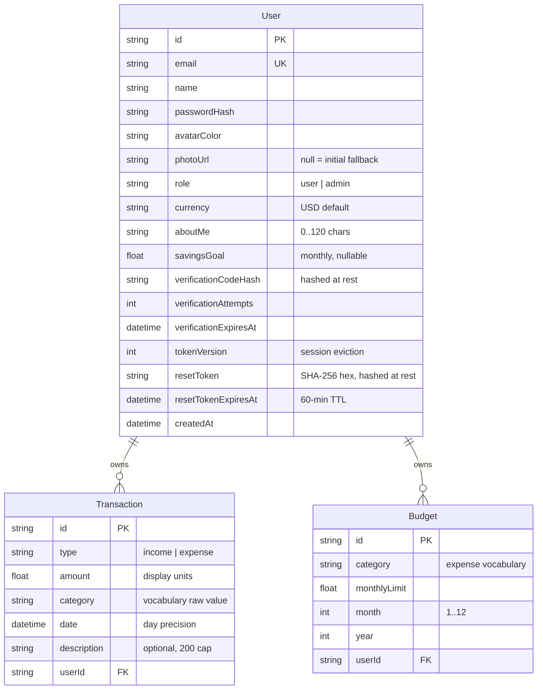
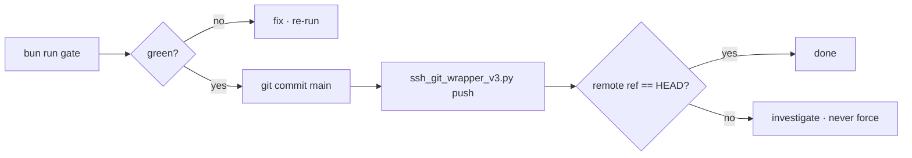

# Budget Wise — Master Project Architecture Document (PAD) v2.12.0

**Classification:** Internal Engineering Reference
**Status:** DEFINITIVE, PRODUCTION-LOCKED BLUEPRINT
**Companion Document:** [README.md](README.md) (user-facing) · [AGENTS.md](AGENTS.md) (agent-facing) · [CLAUDE.md](CLAUDE.md) (workflow)
**Last Updated:** 2026-10-28
**Audience:** Senior Engineers, Tech Leads, DevOps, and Onboarding Engineers
**Rule:** Every architectural decision in this document traces to a specific rationale. Nothing is here "because it's popular."

#### Revision Block — v2.12.0 (Tracked Changes)

- `[AUTH]` **The session-13 verification round (session 202): the TENTH consecutive zero-drift census — a ZERO-FINDING round.** The audit re-verified every parity surface on both apps (the shell, all four pages, the bottom bar byte-identical on every dimension incl. rect y=767 h=77, the clearance 764 ≤ 767 measured per the e2e contract's lowest-box form at scroll-end on both, both dialogs, every page title via full navigations, the 404's interpolated surface `Curl Probe 202 Test | Budget Wise` with the real 404 status on ours, the sitemap format + robots + manifest, the login card's 4-button OAuth row, the donut geometry 341×280 + 200×200 + 331 legend, the row anatomy) — zero drift since session 201, and the reference's demo data HELD at 3 transactions / −$2,481.00 for the second consecutive round (no owner churn; the s200 census baseline stands). The VLM battery answered 2× "Structural Differences: None" (budgets + profile mobile) + the two dashboard pairs' flags all the documented DOM-disproven genera (the savings-badge conditional — the reference's negative balance + $0 income hides it while our seeded 88.5% shows it, the KPI card classes byte-identical; the platform-badge occlusion; the data-borne legend/icon differences). The dev-boot guard fired clean on the round's build→dev sequence (Ready in 278ms, health 200, db up, 0 reload loops, NO deprecation notices — the s201 proxy rename verified live again). **The screenshot battery at its strongest byte-identical count — 9/12** (the dashboard-desktop frame byte-identical on the FIRST capture; the s201 settle-wait lesson applied at capture time) + the profile-mobile frame at the documented avatar-jitter genus (104 px, bbox (84,255)–(235,377), ≤0.0002%) + the two dialog frames at the s201 backdrop-blur compositing genus with the card interiors proven unchanged by the exact-rect crop diff (the live-measured `[role=dialog]` bounds crop-diffed: 21/242,368 px on the Add Transaction card and 50/140,224 px confined to the top 8px edge on the Set Budget card — content byte-identical, the delta entirely the blurred backdrop). No code changes: a docs-and-evidence round.
- `[RES]` Re-audit of the live reference (2026-10-28, session 202): **ZERO structural drift since session 201** — the tenth consecutive shell census with no new restyle wave.
- `[SYN]` Verification: lint 0/0 · tsc 0 · **410 unit HELD** · build · smoke 14/14 · e2e **66 HELD** (CI=1) · the VLM battery 2× "Structural Differences: None" + 2 pairs DOM-disproven genus-only · the screenshot battery recaptured from the dev server (12 images at the 1512×945 + 390×844 convention; 9/12 byte-identical — the strongest byte-identical count in the ladder).

#### Revision Block — v2.11.0 (Tracked Changes)

- `[AUTH]` **The session-12 verification round (session 201): the NINTH consecutive zero-drift census + TWO remediations.** The audit re-verified every parity surface on both apps (the shell, all four pages, the bottom bar byte-identical on every dimension incl. rect y=767 h=77, the clearance 764 ≤ 767 measured per the e2e contract on both, both dialogs, every page title via full navigations, the 404's interpolated surface, the sitemap format + robots, the login card, the donut geometry, the row anatomy) — zero drift since session 200, and the reference's demo data HELD at 3 transactions / −$2,481.00 (no owner churn this round; the s200 census baseline stands). The VLM battery answered 4/4 "Structural Differences: None" — the second consecutive fully-clean battery. The dev-boot guard live-verified on the round's build→dev sequences (health 200, no reload loop, 0 page re-fetches). **(F-1) The middleware→proxy file-convention rename:** Next.js 16.4 deprecates the `middleware` file convention (the dev log emitted the warning on every boot) — `src/middleware.ts` renamed to `src/proxy.ts` with the exported function renamed `middleware`→`proxy` per the installed 16.4.2's own resolution contract (`PROXY_FILENAME`, the named-export requirement); the matcher config byte-identical; the seam's single-header behavior unchanged (the 404's interpolated title curl-verified intact with the real 404 status, all alias titles intact); the unit pin grown by the export-convention assertion + the absence guard (a recreated `src/middleware.ts` → exactly 1 RED — mutation-proofed); the deprecation notice GONE from the boot log. **(F-2) The stale-count true-up:** the two s196-era `401` unit-count claims in the SKILL's §13 + Appendix B corrected to 410 — the count-lockstep lesson recorded: when a count changes, hunt BOTH the old number AND every older number still cited in the tree (`rg "401"` is noisy — the HTTP-401 envelope context). **The screenshot battery's two dialog frames flagged the backdrop-blur compositing genus** (this sandbox's headless blur rasterization of the Radix overlay; the dialog card interiors 0/93,000 px changed — content byte-identical; the same page's no-overlay frame byte-identical) — capture-environment, NOT drift; the two profile frames at the documented avatar-jitter genus (≤0.0002%). Counts HELD at 410/66/14 (the pin growth was assertion-level, not test-level).
- `[RES]` Re-audit of the live reference (2026-10-28, session 201): **ZERO structural drift since session 200** — the ninth consecutive shell census with no new restyle wave.
- `[SYN]` Verification: lint 0/0 · tsc 0 · **410 unit HELD** (the pin growth is assertion-level inside an existing test) · build · smoke 14/14 · e2e **66 HELD** (CI=1) · the VLM battery 4× "Structural Differences: None" · the screenshot battery recaptured from the dev server (12 images at the 1512×945 + 390×844 convention; 8/12 byte-identical + the two profile frames at the avatar-jitter genus + the two dialog frames at the backdrop-blur compositing genus).

#### Revision Block — v2.10.0 (Tracked Changes)

- `[DOC]` **The session-11 verification round (session 200): the EIGHTH consecutive zero-drift census + the VLM battery's cleanest result.** The audit re-verified every parity surface on both apps (the shell, all four pages, the bottom bar byte-identical on every dimension incl. rect y=767 h=77, the clearance 764 ≤ 767 measured per the e2e contract on both, both dialogs, every page title via full navigations, the 404's interpolated surface, the sitemap format + robots, the login card, the donut geometry 200×200 + 331 legend, the row anatomy) — zero drift since session 199. The dev-boot guard live-verified on the round's build→dev sequence (health 200, no reload loop). The VLM battery answered 4/4 "Structural Differences: None" (dashboard desktop + mobile, budgets mobile, profile mobile) — the first fully-clean battery in the project's history. The screenshot battery recaptured: **11/12 pixel-identical** + the profile-mobile frame at 0.0004% pixel diff (the avatar jitter genus) — the strongest render-stability signal yet. **The round's one note (informational, data-borne): the reference's demo data grew to 3 transactions / −$2,481.00** (Balance −$2,481.00 / Income $0.00 / Expenses $2,481.00 / 3 txns) — owner-data churn, the excluded genus, recorded as the fresh census baseline in the SKILL §1. Zero code changes; the counts held at 410/66/14.
- `[RES]` Re-audit of the live reference (2026-10-28, session 200): **ZERO structural drift since session 199** — the eighth consecutive shell census with no new restyle wave.
- `[SYN]` Verification: lint 0/0 · tsc 0 · **410 unit HELD** (an evidence-and-documentation round moves zero counts) · build · smoke 14/14 · e2e **66 HELD** (CI=1) · the VLM battery 4× "Structural Differences: None" · the screenshot battery recaptured from the dev server (12 images at the 1512×945 + 390×844 convention).

#### Revision Block — v2.9.0 (Tracked Changes)

- `[DOC]` **The session-10 verification round (session 199): the SEVENTH consecutive zero-drift census.** The audit re-verified every parity surface on both apps (the shell, all four pages, the bottom bar byte-identical on every dimension, the clearance 764 ≤ 767 on both, both dialogs, every page title via full navigations, the 404's interpolated surface served in the reference's HTML head, the sitemap + robots, the login card, the donut geometry, the row anatomy, the data state) — zero drift since session 198. The dev-boot guard live-verified on the round's build→dev sequence (0 reload loops, ready in 271ms, health 200, the window marker surviving). The screenshot battery recaptured: 10/12 pixel-identical + the two dialog frames at 0.0011%/0.0064% pixel diff (the antialiasing jitter genus) — render-stability evidence across another generation. **The round's one note (informational, methodology): the reference SPA's title reads lag a `pushstate` navigation** — an in-browser title census on the reference must use full navigations (the served-HTML curl remains the authoritative form, as the s196 pinning used); the lag is a probe artifact, NOT drift. Zero code changes; the counts held at 410/66/14.
- `[RES]` Re-audit of the live reference (2026-10-28, session 199): **ZERO structural drift since session 198** — the seventh consecutive shell census with no new restyle wave.
- `[SYN]` Verification: lint 0/0 · tsc 0 · **410 unit HELD** (an evidence-and-documentation round moves zero counts) · build · smoke 14/14 · e2e **66 HELD** (CI=1) · the VLM battery 2× "Structural Differences: None" (budgets mobile, profile mobile) + the two dashboard pairs' flags all the documented data-borne genus (DOM-disproven by the round's direct byte-census) · the screenshot battery recaptured from the dev server (12 images at the 1512×945 + 390×844 convention).

#### Revision Block — v2.8.0 (Tracked Changes)

- `[DOC]` **The session-9 verification round (session 198): the SIXTH consecutive zero-drift census + the body-chrome genus note.** The audit re-verified every parity surface on both apps (the shell, all four pages, the bottom bar byte-identical on every dimension, the clearance 764 ≤ 767 on both, both dialogs, every page title, the 404's interpolated surface, the sitemap + robots, the login card, the donut geometry, the row anatomy) — zero drift since session 197, VLM 3× "None" + the known DOM-disproven genus pair, the dev-boot guard live-verified on BOTH of this session's build→dev sequences (0 reload loops each). **The round's one finding (F-1, informational): the body-level framework chrome genus is under-documented.** Every server-rendered page emits `<div hidden><!--$--><!--/$--></div>` as `body.children[0]` (React's streaming-SSR boundary marker — completed on resolved pages, pending + `<template>` on the 404), plus the Toaster portal and the route announcer; the reference (a client-rendered Vite SPA) answers with `#root` + the platform's edit badge + recharts' measurement span. The div is invisible, a11y-excluded, present identically in dev AND the standalone build, and pinned by no test — platform-face genus, NOT parity drift — but `children[0]`-style body probes hit it first (probed live this session: the undefined-property error that cost an investigation before the classification). Remediated documentation-only: the genus note added to AGENTS.md's architecture facts, the SKILL's §1 reference-state notes, and this PAD's hierarchy descriptions. Zero code changes; the counts held at 410/66/14.
- `[RES]` Re-audit of the live reference (2026-10-28, session 198): **ZERO structural drift since session 197** — the sixth consecutive shell census with no new restyle wave.
- `[SYN]` Verification: lint 0/0 · tsc 0 · **410 unit HELD** (a docs-only round moves zero counts) · build · smoke 14/14 · e2e **66 HELD** (CI=1) · the VLM battery 3× "Structural Differences: None" + the dashboard-mobile pair's two flags DOM-disproven (the platform-badge occlusion + the data-borne savings badge — the s195/s196 genus) · the screenshot battery recaptured from the dev server (12 images; 10/12 byte-identical to the s197 set + the two dialog frames within 6 bytes at 0.001% pixel diff, captured from their canonical origin pages — render-stability evidence across another generation).

#### Revision Block — v2.7.0 (Tracked Changes)

- `[AUTH]` **The session-8 dev-boot guard round (session 197): the dev-vs-build `.next` race — hit LIVE, then guarded at the boot seam.** After the baseline gate's `next build` completed CLEANLY (no concurrency, no killed process — the natural gate-then-dev workflow the docs themselves invite), booting `bun run dev` entered the documented infinite reload loop (646 `GET /login` re-fetches; form fills wiped by the reloads). The prior wording ("a build ran concurrently with / was killed half-into dev") under-described the genus: turbopack dev watching a tree last written by the PRODUCTION compiler loops regardless of how cleanly the tree was produced. Remediated with a boot-time preflight: `scripts/dev-preflight.ts` (NEW) rides the `dev` script (`bun scripts/dev-preflight.ts && next dev …`) and removes a stale production tree before dev boots — the detection is the live-probed marker pair (the production build writes top-level `.next/BUILD_ID`; dev turbopack writes `.next/dev/lock` `{pid, port}` with NO top-level BUILD_ID). The guard's own guard: it never cleans under a live dev server (the lock-pid signal-0 liveness check — EPERM counts as alive), it asks no prompts (agents cannot answer them), and it exits 0 on every pass-through. All three decision branches live-verified: clean (0 loops vs the 646 unguarded), none (normal dev boot untouched), pass-through (a planted BUILD_ID under a live server → warn, tree intact).
- `[RES]` Re-audit of the live reference (2026-10-28, second pass of the day): **ZERO structural drift since session 196** — the FIFTH consecutive shell census with no new restyle wave: the shell, all four pages (containers 7xl/5xl/5xl/4xl, headers, H1s, action buttons), the mobile bottom bar byte-identical on every dimension (bar classes, the `flex items-center justify-around py-2` row wrapper, item classes, ink split, rect y=767 h=77), the scroll-end clearance (732 ≤ 767 on both), both dialogs, the 404 surface (the interpolated humanized title + the slash-less quoted path), the sitemap + robots, the login card, the data state (the single −$1,000 food txn — data-borne, excluded).
- `[SYN]` Verification: lint 0/0 · tsc 0 · **410 unit** (+9: the dev-preflight decision matrix — fresh/dev/clean/pass-through — the lock parser, the pid-liveness helper, and the package.json wiring pin; mutation-proofed: a reverted wiring → exactly 1 RED, restored → green) · build · smoke 14/14 · e2e **66 HELD** · the VLM battery 3× "Structural Differences: None" + the dashboard-mobile pair's two flags DOM-disproven (the platform-badge occlusion + the data-borne savings badge — the s195/s196 genus) · the screenshot battery recaptured from the remediated dev server (12 images; 10/12 byte-identical across THREE generations — s196, first capture, remediated capture — render-stability evidence).

#### Revision Block — v2.6.0 (Tracked Changes)

- `[AUTH]` **The session-7 title-surface round (session 196): TWO title-family parity breaks remediated — both invisible to every prior gate.** (F-1) The reference's 404 title is the INTERPOLATED form — `<Humanized last non-empty path segment> | Budget Wise`, served directly in its HTML head (curl-verified: `<title>Curl Probe Route | Budget Wise</title>`); the humanize splits hyphens AND camelCase boundaries, capitalizing each token's first letter while preserving the rest (9 live-probed cases incl. `/iPhoneCaseTEST` → "I Phone Case TEST", `/foo/bar` → "Bar", `/foo/` → "Foo"). Our 404 answered the static s191 "Budget Wise" and quoted `"/pathname"` WITH the leading slash where the reference quotes `"pathname"` without it. Remediated: `src/middleware.ts` (NEW — the minimal x-pathname request-header stamp; the only way the unmatched path reaches the render, probed: no path header exists otherwise) + `not-found.tsx` generateMetadata + `src/lib/not-found-title.ts` (the pure probed transformation) + the body's quoted-path strip. A client document.title effect was probed and DISCARDED — the metadata reconciliation re-applies the static title over it during hydration. The 404 still answers a REAL 404 status (the reference's 200-everything is its SPA platform's face — our real status is the kept production-grade posture). (F-2) The .jsx capital-alias stubs re-exported ONLY the default export — `/Transactions`, `/Budgets`, `/Profile` (the reference's own nav-href forms, the links every navbar click follows) silently served the layout default "Budget Wise" instead of "<Page> | Budget Wise". Remediated: the three stubs now `export { metadata } from` the lowercase pages (/Dashboard carries no metadata BY DESIGN — both apps title the dashboard "Budget Wise"). The genus: green tests masking drift — the unit pins read the lowercase files, no e2e asserted titles.
- `[RES]` Re-audit of the live reference (2026-10-28): ZERO structural drift since session 195 — the shell (the outer surface wrapper intact, fourth consecutive census with no new wave), all four pages, the bottom bar (byte-identical), the clearance (764 ≤ 767), both dialogs, the sitemap + robots, the login card. Every page TITLE cross-checked on both apps (the census that surfaced F-1/F-2): `/`→"Budget Wise", `/login`→"Budget Wise", `/Dashboard`→"Budget Wise", `/Transactions|/Budgets|/Profile`→"<Page> | Budget Wise" — identical post-fix.
- `[SYN]` Verification: lint 0/0 · tsc 0 · **401 unit** (+13: the 9 not-found-title pins + the 4 alias-metadata pins; the s191 404 pin re-formed for generateMetadata) · build · smoke 14/14 · e2e **66** (+4: the three 404-surface tests + the capitalized-route titles test) · the 404 titles live-verified on 9 paths + the nested `/Dashboard/fake-nested` · the alias titles curl-verified on all four routes · VLM None/None/None/None + the dialog spot-check "None" · the mutation-proof (a reverted alias stub → exactly 1 RED, restored → green) · the screenshot battery recaptured (12 images, several byte-identical to the s195 set — render-stability evidence).

#### Revision Block — v2.5.0 (Tracked Changes)

- `[AUTH]` **The session-6 shell-surface round (session 195): the reference's THIRD shell restyle re-mirrored.** The platform's owner wrapped the whole chrome in an outer surface div. Remediated: the shell now rides `body (WHITE) > DIV('') > DIV.min-h-screen.bg-slate-50 > [NAV(sticky), DIV(bar), MAIN.pb-20 md:pb-0 > DIV.min-h-screen.bg-slate-50 > page]` — the outer wrapper puts slate-50 behind the translucent navbar (`bg-white/80 backdrop-blur-sm` renders rgb(254,254,255) over it, vs rgb(255,255,255) over the white body — pixel-sampled on both apps before and after the fix) and behind the phone clearance strip. The bar's own anatomy, the clearance guarantee (764 ≤ 767), and every page surface re-verified unchanged.
- `[SYN]` The VLM battery's first run flagged two items, both disproven by DOM probes (the discipline held): the "only two tabs" read was the reference's own "Edit with Base44" platform badge occluding tabs 3–4 in the capture (elementFromPoint at the flagged pixels), and the Balance-card badge absence is data-borne (the reference's savings rate is null with zero income txns; ours renders the conditional badge at 88.5%).
- `[SYN]` Verification: lint 0/0 · tsc 0 · **388 unit** (+1 the outer-surface record pin; the wiring assertion joined the existing bar contract test) · build · smoke 14/14 · e2e **62** HELD · the shell hierarchy byte-verified live · the navbar band pixel-identical (254,254,255 both apps) · VLM None/None/None/None (dashboard mobile/desktop, budgets mobile, profile mobile) · the screenshot battery recaptured (12 images).

#### Revision Block — v2.4.0 (Tracked Changes)

- `[AUTH]` **The session-5 full-surface restyle round (session 194): the reference's SECOND structural wave re-mirrored.** The platform's owner restyled every app surface onto stock shadcn/ui. Remediated: the shell hierarchy (`body WHITE > DIV > [NAV, bar, MAIN.pb-20 md:pb-0 > DIV.min-h-screen.bg-slate-50 > page]` — the s193 shell had the root OUTSIDE main, painting slate-50 behind the translucent navbar); the pb-20 bar-clearance padding (content boxes sat +20px behind the fixed bar at phone scroll-end); the per-page containers (7xl/5xl/5xl/4xl) + sm-stacking plain-DIV headers with tracking-tight H1s and direct action buttons; the stock shadcn Button/Card/Input/Select/Badge/Tabs forms (--primary → the neutral #171717; the dialog submits had computed the CRM-era blue); the gradient KPI/summary/dark-card families; divide-y transaction rows with description-first titles + category badges; the restyled Profile (h-20 gradient header, w-20 border-4 avatar, native currency select, pastel overview cells); the dialog true-ups; the category palette re-pinned by a live round-trip probe (one $1 txn per category added + censused + deleted, the owner's data restored verbatim); the chart geometry (donut 280/outer-100/inner-60, weekly 200 with both grid directions).
- `[RES]` Re-audit of the live reference (2026-10-27): the login card, top navbar, bottom bar anatomy, both dialogs' field sets, 404 surface, sitemap format, robots.txt all re-verified UNCHANGED; /About + /Contact still 404 (our documented own-IA superset stands); the data state still the one food transaction (data-borne, excluded).
- `[CA]` The e2e selectors re-pinned to the restyled semantics (p row titles, the native currency select, text card-title assertions); the a11y two-gate's sanctioned register extended for the reference's own About-Me counter ink + the bar label's alternate selector form (new matcher entries, no suppressions).
- `[SYN]` Verification: lint 0/0 · tsc 0 · **387 unit** (+6 restyled-family pins) · build · smoke 14/14 · e2e **62** (+1 the scroll-end clearance test) · census parity on all four pages at the desktop axis (residuals: the SECTION-vs-DIV a11y supersets + data-borne rows) · the shell hierarchy + bar byte-verified live · VLM None/None/None/None (dashboard/budgets/profile/login) · the screenshot battery recaptured (12 images).

#### Revision Block — v2.3.0 (Tracked Changes)

- `[AUTH]` **The session-4 mobile-parity round (session 193): the drawer retirement + the bottom tab bar.** The reference REDESIGNED its phone navigation (first structural drift since the s190 transformation): a fixed bottom tab bar now ships below md on every app page — `md:hidden fixed bottom-0 left-0 right-0 z-50 bg-white border-t border-slate-200 safe-area-pb`, items `flex flex-col items-center gap-1 px-4 py-2 rounded-xl transition-all` with active `text-slate-900` / inactive `text-slate-400`, lucide icons `w-6 h-6` (LayoutDashboard / ArrowLeftRight / Target / User), labels `text-xs font-medium` — byte-extracted and mirrored as the parity surface (`BOTTOM_NAV` in page-layout.ts, the `safe-area-pb` v4 `@utility`). ADR-006's drawer + hamburger — the documented superset while the reference shipped NO phone nav — became visible-pixel divergences the moment the reference shipped its own bar; both retired with the drawer family (MOBILE_NAV_SHEET / MOBILE_NAV_LAYOUT / APP_FOOTER / SITE_NAV.hamburger). The reference's app surface also ships NO footer now — APP_FOOTER retired with it (the landing keeps its own). Profile's nav icon trued up CircleUser → User (the reference's unified lucide set, both navs).
- `[RES]` Re-audit of the live reference (2026-10-27, third pass): the redesign also removed the reference's /About + /Contact (both 404 now; its sitemap lists only /, /Budgets, /Profile, /Transactions) and its demo data gained one food transaction (−$1,000 — data-borne, the excluded genus). OUR /about /contact sitemap entries STAY — they list OUR real public-marketing routes (linked from the landing's footer; the landing is the documented superset surface); the stale D-142a3 reference-parity comments corrected in the sitemap route + tests. Login card, top navbar, both dialogs, Profile structure, 404 surface, sitemap FORMAT, robots.txt: all re-verified unchanged.
- `[CA]` The mobile-nav e2e battery REWRITTEN for the bottom bar (10 tests: renders on every app page, viewport-anchored fixed, navigation round-trip, the active item's ink + OUR aria-current superset, the desktop pill split, the never-locked body scroll, no hamburger, absent on login, hidden at md, capitalized hrefs). The a11y two-gate's sanctioned register gains the bottom bar's inactive-item citation (the reference's own slate-400-on-white ink — the flagged label span inherits the anchor's color, so the matcher cites the anchor's `.gap-1.rounded-xl` chain).
- `[SYN]` Verification: lint 0/0 · tsc 0 · **381 unit** (−11 retired drawer/footer pins + 10 born-green bottom-bar pins + 1 icon pin = −1, lockstepped across README/CLAUDE) · build · smoke 14/14 · e2e **61 HELD** (the drawer battery replaced test-for-test) · VLM side-by-side: mobile dashboard / mobile login / mobile budgets all **"Structural Differences: None"** · the screenshot battery recaptured (12 images; the drawer-open frame retired with the drawer).

#### Revision Block — v2.2.0 (Tracked Changes)

- `[AUTH]` **The session-3 re-audit round (session 192):** the dead-script retirement. Five package.json entries (`db:census`, `sweep`, `probe:ref`, `sweep:fullpage`, `census:interior`) still pointed at CRM-scaffold scripts deleted by the s190 transformation, and `gate:full` chained six of the dead legs — a composite that failed on its first drift gate. The session-97 pins had kept this GREEN by reading the script strings without ever checking the targets existed (green tests masking dead infrastructure — the same class s191 cured for dead modules). All six entries retired via the package manager; the pins replaced by the **dead-script guard** (every script's repo-local file target must exist on disk + every `bun run <name>` reference must resolve) and a drift-gate tombstone.
- `[RES]` Re-audit of the live reference (2026-10-27, second pass): **zero drift** since session 191 — the four-button OAuth row, the 404 title, the empty demo-data state, and the no-mobile-nav gap at 390×844 all re-confirmed. VLM side-by-side: login **"Structural Differences: None"** and dashboard **"Structural Differences: None"** (the empty-vs-seeded data states excluded per the documented genus).
- `[DOC]` The dev-vs-build `.next/` race hazard documented (README Troubleshooting + AGENTS.md): a `next build` running concurrently with (or killed half-into) `next dev` corrupts turbopack's dev state into an endless full-reload loop; the cure is stop-both + `rm -rf .next` + restart. Hit live in sessions 191 ("session dropped after the HMR rebuild") and 192.
- `[SYN]` Verification: lint 0/0 · tsc 0 · **382 unit HELD** (−3 retired pins + 3 born-green guards) · build · smoke 14/14 · e2e 61/61 · the screenshot battery recaptured (8 of 13 byte-identical to the s191 set — render-stability evidence; the 5 refreshed frames are recharts/dialog animation capture states).

#### Revision Block — v2.1.0 (Tracked Changes)

- `[AUTH]` **The remediation round (session 191):** the retired-brand purge + parity true-ups. The 404 route's absolute title (which still read "This Page Does Not Exist | NEO CRM"), the package identity (`name: neo-crm` → `budget-wise`), and the config-file comments were corrected; the dead CRM-era modules (`lib/pdf-export.ts`, `lib/download.ts`, `lib/format.ts`) and their zero-consumer dependencies (`jspdf`, `html2canvas-pro`) were retired.
- `[RES]` Re-audit of the live reference (2026-10-27): the login card now renders a **four-button OAuth row** (Google, Microsoft, Facebook, Apple) — mirrored as visual parity with the family-wide not-configured fallback; the login logo mirrored as a local inline-SVG brand mark (the reference hotlinks a hosted JPEG); the AI Insights empty-state copy true-up ("Get personalized insights based on your spending patterns"); the reference's demo data was found reset to empty (our seed keeps the original demo month — a data-state note, not a divergence); the no-mobile-nav gap re-confirmed at 390×844.
- `[SYN]` Verification: lint 0/0 · tsc 0 · **382 unit** (+8 session-191 pins: the retired-brand purge, the OAuth row, the AI-Insights copy, the package identity + dead-dep census) · build · smoke 14/14 · e2e 61/61 · VLM login-parity re-verified (4/4 buttons, matching order).
- `[DOC]` `budget-wiser_SKILL.md` distilled at the repo root (per `skills/to-distill-project-into-skill`); joined the artifact excludes.

#### Revision Block — v2.0.0 (Tracked Changes)

- `[AUTH]` **Domain transformation:** the codebase was rebuilt from the NEO CRM scaffold (the prior 189-session parity clone of a Base44 CRM) into **Budget Wise** — the personal-finance domain of budget-wiser.base44.app. All CRM domain code retired; the production infrastructure (auth stack, db-path seam, UI primitives, test harness, deployment tooling) carried over. The prior CRM PAD lives in git history.
- `[RES]` Reference audited live 2026-10-27 (agent-browser, logged in, 1512×945 + 390×844): every surface's structure, copy, and category vocabularies byte-captured.
- `[CA]` The mobile-navigation gap identified and closed as a functional superset (the reference ships none).
- `[SR]` Tailwind v4 discipline re-verified (CSS-first tokens, v3 palette re-pins, hover unwrap, tw-animate vendoring).
- `[SYN]` Verification: 374 unit + 61 e2e + 14 smoke checks green; VLM structural parity clean on the dashboard at both axes.

---

## Table of Contents

1. [System Overview & Decisions](#1-system-overview--decisions)
2. [High-Level System Topology](#2-high-level-system-topology)
3. [Application Architecture](#3-application-architecture)
4. [Data Architecture](#4-data-architecture)
5. [Design System Reference](#5-design-system-reference)
6. [Security Architecture](#6-security-architecture)
7. [Testing Strategy](#7-testing-strategy)
8. [Build & Deployment](#8-build--deployment)
9. [Developer Handbook](#9-developer-handbook)
10. [Known Issues & Deferred Debt](#10-known-issues--deferred-debt)

---

## 1. System Overview & Decisions

### 1.1 Document Metadata & Purpose

This PAD is the single source of truth for Budget Wise's architecture. Use it to onboard (read §1–§4 first), debug (§3–§6 + §9), review tech choices (§1.3), and replicate the architecture. The intended posture: a self-hostable, single-deployable personal finance app with a hardened auth stack, server-derived money math, and a parity-verified UI.

### 1.2 Technology Stack Summary

| Layer | Technology | Version | Key Rationale |
|---|---|---|---|
| Web framework | Next.js (App Router) | ≥16.4.2 | Server components for the session guard; route handlers for the API; standalone output for the self-contained deployable |
| UI runtime | React | ≥19.3.1 | The ecosystem's current standard; adjust-during-render patterns for state resets |
| Language | TypeScript (strict) | ≥5.9.3 | The build is the type gate — no `ignoreBuildErrors` escape |
| Styling | Tailwind CSS | ≥4.3.3 | CSS-first `@theme` config with the v3 palette re-pinned (see ADR-5) |
| Component primitives | Radix UI (dialog, alert-dialog, select, tabs, dropdown, label, popover, slot) | current | Accessibility-complete overlays; the sheet/dialog/select families ride them |
| Charts | Recharts | ≥3.10.1 | The donut + weekly bars; `accessibilityLayer={false}` posture carried from the scaffold |
| State | Zustand | ≥5.0.15 | One client store; selector subscriptions; no React Query layer |
| ORM / DB | Prisma + SQLite | ≥6.19.3 | Zero-config local dev; the db-path seam pins the file location |
| Validation | Zod | ≥4.6.7 | Every API boundary; parse-then-mutate doctrine |
| Unit testing | Vitest | ≥5.0.5 | Fast pure-seam battery |
| E2E testing | Playwright | ≥1.64.1 | Real-browser flows against the production standalone build |
| a11y engine | axe-core | ≥4.13.0 | The two-gate spec (structural zero + sanctioned citations) |
| Runtime / PM | Bun | ≥1.3.14 | Script runner + dev server; the gate chain is bun-first |

### 1.3 Architecture Decision Records (ADRs)

**ADR-001: Next.js App Router with a standalone output**
- **Context:** The app must be self-hostable as one artifact with SQLite persistence, serve server-rendered pages behind a session guard, and expose JSON APIs.
- **Decision:** Next.js 16 App Router with `output: "standalone"`.
- **Rationale:** Server components let the `(app)` layout refuse HTML to guests (the fix-over-defect posture); route handlers give the API one home; the standalone output plus the db-path seam yields a deployable that boots anywhere Bun/Node runs.
- **Consequences:** + one deployable, one port, no container needed; − the artifact needs hygiene excludes (ADR-008) and the db-path seam to stay honest.
- **Alternatives rejected:** Vite SPA (no server guard, two deployables); Remix (heavier port of the same idea).

**ADR-002: SQLite via Prisma, schema-relative `DATABASE_URL`**
- **Context:** Personal finance is single-writer; the dev story must be zero-config; the production story must be file-portable.
- **Decision:** SQLite with `DATABASE_URL="file:../db/custom.db"` (relative to `prisma/schema.prisma`), normalized at runtime by `src/lib/db-path.ts`.
- **Rationale:** One file, one writer, trivially backed up. The seam defeats the two historical bugs: the engine resolving against the process CWD (landing outside the repo) and Bun's `.env` absolutization.
- **Consequences:** + zero-config dev, portable prod; − no concurrent-writer scale-out (acceptable for the domain); − the seam is a do-not-touch file (pinned by tests).
- **Alternatives rejected:** PostgreSQL (ops burden for a personal app); absolute dev paths (unportable).

**ADR-003: scrypt + HMAC cookie sessions (no auth framework)**
- **Context:** Self-hosted auth with email verification and password reset, without an external identity provider.
- **Decision:** Hand-rolled, minimal, audited: scrypt password hashing (`src/lib/password.ts`), HMAC-SHA256 signed cookies with a `tokenVersion` eviction dimension, per-IP rate buckets, hashed-at-rest reset tokens.
- **Rationale:** The reference's Base44 OAuth cannot be self-hosted; the email/password path needed production-grade equivalents. The token-version seam makes a password reset kill every prior session.
- **Consequences:** + no dependency, full control, evictable sessions; − the funnels are ours to maintain (449 unit assertions pin them).
- **Alternatives rejected:** NextAuth/better-auth (provider sprawl for a two-funnel need); JWT (no revocation dimension).

**ADR-004: One Zustand store; server-derived money math**
- **Context:** The dashboard renders ~20 derived numbers; the client must never disagree with the server about money.
- **Decision:** `/api/dashboard` computes every figure server-side; the client store caches the response and re-fetches after mutations.
- **Rationale:** Money math duplicated client-side drifts (rounding, timezone, filters); a single aggregate endpoint keeps one implementation, unit-testable in `budget-math.ts` and reused by the profile rollups.
- **Consequences:** + one truth; − a mutation triggers a 3-slice refresh (acceptable at personal scale).
- **Alternatives rejected:** Client-side derivation from the transactions list (the drift class); React Query (a second caching layer with no new capability here).

**ADR-005: Tailwind CSS v4, CSS-first, v3 palette re-pinned**
- **Context:** Tailwind v4's engine re-derived the default palette (oklch) — 56 of 118 literal classes in the scaffold diverged visibly from the reference's v3-era compiled CSS; v4 also renamed the shadow/blur scales.
- **Decision:** No config JS ever; every token in `globals.css` `@theme`; the v3 hex values re-pinned for every used (family, step) pair; `--shadow-sm`/`--blur-sm` re-pinned to v3's computed values; `@custom-variant hover (&:hover)` unwraps the hover media query.
- **Rationale:** Visual parity is a requirement; the re-pins restore byte-level computed parity on every chromatic surface and keep hovers working on touch.
- **Consequences:** + parity that survives Tailwind upgrades; − an unusual globals.css a new agent might want to "clean" (the do-not-touch list forbids it).
- **Alternatives rejected:** v3 (EOL); accepting v4's palette (visible drift).

**ADR-006: The mobile navigation — from documented superset to byte-mirrored parity**
- **Context:** At the s190 audit the reference shipped no navigation below 768px (links `display:none`, no hamburger) — live-verified 2026-10-27 at 390×844. The reference has since REDESIGNED its phone nav (the s193 audit): a fixed bottom tab bar on every app page, and no footer on the app surface.
- **Decision (superseded, s190):** Ship a Radix-Dialog sheet drawer (hamburger `< md`, 288px slate-900 surface) with the full behavioral battery — the answer to the then-empty phone surface.
- **Decision (current, s193):** Retire the drawer + hamburger + APP_FOOTER; byte-mirror the reference's bottom tab bar (the `BOTTOM_NAV` contracts) with the kept a11y superset (`aria-current="page"` + the labelled nav landmark — the reference ships neither).
- **Decision (amended, s195):** The bar rides the reference's exact shell hierarchy — `body (WHITE) > DIV('') > DIV.min-h-screen.bg-slate-50 > [NAV(sticky), DIV(bar), MAIN.pb-20 md:pb-0 > DIV.min-h-screen.bg-slate-50 > page]` — the outer surface wrapper (slate-50 behind the translucent navbar) added in the s195 re-mirror; the ACTIVE item's ink rides its svg (`w-6 h-6 text-slate-900`). The pb-20 clearance is pinned by the e2e scroll-end test on every app page. *(Census caveat, s198: the "body > DIV" form starts at the app shell — the body ALSO carries framework chrome: `body.children[0]` is React's `<div hidden>` streaming-SSR boundary marker on every server-rendered page, plus the Toaster portal and the route announcer; the reference answers with its own platform chrome (`#root`, the base44 edit badge, recharts' measurement span). Platform-face genus, not parity drift — `children[0]`-style body probes hit the hidden div first.)*
- **Rationale:** Supersets live only while invisible-to-pixels. The redesign put a bottom bar (and no hamburger, no footer) on the phone surface — the drawer family became visible divergences, so parity wins.
- **Consequences:** + the phone nav byte-matches the reference (bar rect, item classes, icons, ink split — live-verified identical); − the drawer's behavioral hardening (focus trap, scroll lock, auto-close) retired with it; the bottom-bar battery (10 e2e checks) pins the parity surface.
- **Alternatives rejected:** Keeping the drawer as a dual nav (two phone navigations — a visible superset break); mirroring the reference's missing aria-current (weaker a11y for no pixel gain).

**ADR-007: Deterministic AI Insights (no external LLM)**
- **Context:** The reference's AI Insights panel offers a Generate button behind a hosted model.
- **Decision:** Generate deterministic, data-derived insights client-side (top category, savings pace, over-budget warnings).
- **Rationale:** A self-hosted personal app should not grow an external dependency (and key management) for a panel that its own data can answer; the production build stays hermetic.
- **Consequences:** + zero external deps, instant, private; − no free-form narrative (acceptable; the call-outs cover the reference's shown content class).
- **Alternatives rejected:** An optional LLM key (config sprawl); omitting the panel (a visible parity gap).

**ADR-008: Artifact hygiene via tracing excludes**
- **Context:** Next's file tracing once shipped .env, .git, db/, skills/, docs/ inside every deployable (~550 MB where ~151 MB sufficed).
- **Decision:** `outputFileTracingExcludes` in `next.config.ts` + the build script's `rm -f .next/standalone/.env`; smoke check 14 polices the artifact on every run.
- **Rationale:** A deployable that carries its own .env and database is a security incident.
- **Consequences:** + clean artifact, policed forever; − new repo-root clutter must join the exclude list.
- **Alternatives rejected:** Docker-layer hygiene (no container in the story); post-build shell cleanup only (not policed).

---

## 2. High-Level System Topology

```mermaid
flowchart TB
    U[User's Browser] -->|HTTPS| NX[Next.js standalone server<br/>Bun/Node · port 3000]
    subgraph NX
        RC[Server Components<br/>(app) guard · pages] 
        RH[Route Handlers<br/>/api/*]
        MW[instrumentation → boot-env<br/>AUTH_SECRET gate]
    end
    RC --> DB[(SQLite<br/>db/custom.db)]
    RH --> DB
    RH --> FS[uploads/<br/>profile photos]
    U -->|fetch envelope| RH
    U -->|static assets| CDN-ish[hashed /_next/static]
```

- **Client layer**: any modern browser; localStorage is deliberately unused (the store is in-memory per session).
- **Application layer**: one process, one port. Server components resolve the session cookie on every `(app)` page request; route handlers serve the JSON API.
- **Data layer**: one SQLite file at `<repo>/db/custom.db` (dev) or an absolute path (prod); uploads land in `uploads/` with validated names.
- **External services**: none. The app is hermetic (ADR-007).
- **Scaling characteristics**: single-writer SQLite suits the personal-finance domain (one user, low write rate). The read path is one aggregate query per dashboard load.

## 3. Application Architecture

### 3.1 The Layer Model

```
Layer 0: Prisma schema + db-path seam       — where the data lives. Never bypass the seam.
Layer 1: lib/ domain modules                — pure money math, vocabularies, Zod schemas. No I/O.
Layer 2: Route handlers (/api/*)            — guard → parseBody → ownership checks → Prisma → envelope.
Layer 3: Server components (app/*)          — session guard, metadata, the client island mount.
Layer 4: Client islands + the store         — pages/dialogs/charts; Zustand; the envelope client.
Layer 5: UI primitives (components/ui/*)    — Radix + shadcn patterns riding page-layout records.
```

**The Golden Rule:** money crosses Layer 2→4 exactly once per surface, pre-computed. Layers 1 and 5 are the only places new logic should accrete.

### 3.2 Annotated Directory Structure

```text
src/
  app/
    (app)/                    # server-guarded app group (GuestLoginRedirect for guests)
      dashboard/              #   KPI + charts page (client island + page wrapper)
      Dashboard/page.jsx      #   the capital alias (.jsx — the TS1149 guard)
      transactions/           #   list + filters + CRUD round trips
      budgets/                #   the dark overall-usage card + budget cards
      profile/                #   identity + preferences + pastel overview grid
    (marketing)/              # /About + /Contact — auth-gated marketing pages
    api/
      transactions/[id]/      # DELETE (ownership-scoped 404)
      budgets/[id]/           # PATCH (limit) + DELETE (confirm flow)
      dashboard/route.ts      # THE aggregate endpoint (ADR-004)
      profile/route.ts        # GET projection + PATCH preferences
      auth/                   # login/signup/logout/me/verify/resend/forgot/reset
      health/route.ts         # the boot + db round-trip probe
      upload/ + uploads/[name]# profile photos (validated names)
    login/ signup/ reset-password/
    page.tsx                  # the PUBLIC landing (outside every guard)
  components/
    layout/app-shell.tsx      # sticky navbar + the mobile bottom tab bar
    layout/nav-config.ts      # the four items + isNavActive
    shared/transaction-dialog.tsx  # Add Transaction (tabs swap the category vocabulary)
    shared/budget-dialog.tsx  # Set Budget + the Delete-Budget alertdialog
    charts/budget-charts.tsx  # SpendingDonut + WeeklyBars (recharts)
    ui/                       # button/input/select/dialog/tabs/... riding page-layout records
  lib/
    db-path.ts                # THE seam (ADR-002) — do not touch
    budget-math.ts            # pure money math + ranges + buckets
    categories.ts             # the two vocabularies + presentation metadata
    currency.ts               # the five currencies + symbols
    schemas.ts                # the Zod layer (auth family carried verbatim)
    page-layout.ts            # the class-string contract records
    auth.ts / password.ts / rate-limit.ts / verification*.ts / login-reset.ts
    api.ts                    # the envelope + requireSession + parseBody
    site.ts                   # metadata factory (per-route OG/canonical)
  stores/budget-store.ts      # the one client store
prisma/                       # schema.prisma + seed.ts (the reference demo month)
tests/ + tests/e2e/           # the two test layers
scripts/                      # prisma-env wrapper + smoke-test.sh
db/                           # SQLite files (git-ignored)
docs/                         # screenshots, plan, deployment, push runbook
```

### 3.3 Critical Code Patterns

**Pattern 1 — the session guard (fix-over-defect):**

```tsx
// src/app/(app)/layout.tsx — the guest never receives app HTML
export default async function AppLayout({ children }) {
  const user = await getSessionUser();
  if (!user) return <GuestLoginRedirect />;  // lands on /login?from_url=<abs>
  return <AppShell user={user}>{children}</AppShell>;
}
```

*Why:* the reference serves its data pages to guests (its platform's face); a self-hosted finance app must not. The client-side redirect shim preserves the reference's from_url round-trip while the decision stays server-side.

**Pattern 2 — the API envelope + Zod seam:**

```ts
// every mutating route handler
const guard = await requireSession();
if (isGuarded(guard)) return guard.response;        // 401 envelope
const parsed = await parseBody(req, schema);        // bounded reader + CSRF gate + Zod
if (!parsed.ok) return parsed.response;             // 400 envelope, pinned message
const existing = await db.transaction.findUnique({ where: { id } });
if (!existing || existing.userId !== guard.user.id) return ERR.NOT_FOUND("Transaction");
```

*Why:* parse → ownership → mutate is the only sanctioned order (a DB-bound check cannot live in a schema); the foreign-id 404 prevents existence leaks.

**Pattern 3 — adjust-during-render form hydration:**

```tsx
// profile-page.tsx — the sanctioned React pattern for OWN-state resets
const [hydratedProfileId, setHydratedProfileId] = React.useState<string | null>(null);
if (profile && profile.id !== hydratedProfileId) {
  setHydratedProfileId(profile.id);
  setName(profile.name ?? "");
  // ... one setter per field, before the form paints
}
```

*Why:* `setState` inside an effect trips the lint rule and cascades renders; comparing the last-seen id renders the correction synchronously. (E2E tests that fill these fields must wait for hydration first — see §7.)

## 4. Data Architecture

### 4.1 Database Schema



Unique: `Budget (userId, category, month, year)` — the upsert key behind the Set Budget dialog (re-setting a category updates the limit). Indices: `Transaction (userId, date)`, `(userId, type)`, `(userId, category)`; `Budget (userId, year, month)`.

### 4.2 Persistence Strategy

One Prisma client singleton (`src/lib/db.ts`) resolves its URL through `runtimeDatabaseUrl()`. Seeding is idempotent in place (`deleteMany` + create; user rows upsert by email so session cookies survive re-seeds — the update blocks also clear the reset/verification funnels). The e2e suite uses an isolated `db/e2e.db` pushed + seeded by the global setup; the smoke leg uses `db/smoke.db`; both git-ignored like `db/custom.db`.

## 5. Design System Reference

### 5.1 Typographic System

No webfonts — the system stack (`--font-sans`: ui-sans-serif, system-ui, sans-serif, + emoji fallbacks), pinned in `@theme`. Body computes 16px (the browser default); KPI values `text-3xl font-bold`; section titles `text-lg font-bold`; page H1s `text-3xl font-bold` with `text-slate-500` subtitles.

### 5.2 Color Tokens (the reference's slate family)

| Role | Token / class | Value |
|---|---|---|
| Page background | `bg-slate-50` | #f8fafc |
| Surface | white cards | #ffffff |
| Foreground / brand | `text-slate-900` / active pill `bg-slate-900` | #0f172a |
| Brand gradient | `from-slate-900 to-slate-700` (logo tile) | |
| Muted text | `text-slate-500` (AA-compliant on white) | #64748b |
| Line | `border-slate-200` / `border-slate-100` (cards) | #e2e8f0 / #f1f5f9 |
| Income / positive | `text-emerald-600`, tint `bg-emerald-50/40` | |
| Expense / negative | `text-rose-600`, tint `bg-red-50/40` | |
| AI panel | `bg-indigo-50/30` + `border-indigo-100/50` | |
| Budget bar bands | emerald (healthy) → amber (≥80%) → rose (over) | |

All literal (family, step) pairs resolve through the v3 re-pin block in `globals.css` (ADR-005).

### 5.3 Component Primitives

shadcn-style components over Radix, consuming the contract records in `page-layout.ts` (`SITE_NAV`, `KPI_CARD`, `PANEL`, `DIALOG_*`, `MENU_*`, `TABS_*`, `LOGIN_LAYOUT`). The rule: pages reference records; records carry the class strings; `tests/app-chrome.test.ts` pins both.

### 5.4 Motion / Animation

Radix `data-[state]` animations via the vendored `tw-animate.css` (fade/zoom/slide families on dialogs, the drawer, menus, selects). `prefers-reduced-motion: reduce` collapses every animation to 0.01ms (the globals block). No other motion library.

## 6. Security Architecture

### 6.1 Security Rules

| Rule | Enforcement |
|---|---|
| Every `(app)`/API surface requires a session | `requireSession()` guard + the server-component layout |
| Every request body is Zod-validated, bounded (16KB), content-type gated | `parseBody` → `readBoundedJson` |
| Foreign ids answer 404 (no existence leak) | ownership checks before every mutation |
| Passwords: scrypt, 16-byte salt, 64-byte key | `src/lib/password.ts` (the one implementation — the seed imports it) |
| Sessions: HMAC-SHA256, 7-day TTL, revocable | `tokenVersion` bumps on reset; `getSessionUser` compares |
| Reset tokens: hashed at rest, single-use, 60-min TTL | conditional `updateMany` (atomic consumption) |
| Rate limits: login 10, signup 10, resend 5, verify 20 per IP/15min | `src/lib/rate-limit.ts` + `NEO_PROXY_HOPS` trust depth |
| Production boots fail without `AUTH_SECRET` | `instrumentation.ts` → `boot-env.ts` |
| The artifact ships no secrets | tracing excludes + smoke check 14 |
| Uploads: validated names, no traversal | `src/lib/uploads.ts` |

### 6.2 Authentication & Authorization

Roles: `user` (default) and `admin` (reserved; no admin surface yet). All domain data is user-scoped at the query level (`where: { userId }`) — there is no cross-user read path in the API.

### 6.3 Threat Model

| Vector | Mitigation |
|---|---|
| Credential stuffing | per-IP login buckets + scrypt + the timing equalizer on the unknown-email branch |
| Session theft | `tokenVersion` eviction on password reset; HttpOnly cookies |
| Open redirect | `resolveFromUrl` same-origin guard (foreign origins fall back to `/Dashboard`) |
| CSRF on JSON APIs | the content-type gate in the bounded reader |
| XSS | React's escaping; no `dangerouslySetInnerHTML` anywhere |
| Artifact leakage | ADR-008 |

## 7. Testing Strategy

| Gate | Tool | Count | What it proves |
|---|---|---|---|
| Lint | ESLint (0 warnings) | — | No suppressions; the set-state-in-effect family stays clean |
| Types | tsc + the build | — | Strict mode; the build enforces it |
| Unit | Vitest | 410 | Domain math, vocabularies, Zod contracts, infra seams (incl. the dev-boot race guard), chrome contracts |
| E2E | Playwright | 66 | Real flows against the standalone build: auth walls, every CRUD round trip, the bottom-tab-bar battery (+ the scroll-end clearance), the a11y two-gate, the 404/title surfaces |
| Smoke | bash ladder | 14 | The artifact boots, serves, walls, rate-limits, refuses secretless boots, ships clean |

**Load-bearing details:** the e2e suite shares one SQLite file (`workers: 1`); auth rides a saved storageState (per-test logins would trip the limiter); repeated local runs need `CI=1` (fresh server = fresh buckets). **Tests that fill async-hydrated forms must wait for hydration first** — a fill racing the controlled-value re-render appends instead of replaces.

## 8. Build & Deployment



- **Build**: `next build` + the static/standalone copy steps; the trailing `rm -f .next/standalone/.env` is the double-cure for Next's own .env copy.
- **Production boot**: `DATABASE_URL="file:/abs/path.db" AUTH_SECRET="$(openssl rand -hex 32)" NODE_ENV=production PORT=3000 bun .next/standalone/server.js` — absolute DB path recommended (§4 of docs/DEPLOYMENT.md).
- **Headers**: the security trio (Referrer-Policy, X-Content-Type-Options, HSTS) on every response.
- **Push**: main only, via the SSH wrapper (keys live outside the repo; the wrapper verifies the remote ref).

## 9. Developer Handbook

1. `bun install && cp .env.example .env && bun run db:push && bun run db:seed && bun run dev`.
2. Sign in with the demo credentials; the seeded month mirrors the reference.
3. Before touching styles: read ADR-005 + the `@theme` block. The re-pins are parity, not cruft.
4. Before touching routes: capital aliases are `.jsx` on purpose (TS1149).
5. Before touching the store: ADR-004 — money arrives pre-computed.
6. New API surface: envelope + Zod + ownership; pin the message strings in a unit test.
7. New UI surface: a `page-layout.ts` record + an `app-chrome` pin, not inline class strings.
8. Run `bun run gate` — all five legs. Then commit (Conventional Commits, why-focused) and push via the wrapper.
9. Append the session to `worklog.md`.

## 10. Known Issues & Deferred Debt

| # | Item | Status |
|---|---|---|
| 1 | The transactions list sorts strictly by date (createdAt tiebreak); the reference's row order tracks its own creation history — a data-level nuance, not a UI divergence | Documented; accepted |
| 2 | OAuth buttons on the login card are visual-parity elements that surface a "not configured" notice (the reference's Base44 OAuth cannot be self-hosted) | Documented superset boundary |
| 3 | `role: admin` exists in the schema with no admin surface | Reserved |
| 4 | The About-Me photo upload renders the affordance; the full crop/resize pipeline is the scaffold's uploads API without image processing | Works; enhancement deferred |
| 5 | `NEO_*` env prefixes survive from the CRM scaffold (rename would churn `.env.example` + docs for zero behavior) | Documented; deferred |
