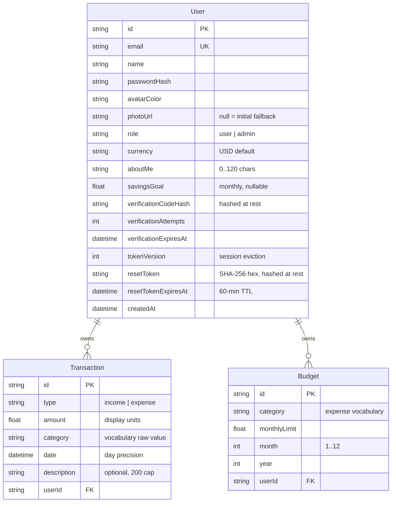
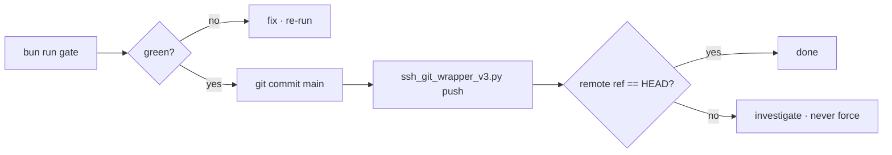

# Budget Wise — Master Project Architecture Document (PAD) v2.0.0

**Classification:** Internal Engineering Reference
**Status:** DEFINITIVE, PRODUCTION-LOCKED BLUEPRINT
**Companion Document:** [README.md](README.md) (user-facing) · [AGENTS.md](AGENTS.md) (agent-facing) · [CLAUDE.md](CLAUDE.md) (workflow)
**Last Updated:** 2026-10-27
**Audience:** Senior Engineers, Tech Leads, DevOps, and Onboarding Engineers
**Rule:** Every architectural decision in this document traces to a specific rationale. Nothing is here "because it's popular."

#### Revision Block — v2.0.0 (Tracked Changes)

- `[AUTH]` **Domain transformation:** the codebase was rebuilt from the NEO CRM scaffold (the prior 189-session parity clone of a Base44 CRM) into **Budget Wise** — the personal-finance domain of budget-wiser.base44.app. All CRM domain code retired; the production infrastructure (auth stack, db-path seam, UI primitives, test harness, deployment tooling) carried over. The prior CRM PAD lives in git history.
- `[RES]` Reference audited live 2026-10-27 (agent-browser, logged in, 1512×945 + 390×844): every surface's structure, copy, and category vocabularies byte-captured.
- `[CA]` The mobile-navigation gap identified and closed as a functional superset (the reference ships none).
- `[SR]` Tailwind v4 discipline re-verified (CSS-first tokens, v3 palette re-pins, hover unwrap, tw-animate vendoring).
- `[SYN]` Verification: 374 unit + 61 e2e + 14 smoke checks green; VLM structural parity clean on the dashboard at both axes.

---

## Table of Contents

1. [System Overview & Decisions](#1-system-overview--decisions)
2. [High-Level System Topology](#2-high-level-system-topology)
3. [Application Architecture](#3-application-architecture)
4. [Data Architecture](#4-data-architecture)
5. [Design System Reference](#5-design-system-reference)
6. [Security Architecture](#6-security-architecture)
7. [Testing Strategy](#7-testing-strategy)
8. [Build & Deployment](#8-build--deployment)
9. [Developer Handbook](#9-developer-handbook)
10. [Known Issues & Deferred Debt](#10-known-issues--deferred-debt)

---

## 1. System Overview & Decisions

### 1.1 Document Metadata & Purpose

This PAD is the single source of truth for Budget Wise's architecture. Use it to onboard (read §1–§4 first), debug (§3–§6 + §9), review tech choices (§1.3), and replicate the architecture. The intended posture: a self-hostable, single-deployable personal finance app with a hardened auth stack, server-derived money math, and a parity-verified UI.

### 1.2 Technology Stack Summary

| Layer | Technology | Version | Key Rationale |
|---|---|---|---|
| Web framework | Next.js (App Router) | ≥16.4.2 | Server components for the session guard; route handlers for the API; standalone output for the self-contained deployable |
| UI runtime | React | ≥19.3.1 | The ecosystem's current standard; adjust-during-render patterns for state resets |
| Language | TypeScript (strict) | ≥5.9.3 | The build is the type gate — no `ignoreBuildErrors` escape |
| Styling | Tailwind CSS | ≥4.3.3 | CSS-first `@theme` config with the v3 palette re-pinned (see ADR-5) |
| Component primitives | Radix UI (dialog, alert-dialog, select, tabs, dropdown, label, popover, slot) | current | Accessibility-complete overlays; the sheet/dialog/select families ride them |
| Charts | Recharts | ≥3.10.1 | The donut + weekly bars; `accessibilityLayer={false}` posture carried from the scaffold |
| State | Zustand | ≥5.0.15 | One client store; selector subscriptions; no React Query layer |
| ORM / DB | Prisma + SQLite | ≥6.19.3 | Zero-config local dev; the db-path seam pins the file location |
| Validation | Zod | ≥4.6.7 | Every API boundary; parse-then-mutate doctrine |
| Unit testing | Vitest | ≥5.0.5 | Fast pure-seam battery |
| E2E testing | Playwright | ≥1.64.1 | Real-browser flows against the production standalone build |
| a11y engine | axe-core | ≥4.13.0 | The two-gate spec (structural zero + sanctioned citations) |
| Runtime / PM | Bun | ≥1.3.14 | Script runner + dev server; the gate chain is bun-first |

### 1.3 Architecture Decision Records (ADRs)

**ADR-001: Next.js App Router with a standalone output**
- **Context:** The app must be self-hostable as one artifact with SQLite persistence, serve server-rendered pages behind a session guard, and expose JSON APIs.
- **Decision:** Next.js 16 App Router with `output: "standalone"`.
- **Rationale:** Server components let the `(app)` layout refuse HTML to guests (the fix-over-defect posture); route handlers give the API one home; the standalone output plus the db-path seam yields a deployable that boots anywhere Bun/Node runs.
- **Consequences:** + one deployable, one port, no container needed; − the artifact needs hygiene excludes (ADR-008) and the db-path seam to stay honest.
- **Alternatives rejected:** Vite SPA (no server guard, two deployables); Remix (heavier port of the same idea).

**ADR-002: SQLite via Prisma, schema-relative `DATABASE_URL`**
- **Context:** Personal finance is single-writer; the dev story must be zero-config; the production story must be file-portable.
- **Decision:** SQLite with `DATABASE_URL="file:../db/custom.db"` (relative to `prisma/schema.prisma`), normalized at runtime by `src/lib/db-path.ts`.
- **Rationale:** One file, one writer, trivially backed up. The seam defeats the two historical bugs: the engine resolving against the process CWD (landing outside the repo) and Bun's `.env` absolutization.
- **Consequences:** + zero-config dev, portable prod; − no concurrent-writer scale-out (acceptable for the domain); − the seam is a do-not-touch file (pinned by tests).
- **Alternatives rejected:** PostgreSQL (ops burden for a personal app); absolute dev paths (unportable).

**ADR-003: scrypt + HMAC cookie sessions (no auth framework)**
- **Context:** Self-hosted auth with email verification and password reset, without an external identity provider.
- **Decision:** Hand-rolled, minimal, audited: scrypt password hashing (`src/lib/password.ts`), HMAC-SHA256 signed cookies with a `tokenVersion` eviction dimension, per-IP rate buckets, hashed-at-rest reset tokens.
- **Rationale:** The reference's Base44 OAuth cannot be self-hosted; the email/password path needed production-grade equivalents. The token-version seam makes a password reset kill every prior session.
- **Consequences:** + no dependency, full control, evictable sessions; − the funnels are ours to maintain (449 unit assertions pin them).
- **Alternatives rejected:** NextAuth/better-auth (provider sprawl for a two-funnel need); JWT (no revocation dimension).

**ADR-004: One Zustand store; server-derived money math**
- **Context:** The dashboard renders ~20 derived numbers; the client must never disagree with the server about money.
- **Decision:** `/api/dashboard` computes every figure server-side; the client store caches the response and re-fetches after mutations.
- **Rationale:** Money math duplicated client-side drifts (rounding, timezone, filters); a single aggregate endpoint keeps one implementation, unit-testable in `budget-math.ts` and reused by the profile rollups.
- **Consequences:** + one truth; − a mutation triggers a 3-slice refresh (acceptable at personal scale).
- **Alternatives rejected:** Client-side derivation from the transactions list (the drift class); React Query (a second caching layer with no new capability here).

**ADR-005: Tailwind CSS v4, CSS-first, v3 palette re-pinned**
- **Context:** Tailwind v4's engine re-derived the default palette (oklch) — 56 of 118 literal classes in the scaffold diverged visibly from the reference's v3-era compiled CSS; v4 also renamed the shadow/blur scales.
- **Decision:** No config JS ever; every token in `globals.css` `@theme`; the v3 hex values re-pinned for every used (family, step) pair; `--shadow-sm`/`--blur-sm` re-pinned to v3's computed values; `@custom-variant hover (&:hover)` unwraps the hover media query.
- **Rationale:** Visual parity is a requirement; the re-pins restore byte-level computed parity on every chromatic surface and keep hovers working on touch.
- **Consequences:** + parity that survives Tailwind upgrades; − an unusual globals.css a new agent might want to "clean" (the do-not-touch list forbids it).
- **Alternatives rejected:** v3 (EOL); accepting v4's palette (visible drift).

**ADR-006: The mobile drawer as a documented superset**
- **Context:** The reference ships no navigation below 768px (links `display:none`, no hamburger) — live-verified 2026-10-27 at 390×844.
- **Decision:** Ship a Radix-Dialog sheet drawer (hamburger `< md`, 288px slate-900 surface) with the full behavioral battery: Escape/scrim close, focus trap + restoration, body scroll lock, route-change close, resize-past-md auto-close.
- **Rationale:** "Production-ready superset in functionality, visual parity in pixels" — the drawer adds a capability the reference lacks without touching a desktop pixel.
- **Consequences:** + phones can actually navigate; − the drawer is ours alone to keep green (10 e2e checks pin it).
- **Alternatives rejected:** Mirroring the gap (unusable phones); a bottom tab bar (a bigger visual delta).

**ADR-007: Deterministic AI Insights (no external LLM)**
- **Context:** The reference's AI Insights panel offers a Generate button behind a hosted model.
- **Decision:** Generate deterministic, data-derived insights client-side (top category, savings pace, over-budget warnings).
- **Rationale:** A self-hosted personal app should not grow an external dependency (and key management) for a panel that its own data can answer; the production build stays hermetic.
- **Consequences:** + zero external deps, instant, private; − no free-form narrative (acceptable; the call-outs cover the reference's shown content class).
- **Alternatives rejected:** An optional LLM key (config sprawl); omitting the panel (a visible parity gap).

**ADR-008: Artifact hygiene via tracing excludes**
- **Context:** Next's file tracing once shipped .env, .git, db/, skills/, docs/ inside every deployable (~550 MB where ~151 MB sufficed).
- **Decision:** `outputFileTracingExcludes` in `next.config.ts` + the build script's `rm -f .next/standalone/.env`; smoke check 14 polices the artifact on every run.
- **Rationale:** A deployable that carries its own .env and database is a security incident.
- **Consequences:** + clean artifact, policed forever; − new repo-root clutter must join the exclude list.
- **Alternatives rejected:** Docker-layer hygiene (no container in the story); post-build shell cleanup only (not policed).

---

## 2. High-Level System Topology

```mermaid
flowchart TB
    U[User's Browser] -->|HTTPS| NX[Next.js standalone server<br/>Bun/Node · port 3000]
    subgraph NX
        RC[Server Components<br/>(app) guard · pages] 
        RH[Route Handlers<br/>/api/*]
        MW[instrumentation → boot-env<br/>AUTH_SECRET gate]
    end
    RC --> DB[(SQLite<br/>db/custom.db)]
    RH --> DB
    RH --> FS[uploads/<br/>profile photos]
    U -->|fetch envelope| RH
    U -->|static assets| CDN-ish[hashed /_next/static]
```

- **Client layer**: any modern browser; localStorage is deliberately unused (the store is in-memory per session).
- **Application layer**: one process, one port. Server components resolve the session cookie on every `(app)` page request; route handlers serve the JSON API.
- **Data layer**: one SQLite file at `<repo>/db/custom.db` (dev) or an absolute path (prod); uploads land in `uploads/` with validated names.
- **External services**: none. The app is hermetic (ADR-007).
- **Scaling characteristics**: single-writer SQLite suits the personal-finance domain (one user, low write rate). The read path is one aggregate query per dashboard load.

## 3. Application Architecture

### 3.1 The Layer Model

```
Layer 0: Prisma schema + db-path seam       — where the data lives. Never bypass the seam.
Layer 1: lib/ domain modules                — pure money math, vocabularies, Zod schemas. No I/O.
Layer 2: Route handlers (/api/*)            — guard → parseBody → ownership checks → Prisma → envelope.
Layer 3: Server components (app/*)          — session guard, metadata, the client island mount.
Layer 4: Client islands + the store         — pages/dialogs/charts; Zustand; the envelope client.
Layer 5: UI primitives (components/ui/*)    — Radix + shadcn patterns riding page-layout records.
```

**The Golden Rule:** money crosses Layer 2→4 exactly once per surface, pre-computed. Layers 1 and 5 are the only places new logic should accrete.

### 3.2 Annotated Directory Structure

```text
src/
  app/
    (app)/                    # server-guarded app group (GuestLoginRedirect for guests)
      dashboard/              #   KPI + charts page (client island + page wrapper)
      Dashboard/page.jsx      #   the capital alias (.jsx — the TS1149 guard)
      transactions/           #   list + filters + CRUD round trips
      budgets/                #   the dark overall-usage card + budget cards
      profile/                #   identity + preferences + pastel overview grid
    (marketing)/              # /About + /Contact — auth-gated marketing pages
    api/
      transactions/[id]/      # DELETE (ownership-scoped 404)
      budgets/[id]/           # PATCH (limit) + DELETE (confirm flow)
      dashboard/route.ts      # THE aggregate endpoint (ADR-004)
      profile/route.ts        # GET projection + PATCH preferences
      auth/                   # login/signup/logout/me/verify/resend/forgot/reset
      health/route.ts         # the boot + db round-trip probe
      upload/ + uploads/[name]# profile photos (validated names)
    login/ signup/ reset-password/
    page.tsx                  # the PUBLIC landing (outside every guard)
  components/
    layout/app-shell.tsx      # sticky navbar + the mobile sheet drawer + footer
    layout/nav-config.ts      # the four items + isNavActive
    shared/transaction-dialog.tsx  # Add Transaction (tabs swap the category vocabulary)
    shared/budget-dialog.tsx  # Set Budget + the Delete-Budget alertdialog
    charts/budget-charts.tsx  # SpendingDonut + WeeklyBars (recharts)
    ui/                       # button/input/select/dialog/tabs/... riding page-layout records
  lib/
    db-path.ts                # THE seam (ADR-002) — do not touch
    budget-math.ts            # pure money math + ranges + buckets
    categories.ts             # the two vocabularies + presentation metadata
    currency.ts               # the five currencies + symbols
    schemas.ts                # the Zod layer (auth family carried verbatim)
    page-layout.ts            # the class-string contract records
    auth.ts / password.ts / rate-limit.ts / verification*.ts / login-reset.ts
    api.ts                    # the envelope + requireSession + parseBody
    site.ts                   # metadata factory (per-route OG/canonical)
  stores/budget-store.ts      # the one client store
prisma/                       # schema.prisma + seed.ts (the reference demo month)
tests/ + tests/e2e/           # the two test layers
scripts/                      # prisma-env wrapper + smoke-test.sh
db/                           # SQLite files (git-ignored)
docs/                         # screenshots, plan, deployment, push runbook
```

### 3.3 Critical Code Patterns

**Pattern 1 — the session guard (fix-over-defect):**

```tsx
// src/app/(app)/layout.tsx — the guest never receives app HTML
export default async function AppLayout({ children }) {
  const user = await getSessionUser();
  if (!user) return <GuestLoginRedirect />;  // lands on /login?from_url=<abs>
  return <AppShell user={user}>{children}</AppShell>;
}
```

*Why:* the reference serves its data pages to guests (its platform's face); a self-hosted finance app must not. The client-side redirect shim preserves the reference's from_url round-trip while the decision stays server-side.

**Pattern 2 — the API envelope + Zod seam:**

```ts
// every mutating route handler
const guard = await requireSession();
if (isGuarded(guard)) return guard.response;        // 401 envelope
const parsed = await parseBody(req, schema);        // bounded reader + CSRF gate + Zod
if (!parsed.ok) return parsed.response;             // 400 envelope, pinned message
const existing = await db.transaction.findUnique({ where: { id } });
if (!existing || existing.userId !== guard.user.id) return ERR.NOT_FOUND("Transaction");
```

*Why:* parse → ownership → mutate is the only sanctioned order (a DB-bound check cannot live in a schema); the foreign-id 404 prevents existence leaks.

**Pattern 3 — adjust-during-render form hydration:**

```tsx
// profile-page.tsx — the sanctioned React pattern for OWN-state resets
const [hydratedProfileId, setHydratedProfileId] = React.useState<string | null>(null);
if (profile && profile.id !== hydratedProfileId) {
  setHydratedProfileId(profile.id);
  setName(profile.name ?? "");
  // ... one setter per field, before the form paints
}
```

*Why:* `setState` inside an effect trips the lint rule and cascades renders; comparing the last-seen id renders the correction synchronously. (E2E tests that fill these fields must wait for hydration first — see §7.)

## 4. Data Architecture

### 4.1 Database Schema



Unique: `Budget (userId, category, month, year)` — the upsert key behind the Set Budget dialog (re-setting a category updates the limit). Indices: `Transaction (userId, date)`, `(userId, type)`, `(userId, category)`; `Budget (userId, year, month)`.

### 4.2 Persistence Strategy

One Prisma client singleton (`src/lib/db.ts`) resolves its URL through `runtimeDatabaseUrl()`. Seeding is idempotent in place (`deleteMany` + create; user rows upsert by email so session cookies survive re-seeds — the update blocks also clear the reset/verification funnels). The e2e suite uses an isolated `db/e2e.db` pushed + seeded by the global setup; the smoke leg uses `db/smoke.db`; both git-ignored like `db/custom.db`.

## 5. Design System Reference

### 5.1 Typographic System

No webfonts — the system stack (`--font-sans`: ui-sans-serif, system-ui, sans-serif, + emoji fallbacks), pinned in `@theme`. Body computes 16px (the browser default); KPI values `text-3xl font-bold`; section titles `text-lg font-bold`; page H1s `text-3xl font-bold` with `text-slate-500` subtitles.

### 5.2 Color Tokens (the reference's slate family)

| Role | Token / class | Value |
|---|---|---|
| Page background | `bg-slate-50` | #f8fafc |
| Surface | white cards | #ffffff |
| Foreground / brand | `text-slate-900` / active pill `bg-slate-900` | #0f172a |
| Brand gradient | `from-slate-900 to-slate-700` (logo tile) | |
| Muted text | `text-slate-500` (AA-compliant on white) | #64748b |
| Line | `border-slate-200` / `border-slate-100` (cards) | #e2e8f0 / #f1f5f9 |
| Income / positive | `text-emerald-600`, tint `bg-emerald-50/40` | |
| Expense / negative | `text-rose-600`, tint `bg-red-50/40` | |
| AI panel | `bg-indigo-50/30` + `border-indigo-100/50` | |
| Budget bar bands | emerald (healthy) → amber (≥80%) → rose (over) | |

All literal (family, step) pairs resolve through the v3 re-pin block in `globals.css` (ADR-005).

### 5.3 Component Primitives

shadcn-style components over Radix, consuming the contract records in `page-layout.ts` (`SITE_NAV`, `KPI_CARD`, `PANEL`, `DIALOG_*`, `MENU_*`, `TABS_*`, `LOGIN_LAYOUT`). The rule: pages reference records; records carry the class strings; `tests/app-chrome.test.ts` pins both.

### 5.4 Motion / Animation

Radix `data-[state]` animations via the vendored `tw-animate.css` (fade/zoom/slide families on dialogs, the drawer, menus, selects). `prefers-reduced-motion: reduce` collapses every animation to 0.01ms (the globals block). No other motion library.

## 6. Security Architecture

### 6.1 Security Rules

| Rule | Enforcement |
|---|---|
| Every `(app)`/API surface requires a session | `requireSession()` guard + the server-component layout |
| Every request body is Zod-validated, bounded (16KB), content-type gated | `parseBody` → `readBoundedJson` |
| Foreign ids answer 404 (no existence leak) | ownership checks before every mutation |
| Passwords: scrypt, 16-byte salt, 64-byte key | `src/lib/password.ts` (the one implementation — the seed imports it) |
| Sessions: HMAC-SHA256, 7-day TTL, revocable | `tokenVersion` bumps on reset; `getSessionUser` compares |
| Reset tokens: hashed at rest, single-use, 60-min TTL | conditional `updateMany` (atomic consumption) |
| Rate limits: login 10, signup 10, resend 5, verify 20 per IP/15min | `src/lib/rate-limit.ts` + `NEO_PROXY_HOPS` trust depth |
| Production boots fail without `AUTH_SECRET` | `instrumentation.ts` → `boot-env.ts` |
| The artifact ships no secrets | tracing excludes + smoke check 14 |
| Uploads: validated names, no traversal | `src/lib/uploads.ts` |

### 6.2 Authentication & Authorization

Roles: `user` (default) and `admin` (reserved; no admin surface yet). All domain data is user-scoped at the query level (`where: { userId }`) — there is no cross-user read path in the API.

### 6.3 Threat Model

| Vector | Mitigation |
|---|---|
| Credential stuffing | per-IP login buckets + scrypt + the timing equalizer on the unknown-email branch |
| Session theft | `tokenVersion` eviction on password reset; HttpOnly cookies |
| Open redirect | `resolveFromUrl` same-origin guard (foreign origins fall back to `/Dashboard`) |
| CSRF on JSON APIs | the content-type gate in the bounded reader |
| XSS | React's escaping; no `dangerouslySetInnerHTML` anywhere |
| Artifact leakage | ADR-008 |

## 7. Testing Strategy

| Gate | Tool | Count | What it proves |
|---|---|---|---|
| Lint | ESLint (0 warnings) | — | No suppressions; the set-state-in-effect family stays clean |
| Types | tsc + the build | — | Strict mode; the build enforces it |
| Unit | Vitest | 374 | Domain math, vocabularies, Zod contracts, infra seams, chrome contracts |
| E2E | Playwright | 61 | Real flows against the standalone build: auth walls, every CRUD round trip, the mobile drawer battery, the a11y two-gate |
| Smoke | bash ladder | 14 | The artifact boots, serves, walls, rate-limits, refuses secretless boots, ships clean |

**Load-bearing details:** the e2e suite shares one SQLite file (`workers: 1`); auth rides a saved storageState (per-test logins would trip the limiter); repeated local runs need `CI=1` (fresh server = fresh buckets). **Tests that fill async-hydrated forms must wait for hydration first** — a fill racing the controlled-value re-render appends instead of replaces.

## 8. Build & Deployment



- **Build**: `next build` + the static/standalone copy steps; the trailing `rm -f .next/standalone/.env` is the double-cure for Next's own .env copy.
- **Production boot**: `DATABASE_URL="file:/abs/path.db" AUTH_SECRET="$(openssl rand -hex 32)" NODE_ENV=production PORT=3000 bun .next/standalone/server.js` — absolute DB path recommended (§4 of docs/DEPLOYMENT.md).
- **Headers**: the security trio (Referrer-Policy, X-Content-Type-Options, HSTS) on every response.
- **Push**: main only, via the SSH wrapper (keys live outside the repo; the wrapper verifies the remote ref).

## 9. Developer Handbook

1. `bun install && cp .env.example .env && bun run db:push && bun run db:seed && bun run dev`.
2. Sign in with the demo credentials; the seeded month mirrors the reference.
3. Before touching styles: read ADR-005 + the `@theme` block. The re-pins are parity, not cruft.
4. Before touching routes: capital aliases are `.jsx` on purpose (TS1149).
5. Before touching the store: ADR-004 — money arrives pre-computed.
6. New API surface: envelope + Zod + ownership; pin the message strings in a unit test.
7. New UI surface: a `page-layout.ts` record + an `app-chrome` pin, not inline class strings.
8. Run `bun run gate` — all five legs. Then commit (Conventional Commits, why-focused) and push via the wrapper.
9. Append the session to `worklog.md`.

## 10. Known Issues & Deferred Debt

| # | Item | Status |
|---|---|---|
| 1 | The transactions list sorts strictly by date (createdAt tiebreak); the reference's row order tracks its own creation history — a data-level nuance, not a UI divergence | Documented; accepted |
| 2 | OAuth buttons on the login card are visual-parity elements that surface a "not configured" notice (the reference's Base44 OAuth cannot be self-hosted) | Documented superset boundary |
| 3 | `role: admin` exists in the schema with no admin surface | Reserved |
| 4 | The About-Me photo upload renders the affordance; the full crop/resize pipeline is the scaffold's uploads API without image processing | Works; enhancement deferred |
| 5 | `NEO_*` env prefixes survive from the CRM scaffold (rename would churn `.env.example` + docs for zero behavior) | Documented; deferred |
