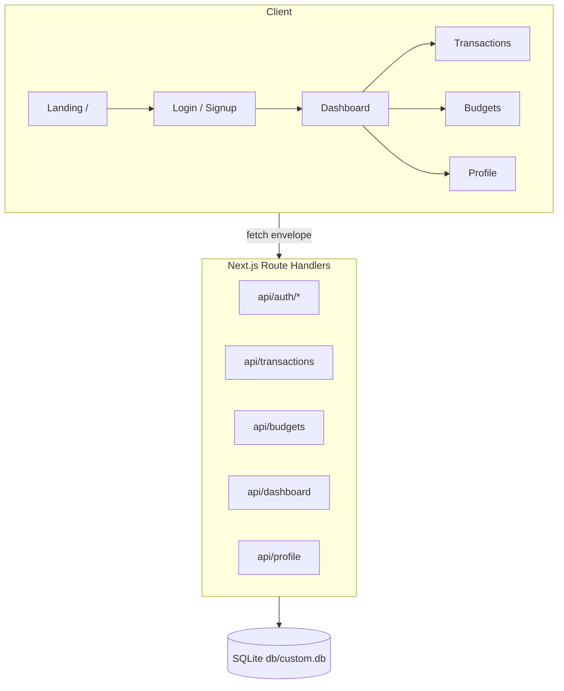

# Budget Wise

     

**A production-grade, self-hosted personal finance app** — a functional superset of the Budget Wise reference app with visual parity: track income and expenses the moment they happen, set category budgets with live progress bars, and watch your savings rate climb on a dashboard that recalculates with every entry.

## Quick Start

> Requires **Bun ≥ 1.3** (or Node ≥ 24 + npm), and the Bun-installed Chromium for e2e.

```bash
git clone https://github.com/nordeim/budget-wiser.git
cd budget-wiser
bun install

# 1. Configure the environment
cp .env.example .env
#    DATABASE_URL="file:../db/custom.db"  (the default — db/ lives at the repo root)
#    AUTH_SECRET="$(openssl rand -hex 32)"

# 2. Create + seed the database
bun run db:push
bun run db:seed

# 3. Start the dev server
bun run dev            # http://localhost:3000
```

**Verify setup** — sign in with the demo account:

| | |
|---|---|
| Email | `sepnetflix2023@outlook.com` |
| Password | `$Abcd1234` |

The seeded demo month mirrors the reference app: one $5,000 Salary income, three expenses (Other $400, Transport $100, Bills & Utilities $75.45), no budgets — balance $4,424.55, 88.5% saved.

## Key Features

| Feature | Description |
|---|---|
| 📊 **Live dashboard** | Balance, Income, Expenses, and Transaction-count KPIs recalculate with every entry; savings-rate badge included |
| 🍩 **Spending by Category** | Donut chart (outer 100 / inner 60 at 280px) with the eight expense categories, live legend |
| 🎯 **Category budgets** | Monthly limits with progress bars — emerald under, amber near the line, rose over; per-card remaining amounts |
| 📅 **Spend summary** | Mon–Sun weekly bar chart (spent vs earned) + year-to-date totals |
| 🧾 **Transactions** | Search, type and category filters, weekday-dated rows, delete with confirmation |
| ✨ **AI Insights** | One-tap, deterministic insights derived from your own data (top category, savings pace, budget warnings) — no external LLM dependency |
| 👤 **Profile & preferences** | Currency (USD/EUR/GBP/CAD/AUD), about-me with live counter, monthly savings goal, photo upload |
| 🔐 **Hardened auth** | Scrypt password hashing, HMAC cookie sessions, rate limiting, email verification + password reset funnels — with the reference's four-button OAuth row (Google, Microsoft, Facebook, Apple) as visual parity over the self-hosted email/password path |
| 📱 **Mobile navigation** | A fixed bottom tab bar on phones (4 icons + labels, active/inactive ink) — byte-mirrored from the reference's redesigned phone nav |

## Architecture

| Layer | Technology | Version | Purpose |
|---|---|---|---|
| Framework | Next.js (App Router) | 16.4 | Server components + route handlers |
| UI runtime | React | 19.3 | Client components + Zustand store |
| Language | TypeScript (strict) | 5.9 | Type gate enforced at build |
| Styling | Tailwind CSS | 4.3 | CSS-first `@theme` config, no config JS |
| Components | Radix UI + shadcn patterns | — | Dialog, Select, Tabs, AlertDialog primitives |
| Charts | Recharts | 3.10 | Donut + weekly bars |
| Database | SQLite via Prisma | 6.19 | `db/custom.db` at the repo root |
| Validation | Zod | 4.6 | Every API boundary |
| Unit tests | Vitest | 5.0 | 414 checks |
| E2E tests | Playwright | 1.64 | 67 checks against the standalone build |
| Runtime | Bun | ≥ 1.3 | Package manager + script runner |



## File Hierarchy

```text
budget-wiser/
📂 src/
  📂 app/
    📂 (app)/            # The authed app group (server-side session guard)
      📂 dashboard/      #   the KPI + charts page (+ /Dashboard capital alias)
      📂 transactions/   #   the list + filters + CRUD dialogs
      📂 budgets/        #   the overall-usage card + budget cards
      📂 profile/        #   identity + preferences + financial overview
    📂 (marketing)/      # /About + /Contact (auth-gated marketing pages)
    📂 api/              # transactions, budgets, dashboard, profile, auth/*, health
    📂 login/            # the login card (email + OAuth-parity buttons)
    📄 page.tsx          # the PUBLIC landing page at /
  📂 components/
    📂 layout/           # app-shell (navbar + bottom tab bar), nav-config, login-card
    📂 shared/           # transaction-dialog, budget-dialog
    📂 charts/           # donut + weekly bars (recharts)
    📂 ui/               # shadcn-style primitives (Radix)
  📂 lib/                # db-path seam, auth, schemas, categories, budget-math, page-layout
  📂 stores/             # budget-store (Zustand, single client store)
📂 prisma/               # schema.prisma + seed.ts
📂 tests/                # Vitest unit tests
  📂 e2e/                # Playwright specs (auth, app-flows, mobile-navigation, a11y…)
📂 db/                   # SQLite databases (git-ignored)
📂 docs/                 # screenshots, implementation plan, deployment guide
📄 .env.example          # the six-knob environment contract
```

## Environment Variables

```bash
# ---- Database -------------------------------------------------------------
DATABASE_URL="file:../db/custom.db"   # RELATIVE to prisma/schema.prisma → <repo>/db/
# ---- Site -----------------------------------------------------------------
NEXT_PUBLIC_SITE_URL=http://localhost:3000   # canonical origin (inlined at build)
# ---- Auth -----------------------------------------------------------------
AUTH_SECRET=""    # REQUIRED in production: openssl rand -hex 32 (>= 16 chars)
NEO_PROXY_HOPS="" # proxy-topology trust depth for rate-limit IP keying (default 1)
NEO_DISABLE_IN_APP_OTP=""   # "1" = stop returning verification codes in responses
NEO_DISABLE_IN_APP_RESET="" # "1" = stop returning reset links in responses
```

The relative `DATABASE_URL` is resolved by `src/lib/db-path.ts` — the CLI, `next build`, and the standalone server all land on `<repo>/db/custom.db` regardless of the process working directory.

## Testing

```bash
bun run test           # Vitest unit layer (414 checks) — pure seams, no browser
bun run test:e2e       # Playwright e2e (67 checks) — requires `bun run build` first
bun run lint           # ESLint, zero warnings allowed
bun run typecheck      # tsc --noEmit
bun run gate           # lint + typecheck + test + build + smoke + e2e (the full chain)
bun run smoke          # boots the standalone artifact on :3210 with a scratch db
```

The e2e suite boots the **production standalone server** on an isolated port with its own seeded `db/e2e.db` — it validates what ships, not the dev server. The a11y spec runs the axe two-gate (structural violations must be zero; contrast flags must cite sanctioned palette matchers).

## Deployment

The production build is self-contained:

```bash
bun run build                          # emits .next/standalone
DATABASE_URL="file:/absolute/path/to/custom.db" \
AUTH_SECRET="$(openssl rand -hex 32)" \
NODE_ENV=production PORT=3000 \
  bun .next/standalone/server.js
```

An **absolute** `DATABASE_URL` is recommended in production (see `docs/DEPLOYMENT.md` §4). The build refuses to serve without `AUTH_SECRET` in production — the boot gate names the missing variable.

## Security Posture

| Control | Mechanism |
|---|---|
| Password storage | scrypt (16-byte salt, 64-byte key) — `src/lib/password.ts` |
| Sessions | HMAC-SHA256 signed cookies, 7-day TTL, token-version revocation |
| Rate limiting | Per-IP buckets (login 10/15min, signup 10, resend 5, verify 20) |
| Input validation | Zod at every API boundary; bounded JSON reader (16KB) + content-type CSRF gate |
| SQL injection | Prisma parameterized queries only |
| Reset tokens | SHA-256 hashed at rest, single-use, atomic consumption, 60-min TTL |
| Artifact hygiene | The standalone build excludes .env/.git/db/docs/skills (pinned by smoke check 14) |

## The Mobile Navigation Bottom Tab Bar

The reference app redesigned its phone navigation (audited 2026-10-27): a fixed bottom tab bar now carries the four destinations below 768px — `md:hidden fixed bottom-0 left-0 right-0 z-50 bg-white border-t border-slate-200 safe-area-pb`, items with `w-6 h-6` lucide icons and `text-xs` labels, active `text-slate-900` (the ink on the anchor AND its svg) / inactive `text-slate-400`. This clone byte-mirrors that bar (plus the kept a11y superset: an `aria-current="page"` marker and a labelled nav landmark, which the reference ships without). The bar-clearance contract: the shell's `<main>` carries `pb-20 md:pb-0` so scrolled-to-end content clears the fixed bar below md, and the whole chrome rides the reference's exact hierarchy — `body (white) > DIV > DIV.min-h-screen.bg-slate-50 > [NAV, bar, MAIN.pb-20 > DIV.min-h-screen.bg-slate-50 > page]` (the outer surface wrapper, mirrored live 2026-10-27, puts slate-50 behind the translucent navbar so its white/80 backdrop renders rgb(254,254,255) instead of pure white). An earlier round shipped a hamburger + slide-out drawer as a superset while the reference had NO phone nav — the redesign retired it. The full battery (visibility, anchoring, navigation, the ink split, the scroll-end clearance) lives in `tests/e2e/mobile-navigation.spec.ts`.

## Troubleshooting

| Issue | Fix |
|---|---|
| `PrismaClientInitializationError: unable to open database file` at a parent-of-repo path | Keep `DATABASE_URL` relative (`file:../db/custom.db`) — the db-path seam resolves it; never absolutize it yourself for dev |
| e2e login 429s on repeated runs | The auth rate limiter is per-IP/15min; run with `CI=1` (fresh server = fresh buckets) or wait out the window |
| `AUTH_SECRET` boot failure in production | Generate one: `openssl rand -hex 32` — the server refuses to serve without it |
| Tailwind classes silently missing | This is Tailwind v4 CSS-first config — check `src/app/globals.css` `@theme` tokens, not a config JS file (there is none) |
| Dev server stuck in a reload loop (page re-fetches `/login` + `/manifest.json` several times per second) | A `.next` tree written by `next build` — concurrently with dev, killed half-into a run, **or cleanly completed and then booted onto** (turbopack dev watching production-compiler output full-reloads forever; hit live after a plain gate-then-dev sequence). The `dev` script's preflight guard (`scripts/dev-preflight.ts`) now removes the stale production tree automatically before `next dev` boots. If a loop is already live: stop the server, `rm -rf .next`, restart `bun run dev`. Never run `bun run build` while the dev server is live on the same tree. |

## License

MIT — see [LICENSE](LICENSE).

## Reference

This codebase is a self-hosted clone/superset of the Budget Wise app on Base44, built for parity verification against the live reference (audited 2026-10-27). The engineering conventions, Tailwind v4 discipline, and test architecture are documented in [AGENTS.md](AGENTS.md), [CLAUDE.md](CLAUDE.md), and the [Project Architecture Document](Project_Architecture_Document.md).
