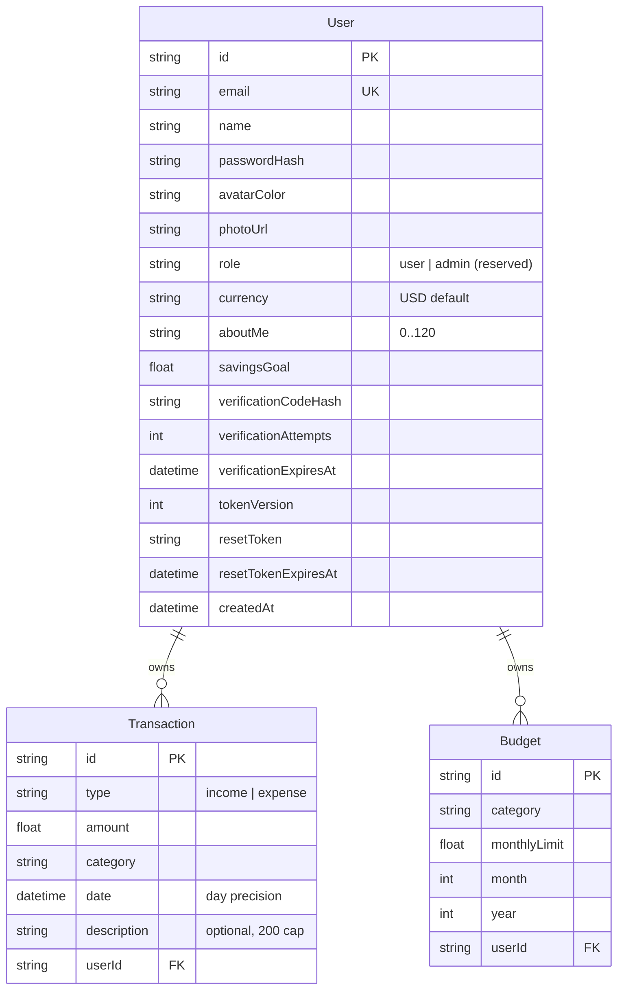

# Budget Wise — Complete Engineering Skill

> **What this is:** the single-source-of-truth engineering reference for the Budget Wise codebase. Use it to extend, debug, audit, onboard, or replicate the architecture. Every claim below was verified against the tree at the session-191 pin or live-probed against the reference app.

---

## Table of Contents

1. [Project Identity & Design Philosophy](#1-project-identity--design-philosophy)
2. [Tech Stack & Environment](#2-tech-stack--environment)
3. [Bootstrapping & Configuration](#3-bootstrapping--configuration)
4. [The Design System (Tailwind v4, CSS-First)](#4-the-design-system-tailwind-v4-css-first)
5. [Component Architecture & Patterns](#5-component-architecture--patterns)
6. [State Management — The ONE Store](#6-state-management--the-one-store)
7. [Data Model, Domain Math & Seeding](#7-data-model-domain-math--seeding)
8. [The API Layer — Route Handler Idiom](#8-the-api-layer--route-handler-idiom)
9. [Authentication & Authorization](#9-authentication--authorization)
10. [Accessibility Implementation](#10-accessibility-implementation)
11. [SEO, Metadata & PWA Surface](#11-seo-metadata--pwa-surface)
12. [Testing Strategy (three tiers, one law)](#12-testing-strategy-three-tiers-one-law)
13. [The Quality Gate](#13-the-quality-gate)
14. [Security Checklist](#14-security-checklist)
15. [Build, Artifact Hygiene & Deployment](#15-build-artifact-hygiene--deployment)
16. [Debugging Guide (symptom → root cause → fix)](#16-debugging-guide-symptom--root-cause--fix)
17. [Anti-Patterns & Common Bugs](#17-anti-patterns--common-bugs)
18. [Lessons Learnt & How to Avoid Them](#18-lessons-learnt--how-to-avoid-them)
19. [Pitfalls to Avoid](#19-pitfalls-to-avoid)
20. [Best Practices](#20-best-practices)
21. [Coding Patterns (with code)](#21-coding-patterns-with-code)
22. [Responsive & Layout Reference](#22-responsive--layout-reference)
23. [Color Reference (Complete)](#23-color-reference-complete)
24. [The TypeScript Contract Reference](#24-the-typescript-contract-reference)
25. [Appendix A — ADR Index](#appendix-a--adr-index)
26. [Appendix B — Pre-Ship Checklist](#appendix-b--pre-ship-checklist)
27. [Appendix C — Audit History](#appendix-c--audit-history)

---

## 1. Project Identity & Design Philosophy

**Budget Wise** is a self-hosted, single-deployable personal finance application — a functional superset of the Budget Wise reference app (`budget-wiser.base44.app`) with visual parity. It tracks income and expenses, sets per-category monthly budgets, and renders a live dashboard of the user's financial health.

**The four app pages** (capitalized hrefs, the reference's own routing):

| Route | Surface |
|---|---|
| `/Dashboard` | 4 KPI cards (Balance + savings badge, Income, Expenses, Transactions count), Spending-by-Category donut, Budget Progress bars, Spend Summary (This Week / This Year tabs + weekly bar chart), Recent Transactions, AI Insights |
| `/Transactions` | Total income/expenses summary, search, type + category filters, weekday-dated rows with tinted category icons, delete with AlertDialog confirmation |
| `/Budgets` | Overall Budget Usage dark card (progress + %), Active/On Track/Over Budget KPI cards, per-category budget cards with state-colored progress bars, empty state with "Set Your First Budget" |
| `/Profile` | Dark-header identity card with straddling avatar (photo upload), Preferences (currency, About Me 0/120, savings goal), pastel 3×2 Financial Overview grid, white 2026 Summary row |

Plus the public landing at `/`, the login card (four OAuth buttons + email/password + in-place signup/verify/reset views), and `/signup` (our documented superset — the reference 404s it).

**Non-negotiable principles:**

- **Parity with the reference, superset where it is broken.** Visual parity at desktop + phone axes; functional supersets must be invisible to pixels (the a11y naming on the bottom tab bar) or strictly additive (AI insights, the public landing, the working email/password funnels). Every deviation lives in the PAD's Known Issues.
- **The gate is the only gate.** No hosted CI exists — `bun run gate` must be green before any push.
- **Money math is server-side and unit-tested.** `/api/dashboard` computes every number the dashboard renders; the client never re-derives. Pure helpers live in `src/lib/budget-math.ts`.
- **Nothing reaches Prisma unvalidated.** Zod at every boundary; DB-bound checks (ownership, FK existence) stay route-side.
- **One deployable.** `next build` emits `.next/standalone` — the app boots anywhere Bun/Node runs with one SQLite file.

**Reference-state notes (live-verified 2026-10-27/28 — the fifth consecutive zero-drift census confirmed at session 197):**
- The reference **redesigned its phone navigation** (session 193, 2026-10-27): a fixed bottom tab bar below md (`md:hidden fixed bottom-0 left-0 right-0 z-50 bg-white border-t border-slate-200 safe-area-pb`, active `text-slate-900` on BOTH the anchor and its svg / inactive `text-slate-400`, lucide icons `w-6 h-6`, labels `text-xs font-medium`) with **no footer** on the app surface. We byte-mirror the bar (the `BOTTOM_NAV` contracts) + the kept a11y superset (`aria-current` + the labelled landmark). Sessions 190–192 had shipped a drawer + hamburger as the superset while the reference had NO phone nav — retired when the redesign landed.
- The reference **restyled its entire surface system onto stock shadcn/ui** (session 194, 2026-10-27): per-page containers (7xl/5xl/5xl/4xl), sm-stacking plain-DIV headers with tracking-tight H1s, the h-9 stock Button/Card/Input/Select/Badge/Tabs forms, gradient KPI/summary/dark cards, divide-y transaction rows with description-first titles + category badges, the native currency select on Profile, and --primary as the neutral #171717. The shell rides the exact hierarchy `body (WHITE) > DIV > DIV.min-h-screen.bg-slate-50 > [NAV, bar, MAIN.pb-20 md:pb-0 > DIV.min-h-screen.bg-slate-50 > page]` (session 195: the outer surface wrapper puts slate-50 behind the translucent navbar — its white/80 backdrop renders rgb(254,254,255), not pure white) — the pb-20 clearance guarantees content clears the fixed bar below md. The category palette is the round-trip-probed set (food emerald+Utensils, transport blue, entertainment violet+Film, shopping amber, bills red+Receipt, healthcare cyan+Heart, education lime, other slate+Ellipsis; salary indigo, freelance purple+Wallet, investment teal, gift pink).
- The reference serves app HTML to guests (its platform's face). We ship a public landing + server-side `(app)` guard — the production-grade posture.
- The reference's demo data was reset to empty at the session-191 audit, then re-populated with a single food txn (−$1,000) from s193 on (Balance −$1,000.00 / Income $0.00 / 1 txn — data-borne, the excluded genus). Our seed keeps the original demo month ($5,000 Salary + $575.45 expenses across 4 transactions, balance $4,424.55, 88.5% saved) — README-documented.
- The reference's **404 title interpolates the unmatched path** (session 196, 2026-10-28, curl-verified in its served HTML): `<Humanized last non-empty path segment> | Budget Wise` — the humanize splits hyphens AND camelCase boundaries, capitalizing each token's first letter while preserving the rest (`/iPhoneCaseTEST` → "I Phone Case TEST", `/foo/bar` → "Bar", `/foo/` → "Foo"); the body quotes the pathname WITHOUT the leading slash. We mirror it server-side: `src/middleware.ts` stamps `x-pathname` (the only way the unmatched path reaches the render — probed) → `not-found.tsx` generateMetadata → `src/lib/not-found-title.ts`. The .jsx capital aliases MUST re-export the lowercase page's `metadata` — without it, /Transactions//Budgets//Profile silently serve the layout-default "Budget Wise" tab title (found live, invisible to every gate; /Dashboard is metadata-less BY DESIGN on both apps).
- The reference's OAuth buttons (Google, Microsoft, Facebook, Apple) redirect to real providers — unimplementable self-hosted. Ours render the full four-button row (visual parity) surfacing a not-configured `toast.info` (the documented boundary).

---

## 2. Tech Stack & Environment

| Layer | Technology | Version floor | Notes |
|---|---|---|---|
| Framework | Next.js (App Router) | 16.4 | `output: "standalone"`; `outputFileTracingRoot` pinned to repo root; the build IS the type gate (no `ignoreBuildErrors`) |
| UI runtime | React | 19.3 | `"use client"` islands; no `forwardRef` needed; adjust-during-render for own-state resets |
| Language | TypeScript | 5.9 | `strict: true`; `tsc --noEmit` is a gate leg |
| Styling | Tailwind CSS | 4.3 | CSS-first `@theme` in `src/app/globals.css`; **no `tailwind.config.js` and there must never be one** |
| PostCSS | `@tailwindcss/postcss` | ^4 | The only plugin; missing it = pages render unstyled |
| Primitives | Radix UI (dialog, alert-dialog, select, tabs, dropdown, label, popover, slot) | current | Accessibility-complete overlays; never hand-roll focus trapping |
| Charts | Recharts | 3.10 | Donut + weekly bars; `accessibilityLayer={false}` |
| State | Zustand | 5.0 | ONE client store (`src/stores/budget-store.ts`) |
| ORM / DB | Prisma / SQLite | 6.19 | `DATABASE_URL="file:../db/custom.db"` (schema-relative); `src/lib/db-path.ts` normalizes |
| Validation | Zod | 4.6 | Every API boundary; bounded reader + CSRF content-type gate |
| Icons | lucide-react | 0.525 | Inherit stroke-2 defaults |
| Unit tests | Vitest | 5.0 | Node env; `*.test.ts` only; `@` alias |
| E2E | @playwright/test | 1.64 | Against the **production standalone build**; Chromium only; storageState auth |
| a11y engine | axe-core | 4.13 | The two-gate spec (structural zero + sanctioned contrast citations) |
| Runtime / PM | Bun | 1.3 | Script runner; the gate chain is bun-first |

**Environment contract (exactly six knobs — additions require an ADR):**

| Variable | Required | Purpose |
|---|---|---|
| `DATABASE_URL` | yes | `file:../db/custom.db` — RELATIVE to `prisma/schema.prisma` → `<repo>/db/` |
| `NEXT_PUBLIC_SITE_URL` | recommended | Canonical origin for metadata/sitemap/robots — **inlined at build time** |
| `AUTH_SECRET` | **production: hard requirement** | HMAC key for session cookies, ≥ 16 chars (`openssl rand -hex 32`); missing in prod fails at boot |
| `NEO_PROXY_HOPS` | prod-behind-proxy | Rate-limit IP trust depth (unset = 1; unparsable fails CLOSED to 1) |
| `NEO_DISABLE_IN_APP_OTP` | prod | `"1"` = stop returning verification codes in responses |
| `NEO_DISABLE_IN_APP_RESET` | prod | `"1"` = stop returning reset links in responses |

`.env` is git-ignored; `.env.example` mirrors the contract exactly and documents the PostgreSQL swap. The `NEO_*` prefixes survive from the CRM scaffold (documented deferred debt — renaming churns `.env.example` + docs for zero behavior).

---

## 3. Bootstrapping & Configuration

```bash
git clone https://github.com/nordeim/budget-wiser.git
cd budget-wiser
bun install                       # 537 packages
cp .env.example .env              # DATABASE_URL already correct; add AUTH_SECRET in prod
bun run db:push                   # schema → db/custom.db (repo-root db/)
bun run db:seed                   # idempotent demo data (the reference's demo month)
bun run dev                       # http://localhost:3000
```

Demo login: `sepnetflix2023@outlook.com` / `$Abcd1234`.

**The DATABASE_URL contract (read twice — it bit every sibling codebase):**

A relative `file:` URL resolves differently per reader: the Prisma CLI anchors at `prisma/schema.prisma`; a shell-inherited `DATABASE_URL` anchors at the CWD (unpredictable); Next's standalone `server.js` runs `process.chdir()` before your code loads.

1. `src/lib/db-path.ts` is the **only** sanctioned source of the runtime URL (the anchor chain: standalone-repo-root detector → module anchor validated on disk → CWD with existence guard). `db.ts` never reads `process.env.DATABASE_URL` directly.
2. `db-path.ts` is a pure seam with fixture tests (`tests/db-path.test.ts`) — the most-tested module in the tree.
3. npm scripts pin the environment: runtime scripts inline `DATABASE_URL=…`; Prisma CLI scripts strip it (`env -u DATABASE_URL prisma …`) so a polluted parent shell can never redirect the database.
4. **Symptom to memorize:** `Error code 14: Unable to open the database file` = wrong anchor or a shell env override — check `env | rg DATABASE` and the startup log line before touching code.

**Config files that carry non-obvious weight:**

| File | Locks in |
|---|---|
| `next.config.ts` | standalone output; tracing root; `outputFileTracingExcludes` (the artifact-hygiene cure — includes both `neo-crm_SKILL.md` and `budget-wiser_SKILL.md`); the three-header security set; `devIndicators: false` |
| `tsconfig.json` | strict TS; `@/*` → `src/*`; vendored non-app dirs excluded |
| `eslint.config.mjs` | next/core-web-vitals + next/typescript; React 19 hook rules (incl. `set-state-in-effect`) as **errors**; skills/ ignored |
| `vitest.config.ts` | `src/**/*.test.ts` + `tests/**/*.test.ts`; never matches Playwright's `*.spec.ts` |
| `playwright.config.ts` | setup project (one login → storageState); webServer = standalone build on its own port with its **own** pinned `DATABASE_URL` (`file:../db/e2e.db`); `workers: 1` is load-bearing (one shared SQLite file) |
| `postcss.config.mjs` | `@tailwindcss/postcss` only |

---

## 4. The Design System (Tailwind v4, CSS-First)

All tokens in `src/app/globals.css` `@theme`. **Literal hex values only** — no var() chains, no bare HSL triplets (a bare HSL triplet in `@theme` silently resolves to transparent).

**The v4 traps, all mitigated in-tree:**

1. **The default palette is oklch and drifts** from v3's compiled hexes — the re-pin block re-declares every literal (family, step) pair used in `src/` (slate, emerald, rose, indigo, amber…) at the v3 hex values. **Do not "clean these up"** — removing them drifts every chromatic surface.
2. **The shadow scale moved one notch** (v3 shadow-sm → v4 shadow-xs) — `--shadow-sm` is re-pinned to v3's computed `0 1px 2px 0 rgb(0 0 0 / 0.05)`. Same for `--blur-sm: 4px`.
3. **`hover:` wraps in `@media (hover: hover)`** — hovers no-op on touch. The `@custom-variant hover (&:hover)` declaration unwraps it (family-wide, live-proven divergence on the reference).
4. **Gradient utilities interpolate in oklab** — brand gradients use the `from-slate-900 to-slate-700` literal pair (slate family interpolates cleanly; do not introduce oklab-sensitive multi-hue gradients without checking computed output).
5. **Literal class strings only in source** — v4 scans for literals; dynamic `` `grid-cols-${n}` `` templates never compile. See the `GRID_COLS` static-map pattern in `tabs.tsx`.
6. **Never fight display utilities with the `hidden` attribute** — v4: `hidden` WINS. Mount/unmount instead.
7. **Radix animations** ride the vendored `src/app/vendor/tw-animate.css` (`data-[state=open]:animate-in` family) — Tailwind v4 does not ship these.
8. **Custom classes lose the cascade to arbitrary utilities** — an `shadow-[…]`/`rounded-*` utility on an element that also carries a custom component class silently loses. Override with a dedicated custom class or inline style.
9. **Preflight sets no `cursor: pointer` on buttons** — the base-layer rule exists in globals.css.
10. **`space-y-*` rewrote** (margin-block-end on `:not(:last-child)` vs v3's margin-top on `* + *`) — mirror reference rhythm with explicit `mt-*` on the later child; never stack `mt/mb` on children of `space-y` containers.

**The sanctioned token families (see §23 for the complete color reference):** slate neutrals, emerald = income/positive, rose/red = expense/negative, indigo = AI panel, amber = budget warning band.

**Class contracts live in `src/lib/page-layout.ts`** — pages consume the exported records (`SITE_NAV`, `KPI_CARD`, `PANEL`, `PAGE_HEADER`, `PAGE_ROOT`, `HEADER_BUTTONS`, `APP_FOOTER`, `MOBILE_NAV_SHEET`, `LOGIN_LAYOUT`, `LOGIN_SIGNUP_LAYOUT`, `LOGIN_RESET_LAYOUT`, `LOGIN_VERIFY_LAYOUT`, `DIALOG_*`, …). **New surfaces add a record, not inline strings** — `tests/app-chrome.test.ts` pins them.

---

## 5. Component Architecture & Patterns

### 5.1 The Layer Model

```
Layer 0: Prisma schema + db-path seam       — where the data lives. Never bypass the seam.
Layer 1: lib/ domain modules                — pure money math, vocabularies, Zod schemas. No I/O.
Layer 2: Route handlers (/api/*)            — guard → parseBody → ownership checks → Prisma → envelope.
Layer 3: Server components (app/*)          — session guard, metadata, the client island mount.
Layer 4: Client islands + the store         — pages/dialogs/charts; Zustand; the envelope client.
Layer 5: UI primitives (components/ui/*)    — Radix + shadcn patterns riding page-layout records.
```

**The Golden Rule:** money crosses Layer 2→4 exactly once per surface, pre-computed. Layers 1 and 5 are the only places new logic should accrete.

### 5.2 Directory Map

```text
src/
  app/
    (app)/                    # server-guarded app group (GuestLoginRedirect for guests)
      dashboard/              #   page.tsx (server wrapper) + dashboard-page.tsx (client island)
      Dashboard/page.jsx      #   the CAPITAL alias — MUST be .jsx (TS1149 on .ts same-program casing)
      transactions/ budgets/ profile/   # + their capital aliases
    (marketing)/              # /About + /Contact (auth-gated marketing pages)
    api/
      transactions/[id]/      # DELETE (ownership-scoped 404)
      budgets/[id]/           # PATCH (limit) + DELETE (confirm flow)
      dashboard/route.ts      # THE aggregate endpoint
      profile/route.ts        # GET projection + PATCH preferences
      auth/                   # login/signup/logout/me/verify/resend/forgot/reset
      health/ upload/ uploads/[name]/ reset/
    login/ signup/ reset-password/
    page.tsx                  # the PUBLIC landing (outside every guard)
    globals.css  icon.png  apple-icon.png  robots.txt/  sitemap.xml/  manifest.json/
    error.tsx global-error.tsx not-found.tsx not-found-body.tsx
  components/
    layout/app-shell.tsx      # sticky navbar + the mobile bottom tab bar
    layout/nav-config.ts      # the four items + isNavActive
    layout/login-card.tsx     # the multi-view auth card (signin/signup/verify/reset/forgot)
    layout/guest-login-redirect.tsx reset-password-screen.tsx
    shared/transaction-dialog.tsx  # Add Transaction (Expense/Income tabs swap vocabularies)
    shared/budget-dialog.tsx  # Set Budget + Delete-Budget AlertDialog
    charts/budget-charts.tsx  # SpendingDonut + WeeklyBars (recharts wrappers)
    landing/landing-page.tsx  # the public marketing surface
    ui/                       # button/input/select/dialog/tabs/alert-dialog/… (Radix)
  lib/                        # db-path, db, api, auth, password, rate-limit, verification*,
                              # login-reset, schemas, budget-math, categories, currency,
                              # page-layout, site, uploads, utils, boot-env, chunk-recovery
  stores/budget-store.ts      # the ONE client store
  types/index.ts              # the API wire shapes
prisma/                       # schema.prisma + seed.ts
tests/ + tests/e2e/           # the two test layers
scripts/                      # prisma-env wrapper + smoke-test.sh (the CRM-era sweep/census
                              # family was retired at s190; its package.json entries at s192)
db/                           # SQLite files (git-ignored)
```

### 5.3 The Route Casing Rule (an agent WILL guess wrong)

Nav hrefs are capitalized (`/Dashboard`, `/Transactions`, `/Budgets`, `/Profile`) — the reference's own form. Lowercase folders carry the implementation; the capital aliases are **`.jsx` re-export stubs**:

```jsx
// src/app/(app)/Dashboard/page.jsx — the TS1149 guard
export { default, metadata } from "../dashboard/page";
```

**Never make the alias a `.ts`/`.tsx` file** — TS1149 fires on same-program paths differing only in casing. The sitemap lists the real lowercase routes (our router is case-sensitive; the reference's platform is not — the documented s14/s18 decision).

### 5.4 Pattern 1 — the session guard (fix-over-defect)

```tsx
// src/app/(app)/layout.tsx — the guest never receives app HTML
export default async function AppLayout({ children }) {
  const user = await getSessionUser();
  if (!user) return <GuestLoginRedirect />;  // lands on /login?from_url=<abs>
  return <AppShell user={user}>{children}</AppShell>;
}
```

*Why:* the reference serves its data pages to guests (its platform's face); a self-hosted finance app must not. The client-side redirect shim preserves the reference's `from_url` round-trip while the decision stays server-side.

### 5.5 Pattern 2 — adjust-during-render form hydration

```tsx
// profile-page.tsx — the sanctioned React pattern for OWN-state resets
const [hydratedProfileId, setHydratedProfileId] = React.useState<string | null>(null);
if (profile && profile.id !== hydratedProfileId) {
  setHydratedProfileId(profile.id);
  setName(profile.name ?? "");
  // ... one setter per field, before the form paints
}
```

*Why:* `setState` inside an effect trips the lint rule and cascades renders; comparing the last-seen id renders the correction synchronously. (E2E tests that fill these fields must wait for hydration first — see §12.)

### 5.6 Pattern 3 — the app shell + the mobile bottom tab bar

`app-shell.tsx`: sticky `h-16` navbar (`bg-white/80 backdrop-blur border-b`), gradient slate-900→700 logo tile + "BudgetWise" wordmark, desktop pill row `hidden md:flex` (active `bg-slate-900 text-white`), and the **bottom tab bar** below md — the reference's redesigned phone nav, byte-mirrored (`BOTTOM_NAV` in page-layout.ts): `md:hidden fixed bottom-0 left-0 right-0 z-50 bg-white border-t border-slate-200 safe-area-pb`, items `flex flex-col items-center gap-1 px-4 py-2 rounded-xl transition-all` + active `text-slate-900` / inactive `text-slate-400`, lucide icons `w-6 h-6` (LayoutDashboard / ArrowLeftRight / Target / User), labels `text-xs font-medium`. OUR kept a11y superset: `aria-current="page"` + the labelled nav landmark. The bar is plain fixed chrome — NOT an overlay: no portal, no focus trap, no scroll lock, no matchMedia. The reference's app surface ships NO footer (the landing keeps its own). History: sessions 190–192 shipped a Radix drawer + hamburger as the superset while the reference had NO phone nav — both retired the moment the reference shipped its own bar (visible-pixel divergence).

---

## 6. State Management — The ONE Store

**Zustand, not React Query/SWR.** One client store (`src/stores/budget-store.ts`) holds the session user, transactions, budgets, dashboard aggregates, and profile. Actions call the API envelope then refresh the affected slices. `call()` (inside the store) is the only sanctioned JSON client.

**Rules:**

- Selector subscriptions (`useBudgetStore((s) => s.transactions)`) — no prop drilling of server data.
- The store hydrates once on shell mount (`React.useEffect(() => { void hydrate(); }, [hydrate])` — dropping this bootstrap once shipped a permanent "Loading…" state; the e2e battery caught it).
- A mutation triggers a 3-slice refresh (transactions + budgets + dashboard) — acceptable at personal scale; the server is the single truth.
- Money arrives pre-computed from `/api/dashboard` — the client never re-derives totals.

---

## 7. Data Model, Domain Math & Seeding

### 7.1 The Schema (Prisma)



Unique: `Budget (userId, category, month, year)` — the upsert key behind Set Budget (re-setting a category updates the limit). Indices: `Transaction (userId, date)`, `(userId, type)`, `(userId, category)`; `Budget (userId, year, month)`.

### 7.2 The Category Vocabularies (byte-matched to the reference)

- **Expense (8):** Food & Dining, Transport, Entertainment, Shopping, Bills & Utilities, Healthcare, Education, Other
- **Income (5):** Salary, Freelance, Investment, Gift, Other

Both vocabularies + their presentation metadata (lucide icons, tint classes) live in `src/lib/categories.ts` — single source; dropdowns, badges, donut legends, and Zod schemas all import the same arrays. **Never fork a category copy into a component.**

### 7.3 Money Math (`src/lib/budget-math.ts` — pure, unit-tested, importable both sides)

- **Two-decimal money rounding at every aggregate boundary.** The round1() era bug rendered $575.45 as $575.50 (caught by the e2e API probe) — every sum rounds through the two-decimal helper.
- `spentForCategory`, `remaining`, `pct`, `onTrack` (emerald < 80%, amber ≥ 80%, rose over), month ranges, week buckets (Mon–Sun), year-to-date rollups.
- Currencies: USD/EUR/GBP/CAD/AUD with symbols (`src/lib/currency.ts`) — display-layer formatting only.

### 7.4 Seeding (`prisma/seed.ts` — idempotent in place)

`deleteMany` domain tables → insert the canonical demo month (mirrors the reference's original demo data: one $5,000 Salary income on Oct 1, Other $400 on Oct 10, Transport $100 on Oct 25, Bills & Utilities $75.45 on Oct 26). User rows upsert by email so session cookies survive re-seeds. Route the seed through the db-path seam like the app — a bare `new PrismaClient()` seed bypasses it. **Never `rm` the db file under a running server** (the process keeps the deleted inode and serves stale data).

---

## 8. The API Layer — Route Handler Idiom

**The envelope, always:** `{ ok: true, data } | { ok: false, error: { code, message } }` — `ok()`/`ERR` from `src/lib/api.ts`.

```ts
// every mutating route handler — the sanctioned order
const guard = await requireSession();
if (isGuarded(guard)) return guard.response;        // 401 envelope
const parsed = await parseBody(req, schema);        // bounded reader (16KB) + CSRF content-type gate + Zod
if (!parsed.ok) return parsed.response;             // 400 envelope, pinned message
const existing = await db.transaction.findUnique({ where: { id } });
if (!existing || existing.userId !== guard.user.id) return ERR.NOT_FOUND("Transaction");
```

**Route map:**

| Route | Methods | Notes |
|---|---|---|
| `/api/transactions` | GET, POST | day-precision dates; type-scoped categories |
| `/api/transactions/[id]` | DELETE | ownership-scoped 404 (no existence leak) |
| `/api/budgets` | GET, POST | GET pre-joins spent; POST upserts (user, category, month, year) |
| `/api/budgets/[id]` | PATCH, DELETE | limit updates + the confirm-delete |
| `/api/dashboard` | GET | every dashboard number, computed server-side |
| `/api/profile` | GET, PATCH | identity + preferences + overview rollups |
| `/api/auth/*` | — | login, signup, logout, me, verify, resend, forgot, reset-password |
| `/api/health` | GET | the boot + db round-trip probe |
| `/api/upload` + `/api/uploads/[name]` | — | profile photos (validated names, no traversal) |

**Conventions:**

- **Ownership scoping answers 404, not 403** — a foreign id must not leak existence.
- **Error messages are pinned strings** — the unit + e2e suites assert exact user-facing words; changing one REDs tests by design. Update the pin and the string together.
- DB-bound checks (ownership, FK existence) stay route-side — a schema cannot express them.

---

## 9. Authentication & Authorization

Hand-rolled, minimal, audited (ADR-003) — no auth framework:

- **Passwords:** scrypt, 16-byte salt, 64-byte key (`src/lib/password.ts` — the one implementation; the seed imports it). A timing equalizer runs on the unknown-email branch.
- **Sessions:** HMAC-SHA256 signed cookies, 7-day TTL, HttpOnly, `tokenVersion` eviction dimension — a password reset kills every prior session.
- **Rate limits (per IP / 15 min):** login 10, signup 10, resend 5, verify 20. `NEO_PROXY_HOPS` declares the proxy trust depth; unparsable values fail CLOSED.
- **Email verification:** 6-digit OTP, hashed at rest, 5-attempt lockout, expiry — the full funnel with in-app delivery (disable with `NEO_DISABLE_IN_APP_OTP=1` in production).
- **Password reset:** SHA-256-hashed tokens at rest, single-use (atomic conditional `updateMany` consumption), 60-min TTL, no-enumeration 200s.
- **The login card is a multi-view state machine** (`src/lib/login-reset.ts`): signin ↔ signup ↔ verify ↔ forgot ↔ sent ↔ reset — the reference's in-place view swaps (URL stays `/login`), pinned by `tests/login-reset.test.ts` + `tests/login-views.test.ts`.
- **OAuth buttons:** the full four-button row (Google, Microsoft, Facebook, Apple) is visual parity; every button surfaces a not-configured `toast.info` (a real provider redirect is unimplementable self-hosted — the documented boundary, pinned family-wide by `tests/login-views.test.ts`).
- **Open redirect guard:** `resolveFromUrl` same-origin check — foreign origins fall back to `/Dashboard`.

Roles: `user` (default) and `admin` (reserved; no admin surface yet). All domain data is user-scoped at the query level.

---

## 10. Accessibility Implementation

- **Radix primitives are load-bearing:** dialogs expose `role="dialog"` + `aria-modal` + focus trap + focus return + Escape/overlay close; selects expose combobox/option trees. E2E locators depend on these roles — removing them breaks the suite (a feature, not a bug).
- **Every input has a `<Label>`**; icon-only controls carry `aria-label` ("Delete {category} transaction", "Open navigation menu").
- **The a11y two-gate (e2e):** axe-core structural violations must be **zero**; contrast flags must cite sanctioned palette matchers. Five genuine AA fixes shipped in session 190 (small slate-400→500 text, the emerald badge, the dark-card labels).
- **Select triggers need accessible labels** (the a11y spec caught the bare comboboxes).
- **Dialog Tabs need real panels** — `aria-controls` pointing at nonexistent ids flags `aria-valid-attr-value`.
- **Exit animations keep nodes mounted ~200–300ms** — automation (or a11y probes) asserting "closed" must settle-wait first.
- **44px touch floor on mobile bands** (document exceptions where the reference demands parity).
- **The bottom tab bar rides plain anchor semantics** — a labelled nav landmark + `aria-current` on the active item (OUR superset; the reference ships neither).

---

## 11. SEO, Metadata & PWA Surface

- **`src/lib/site.ts`** — the metadata factory: `siteUrl()` (NEXT_PUBLIC_SITE_URL seam, inlined at build), `SITE_DESCRIPTION` (the 405-char marketing paragraph, byte-matched), `pageMetadata({ page, route, title })` per-route canonical/OG/Twitter, `PWA_META` (mobile-web-app-capable + the apple pair — page-level metadata REPLACES the layout's `other` map, so every page re-declares them).
- **`/sitemap.xml`** — an explicit route handler (Next's sitemap.ts serializer DROPS the number formatting: "1.0" serializes as "1"). LF-only, 4-space URL indent, changefreq weekly, priority 1.0 for `/` and 0.8 for the rest, `application/xml`. Lists the real lowercase routes.
- **`/robots.txt`** — explicit route handler (Next's robots.ts serializer emits "User-Agent" with a capital A; the reference ships "User-agent"). `text/plain; charset=utf-8`.
- **`/manifest.json`** — explicit route handler (Next's serializer re-orders keys); `{name, short_name} "Budget Wise"`, two icon entries (192 + 512, same src), standalone display.
- **The 404 route's title is `Budget Wise`** (absolute — keeps the root layout's `%s | Budget Wise` template from doubling). The reference's 404 answers with the plain site title (live-verified). Pinned by `tests/metadata.test.ts`.
- **og-image.png** (1200×630) + icon.png/apple-icon.png ride the app-router file conventions.

---

## 12. Testing Strategy (three tiers, one law)

**The law: the dev server lies about production.** E2E runs against the production standalone build.

### Tier 1 — Unit (Vitest, 410 checks)

Domain math, vocabularies, Zod contracts, infra seams (db-path, auth, rate-limit, boot-env, metadata, pwa-metadata, http-headers, upload), chrome contracts (page-layout records, nav config, landing copy), the login view machine, error boundaries, the gate script. **TDD default at the pure seams** (red → green → refactor). Source-regex pins (the established pattern): read the component source and assert the contract — comments stripped where institutional memory may cite retired spellings.

### Tier 2 — E2E (Playwright, 66 checks)

Real UI against the standalone server on an isolated port + its own seeded `db/e2e.db`:

- `auth.spec.ts` — walls + login/logout round trips (logged-out surface opts out of storageState)
- `app-flows.spec.ts` — every CRUD round trip, the dialogs, filters, the profile form
- `mobile-navigation.spec.ts` — **the 10-check bottom-bar battery** (the parity surface's guard: renders on every app page, viewport-anchored fixed, navigation round-trip, the active item's ink + aria-current, the desktop pill split, the never-locked body scroll, no hamburger, absent on login, hidden at md, capitalized hrefs)
- `a11y.spec.ts` — the axe two-gate
- `landing.spec.ts`, `reset-password.spec.ts` — the public surface + the full reset funnel

**Load-bearing details:**

- Auth rides a saved storageState (one setup-project login) — per-test logins would trip the rate limiter.
- `workers: 1` — the specs share one SQLite file.
- **Tests that fill async-hydrated forms MUST wait for hydration first** — a fill racing the controlled-value re-render appends instead of replaces (the profile savings-goal e2e bug, session 190).
- Repeated local runs can trip the in-memory limiter — export `CI=1` (fresh server = fresh buckets) or wait out the 15-min window.

### Tier 3 — Smoke (bash ladder, 14 checks)

Boots the standalone artifact on :3210 with a scratch `db/smoke.db` and a throwaway AUTH_SECRET: health, auth walls, login + cookie, sessioned reads, invalid-payload 400, valid create, logout invalidation, the rate-limit 429, the SEO family (sitemap/robots/manifest), the secretless-boot refusal, and **artifact hygiene** (no .env/.git/db/skills/docs/uploads inside the deployable).

**Count lockstep:** test totals are documentation claims — when a count changes, `rg "<old number>"` the whole doc set (README, AGENTS.md, CLAUDE.md, PAD, this skill) in the same commit.

---

## 13. The Quality Gate

```bash
bun run lint            # eslint . --max-warnings 0 (hook rules are errors)
bun run typecheck       # tsc --noEmit
bun run test            # full unit suite (401)
bun run build           # clean compile + standalone assembly (the type gate enforcer)
./scripts/smoke-test.sh # 14 checks against the artifact
CI=1 bun run test:e2e   # 66 checks against the artifact
# — or all of it: bun run gate
```

- **Order matters** (fast gates first). `CI=1` on the e2e leg forces a fresh server (the stale-reuse hazard).
- **Never weaken a guardrail to make a gate pass** — no disabled lint rules, no loosened types, no skipped hooks, no deleted tests. A green gate achieved by weakening the gate is not green.
- **Fresh-clone verification** is a periodic gate: a clean `install → db:push → db:seed → dev` and `install → typecheck → build` must work from a pristine clone.
- Run the gate before every push. There is no hosted CI — the local gate is the only gate.

---

## 14. Security Checklist

- [ ] All external input validated (Zod at every boundary) — bodies, query params, uploads
- [ ] Parameterized queries only (Prisma) — never string-concatenated SQL
- [ ] No `dangerouslySetInnerHTML` anywhere; React escapes render text by default
- [ ] Passwords: scrypt + per-user salt + constant-time compare; pure crypto seam
- [ ] Sessions: HMAC-signed, httpOnly, sameSite=lax, secure in prod, TTL bounded, tokenVersion revocation on reset
- [ ] Reset tokens hashed at rest, single-use, atomic consumption, 60-min TTL
- [ ] Rate limits on every auth endpoint; proxy trust depth fails CLOSED
- [ ] Foreign ids answer 404 (no existence leak); ownership checked before every mutation
- [ ] The bounded reader (16KB) + content-type CSRF gate on every mutating route
- [ ] Production boots fail without AUTH_SECRET (instrumentation → boot-env)
- [ ] The artifact ships no secrets (tracing excludes + the build's `rm -f .next/standalone/.env` + smoke check 14)
- [ ] Uploads: validated names, no traversal (`src/lib/uploads.ts`)
- [ ] Open redirect guard on `from_url` (same-origin or fall back to `/Dashboard`)
- [ ] No secrets in the tree; `.env` git-ignored; keys never live inside the repo (push via the SSH wrapper)

---

## 15. Build, Artifact Hygiene & Deployment

```bash
bun run build    # next build + copy static/public into standalone + rm the .env copy
DATABASE_URL="file:/absolute/path/to/custom.db" \
AUTH_SECRET="$(openssl rand -hex 32)" \
NODE_ENV=production PORT=3000 \
  bun .next/standalone/server.js
```

- **Artifact hygiene (ADR-008):** `outputFileTracingExcludes` keeps .env/.git/db/uploads/skills/docs/tests/scripts + every root .md out of the deployable (~151 MB, not ~550 MB). New repo-root files must join the exclude list (this skill file did). Smoke check 14 polices it forever.
- **The db-path seam** resolves the relative URL correctly for the standalone server regardless of CWD — use an ABSOLUTE `DATABASE_URL` in production anyway (docs/DEPLOYMENT.md §4).
- **The security trio** (Referrer-Policy, X-Content-Type-Options, HSTS) ships on every response via `next.config.ts` headers().
- **The boot gate:** no AUTH_SECRET in production = refuse to serve, log names the variable and the openssl command.

---

## 16. Debugging Guide (symptom → root cause → fix)

| Symptom | Root cause | Fix |
|---|---|---|
| `PrismaClientInitializationError: unable to open database file` at a parent-of-repo path | Wrong anchor: shell-exported `DATABASE_URL` or an absolutized dev path | Keep the URL relative; check `env \| rg DATABASE`; the db-path seam + `env -u` script discipline handle it |
| A page renders permanently as "Loading…" | The store's `hydrate()` bootstrap was dropped from the shell | Restore the mount effect in `app-shell.tsx` |
| Money renders one decimal off ($575.45 → $575.50) | Aggregate rounding at the wrong boundary | Route every sum through the two-decimal helper in `budget-math.ts` |
| E2E form fill appends instead of replaces | The fill raced the controlled-value re-render (async hydration) | Wait for hydration before filling (the profile-form pattern) |
| Hover styles no-op on touch | Tailwind v4's `@media (hover: hover)` wrap | The `@custom-variant hover (&:hover)` unwrap in globals.css — never remove it |
| Colors drift 1–3 units from the reference | v4's oklch default palette | The v3 re-pin block in globals.css — never "clean it up" |
| `shadow-sm` renders one step too heavy | v4 renamed the shadow scale | The `--shadow-sm` re-pin — leave it |
| A dialog's focus restoration breaks | A stray `DialogPrimitive.Title` outside `DialogContent` broke the context (the retired drawer's original bug — the class generalizes) | Keep every dialog piece inside Content |
| E2E login 429s on repeated runs | The in-memory rate buckets survive a reused server | `CI=1` (fresh boot) or wait out the 15-min window |
| Test fails on a pinned string you just changed | The pin is the contract | Update the pin and the string together, same commit |
| Capital route alias fails TS1149 | The alias is a `.ts` file | Capital aliases are `.jsx` re-export stubs only |
| The a11y spec flags a bare combobox | Select trigger lacks an accessible label | `<SelectTrigger aria-label>` or a visible `<Label>` |
| 404 page shows the wrong product name | A retired-brand absolute title survived a domain transformation | `title: { absolute: "Budget Wise" }`; pinned by metadata tests with comments stripped |
| Dev server reload-loops (hundreds of page re-fetches; form fills wiped) | Turbopack dev watching a `.next` tree last written by the production compiler — concurrent, killed half-into, **or cleanly completed then booted onto** (hit live s197 after a plain gate-then-dev sequence) | The `dev` script's preflight (`scripts/dev-preflight.ts`) removes the stale production tree before boot (the BUILD_ID + live-lock-pid marker pair); if already looping: stop dev, `rm -rf .next`, restart |

---

## 17. Anti-Patterns & Common Bugs

1. **Never hand-write class strings in pages** — consume `page-layout.ts` records; add a record for new surfaces.
2. **Never fork an enum copy into a component** — import the vocabulary arrays from `categories.ts`.
3. **Never derive money client-side** — the dashboard endpoint is the single truth.
4. **Never make a capital route alias `.ts`/`.tsx`** — TS1149.
5. **Never use the `hidden` attribute against display utilities** — v4: `hidden` wins; mount/unmount instead.
6. **Never emit dynamic class template strings** — v4 scans literals; use static maps (`GRID_COLS`).
7. **Never swallow an error to make a gate pass** — fix the code or flag the debt explicitly.
8. **Never weaken a lint rule / type / assertion to ship** — a weakened green is not green.
9. **Never edit `package.json` dependencies by hand** — `bun add`/`bun remove`/`npm pkg set` only.
10. **Never commit secrets or db files** — the .gitignore covers db/; keys live outside the repo.
11. **Never bypass `db-path.ts`** — a bare `new PrismaClient()` (seed, script) lands on the wrong database.
12. **Never `rm` the db file under a running server** — the process serves the deleted inode.
13. **Never leave placeholder values in deliverables** — no TODO, no lorem, no fake keys.
14. **Never ship a retired brand in user-facing strings or titles** — the session-191 purge class; comments may cite history, shipped metadata may not.
15. **Never trust the dev server for production behavior** — the e2e doctrine: validate what ships.

---

## 18. Lessons Learnt & How to Avoid Them

1. **The reference can change under you.** The login card's OAuth row was ONE button at the session-190 audit and FOUR at session-191; the demo data reset to empty between sessions. Re-audit live surfaces each round; pin what parity means at audit time.
2. **A domain transformation leaks.** The CRM's name survived in package.json, the 404 title, config comments, and dead PDF-export modules for an entire session. Post-transformation, sweep `rg "<old brand>"` across every config + user-facing surface — and pin the purge with tests.
3. **The regex pin catches comments too.** A source-regex assertion over a file with institutional-memory comments needs comment stripping — else the pin reds on its own documentation.
4. **The one-of-four parity gap hides in plain sight.** Structure snapshots matched; only the VLM side-by-side surfaced the missing three OAuth buttons. Use both census layers (a11y tree + visual compare).
5. **Dead code compounds.** pdf-export.ts dragged two heavy dependencies (jspdf, html2canvas-pro) with zero consumers. Run the dead-import census periodically; remove through the package manager.
6. **The store bootstrap is invisible until it is missing.** Dropping one `useEffect` shipped a permanent loading state — the e2e suite is the safety net; keep it green before every push.
7. **Rounding boundaries are product decisions.** round1 vs round2 was a $0.05 visible bug. Money rounds at exactly one place: the aggregate helper.
8. **The fill-vs-hydration race is systemic.** Any controlled input fed by an async fetch can append instead of replace under a racing fill. Tests wait for hydration first; production uses adjust-during-render.
9. **Focus machinery is all-or-nothing.** One stray Radix primitive outside Content breaks the whole dialog context. Keep dialog anatomy canonical.
10. **The artifact grows silently.** Every new repo-root file must join `outputFileTracingExcludes` — the smoke hygiene check is the police; the excludes list is the law.

---

## 19. Pitfalls to Avoid

- **Do not touch `src/lib/db-path.ts`** — the seam that keeps every consumer on the right database (pinned by tests).
- **Do not touch the `@theme` re-pin blocks** (palette, shadow, blur, hover variant) — they ARE the parity.
- **Do not touch `scripts/smoke-test.sh`'s assertion ladder** — the ship gate's smoke leg.
- **Do not touch the `.jsx` capital-route aliases** — the TS1149 guard.
- **Do not touch `next.config.ts`'s `outputFileTracingExcludes`** — the artifact-hygiene cure.
- **Do not add a `tailwind.config.js`** — CSS-first is the contract.
- **Do not set `typescript.ignoreBuildErrors`** — the build is the type gate.
- **Do not introduce a second font-loading path** — system stack only.
- **Do not create feature branches** — main only, pushed via the SSH wrapper after the gate.
- **Do not hotlink the reference's hosted assets** (its logo JPEG, its CDN icons) — mirror them locally as inline SVG with the same structure.

---

## 20. Best Practices

- **Read the four root docs before working:** README (users), AGENTS.md (agents — the compact command + fact file), CLAUDE.md (the six-phase workflow), PAD (architecture + ADRs + known debt).
- **Append every session to `worklog.md`** — never overwrite.
- **Conventional Commits, atomic units** — the message explains why.
- **Comments explain WHY with evidence** (live-probe findings, session citations); delete stale ones when the code they describe changes.
- **Count the things** (routes, tests, checks, env vars) and keep the numbers true across the doc set.
- **TDD at the pure seams; e2e pins for user-visible surfaces.**
- **When cloning behavior from the reference:** census the a11y tree AND the computed styles AND the visual (VLM) — three layers, because each catches a class the others miss.
- **When a test pins a string you must change:** change the pin and the string in the same commit.
- **Re-run the full gate after ANY change** — five legs, no exceptions before push.

---

## 21. Coding Patterns (with code)

### 21.1 The Zod schema family (`src/lib/schemas.ts`)

```ts
export const transactionCreateSchema = z.object({
  type: z.enum(["income", "expense"]),
  amount: z.number().positive("Amount must be greater than 0"),
  category: z.string().min(1, "Category is required"),
  date: z.string().datetime(),           // day precision, normalized server-side
  description: z.string().max(200).optional(),
});
// parseBody applies it inside the bounded reader + CSRF gate
```

### 21.2 The static-map pattern for dynamic variants

```ts
// tabs.tsx — v4 scans for literals; a template string NEVER compiles
const GRID_COLS = { 2: "grid-cols-2", 3: "grid-cols-3", 4: "grid-cols-4" } as const;
<div className={GRID_COLS[cols]} />
```

### 21.3 The adjust-during-render reset (see §5.5)

### 21.4 The dialog anatomy (canonical Radix)

```tsx
<DialogPrimitive.Root open={open} onOpenChange={setOpen}>
  <DialogPrimitive.Trigger asChild>{trigger}</DialogPrimitive.Trigger>
  <DialogPrimitive.Portal>
    <DialogOverlay />
    <DialogPrimitive.Content className={DIALOG_LAYOUT.content}>
      <DialogPrimitive.Title className={DIALOG_LAYOUT.title}>…</DialogPrimitive.Title>
      <DialogPrimitive.Description className={DIALOG_LAYOUT.description}>…</DialogPrimitive.Description>
      {/* the form */}
      <DialogPrimitive.Close className={DIALOG_LAYOUT.close}>…</DialogPrimitive.Close>
    </DialogPrimitive.Content>
  </DialogPrimitive.Portal>
</DialogPrimitive.Root>
```

*Every piece inside Content; the trigger is a real Trigger (focus restoration); Title + Description always present (a11y).*

### 21.5 The not-configured OAuth fallback family

```tsx
<button type="button" className={LOGIN_LAYOUT.google}
  onClick={() => toast.info(
    "Microsoft sign-in not configured",
    "This self-hosted clone uses email and password sign-in (demo credentials in the README).",
  )}>
  <div className={LOGIN_LAYOUT.googleIcon}><MicrosoftIcon /></div>
  <span>Continue with Microsoft</span>
</button>
```

*One anatomy for all four providers; brand SVGs are aria-hidden (the text carries the name); never a real provider redirect.*

### 21.6 The local brand-mark mirror (no hotlinks)

```tsx
function BudgetWiseLogoMark() {
  return (
    <svg viewBox="0 0 96 96" className="h-full w-full" aria-hidden="true">
      <rect x="18" y="44" width="10" height="16" rx="2" fill="#2563eb" />
      {/* …four ascending bars… */}
      <text x="44" y="72" textAnchor="middle" fontSize="9.5" fontWeight="700"
        letterSpacing="0.5" fill="#0f172a" fontFamily="ui-sans-serif, system-ui, sans-serif">
        BUDGET WISE
      </text>
    </svg>
  );
}
```

*Structure mirrors the reference's hosted logo (bars + wordmark in the ringed badge); the bytes are ours.*

---

## 22. Responsive & Layout Reference

| Breakpoint | Behavior |
|---|---|
| `< 768px` (base) | The bottom tab bar appears (`md:hidden` — the reference's redesigned phone nav, byte-mirrored); the desktop pill row is `display:none` (the reference's own split); single-column grids |
| `≥ 768px` (md) | Desktop pill row; the bottom bar is `display:none` |
| `≥ 1024px` (lg) | The dashboard's 4-col KPI grid; the 2-col panel rows (donut 7 / insights 5) |
| `≥ 1280px` (xl) | max-w-7xl container breathes |

**Layout constants:** the document scrolls at the WINDOW level (`min-h-screen bg-slate-50`, sticky navbar, NO footer on the app surface — the reference's own redesign; the landing keeps its own). No scroll locks anywhere (the drawer's body lock was retired with the drawer). The page container: `max-w-7xl mx-auto px-4 sm:px-6 lg:px-8 py-8`.

**Z-index is a flat documented scale** — navbar `z-50`, the sheet `z-50`, overlays `z-50` (Radix portals to body), toasts above. No `z-[9999]`.

---

## 23. Color Reference (Complete)

| Role | Token / class | Value |
|---|---|---|
| Page background | `bg-slate-50` | #f8fafc |
| Surface | white cards | #ffffff |
| Foreground / brand | `text-slate-900` / active pill `bg-slate-900` | #0f172a |
| Brand gradient | `from-slate-900 to-slate-700` (logo tile) | |
| Muted text | `text-slate-500` (AA on white) | #64748b |
| Line | `border-slate-200` / `border-slate-100` (cards) | #e2e8f0 / #f1f5f9 |
| Income / positive | `text-emerald-600`, tint `bg-emerald-50/40`, badge `text-emerald-700` (AA) | |
| Expense / negative | `text-rose-600`, tint `bg-red-50/40` | |
| AI panel | `bg-indigo-50/30` + `border-indigo-100/50` | |
| Budget bar bands | emerald (healthy) → amber (≥80%) → rose (over) | |
| Login submit | `bg-slate-900` hover `bg-slate-800` | |
| OAuth buttons | white bg, `border-slate-200`, slate-700 text | |
| Scaffold-era brand (login logo bars) | #2563eb / #1d4ed8 (blue-600 family) | |

All literal (family, step) pairs resolve through the v3 re-pin block in `globals.css`.

---

## 24. The TypeScript Contract Reference

The API wire shapes live in `src/types/index.ts` (named domain types — `User`, `Transaction`, `Budget`, `DashboardData`, `ProfileData`). Strict mode; no `any` (`unknown` instead); `interface` for object shapes, `type` for unions. The build is the type gate — there is no `ignoreBuildErrors` escape.

---

## Appendix A — ADR Index

| ADR | Decision | One-line rationale |
|---|---|---|
| 001 | Next.js App Router + standalone output | One deployable, server-side session guard |
| 002 | SQLite via Prisma, schema-relative DATABASE_URL | Zero-config dev, portable prod; the seam defeats the anchor bugs |
| 003 | scrypt + HMAC cookie sessions (no framework) | Self-hosted, evictable, no dependency sprawl |
| 004 | One Zustand store; server-derived money math | One truth; the client never disagrees about money |
| 005 | Tailwind v4 CSS-first, v3 palette re-pinned | Visual parity survives upgrades |
| 006 | The mobile navigation — from documented superset to byte-mirrored parity (s193) | The phone nav matches the reference's redesigned bottom bar |
| 007 | Deterministic AI Insights (no external LLM) | Hermetic production build |
| 008 | Artifact hygiene via tracing excludes | A deployable carrying its own .env is an incident |

(Full ADRs with consequences + rejected alternatives: `Project_Architecture_Document.md` §1.3.)

## Appendix B — Pre-Ship Checklist

```bash
bun run gate                 # lint → typecheck → test (401) → build → smoke (14) → e2e (66)
rg "TODO\|FIXME\|lorem" src/ # zero placeholders
rg "console\.log" src/       # zero debug output (console.error in sanctioned handlers only)
git status                   # no secrets, no db files, no stray artifacts
```

- [ ] The full gate is green (all six legs)
- [ ] Test counts updated in README + AGENTS + CLAUDE + PAD + this skill (count lockstep)
- [ ] No lint suppressions, no weakened assertions, no `any`
- [ ] `rg "<retired brand>"` clean in shipped surfaces (comments may cite history)
- [ ] The dead-import census is clean (no zero-consumer modules or deps)
- [ ] **The dead-script census is clean** (the session-192 guard in `tests/gate-script.test.ts`: every script's repo-local file target exists + every `bun run <name>` resolves — a removed file's package.json entry is a landmine the string-pinning tests will NOT catch)
- [ ] New repo-root files joined `outputFileTracingExcludes`
- [ ] Screenshots refreshed under `docs/screenshots/` if visuals changed
- [ ] worklog.md appended; Conventional Commit message explains why
- [ ] Push via `docs/ssh_git_wrapper_v3.py` (main only; remote ref verified; key shredded)

## Appendix C — Audit History

| Session | Round | Headline |
|---|---|---|
| 190 | The domain transformation | NEO CRM → Budget Wise: schema swap, six domain routes, four pages + dialogs + charts, the mobile-nav superset, 374 unit + 61 e2e + 14 smoke green, VLM parity verified, two commits pushed to main |
| 191 | The remediation round | The retired-brand purge (404 title, package identity, config comments), the four-button OAuth row, the login brand mark, the AI-Insights copy true-up, dead-code retirement (pdf-export/download/format + jspdf/html2canvas-pro), 382 unit + 61 e2e + 14 smoke green, live re-audit of every reference surface, this skill distilled |
| 192 | The session-3 re-audit round | Zero reference drift re-confirmed; VLM parity None/None (login + dashboard); the dead-script retirement (six CRM-scaffold package.json entries incl. the broken `gate:full` composite) + the dead-script guard born green; the dev-vs-build `.next/` race hazard documented (README + AGENTS); 382 unit HELD + 61 e2e + 14 smoke green; the screenshot battery recaptured (8/13 byte-identical — render-stability evidence) |
| 193 | The session-4 mobile-parity round | **The reference's first structural drift**: its phone-nav redesign (a fixed bottom tab bar below md, no footer, /About + /Contact removed, Profile icon unified on lucide-user) mirrored byte-for-byte — the `BOTTOM_NAV` contracts + the `safe-area-pb` v4 utility + the kept aria-current superset; the drawer/hamburger/APP_FOOTER family retired with ADR-006 superseded; the e2e battery rewritten test-for-test; the a11y sanctioned register extended for the reference's own slate-400 inactive ink; 381 unit + 61 e2e + 14 smoke green; VLM parity None/None/None (mobile dashboard/login/budgets) |
| 194 | The session-5 full-surface restyle round | **The reference's second structural wave**: every app surface restyled onto stock shadcn/ui — the shell hierarchy re-mirrored (`body WHITE > DIV > [NAV, bar, MAIN.pb-20 > min-h-screen]`, the pb-20 bar-clearance), the stock Button/Card/Input/Select/Badge/Tabs families, per-page containers + sm-stacking headers, the gradient KPI/summary/dark cards, divide-y rows with description-first titles, the restyled Profile + dialogs, the category palette re-pinned by a live round-trip probe (the owner's data restored verbatim), the chart geometry re-tuned, --primary → the neutral #171717; 387 unit + 62 e2e + 14 smoke green; VLM parity None/None/None/None (dashboard/budgets/profile/login) |
| 195 | The session-6 shell-surface round | **The reference's third shell restyle**: an outer `min-h-screen bg-slate-50` wrapper now encloses [NAV, bar, MAIN] — slate-50 behind the translucent navbar (pixel-sampled rgb(254,254,255) vs our rgb(255,255,255) pre-fix) and behind the phone clearance strip. Mirrored via `SHELL_LAYOUT.outer` (+1 unit pin); the bar anatomy, clearance (764 ≤ 767), and every page surface re-verified unchanged; the VLM battery's two first-run flags both disproven by DOM probes (the platform badge occluding tabs 3–4; the data-borne Balance-badge null-savings conditional); 388 unit + 62 e2e + 14 smoke green; VLM None/None/None/None |
| 196 | The session-7 title-surface round | **Zero structural drift re-confirmed + TWO title-family breaks fixed (both invisible to every prior gate)**: the 404's interpolated humanized title (`<Humanized last segment> | Budget Wise`, served in the reference's HTML head — mirrored via the NEW x-pathname middleware stamp + generateMetadata + the pure not-found-title helper; the quoted path's leading slash stripped) and the capital-alias metadata drop (the .jsx stubs re-exported only the default — /Transactions//Budgets//Profile served "Budget Wise" instead of "<Page> | Budget Wise"; fixed with the metadata re-export, mutation-proofed). The client document.title approach probed and DISCARDED (the metadata reconciliation re-applies over it during hydration). 401 unit + 66 e2e + 14 smoke green; VLM None/None/None/None + the dialog spot-check None |
| 197 | The session-8 dev-boot guard round | **The dev-vs-build `.next` race hit LIVE, then guarded at the boot seam** — after the gate's `next build` completed CLEANLY, booting `bun run dev` looped (646 page re-fetches); the documented wording had under-described the genus (the sequence trigger). Remediated: `scripts/dev-preflight.ts` rides the `dev` script and removes the stale production tree before boot (the live-probed marker pair: top-level `.next/BUILD_ID` = production-written; `.next/dev/lock` `{pid,port}` = dev-owned; never cleans under a live server — the lock-pid signal-0 check). All three decision branches live-verified (clean 0-loops / none untouched / pass-through tree-intact); mutation-proofed wiring pin. The FIFTH consecutive zero-drift reference census (shell, pages, bar byte-identical, dialogs, titles, 404, sitemap/robots); VLM 3× None + 1 known-genus pair; the screenshot battery 10/12 byte-identical across THREE generations. 410 unit + 66 e2e + 14 smoke green |
