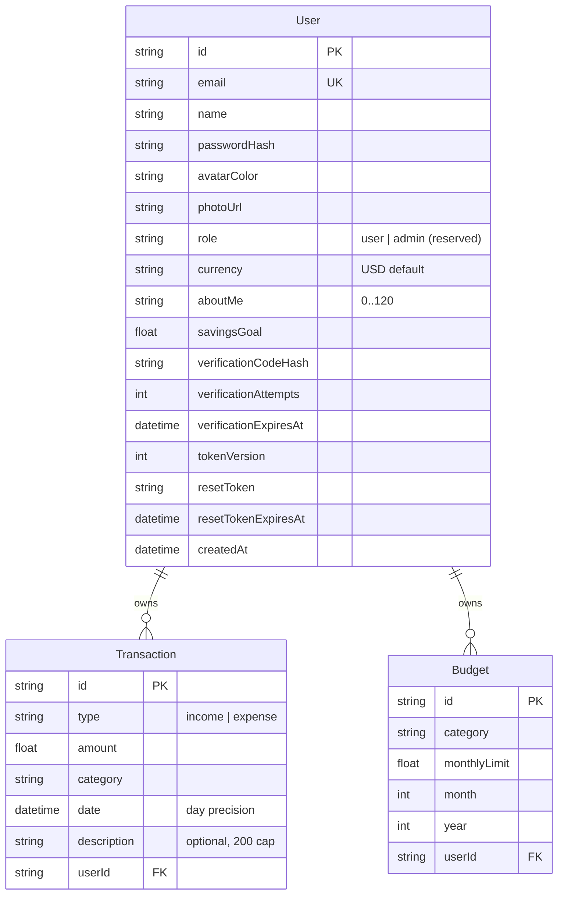

# Budget Wise — Complete Engineering Skill

> **What this is:** the single-source-of-truth engineering reference for the Budget Wise codebase. Use it to extend, debug, audit, onboard, or replicate the architecture. Every claim below was verified against the tree at the session-191 pin or live-probed against the reference app.

---

## Table of Contents

1. [Project Identity & Design Philosophy](#1-project-identity--design-philosophy)
2. [Tech Stack & Environment](#2-tech-stack--environment)
3. [Bootstrapping & Configuration](#3-bootstrapping--configuration)
4. [The Design System (Tailwind v4, CSS-First)](#4-the-design-system-tailwind-v4-css-first)
5. [Component Architecture & Patterns](#5-component-architecture--patterns)
6. [State Management — The ONE Store](#6-state-management--the-one-store)
7. [Data Model, Domain Math & Seeding](#7-data-model-domain-math--seeding)
8. [The API Layer — Route Handler Idiom](#8-the-api-layer--route-handler-idiom)
9. [Authentication & Authorization](#9-authentication--authorization)
10. [Accessibility Implementation](#10-accessibility-implementation)
11. [SEO, Metadata & PWA Surface](#11-seo-metadata--pwa-surface)
12. [Testing Strategy (three tiers, one law)](#12-testing-strategy-three-tiers-one-law)
13. [The Quality Gate](#13-the-quality-gate)
14. [Security Checklist](#14-security-checklist)
15. [Build, Artifact Hygiene & Deployment](#15-build-artifact-hygiene--deployment)
16. [Debugging Guide (symptom → root cause → fix)](#16-debugging-guide-symptom--root-cause--fix)
17. [Anti-Patterns & Common Bugs](#17-anti-patterns--common-bugs)
18. [Lessons Learnt & How to Avoid Them](#18-lessons-learnt--how-to-avoid-them)
19. [Pitfalls to Avoid](#19-pitfalls-to-avoid)
20. [Best Practices](#20-best-practices)
21. [Coding Patterns (with code)](#21-coding-patterns-with-code)
22. [Responsive & Layout Reference](#22-responsive--layout-reference)
23. [Color Reference (Complete)](#23-color-reference-complete)
24. [The TypeScript Contract Reference](#24-the-typescript-contract-reference)
25. [Appendix A — ADR Index](#appendix-a--adr-index)
26. [Appendix B — Pre-Ship Checklist](#appendix-b--pre-ship-checklist)
27. [Appendix C — Audit History](#appendix-c--audit-history)

---

## 1. Project Identity & Design Philosophy

**Budget Wise** is a self-hosted, single-deployable personal finance application — a functional superset of the Budget Wise reference app (`budget-wiser.base44.app`) with visual parity. It tracks income and expenses, sets per-category monthly budgets, and renders a live dashboard of the user's financial health.

**The four app pages** (capitalized hrefs, the reference's own routing):

| Route | Surface |
|---|---|
| `/Dashboard` | 4 KPI cards (Balance + savings badge, Income, Expenses, Transactions count), Spending-by-Category donut, Budget Progress bars, Spend Summary (This Week / This Year tabs + weekly bar chart), Recent Transactions, AI Insights |
| `/Transactions` | Total income/expenses summary, search, type + category filters, weekday-dated rows with tinted category icons, delete with AlertDialog confirmation |
| `/Budgets` | Overall Budget Usage dark card (progress + %), Active/On Track/Over Budget KPI cards, per-category budget cards with state-colored progress bars, empty state with "Set Your First Budget" |
| `/Profile` | Dark-header identity card with straddling avatar (photo upload), Preferences (currency, About Me 0/120, savings goal), pastel 3×2 Financial Overview grid, white 2026 Summary row |

Plus the public landing at `/`, the login card (four OAuth buttons + email/password + in-place signup/verify/reset views), and `/signup` (our documented superset — the reference 404s it).

**Non-negotiable principles:**

- **Parity with the reference, superset where it is broken.** Visual parity at desktop + phone axes; functional supersets must be invisible to pixels (the a11y naming on the bottom tab bar) or strictly additive (AI insights, the public landing, the working email/password funnels). Every deviation lives in the PAD's Known Issues.
- **The gate is the only gate.** No hosted CI exists — `bun run gate` must be green before any push.
- **Money math is server-side and unit-tested.** `/api/dashboard` computes every number the dashboard renders; the client never re-derives. Pure helpers live in `src/lib/budget-math.ts`.
- **Nothing reaches Prisma unvalidated.** Zod at every boundary; DB-bound checks (ownership, FK existence) stay route-side.
- **One deployable.** `next build` emits `.next/standalone` — the app boots anywhere Bun/Node runs with one SQLite file.

**Reference-state notes (live-verified 2026-10-27/28 — the twelfth consecutive zero-drift census confirmed at session 204):**
- The reference **redesigned its phone navigation** (session 193, 2026-10-27): a fixed bottom tab bar below md (`md:hidden fixed bottom-0 left-0 right-0 z-50 bg-white border-t border-slate-200 safe-area-pb`, active `text-slate-900` on BOTH the anchor and its svg / inactive `text-slate-400`, lucide icons `w-6 h-6`, labels `text-xs font-medium`) with **no footer** on the app surface. We byte-mirror the bar (the `BOTTOM_NAV` contracts) + the kept a11y superset (`aria-current` + the labelled landmark). Sessions 190–192 had shipped a drawer + hamburger as the superset while the reference had NO phone nav — retired when the redesign landed.
- The reference **restyled its entire surface system onto stock shadcn/ui** (session 194, 2026-10-27): per-page containers (7xl/5xl/5xl/4xl), sm-stacking plain-DIV headers with tracking-tight H1s, the h-9 stock Button/Card/Input/Select/Badge/Tabs forms, gradient KPI/summary/dark cards, divide-y transaction rows with description-first titles + category badges, the native currency select on Profile, and --primary as the neutral #171717. The shell rides the exact hierarchy `body (WHITE) > DIV > DIV.min-h-screen.bg-slate-50 > [NAV, bar, MAIN.pb-20 md:pb-0 > DIV.min-h-screen.bg-slate-50 > page]` (session 195: the outer surface wrapper puts slate-50 behind the translucent navbar — its white/80 backdrop renders rgb(254,254,255), not pure white) — the pb-20 clearance guarantees content clears the fixed bar below md. The category palette is the round-trip-probed set (food emerald+Utensils, transport blue, entertainment violet+Film, shopping amber, bills red+Receipt, healthcare cyan+Heart, education lime, other slate+Ellipsis; salary indigo, freelance purple+Wallet, investment teal, gift pink).
- The reference serves app HTML to guests (its platform's face). We ship a public landing + server-side `(app)` guard — the production-grade posture.
- The reference's demo data was reset to empty at the session-191 audit, then re-populated with a single food txn (−$1,000) from s193 through s199, then grew to 3 transactions / −$2,481.00 at the session-200 audit (Balance −$2,481.00 / Income $0.00 / Expenses $2,481.00 / 3 txns, a Bills & Utilities row first) — owner-data churn, data-borne, the excluded genus. Our seed keeps the original demo month ($5,000 Salary + $575.45 expenses across 4 transactions, balance $4,424.55, 88.5% saved) — README-documented.
- The reference's **404 title interpolates the unmatched path** (session 196, 2026-10-28, curl-verified in its served HTML): `<Humanized last non-empty path segment> | Budget Wise` — the humanize splits hyphens AND camelCase boundaries, capitalizing each token's first letter while preserving the rest (`/iPhoneCaseTEST` → "I Phone Case TEST", `/foo/bar` → "Bar", `/foo/` → "Foo"); the body quotes the pathname WITHOUT the leading slash. **The humanize DECODES percent-escapes first** (session 207, 2026-10-29, served-HTML curl-verified): `/Curl%20Probe%20207%20Test` → "Curl Probe 207 Test | Budget Wise", `/foo%2Dbar` → "Foo Bar | Budget Wise" (the decode precedes the hyphen split), malformed escapes bounce off the reference's CDN with a bare 400 while ours answers the designed 404 (the never-throw raw fallback in `decodeSegment()`); the 404 BODY keeps the raw encoded path on BOTH apps — the decode is title-path-only. We mirror it server-side: `src/proxy.ts` stamps `x-pathname` (the only way the unmatched path reaches the render — probed; renamed from middleware.ts at s201 — Next.js 16.4 deprecates that file convention) → `not-found.tsx` generateMetadata → `src/lib/not-found-title.ts`. The .jsx capital aliases MUST re-export the lowercase page's `metadata` — without it, /Transactions//Budgets//Profile silently serve the layout-default "Budget Wise" tab title (found live, invisible to every gate; /Dashboard is metadata-less BY DESIGN on both apps). The census-probe lesson: the s196 pin cases were all unencoded — probe a %20 path at least once per census or the decode genus regresses invisibly.
- The reference's OAuth buttons (Google, Microsoft, Facebook, Apple) redirect to real providers — unimplementable self-hosted. Ours render the full four-button row (visual parity) surfacing a not-configured `toast.info` (the documented boundary).
- **The body-children census caveat (session 198):** the shell-hierarchy form `body (WHITE) > DIV > DIV.min-h-screen…` starts at the APP SHELL — the body itself carries framework chrome on both apps. Ours (Next.js SSR): `body.children[0]` is React's `<div hidden><!--$--><!--/$--></div>` streaming-boundary marker on every server-rendered page (pending `<!--$?-->` + `<template>` on the 404), plus the Toaster portal + the route announcer. The reference (Vite SPA): `#root` + the platform's `#base44-edit-badge` + recharts' measurement span. Platform-face genus, NOT parity drift — invisible, a11y-excluded, identical in dev and the standalone build, pinned by no test (pinning framework output is the brittle genus). A `children[0]`-style body probe hits the hidden div first (the live undefined-property error that cost an investigation before the s198 classification).
- **The title-census methodology footnote (session 199):** the reference is a client-rendered SPA whose router updates `document.title` on full navigations — an in-browser `pushstate` probe reads the STALE title (observed: `/Transactions` answering "Budget Wise" via pushstate but "Transactions | Budget Wise" on the full navigation seconds later). Title censuses on the reference must use full navigations (or the served-HTML curl, which is what the s196 pinning used); a pushstate lag is a methodology artifact, NOT drift.
- **The raw option-value genus (session 203, first observation — pre-existing, invisible):** the reference's category `<select>`s carry internal ids `value="health"` (Healthcare) and REUSE `value="other"` across BOTH families (its income Other); ours carry `value="healthcare"` and disambiguate `value="other_income"` (our Zod union validates both families together, so the raw ids must not collide; the reference's own API may namespace per-type). The visible LABELS are byte-identical on both apps ("Healthcare", "Other") and the tab-swap behavior works on both — the value attribute is each app's internal DB/API wire id, never a parity surface. First observed at s203 because no prior census read VALUE attributes (labels/counts/tabs only). Do NOT "fix" ours to mirror the reference's ids — the raw ids are the stored-data contract (pinned by the Zod schemas, the unit suites, the seeded rows); renaming them breaks data with zero visible gain.
- **The tab keyboard-activation methodology footnote (session 203):** the reference's Add-Transaction Income tab does NOT activate under synthetic CLICKS (aria-selected stays "false" across settled attempts — the platform's tab binding does not take pointer events on the tab node), while keyboard activation (focus + Enter) flips it cleanly and the list swaps to the income family exactly per the documented contract. Same family as the s199 pushstate note: when a reference control appears inert under a synthetic click, verify via keyboard activation before classifying functional drift — the inert click is a probe artifact, NOT a broken control.
- **The VLM-battery flag-variance methodology note (session 204):** the VLM battery is a coarse parity SIGNAL, not a parity gate — its "Structural Differences: None" count varies run-to-run over an UNCHANGED DOM (observed: 4/4 None at s200/s201, 3/4 at s203, 0/4 at s204 — every s204 flag answering a documented DOM-disproven genus: the savings-badge conditional, the platform-badge occlusion, the platform badge, the avatar-content genus). Always cross-check every VLM flag against the round's direct byte-census before classification (the discipline every round since s195 has applied); a low None-count alone is never regression evidence.
- **The frame-capture state-order discipline (session 222, the TAB-STATE CAPTURE MISS):** a screenshot battery frame must capture its surface in the DEFAULT state — state-probing (tab flips, filter changes, form fills) runs AFTER the frame capture, never before, or re-open the surface fresh before the capture. The s222 round's first add-transaction-dialog frame captured the INCOME form (13,937 changed px, 12,144 above the 8-luminance threshold, spread across 396 columns — a state difference, not a rendering genus) because the Income-tab census had preceded it; the fresh-default-state recapture re-answered the exact blur-column genus md5 (`e5dd4c69`, 16px confined to the single x=590 column). Same family as the s217 capture-order lesson (frame before scroll) and the s221 parked-cursor/viewport/donut lessons: capture-state properties masquerade as whole-frame deltas, and the battery's own classification machinery (the above-threshold count + the spread pattern) is the guard that catches them.
- **The frame-capture origin-surface discipline (session 223, the ORIGIN-SURFACE CAPTURE MISS):** a dialog frame's ORIGIN SURFACE — the page the dialog was opened FROM — is part of its capture state. The s223 round's first add-transaction-dialog capture, taken with the dialog opened from the TRANSACTIONS page, answered a new md5 with 523,672 changed px (72,315 above the 8-luminance threshold, spread across 939 columns — the diff concentrated in the dimmed backdrop bands where the origin pages' content differs; the dialog's own white span was identical at x 532..979 in both frames). HEAD's frame is a DASHBOARD-origin capture — the s218 refresh note documents its blurred Dashboard backdrop. The Dashboard-origin recapture re-answered the exact blur-column genus md5 `e5dd4c69`. The discipline: pin each dialog frame to its documented origin (add-transaction-dialog is Dashboard-origin; set-budget-dialog is Budgets-origin), and classify the backdrop region before trusting a whole-frame delta — a state difference shows the multi-column spread signature, a rendering genus stays confined. The fifth capture-state lesson family member (after the s218 settle-waits, the s219 viewport re-pin, the s221 parked-cursor/viewport/donut family, and the s222 tab-state miss).
- **The genus-form-alternation discipline (session 224, the GENUS-FORM ALTERNATION ACROSS BOOTS):** a rendering genus can answer MORE THAN ONE documented form, and the form it answers can alternate across boots and across frames within a single round. The s224 round's two-boot proof caught the avatar-jitter genus's one-shot/HEAD-identical dichotomy BOOT-TO-BOOT (profile-mobile: the jitter mobile form `8c6e81e7` on boot 1, HEAD's exact bytes — zero changed px — on boot 2; both sub-threshold, both confined to the avatar bbox); the same round caught the blur-column genus alternating ACROSS FRAMES (set-budget-dialog carried the 16-px x=590 dark↔white column at its own y-offset where add-transaction-dialog answered HEAD's exact bytes — the mirror image of s223). The discipline: a delta frame's two-boot determinism claim holds per-FORM — the genus answers ONE OF ITS DOCUMENTED FORMS on any given boot; a boot-pair answering different forms is the genus's own dichotomy, NOT a capture-state miss. The distinguishing signature: the genus form is sub-threshold or single-column (zero or few px above the 8-luminance bar, a confined bbox, no multi-column spread) where a state difference answers tens of thousands of above-threshold px spread across hundreds of columns. The sixth capture-state lesson family member (the first evidence-class extension: the genus families themselves now document their form alternations).

---

## 2. Tech Stack & Environment

| Layer | Technology | Version floor | Notes |
|---|---|---|---|
| Framework | Next.js (App Router) | 16.4 | `output: "standalone"`; `outputFileTracingRoot` pinned to repo root; the build IS the type gate (no `ignoreBuildErrors`) |
| UI runtime | React | 19.3 | `"use client"` islands; no `forwardRef` needed; adjust-during-render for own-state resets |
| Language | TypeScript | 5.9 | `strict: true`; `tsc --noEmit` is a gate leg |
| Styling | Tailwind CSS | 4.3 | CSS-first `@theme` in `src/app/globals.css`; **no `tailwind.config.js` and there must never be one** |
| PostCSS | `@tailwindcss/postcss` | ^4 | The only plugin; missing it = pages render unstyled |
| Primitives | Radix UI (dialog, alert-dialog, select, tabs, dropdown, label, popover, slot) | current | Accessibility-complete overlays; never hand-roll focus trapping |
| Charts | Recharts | 3.10 | Donut + weekly bars; `accessibilityLayer={false}` |
| State | Zustand | 5.0 | ONE client store (`src/stores/budget-store.ts`) |
| ORM / DB | Prisma / SQLite | 6.19 | `DATABASE_URL="file:../db/custom.db"` (schema-relative); `src/lib/db-path.ts` normalizes |
| Validation | Zod | 4.6 | Every API boundary; bounded reader + CSRF content-type gate |
| Icons | lucide-react | 0.525 | Inherit stroke-2 defaults |
| Unit tests | Vitest | 5.0 | Node env; `*.test.ts` only; `@` alias |
| E2E | @playwright/test | 1.64 | Against the **production standalone build**; Chromium only; storageState auth |
| a11y engine | axe-core | 4.13 | The two-gate spec (structural zero + sanctioned contrast citations) |
| Runtime / PM | Bun | 1.3 | Script runner; the gate chain is bun-first |

**Environment contract (exactly six knobs — additions require an ADR):**

| Variable | Required | Purpose |
|---|---|---|
| `DATABASE_URL` | yes | `file:../db/custom.db` — RELATIVE to `prisma/schema.prisma` → `<repo>/db/` |
| `NEXT_PUBLIC_SITE_URL` | recommended | Canonical origin for metadata/sitemap/robots — **inlined at build time** |
| `AUTH_SECRET` | **production: hard requirement** | HMAC key for session cookies, ≥ 16 chars (`openssl rand -hex 32`); missing in prod fails at boot |
| `NEO_PROXY_HOPS` | prod-behind-proxy | Rate-limit IP trust depth (unset = 1; unparsable fails CLOSED to 1) |
| `NEO_DISABLE_IN_APP_OTP` | prod | `"1"` = stop returning verification codes in responses |
| `NEO_DISABLE_IN_APP_RESET` | prod | `"1"` = stop returning reset links in responses |

`.env` is git-ignored; `.env.example` mirrors the contract exactly and documents the PostgreSQL swap. The `NEO_*` prefixes survive from the CRM scaffold (documented deferred debt — renaming churns `.env.example` + docs for zero behavior).

---

## 3. Bootstrapping & Configuration

```bash
git clone https://github.com/nordeim/budget-wiser.git
cd budget-wiser
bun install                       # 537 packages
cp .env.example .env              # DATABASE_URL already correct; add AUTH_SECRET in prod
bun run db:push                   # schema → db/custom.db (repo-root db/)
bun run db:seed                   # idempotent demo data (the reference's demo month)
bun run dev                       # http://localhost:3000
```

Demo login: `sepnetflix2023@outlook.com` / `$Abcd1234`.

**The DATABASE_URL contract (read twice — it bit every sibling codebase):**

A relative `file:` URL resolves differently per reader: the Prisma CLI anchors at `prisma/schema.prisma`; a shell-inherited `DATABASE_URL` anchors at the CWD (unpredictable); Next's standalone `server.js` runs `process.chdir()` before your code loads.

1. `src/lib/db-path.ts` is the **only** sanctioned source of the runtime URL (the anchor chain: standalone-repo-root detector → module anchor validated on disk → CWD with existence guard). `db.ts` never reads `process.env.DATABASE_URL` directly.
2. `db-path.ts` is a pure seam with fixture tests (`tests/db-path.test.ts`) — the most-tested module in the tree.
3. npm scripts pin the environment: runtime scripts inline `DATABASE_URL=…`; Prisma CLI scripts strip it (`env -u DATABASE_URL prisma …`) so a polluted parent shell can never redirect the database.
4. **Symptom to memorize:** `Error code 14: Unable to open the database file` = wrong anchor or a shell env override — check `env | rg DATABASE` and the startup log line before touching code.

**Config files that carry non-obvious weight:**

| File | Locks in |
|---|---|
| `next.config.ts` | standalone output; tracing root; `outputFileTracingExcludes` (the artifact-hygiene cure — includes both `neo-crm_SKILL.md` and `budget-wiser_SKILL.md`); the three-header security set; `devIndicators: false` |
| `tsconfig.json` | strict TS; `@/*` → `src/*`; vendored non-app dirs excluded |
| `eslint.config.mjs` | next/core-web-vitals + next/typescript; React 19 hook rules (incl. `set-state-in-effect`) as **errors**; skills/ ignored |
| `vitest.config.ts` | `src/**/*.test.ts` + `tests/**/*.test.ts`; never matches Playwright's `*.spec.ts` |
| `playwright.config.ts` | setup project (one login → storageState); webServer = standalone build on its own port with its **own** pinned `DATABASE_URL` (`file:../db/e2e.db`); `workers: 1` is load-bearing (one shared SQLite file) |
| `postcss.config.mjs` | `@tailwindcss/postcss` only |

---

## 4. The Design System (Tailwind v4, CSS-First)

All tokens in `src/app/globals.css` `@theme`. **Literal hex values only** — no var() chains, no bare HSL triplets (a bare HSL triplet in `@theme` silently resolves to transparent).

**The v4 traps, all mitigated in-tree:**

1. **The default palette is oklch and drifts** from v3's compiled hexes — the re-pin block re-declares every literal (family, step) pair used in `src/` (slate, emerald, rose, indigo, amber…) at the v3 hex values. **Do not "clean these up"** — removing them drifts every chromatic surface.
2. **The shadow scale moved one notch** (v3 shadow-sm → v4 shadow-xs) — `--shadow-sm` is re-pinned to v3's computed `0 1px 2px 0 rgb(0 0 0 / 0.05)`. Same for `--blur-sm: 4px`.
3. **`hover:` wraps in `@media (hover: hover)`** — hovers no-op on touch. The `@custom-variant hover (&:hover)` declaration unwraps it (family-wide, live-proven divergence on the reference).
4. **Gradient utilities interpolate in oklab** — brand gradients use the `from-slate-900 to-slate-700` literal pair (slate family interpolates cleanly; do not introduce oklab-sensitive multi-hue gradients without checking computed output).
5. **Literal class strings only in source** — v4 scans for literals; dynamic `` `grid-cols-${n}` `` templates never compile. See the `GRID_COLS` static-map pattern in `tabs.tsx`.
6. **Never fight display utilities with the `hidden` attribute** — v4: `hidden` WINS. Mount/unmount instead.
7. **Radix animations** ride the vendored `src/app/vendor/tw-animate.css` (`data-[state=open]:animate-in` family) — Tailwind v4 does not ship these.
8. **Custom classes lose the cascade to arbitrary utilities** — an `shadow-[…]`/`rounded-*` utility on an element that also carries a custom component class silently loses. Override with a dedicated custom class or inline style.
9. **Preflight sets no `cursor: pointer` on buttons** — the base-layer rule exists in globals.css.
10. **`space-y-*` rewrote** (margin-block-end on `:not(:last-child)` vs v3's margin-top on `* + *`) — mirror reference rhythm with explicit `mt-*` on the later child; never stack `mt/mb` on children of `space-y` containers.

**The sanctioned token families (see §23 for the complete color reference):** slate neutrals, emerald = income/positive, rose/red = expense/negative, indigo = AI panel, amber = budget warning band.

**Class contracts live in `src/lib/page-layout.ts`** — pages consume the exported records (`SITE_NAV`, `KPI_CARD`, `PANEL`, `PAGE_HEADER`, `PAGE_ROOT`, `HEADER_BUTTONS`, `APP_FOOTER`, `MOBILE_NAV_SHEET`, `LOGIN_LAYOUT`, `LOGIN_SIGNUP_LAYOUT`, `LOGIN_RESET_LAYOUT`, `LOGIN_VERIFY_LAYOUT`, `DIALOG_*`, …). **New surfaces add a record, not inline strings** — `tests/app-chrome.test.ts` pins them.

---

## 5. Component Architecture & Patterns

### 5.1 The Layer Model

```
Layer 0: Prisma schema + db-path seam       — where the data lives. Never bypass the seam.
Layer 1: lib/ domain modules                — pure money math, vocabularies, Zod schemas. No I/O.
Layer 2: Route handlers (/api/*)            — guard → parseBody → ownership checks → Prisma → envelope.
Layer 3: Server components (app/*)          — session guard, metadata, the client island mount.
Layer 4: Client islands + the store         — pages/dialogs/charts; Zustand; the envelope client.
Layer 5: UI primitives (components/ui/*)    — Radix + shadcn patterns riding page-layout records.
```

**The Golden Rule:** money crosses Layer 2→4 exactly once per surface, pre-computed. Layers 1 and 5 are the only places new logic should accrete.

### 5.2 Directory Map

```text
src/
  app/
    (app)/                    # server-guarded app group (GuestLoginRedirect for guests)
      dashboard/              #   page.tsx (server wrapper) + dashboard-page.tsx (client island)
      Dashboard/page.jsx      #   the CAPITAL alias — MUST be .jsx (TS1149 on .ts same-program casing)
      transactions/ budgets/ profile/   # + their capital aliases
    (marketing)/              # /About + /Contact (auth-gated marketing pages)
    api/
      transactions/[id]/      # DELETE (ownership-scoped 404)
      budgets/[id]/           # PATCH (limit) + DELETE (confirm flow)
      dashboard/route.ts      # THE aggregate endpoint
      profile/route.ts        # GET projection + PATCH preferences
      auth/                   # login/signup/logout/me/verify/resend/forgot/reset
      health/ upload/ uploads/[name]/ reset/
    login/ signup/ reset-password/
    page.tsx                  # the PUBLIC landing (outside every guard)
    globals.css  icon.png  apple-icon.png  robots.txt/  sitemap.xml/  manifest.json/
    error.tsx global-error.tsx not-found.tsx not-found-body.tsx
  components/
    layout/app-shell.tsx      # sticky navbar + the mobile bottom tab bar
    layout/nav-config.ts      # the four items + isNavActive
    layout/login-card.tsx     # the multi-view auth card (signin/signup/verify/reset/forgot)
    layout/guest-login-redirect.tsx reset-password-screen.tsx
    shared/transaction-dialog.tsx  # Add Transaction (Expense/Income tabs swap vocabularies)
    shared/budget-dialog.tsx  # Set Budget + Delete-Budget AlertDialog
    charts/budget-charts.tsx  # SpendingDonut + WeeklyBars (recharts wrappers)
    landing/landing-page.tsx  # the public marketing surface
    ui/                       # button/input/select/dialog/tabs/alert-dialog/… (Radix)
  lib/                        # db-path, db, api, auth, password, rate-limit, verification*,
                              # login-reset, schemas, budget-math, categories, currency,
                              # page-layout, site, uploads, utils, boot-env, chunk-recovery
  stores/budget-store.ts      # the ONE client store
  types/index.ts              # the API wire shapes
prisma/                       # schema.prisma + seed.ts
tests/ + tests/e2e/           # the two test layers
scripts/                      # prisma-env wrapper + smoke-test.sh (the CRM-era sweep/census
                              # family was retired at s190; its package.json entries at s192)
db/                           # SQLite files (git-ignored)
```

### 5.3 The Route Casing Rule (an agent WILL guess wrong)

Nav hrefs are capitalized (`/Dashboard`, `/Transactions`, `/Budgets`, `/Profile`) — the reference's own form. Lowercase folders carry the implementation; the capital aliases are **`.jsx` re-export stubs**:

```jsx
// src/app/(app)/Dashboard/page.jsx — the TS1149 guard
export { default, metadata } from "../dashboard/page";
```

**Never make the alias a `.ts`/`.tsx` file** — TS1149 fires on same-program paths differing only in casing. The sitemap lists the real lowercase routes (our router is case-sensitive; the reference's platform is not — the documented s14/s18 decision).

### 5.4 Pattern 1 — the session guard (fix-over-defect)

```tsx
// src/app/(app)/layout.tsx — the guest never receives app HTML
export default async function AppLayout({ children }) {
  const user = await getSessionUser();
  if (!user) return <GuestLoginRedirect />;  // lands on /login?from_url=<abs>
  return <AppShell user={user}>{children}</AppShell>;
}
```

*Why:* the reference serves its data pages to guests (its platform's face); a self-hosted finance app must not. The client-side redirect shim preserves the reference's `from_url` round-trip while the decision stays server-side.

### 5.5 Pattern 2 — adjust-during-render form hydration

```tsx
// profile-page.tsx — the sanctioned React pattern for OWN-state resets
const [hydratedProfileId, setHydratedProfileId] = React.useState<string | null>(null);
if (profile && profile.id !== hydratedProfileId) {
  setHydratedProfileId(profile.id);
  setName(profile.name ?? "");
  // ... one setter per field, before the form paints
}
```

*Why:* `setState` inside an effect trips the lint rule and cascades renders; comparing the last-seen id renders the correction synchronously. (E2E tests that fill these fields must wait for hydration first — see §12.)

### 5.6 Pattern 3 — the app shell + the mobile bottom tab bar

`app-shell.tsx`: sticky `h-16` navbar (`bg-white/80 backdrop-blur border-b`), gradient slate-900→700 logo tile + "BudgetWise" wordmark, desktop pill row `hidden md:flex` (active `bg-slate-900 text-white`), and the **bottom tab bar** below md — the reference's redesigned phone nav, byte-mirrored (`BOTTOM_NAV` in page-layout.ts): `md:hidden fixed bottom-0 left-0 right-0 z-50 bg-white border-t border-slate-200 safe-area-pb`, items `flex flex-col items-center gap-1 px-4 py-2 rounded-xl transition-all` + active `text-slate-900` / inactive `text-slate-400`, lucide icons `w-6 h-6` (LayoutDashboard / ArrowLeftRight / Target / User), labels `text-xs font-medium`. OUR kept a11y superset: `aria-current="page"` + the labelled nav landmark. The bar is plain fixed chrome — NOT an overlay: no portal, no focus trap, no scroll lock, no matchMedia. The reference's app surface ships NO footer (the landing keeps its own). History: sessions 190–192 shipped a Radix drawer + hamburger as the superset while the reference had NO phone nav — both retired the moment the reference shipped its own bar (visible-pixel divergence).

---

## 6. State Management — The ONE Store

**Zustand, not React Query/SWR.** One client store (`src/stores/budget-store.ts`) holds the session user, transactions, budgets, dashboard aggregates, and profile. Actions call the API envelope then refresh the affected slices. `call()` (inside the store) is the only sanctioned JSON client.

**Rules:**

- Selector subscriptions (`useBudgetStore((s) => s.transactions)`) — no prop drilling of server data.
- The store hydrates once on shell mount (`React.useEffect(() => { void hydrate(); }, [hydrate])` — dropping this bootstrap once shipped a permanent "Loading…" state; the e2e battery caught it).
- A mutation triggers a 3-slice refresh (transactions + budgets + dashboard) — acceptable at personal scale; the server is the single truth.
- Money arrives pre-computed from `/api/dashboard` — the client never re-derives totals.

---

## 7. Data Model, Domain Math & Seeding

### 7.1 The Schema (Prisma)



Unique: `Budget (userId, category, month, year)` — the upsert key behind Set Budget (re-setting a category updates the limit). Indices: `Transaction (userId, date)`, `(userId, type)`, `(userId, category)`; `Budget (userId, year, month)`.

### 7.2 The Category Vocabularies (byte-matched to the reference)

- **Expense (8):** Food & Dining, Transport, Entertainment, Shopping, Bills & Utilities, Healthcare, Education, Other
- **Income (5):** Salary, Freelance, Investment, Gift, Other

Both vocabularies + their presentation metadata (lucide icons, tint classes) live in `src/lib/categories.ts` — single source; dropdowns, badges, donut legends, and Zod schemas all import the same arrays. **Never fork a category copy into a component.**

### 7.3 Money Math (`src/lib/budget-math.ts` — pure, unit-tested, importable both sides)

- **Two-decimal money rounding at every aggregate boundary.** The round1() era bug rendered $575.45 as $575.50 (caught by the e2e API probe) — every sum rounds through the two-decimal helper.
- `spentForCategory`, `remaining`, `pct`, `onTrack` (emerald < 80%, amber ≥ 80%, rose over), month ranges, week buckets (Mon–Sun), year-to-date rollups.
- Currencies: USD/EUR/GBP/CAD/AUD with symbols (`src/lib/currency.ts`) — display-layer formatting only.

### 7.4 Seeding (`prisma/seed.ts` — idempotent in place)

`deleteMany` domain tables → insert the canonical demo month (mirrors the reference's original demo data: one $5,000 Salary income on Oct 1, Other $400 on Oct 10, Transport $100 on Oct 25, Bills & Utilities $75.45 on Oct 26). User rows upsert by email so session cookies survive re-seeds. Route the seed through the db-path seam like the app — a bare `new PrismaClient()` seed bypasses it. **Never `rm` the db file under a running server** (the process keeps the deleted inode and serves stale data).

---

## 8. The API Layer — Route Handler Idiom

**The envelope, always:** `{ ok: true, data } | { ok: false, error: { code, message } }` — `ok()`/`ERR` from `src/lib/api.ts`.

```ts
// every mutating route handler — the sanctioned order
const guard = await requireSession();
if (isGuarded(guard)) return guard.response;        // 401 envelope
const parsed = await parseBody(req, schema);        // bounded reader (16KB) + CSRF content-type gate + Zod
if (!parsed.ok) return parsed.response;             // 400 envelope, pinned message
const existing = await db.transaction.findUnique({ where: { id } });
if (!existing || existing.userId !== guard.user.id) return ERR.NOT_FOUND("Transaction");
```

**Route map:**

| Route | Methods | Notes |
|---|---|---|
| `/api/transactions` | GET, POST | day-precision dates; type-scoped categories |
| `/api/transactions/[id]` | DELETE | ownership-scoped 404 (no existence leak) |
| `/api/budgets` | GET, POST | GET pre-joins spent; POST upserts (user, category, month, year) |
| `/api/budgets/[id]` | PATCH, DELETE | limit updates + the confirm-delete |
| `/api/dashboard` | GET | every dashboard number, computed server-side |
| `/api/profile` | GET, PATCH | identity + preferences + overview rollups |
| `/api/auth/*` | — | login, signup, logout, me, verify, resend, forgot, reset-password |
| `/api/health` | GET | the boot + db round-trip probe |
| `/api/upload` + `/api/uploads/[name]` | — | profile photos (validated names, no traversal) |

**Conventions:**

- **Ownership scoping answers 404, not 403** — a foreign id must not leak existence.
- **Error messages are pinned strings** — the unit + e2e suites assert exact user-facing words; changing one REDs tests by design. Update the pin and the string together.
- DB-bound checks (ownership, FK existence) stay route-side — a schema cannot express them.

---

## 9. Authentication & Authorization

Hand-rolled, minimal, audited (ADR-003) — no auth framework:

- **Passwords:** scrypt, 16-byte salt, 64-byte key (`src/lib/password.ts` — the one implementation; the seed imports it). A timing equalizer runs on the unknown-email branch.
- **Sessions:** HMAC-SHA256 signed cookies, 7-day TTL, HttpOnly, `tokenVersion` eviction dimension — a password reset kills every prior session.
- **Rate limits (per IP / 15 min):** login 10, signup 10, resend 5, verify 20. `NEO_PROXY_HOPS` declares the proxy trust depth; unparsable values fail CLOSED.
- **Email verification:** 6-digit OTP, hashed at rest, 5-attempt lockout, expiry — the full funnel with in-app delivery (disable with `NEO_DISABLE_IN_APP_OTP=1` in production).
- **Password reset:** SHA-256-hashed tokens at rest, single-use (atomic conditional `updateMany` consumption), 60-min TTL, no-enumeration 200s.
- **The login card is a multi-view state machine** (`src/lib/login-reset.ts`): signin ↔ signup ↔ verify ↔ forgot ↔ sent ↔ reset — the reference's in-place view swaps (URL stays `/login`), pinned by `tests/login-reset.test.ts` + `tests/login-views.test.ts`.
- **OAuth buttons:** the full four-button row (Google, Microsoft, Facebook, Apple) is visual parity; every button surfaces a not-configured `toast.info` (a real provider redirect is unimplementable self-hosted — the documented boundary, pinned family-wide by `tests/login-views.test.ts`).
- **Open redirect guard:** `resolveFromUrl` same-origin check — foreign origins fall back to `/Dashboard`.

Roles: `user` (default) and `admin` (reserved; no admin surface yet). All domain data is user-scoped at the query level.

---

## 10. Accessibility Implementation

- **Radix primitives are load-bearing:** dialogs expose `role="dialog"` + `aria-modal` + focus trap + focus return + Escape/overlay close; selects expose combobox/option trees. E2E locators depend on these roles — removing them breaks the suite (a feature, not a bug).
- **Every input has a `<Label>`**; icon-only controls carry `aria-label` ("Delete {category} transaction", "Open navigation menu").
- **The a11y two-gate (e2e):** axe-core structural violations must be **zero**; contrast flags must cite sanctioned palette matchers. Five genuine AA fixes shipped in session 190 (small slate-400→500 text, the emerald badge, the dark-card labels).
- **Select triggers need accessible labels** (the a11y spec caught the bare comboboxes).
- **Dialog Tabs need real panels** — `aria-controls` pointing at nonexistent ids flags `aria-valid-attr-value`.
- **Exit animations keep nodes mounted ~200–300ms** — automation (or a11y probes) asserting "closed" must settle-wait first.
- **44px touch floor on mobile bands** (document exceptions where the reference demands parity).
- **The bottom tab bar rides plain anchor semantics** — a labelled nav landmark + `aria-current` on the active item (OUR superset; the reference ships neither).

---

## 11. SEO, Metadata & PWA Surface

- **`src/lib/site.ts`** — the metadata factory: `siteUrl()` (NEXT_PUBLIC_SITE_URL seam, inlined at build), `SITE_DESCRIPTION` (the 405-char marketing paragraph, byte-matched), `pageMetadata({ page, route, title })` per-route canonical/OG/Twitter, `PWA_META` (mobile-web-app-capable + the apple pair — page-level metadata REPLACES the layout's `other` map, so every page re-declares them).
- **`/sitemap.xml`** — an explicit route handler (Next's sitemap.ts serializer DROPS the number formatting: "1.0" serializes as "1"). LF-only, 4-space URL indent, changefreq weekly, priority 1.0 for `/` and 0.8 for the rest, `application/xml`. Lists the real lowercase routes.
- **`/robots.txt`** — explicit route handler (Next's robots.ts serializer emits "User-Agent" with a capital A; the reference ships "User-agent"). `text/plain; charset=utf-8`.
- **`/manifest.json`** — explicit route handler (Next's serializer re-orders keys); `{name, short_name} "Budget Wise"`, two icon entries (192 + 512, same src), standalone display.
- **The 404 route's title is `Budget Wise`** (absolute — keeps the root layout's `%s | Budget Wise` template from doubling). The reference's 404 answers with the plain site title (live-verified). Pinned by `tests/metadata.test.ts`.
- **og-image.png** (1200×630) + icon.png/apple-icon.png ride the app-router file conventions.

---

## 12. Testing Strategy (three tiers, one law)

**The law: the dev server lies about production.** E2E runs against the production standalone build.

### Tier 1 — Unit (Vitest, 420 checks)

Domain math, vocabularies, Zod contracts, infra seams (db-path, auth, rate-limit, boot-env, metadata, pwa-metadata, http-headers, upload), chrome contracts (page-layout records, nav config, landing copy), the login view machine, error boundaries, the gate script. **TDD default at the pure seams** (red → green → refactor). Source-regex pins (the established pattern): read the component source and assert the contract — comments stripped where institutional memory may cite retired spellings.

### Tier 2 — E2E (Playwright, 68 checks)

Real UI against the standalone server on an isolated port + its own seeded `db/e2e.db`:

- `auth.spec.ts` — walls + login/logout round trips (logged-out surface opts out of storageState)
- `app-flows.spec.ts` — every CRUD round trip, the dialogs, filters, the profile form
- `mobile-navigation.spec.ts` — **the 10-check bottom-bar battery** (the parity surface's guard: renders on every app page, viewport-anchored fixed, navigation round-trip, the active item's ink + aria-current, the desktop pill split, the never-locked body scroll, no hamburger, absent on login, hidden at md, capitalized hrefs)
- `a11y.spec.ts` — the axe two-gate
- `landing.spec.ts`, `reset-password.spec.ts` — the public surface + the full reset funnel

**Load-bearing details:**

- Auth rides a saved storageState (one setup-project login) — per-test logins would trip the rate limiter.
- `workers: 1` — the specs share one SQLite file.
- **Tests that fill async-hydrated forms MUST wait for hydration first** — a fill racing the controlled-value re-render appends instead of replaces (the profile savings-goal e2e bug, session 190).
- Repeated local runs can trip the in-memory limiter — export `CI=1` (fresh server = fresh buckets) or wait out the 15-min window.

### Tier 3 — Smoke (bash ladder, 14 checks)

Boots the standalone artifact on :3210 with a scratch `db/smoke.db` and a throwaway AUTH_SECRET: health, auth walls, login + cookie, sessioned reads, invalid-payload 400, valid create, logout invalidation, the rate-limit 429, the SEO family (sitemap/robots/manifest), the secretless-boot refusal, and **artifact hygiene** (no .env/.git/db/skills/docs/uploads inside the deployable).

**Count lockstep:** test totals are documentation claims — when a count changes, `rg "<old number>"` the whole doc set (README, AGENTS.md, CLAUDE.md, PAD, this skill) in the same commit.

---

## 13. The Quality Gate

```bash
bun run lint            # eslint . --max-warnings 0 (hook rules are errors)
bun run typecheck       # tsc --noEmit
bun run test            # full unit suite (420)
bun run build           # clean compile + standalone assembly (the type gate enforcer)
./scripts/smoke-test.sh # 14 checks against the artifact
CI=1 bun run test:e2e   # 68 checks against the artifact
# — or all of it: bun run gate
```

- **Order matters** (fast gates first). `CI=1` on the e2e leg forces a fresh server (the stale-reuse hazard).
- **Never weaken a guardrail to make a gate pass** — no disabled lint rules, no loosened types, no skipped hooks, no deleted tests. A green gate achieved by weakening the gate is not green.
- **Fresh-clone verification** is a periodic gate: a clean `install → db:push → db:seed → dev` and `install → typecheck → build` must work from a pristine clone.
- Run the gate before every push. There is no hosted CI — the local gate is the only gate.

---

## 14. Security Checklist

- [ ] All external input validated (Zod at every boundary) — bodies, query params, uploads
- [ ] Parameterized queries only (Prisma) — never string-concatenated SQL
- [ ] No `dangerouslySetInnerHTML` anywhere; React escapes render text by default
- [ ] Passwords: scrypt + per-user salt + constant-time compare; pure crypto seam
- [ ] Sessions: HMAC-signed, httpOnly, sameSite=lax, secure in prod, TTL bounded, tokenVersion revocation on reset
- [ ] Reset tokens hashed at rest, single-use, atomic consumption, 60-min TTL
- [ ] Rate limits on every auth endpoint; proxy trust depth fails CLOSED
- [ ] Foreign ids answer 404 (no existence leak); ownership checked before every mutation
- [ ] The bounded reader (16KB) + content-type CSRF gate on every mutating route
- [ ] Production boots fail without AUTH_SECRET (instrumentation → boot-env)
- [ ] The artifact ships no secrets (tracing excludes + the build's `rm -f .next/standalone/.env` + smoke check 14)
- [ ] Uploads: validated names, no traversal (`src/lib/uploads.ts`)
- [ ] Open redirect guard on `from_url` (same-origin or fall back to `/Dashboard`)
- [ ] No secrets in the tree; `.env` git-ignored; keys never live inside the repo (push via the SSH wrapper)

---

## 15. Build, Artifact Hygiene & Deployment

```bash
bun run build    # next build + copy static/public into standalone + rm the .env copy
DATABASE_URL="file:/absolute/path/to/custom.db" \
AUTH_SECRET="$(openssl rand -hex 32)" \
NODE_ENV=production PORT=3000 \
  bun .next/standalone/server.js
```

- **Artifact hygiene (ADR-008):** `outputFileTracingExcludes` keeps .env/.git/db/uploads/skills/docs/tests/scripts + every root .md out of the deployable (~151 MB, not ~550 MB). New repo-root files must join the exclude list (this skill file did). Smoke check 14 polices it forever.
- **The db-path seam** resolves the relative URL correctly for the standalone server regardless of CWD — use an ABSOLUTE `DATABASE_URL` in production anyway (docs/DEPLOYMENT.md §4).
- **The security trio** (Referrer-Policy, X-Content-Type-Options, HSTS) ships on every response via `next.config.ts` headers().
- **The boot gate:** no AUTH_SECRET in production = refuse to serve, log names the variable and the openssl command.

---

## 16. Debugging Guide (symptom → root cause → fix)

| Symptom | Root cause | Fix |
|---|---|---|
| `PrismaClientInitializationError: unable to open database file` at a parent-of-repo path | Wrong anchor: shell-exported `DATABASE_URL` or an absolutized dev path | Keep the URL relative; check `env \| rg DATABASE`; the db-path seam + `env -u` script discipline handle it |
| A page renders permanently as "Loading…" | The store's `hydrate()` bootstrap was dropped from the shell | Restore the mount effect in `app-shell.tsx` |
| Money renders one decimal off ($575.45 → $575.50) | Aggregate rounding at the wrong boundary | Route every sum through the two-decimal helper in `budget-math.ts` |
| E2E form fill appends instead of replaces | The fill raced the controlled-value re-render (async hydration) | Wait for hydration before filling (the profile-form pattern) |
| Hover styles no-op on touch | Tailwind v4's `@media (hover: hover)` wrap | The `@custom-variant hover (&:hover)` unwrap in globals.css — never remove it |
| Colors drift 1–3 units from the reference | v4's oklch default palette | The v3 re-pin block in globals.css — never "clean it up" |
| `shadow-sm` renders one step too heavy | v4 renamed the shadow scale | The `--shadow-sm` re-pin — leave it |
| A dialog's focus restoration breaks | A stray `DialogPrimitive.Title` outside `DialogContent` broke the context (the retired drawer's original bug — the class generalizes) | Keep every dialog piece inside Content |
| E2E login 429s on repeated runs | The in-memory rate buckets survive a reused server | `CI=1` (fresh boot) or wait out the 15-min window |
| Test fails on a pinned string you just changed | The pin is the contract | Update the pin and the string together, same commit |
| Capital route alias fails TS1149 | The alias is a `.ts` file | Capital aliases are `.jsx` re-export stubs only |
| The a11y spec flags a bare combobox | Select trigger lacks an accessible label | `<SelectTrigger aria-label>` or a visible `<Label>` |
| 404 page shows the wrong product name | A retired-brand absolute title survived a domain transformation | `title: { absolute: "Budget Wise" }`; pinned by metadata tests with comments stripped |
| Dev server reload-loops (hundreds of page re-fetches; form fills wiped) | Turbopack dev watching a `.next` tree last written by the production compiler — concurrent, killed half-into, **or cleanly completed then booted onto** (hit live s197 after a plain gate-then-dev sequence) | The `dev` script's preflight (`scripts/dev-preflight.ts`) removes the stale production tree before boot (the BUILD_ID + live-lock-pid marker pair); if already looping: stop dev, `rm -rf .next`, restart |

---

## 17. Anti-Patterns & Common Bugs

1. **Never hand-write class strings in pages** — consume `page-layout.ts` records; add a record for new surfaces.
2. **Never fork an enum copy into a component** — import the vocabulary arrays from `categories.ts`.
3. **Never derive money client-side** — the dashboard endpoint is the single truth.
4. **Never make a capital route alias `.ts`/`.tsx`** — TS1149.
5. **Never use the `hidden` attribute against display utilities** — v4: `hidden` wins; mount/unmount instead.
6. **Never emit dynamic class template strings** — v4 scans literals; use static maps (`GRID_COLS`).
7. **Never swallow an error to make a gate pass** — fix the code or flag the debt explicitly.
8. **Never weaken a lint rule / type / assertion to ship** — a weakened green is not green.
9. **Never edit `package.json` dependencies by hand** — `bun add`/`bun remove`/`npm pkg set` only.
10. **Never commit secrets or db files** — the .gitignore covers db/; keys live outside the repo.
11. **Never bypass `db-path.ts`** — a bare `new PrismaClient()` (seed, script) lands on the wrong database.
12. **Never `rm` the db file under a running server** — the process serves the deleted inode.
13. **Never leave placeholder values in deliverables** — no TODO, no lorem, no fake keys.
14. **Never ship a retired brand in user-facing strings or titles** — the session-191 purge class; comments may cite history, shipped metadata may not.
15. **Never trust the dev server for production behavior** — the e2e doctrine: validate what ships.

---

## 18. Lessons Learnt & How to Avoid Them

1. **The reference can change under you.** The login card's OAuth row was ONE button at the session-190 audit and FOUR at session-191; the demo data reset to empty between sessions. Re-audit live surfaces each round; pin what parity means at audit time.
2. **A domain transformation leaks.** The CRM's name survived in package.json, the 404 title, config comments, and dead PDF-export modules for an entire session. Post-transformation, sweep `rg "<old brand>"` across every config + user-facing surface — and pin the purge with tests.
3. **The regex pin catches comments too.** A source-regex assertion over a file with institutional-memory comments needs comment stripping — else the pin reds on its own documentation.
4. **The one-of-four parity gap hides in plain sight.** Structure snapshots matched; only the VLM side-by-side surfaced the missing three OAuth buttons. Use both census layers (a11y tree + visual compare).
5. **Dead code compounds.** pdf-export.ts dragged two heavy dependencies (jspdf, html2canvas-pro) with zero consumers. Run the dead-import census periodically; remove through the package manager.
6. **The store bootstrap is invisible until it is missing.** Dropping one `useEffect` shipped a permanent loading state — the e2e suite is the safety net; keep it green before every push.
7. **Rounding boundaries are product decisions.** round1 vs round2 was a $0.05 visible bug. Money rounds at exactly one place: the aggregate helper.
8. **The fill-vs-hydration race is systemic.** Any controlled input fed by an async fetch can append instead of replace under a racing fill. Tests wait for hydration first; production uses adjust-during-render.
9. **Focus machinery is all-or-nothing.** One stray Radix primitive outside Content breaks the whole dialog context. Keep dialog anatomy canonical.
10. **The artifact grows silently.** Every new repo-root file must join `outputFileTracingExcludes` — the smoke hygiene check is the police; the excludes list is the law.

---

## 19. Pitfalls to Avoid

- **Do not touch `src/lib/db-path.ts`** — the seam that keeps every consumer on the right database (pinned by tests).
- **Do not touch the `@theme` re-pin blocks** (palette, shadow, blur, hover variant) — they ARE the parity.
- **Do not touch `scripts/smoke-test.sh`'s assertion ladder** — the ship gate's smoke leg.
- **Do not touch the `.jsx` capital-route aliases** — the TS1149 guard.
- **Do not touch `next.config.ts`'s `outputFileTracingExcludes`** — the artifact-hygiene cure.
- **Do not add a `tailwind.config.js`** — CSS-first is the contract.
- **Do not set `typescript.ignoreBuildErrors`** — the build is the type gate.
- **Do not introduce a second font-loading path** — system stack only.
- **Do not create feature branches** — main only, pushed via the SSH wrapper after the gate.
- **Do not hotlink the reference's hosted assets** (its logo JPEG, its CDN icons) — mirror them locally as inline SVG with the same structure.

---

## 20. Best Practices

- **Read the four root docs before working:** README (users), AGENTS.md (agents — the compact command + fact file), CLAUDE.md (the six-phase workflow), PAD (architecture + ADRs + known debt).
- **Append every session to `worklog.md`** — never overwrite.
- **Conventional Commits, atomic units** — the message explains why.
- **Comments explain WHY with evidence** (live-probe findings, session citations); delete stale ones when the code they describe changes.
- **Count the things** (routes, tests, checks, env vars) and keep the numbers true across the doc set.
- **TDD at the pure seams; e2e pins for user-visible surfaces.**
- **When cloning behavior from the reference:** census the a11y tree AND the computed styles AND the visual (VLM) — three layers, because each catches a class the others miss.
- **When a test pins a string you must change:** change the pin and the string in the same commit.
- **Re-run the full gate after ANY change** — five legs, no exceptions before push.

---

## 21. Coding Patterns (with code)

### 21.1 The Zod schema family (`src/lib/schemas.ts`)

```ts
export const transactionCreateSchema = z.object({
  type: z.enum(["income", "expense"]),
  amount: z.number().positive("Amount must be greater than 0"),
  category: z.string().min(1, "Category is required"),
  date: z.string().datetime(),           // day precision, normalized server-side
  description: z.string().max(200).optional(),
});
// parseBody applies it inside the bounded reader + CSRF gate
```

### 21.2 The static-map pattern for dynamic variants

```ts
// tabs.tsx — v4 scans for literals; a template string NEVER compiles
const GRID_COLS = { 2: "grid-cols-2", 3: "grid-cols-3", 4: "grid-cols-4" } as const;
<div className={GRID_COLS[cols]} />
```

### 21.3 The adjust-during-render reset (see §5.5)

### 21.4 The dialog anatomy (canonical Radix)

```tsx
<DialogPrimitive.Root open={open} onOpenChange={setOpen}>
  <DialogPrimitive.Trigger asChild>{trigger}</DialogPrimitive.Trigger>
  <DialogPrimitive.Portal>
    <DialogOverlay />
    <DialogPrimitive.Content className={DIALOG_LAYOUT.content}>
      <DialogPrimitive.Title className={DIALOG_LAYOUT.title}>…</DialogPrimitive.Title>
      <DialogPrimitive.Description className={DIALOG_LAYOUT.description}>…</DialogPrimitive.Description>
      {/* the form */}
      <DialogPrimitive.Close className={DIALOG_LAYOUT.close}>…</DialogPrimitive.Close>
    </DialogPrimitive.Content>
  </DialogPrimitive.Portal>
</DialogPrimitive.Root>
```

*Every piece inside Content; the trigger is a real Trigger (focus restoration); Title + Description always present (a11y).*

### 21.5 The not-configured OAuth fallback family

```tsx
<button type="button" className={LOGIN_LAYOUT.google}
  onClick={() => toast.info(
    "Microsoft sign-in not configured",
    "This self-hosted clone uses email and password sign-in (demo credentials in the README).",
  )}>
  <div className={LOGIN_LAYOUT.googleIcon}><MicrosoftIcon /></div>
  <span>Continue with Microsoft</span>
</button>
```

*One anatomy for all four providers; brand SVGs are aria-hidden (the text carries the name); never a real provider redirect.*

### 21.6 The local brand-mark mirror (no hotlinks)

```tsx
function BudgetWiseLogoMark() {
  return (
    <svg viewBox="0 0 96 96" className="h-full w-full" aria-hidden="true">
      <rect x="18" y="44" width="10" height="16" rx="2" fill="#2563eb" />
      {/* …four ascending bars… */}
      <text x="44" y="72" textAnchor="middle" fontSize="9.5" fontWeight="700"
        letterSpacing="0.5" fill="#0f172a" fontFamily="ui-sans-serif, system-ui, sans-serif">
        BUDGET WISE
      </text>
    </svg>
  );
}
```

*Structure mirrors the reference's hosted logo (bars + wordmark in the ringed badge); the bytes are ours.*

---

## 22. Responsive & Layout Reference

| Breakpoint | Behavior |
|---|---|
| `< 768px` (base) | The bottom tab bar appears (`md:hidden` — the reference's redesigned phone nav, byte-mirrored); the desktop pill row is `display:none` (the reference's own split); single-column grids |
| `≥ 768px` (md) | Desktop pill row; the bottom bar is `display:none` |
| `≥ 1024px` (lg) | The dashboard's 4-col KPI grid; the 2-col panel rows (donut 7 / insights 5) |
| `≥ 1280px` (xl) | max-w-7xl container breathes |

**Layout constants:** the document scrolls at the WINDOW level (`min-h-screen bg-slate-50`, sticky navbar, NO footer on the app surface — the reference's own redesign; the landing keeps its own). No scroll locks anywhere (the drawer's body lock was retired with the drawer). The page container: `max-w-7xl mx-auto px-4 sm:px-6 lg:px-8 py-8`.

**Z-index is a flat documented scale** — navbar `z-50`, the sheet `z-50`, overlays `z-50` (Radix portals to body), toasts above. No `z-[9999]`.

---

## 23. Color Reference (Complete)

| Role | Token / class | Value |
|---|---|---|
| Page background | `bg-slate-50` | #f8fafc |
| Surface | white cards | #ffffff |
| Foreground / brand | `text-slate-900` / active pill `bg-slate-900` | #0f172a |
| Brand gradient | `from-slate-900 to-slate-700` (logo tile) | |
| Muted text | `text-slate-500` (AA on white) | #64748b |
| Line | `border-slate-200` / `border-slate-100` (cards) | #e2e8f0 / #f1f5f9 |
| Income / positive | `text-emerald-600`, tint `bg-emerald-50/40`, badge `text-emerald-700` (AA) | |
| Expense / negative | `text-rose-600`, tint `bg-red-50/40` | |
| AI panel | `bg-indigo-50/30` + `border-indigo-100/50` | |
| Budget bar bands | emerald (healthy) → amber (≥80%) → rose (over) | |
| Login submit | `bg-slate-900` hover `bg-slate-800` | |
| OAuth buttons | white bg, `border-slate-200`, slate-700 text | |
| Scaffold-era brand (login logo bars) | #2563eb / #1d4ed8 (blue-600 family) | |

All literal (family, step) pairs resolve through the v3 re-pin block in `globals.css`.

---

## 24. The TypeScript Contract Reference

The API wire shapes live in `src/types/index.ts` (named domain types — `User`, `Transaction`, `Budget`, `DashboardData`, `ProfileData`). Strict mode; no `any` (`unknown` instead); `interface` for object shapes, `type` for unions. The build is the type gate — there is no `ignoreBuildErrors` escape.

---

## Appendix A — ADR Index

| ADR | Decision | One-line rationale |
|---|---|---|
| 001 | Next.js App Router + standalone output | One deployable, server-side session guard |
| 002 | SQLite via Prisma, schema-relative DATABASE_URL | Zero-config dev, portable prod; the seam defeats the anchor bugs |
| 003 | scrypt + HMAC cookie sessions (no framework) | Self-hosted, evictable, no dependency sprawl |
| 004 | One Zustand store; server-derived money math | One truth; the client never disagrees about money |
| 005 | Tailwind v4 CSS-first, v3 palette re-pinned | Visual parity survives upgrades |
| 006 | The mobile navigation — from documented superset to byte-mirrored parity (s193) | The phone nav matches the reference's redesigned bottom bar |
| 007 | Deterministic AI Insights (no external LLM) | Hermetic production build |
| 008 | Artifact hygiene via tracing excludes | A deployable carrying its own .env is an incident |

(Full ADRs with consequences + rejected alternatives: `Project_Architecture_Document.md` §1.3.)

## Appendix B — Pre-Ship Checklist

```bash
bun run gate                 # lint → typecheck → test (420) → build → smoke (14) → e2e (68)
rg "TODO\|FIXME\|lorem" src/ # zero placeholders
rg "console\.log" src/       # zero debug output (console.error in sanctioned handlers only)
git status                   # no secrets, no db files, no stray artifacts
```

- [ ] The full gate is green (all six legs)
- [ ] Test counts updated in README + AGENTS + CLAUDE + PAD + this skill (count lockstep)
- [ ] No lint suppressions, no weakened assertions, no `any`
- [ ] `rg "<retired brand>"` clean in shipped surfaces (comments may cite history)
- [ ] The dead-import census is clean (no zero-consumer modules or deps)
- [ ] **The dead-script census is clean** (the session-192 guard in `tests/gate-script.test.ts`: every script's repo-local file target exists + every `bun run <name>` resolves — a removed file's package.json entry is a landmine the string-pinning tests will NOT catch)
- [ ] New repo-root files joined `outputFileTracingExcludes`
- [ ] Screenshots refreshed under `docs/screenshots/` if visuals changed
- [ ] worklog.md appended; Conventional Commit message explains why
- [ ] Push via `docs/ssh_git_wrapper_v3.py` (main only; remote ref verified; key shredded)

## Appendix C — Audit History

| Session | Round | Headline |
|---|---|---|
| 190 | The domain transformation | NEO CRM → Budget Wise: schema swap, six domain routes, four pages + dialogs + charts, the mobile-nav superset, 374 unit + 61 e2e + 14 smoke green, VLM parity verified, two commits pushed to main |
| 191 | The remediation round | The retired-brand purge (404 title, package identity, config comments), the four-button OAuth row, the login brand mark, the AI-Insights copy true-up, dead-code retirement (pdf-export/download/format + jspdf/html2canvas-pro), 382 unit + 61 e2e + 14 smoke green, live re-audit of every reference surface, this skill distilled |
| 192 | The session-3 re-audit round | Zero reference drift re-confirmed; VLM parity None/None (login + dashboard); the dead-script retirement (six CRM-scaffold package.json entries incl. the broken `gate:full` composite) + the dead-script guard born green; the dev-vs-build `.next/` race hazard documented (README + AGENTS); 382 unit HELD + 61 e2e + 14 smoke green; the screenshot battery recaptured (8/13 byte-identical — render-stability evidence) |
| 193 | The session-4 mobile-parity round | **The reference's first structural drift**: its phone-nav redesign (a fixed bottom tab bar below md, no footer, /About + /Contact removed, Profile icon unified on lucide-user) mirrored byte-for-byte — the `BOTTOM_NAV` contracts + the `safe-area-pb` v4 utility + the kept aria-current superset; the drawer/hamburger/APP_FOOTER family retired with ADR-006 superseded; the e2e battery rewritten test-for-test; the a11y sanctioned register extended for the reference's own slate-400 inactive ink; 381 unit + 61 e2e + 14 smoke green; VLM parity None/None/None (mobile dashboard/login/budgets) |
| 194 | The session-5 full-surface restyle round | **The reference's second structural wave**: every app surface restyled onto stock shadcn/ui — the shell hierarchy re-mirrored (`body WHITE > DIV > [NAV, bar, MAIN.pb-20 > min-h-screen]`, the pb-20 bar-clearance), the stock Button/Card/Input/Select/Badge/Tabs families, per-page containers + sm-stacking headers, the gradient KPI/summary/dark cards, divide-y rows with description-first titles, the restyled Profile + dialogs, the category palette re-pinned by a live round-trip probe (the owner's data restored verbatim), the chart geometry re-tuned, --primary → the neutral #171717; 387 unit + 62 e2e + 14 smoke green; VLM parity None/None/None/None (dashboard/budgets/profile/login) |
| 195 | The session-6 shell-surface round | **The reference's third shell restyle**: an outer `min-h-screen bg-slate-50` wrapper now encloses [NAV, bar, MAIN] — slate-50 behind the translucent navbar (pixel-sampled rgb(254,254,255) vs our rgb(255,255,255) pre-fix) and behind the phone clearance strip. Mirrored via `SHELL_LAYOUT.outer` (+1 unit pin); the bar anatomy, clearance (764 ≤ 767), and every page surface re-verified unchanged; the VLM battery's two first-run flags both disproven by DOM probes (the platform badge occluding tabs 3–4; the data-borne Balance-badge null-savings conditional); 388 unit + 62 e2e + 14 smoke green; VLM None/None/None/None |
| 196 | The session-7 title-surface round | **Zero structural drift re-confirmed + TWO title-family breaks fixed (both invisible to every prior gate)**: the 404's interpolated humanized title (`<Humanized last segment> | Budget Wise`, served in the reference's HTML head — mirrored via the NEW x-pathname middleware stamp + generateMetadata + the pure not-found-title helper; the quoted path's leading slash stripped) and the capital-alias metadata drop (the .jsx stubs re-exported only the default — /Transactions//Budgets//Profile served "Budget Wise" instead of "<Page> | Budget Wise"; fixed with the metadata re-export, mutation-proofed). The client document.title approach probed and DISCARDED (the metadata reconciliation re-applies over it during hydration). 401 unit + 66 e2e + 14 smoke green; VLM None/None/None/None + the dialog spot-check None |
| 197 | The session-8 dev-boot guard round | **The dev-vs-build `.next` race hit LIVE, then guarded at the boot seam** — after the gate's `next build` completed CLEANLY, booting `bun run dev` looped (646 page re-fetches); the documented wording had under-described the genus (the sequence trigger). Remediated: `scripts/dev-preflight.ts` rides the `dev` script and removes the stale production tree before boot (the live-probed marker pair: top-level `.next/BUILD_ID` = production-written; `.next/dev/lock` `{pid,port}` = dev-owned; never cleans under a live server — the lock-pid signal-0 check). All three decision branches live-verified (clean 0-loops / none untouched / pass-through tree-intact); mutation-proofed wiring pin. The FIFTH consecutive zero-drift reference census (shell, pages, bar byte-identical, dialogs, titles, 404, sitemap/robots); VLM 3× None + 1 known-genus pair; the screenshot battery 10/12 byte-identical across THREE generations. 410 unit + 66 e2e + 14 smoke green |
| 198 | The session-9 verification round | **The SIXTH consecutive zero-drift census + the body-chrome genus note** — every parity surface re-verified byte-identical on both apps (shell, pages, bar, clearance 764 ≤ 767 both, dialogs, titles, 404 interpolated title, SEO surfaces, donut geometry, row anatomy); the dev-boot guard live-verified on BOTH of the round's build→dev sequences (0 reload loops each); VLM 3× None + the known DOM-disproven genus pair; the screenshot battery 10/12 byte-identical + the two dialog frames within 6 bytes at 0.001% pixel diff (captured from their canonical origin pages). The round's one finding (F-1, informational): the hidden React streaming div at `body.children[0]` — present on every SSR page in dev AND the standalone build, invisible, a11y-excluded, structurally impossible on the reference's Vite SPA — classified platform-face genus and documented (AGENTS.md architecture fact + the SKILL §1 caveat + the PAD census note) so future body-children censuses don't re-investigate or mis-classify it. A docs-only round: zero code changes, counts HELD at 410/66/14 |
| 199 | The session-10 verification round | **The SEVENTH consecutive zero-drift census** — every parity surface re-verified on both apps (shell, pages, bar byte-identical on every dimension, clearance 764 ≤ 767 both, dialogs, all titles via full navigations, the 404 interpolated title served in the reference's HTML head, SEO surfaces, donut geometry, row anatomy, the data state); the dev-boot guard live-verified on the round's build→dev sequence (0 reload loops, ready in 271ms, health 200, the marker surviving); VLM 2× "Structural Differences: None" (budgets mobile, profile mobile) + the two dashboard pairs' flags all the documented data-borne genus (DOM-disproven by the direct byte-census); the screenshot battery 10/12 pixel-identical + the two dialog frames at 0.0011%/0.0064% pixel diff (the antialiasing jitter genus) — render-stability evidence across another generation. The round's one methodology note (informational): the reference SPA's title reads lag a `pushstate` navigation — title censuses must use full navigations (recorded in the SKILL §1 + this plan). A docs-and-evidence-only round: zero code changes, counts HELD at 410/66/14 |
| 200 | The session-11 verification round | **The EIGHTH consecutive zero-drift census + the VLM battery's cleanest result** — every parity surface re-verified on both apps (shell, pages, bar byte-identical on every dimension incl. rect y=767 h=77, clearance 764 ≤ 767 measured per the e2e contract on BOTH apps, both dialogs, all titles via full navigations, the 404 interpolated title, sitemap format + robots, login card, donut geometry 200×200 + 331 legend, row anatomy); the dev-boot guard live-verified on the round's build→dev sequence (health 200, no reload loop); VLM 4/4 "Structural Differences: None" (dashboard desktop + mobile, budgets mobile, profile mobile) — the first fully-clean battery in the project's history; the screenshot battery 11/12 pixel-identical + the profile-mobile frame at 0.0004% pixel diff (the avatar jitter genus) — the strongest render-stability signal yet. The round's one data note (informational): the reference's demo data grew to 3 transactions / −$2,481.00 (owner-data churn — data-borne, the excluded genus; recorded as the fresh census baseline). An evidence-and-documentation round: zero code changes, counts HELD at 410/66/14 |
| 201 | The session-12 verification round | **The NINTH consecutive zero-drift census (the data state UNCHANGED from the s200 baseline) + TWO remediations: the middleware→proxy convention rename + the stale-count true-up.** Every parity surface re-verified on both apps (shell, pages, bar byte-identical incl. rect y=767 h=77, clearance 764 ≤ 767 both, both dialogs, all titles via full navigations, the 404 interpolated title, sitemap + robots, login card, donut geometry, row anatomy) — and the reference's demo data held at 3 txns / −$2,481.00 (no owner churn this round). VLM 4/4 "Structural Differences: None" — the second consecutive fully-clean battery. **F-1:** Next.js 16.4 deprecates the `middleware` file convention (the dev log warned on every boot) — `src/middleware.ts` renamed to `src/proxy.ts` with the exported function renamed `middleware`→`proxy` (the installed 16.4.2's own resolution contract; the matcher byte-identical; the deprecation notice GONE from the boot log; the 404 interpolated title curl-verified intact with the real 404 status; the pin grown by the export-convention assertion + the absence guard, mutation-proofed: a recreated src/middleware.ts → exactly 1 RED). **F-2:** the two s196-era stale `401` unit-count claims in this skill's §13 + Appendix B trued to 410 (the count-lockstep lesson: hunt BOTH the old number AND every older number still in the tree). The screenshot battery: 8/12 byte-identical + the two profile frames at the avatar-jitter genus (87/104 px, ≤0.0002%) + the two dialog frames at the NEW backdrop-blur compositing genus (this sandbox's headless blur rasterization; the card interiors 0/93,000 px changed — content byte-identical, the delta entirely in the blurred backdrop; the same page's no-overlay frame byte-identical — capture-environment, NOT drift). Counts HELD at 410/66/14 (the pin growth was assertion-level, not test-level) |
| 202 | The session-13 verification round | **The TENTH consecutive zero-drift census (the data state UNCHANGED at 3 txns / −$2,481.00 for the second consecutive round) — a ZERO-FINDING round.** Every parity surface re-verified on both apps (shell, pages, bar byte-identical incl. rect y=767 h=77, clearance 764 ≤ 767 both measured per the e2e contract's lowest-box form at scroll-end, both dialogs, all titles via full navigations, the 404 interpolated title `Curl Probe 202 Test | Budget Wise` with the real 404 status on ours, sitemap + robots, login card, donut geometry 341×280 + 200×200 + 331 legend, row anatomy). VLM 2× "Structural Differences: None" (budgets mobile, profile mobile) + the two dashboard pairs' flags all the documented DOM-disproven genera (the savings-badge conditional — the reference's negative balance hides it, our seeded 88.5% shows it, the card classes byte-identical; the platform-badge occlusion; the data-borne legend/icon differences). The dev-boot guard fired clean on the round's build→dev sequence (Ready in 278ms, health 200, db up, zero reload loops, NO deprecation notices — the s201 proxy rename verified live again). The screenshot battery at its strongest byte-identical count — **9/12** (the dashboard-desktop frame byte-identical on the FIRST capture; the s201 settle-wait lesson applied) + the profile-mobile frame at the avatar-jitter genus (104 px, bbox (84,255)–(235,377)) + the two dialog frames at the s201 backdrop-blur compositing genus with the card interiors proven unchanged by the exact-rect crop diff (21/242,368 px and 50/140,224 px top-8px-edge — content byte-identical, the delta entirely the blurred backdrop). A docs-only round: zero code changes, counts HELD at 410/66/14 |
| 203 | The session-14 verification round | **The ELEVENTH consecutive zero-drift census (the data state UNCHANGED at 3 txns / −$2,481.00 for the third consecutive round) — a zero-code-finding round with TWO first-observation informational notes recorded as documentation.** Every parity surface re-verified on both apps (shell, pages, bar byte-identical incl. rect y=767 h=77, clearance 764 ≤ 767 both measured per the e2e contract's lowest-box form at scroll-end, both dialogs incl. this round's upgraded VALUE-attribute probe, all titles via full navigations, the 404 interpolated title `Curl Probe 203 Test | Budget Wise` with the real 404 status on ours, sitemap + robots + manifest, login card, donut geometry 341×280 + 200×200 + 331 legend on the precise responsive-container probe, row anatomy). VLM 3× "Structural Differences: None" (dashboard desktop, budgets mobile, profile mobile) + the dashboard-mobile pair's three flags all the documented DOM-disproven genera (the savings-badge conditional, the platform-badge occlusion over the bar's right tabs, the platform badge itself). The dev-boot guard fired clean on the round's build→dev sequence (Ready in 273ms, health 200 + db up, zero reload loops, zero notices — the proxy.ts leg visible in the request traces). The screenshot battery **8/12 byte-identical** (the dashboard-desktop frame byte-identical on the FIRST capture again) + the profile-mobile frame at the avatar-jitter genus in its EXACT s202 form (104 px, bbox (84,255)–(235,377), 0.0002%) + the profile-desktop frame at the same genus (87 px, bbox (357,255)–(505,374), ≤0.0001%) + the two dialog frames at the backdrop-blur compositing genus with the card interiors proven unchanged by the exact-rect crop diff (16/242,368 px and 16/140,224 px — a 2×17px antialiasing sliver at the same in-card x; the live-measured dialog rects byte-identical to the s202 measurements). **(F-1) The raw option-value genus:** the reference's selects carry `value="health"` / income-`other` vs our `healthcare` / `other_income` — labels byte-identical, the raw ids each app's internal wire contract; first observed because this round's probe read VALUE attributes (no prior census did); ours kept (the Zod union + the stored data pin it). **(F-2) The tab keyboard-activation methodology footnote:** the reference's Income tab does not take synthetic clicks (aria-selected stays "false") but flips cleanly on focus + Enter with the documented list swap — a probe artifact of the platform's tab binding; verify via keyboard before classifying an inert control as broken. A docs-only round: zero code changes, counts HELD at 410/66/14 |
| 204 | The session-15 verification round | **The TWELFTH consecutive zero-drift census (the data state UNCHANGED at 3 txns / −$2,481.00 for the FOURTH consecutive round) — a zero-code-finding round, the fresh-clone bootstrap live-proven end-to-end.** Every parity surface re-verified on both apps (shell, pages, bar byte-identical incl. rect y=767 h=77, clearance 764 ≤ 767 both measured per the e2e contract's lowest-box form at scroll-end, both dialogs incl. the VALUE-attribute probe answering the s203 genera verbatim, all titles via full navigations, the 404 interpolated title `Curl Probe 204 Test | Budget Wise` with the real 404 status on ours, sitemap + robots + manifest, login card, donut geometry 341×280 + 200×200 + 331 legend on the precise probe, row anatomy); the reference's Income tab keyboard-activated cleanly (the s203 F-2 methodology note re-verified); the mobile-nav battery 12/12 green standalone. The dev-boot guard fired clean on the round's build→dev sequence (Ready in 327ms, health 200 + db up, zero reload loops, zero deprecation notices — the proxy.ts leg visible in the request traces). The screenshot battery **11/12 byte-identical — TYING the s200 ladder peak** (the dashboard-desktop frame byte-identical; BOTH dialog frames byte-identical — the backdrop-blur genus did NOT fire in this fresh sandbox, confirming the capture-environment classification; the single delta the profile-mobile frame at the avatar-jitter genus in its EXACT s202/s203 form: 104 px, bbox (84,255)–(235,377), 0.0316%). The VLM battery 0× "Structural Differences: None" with EVERY flag answering a documented DOM-disproven genus over an unchanged DOM — the flag-variance methodology note recorded (the VLM battery is a coarse signal, never a gate; cross-check every flag against the byte-census). The workspace had been RESET: the full fresh-clone bootstrap exercised live (bun install → .env from .env.example → db:push + db:seed → the full gate green on the first pass; the e2e leg's Chromium per the README requirement). A docs-only round: zero code changes, counts HELD at 410/66/14 |
| 205 | The session-16 verification round | **The THIRTEENTH consecutive zero-drift census (the data state UNCHANGED at 3 txns / −$2,481.00 for the FIFTH consecutive round) — a zero-code-finding round.** Every parity surface re-verified on both apps (shell, pages, bar byte-identical incl. rect y=767 h=77, clearance 764 ≤ 767 both measured per the e2e contract's lowest-box form at scroll-end, both dialogs incl. the VALUE-attribute probe answering the s203 genera verbatim + the reference's Income tab keyboard-activated cleanly per the F-2 note, all titles via full navigations, the 404 interpolated title `Curl Probe 205 Test | Budget Wise` with the real 404 status on ours, sitemap + robots + manifest, login card, donut geometry 341×280 + 200×200 + 331 legend on the precise probe, row anatomy); the mobile-nav battery 12/12 green standalone. The un-daemonized `bun run dev` boot live-verified the s197 preflight guard once more (the stale production tree removed, Ready in 259ms, health 200 + db up, 0 reload loops, zero notices) before the daemonized census boot (the s204 process-reaper posture — this sandbox class reaps backgrounded trees). The screenshot battery **9/12 byte-identical** with the three delta frames at their EXACT documented genera: the profile-mobile frame at the avatar-jitter genus in its exact s202/s203/s204 form (104 px, bbox (84,255)–(235,377), 0.0316% — the deterministic genus confirmed a FOURTH time) + both dialog frames at the backdrop-blur/antialiasing-sliver genus with the card interiors proven unchanged by the exact-rect crop diff at the EXACT s203 counts (16/242,368 px and 16/140,224 px — this round's capture environment carrying the genus where the s204 fresh sandbox did not, the capture-environment classification confirmed once more). The VLM battery 0× "Structural Differences: None" again with EVERY flag answering a documented DOM-disproven genus over an unchanged DOM (the s204 flag-variance note re-confirmed: the battery is a coarse signal, never a gate). The workspace had been RESET again: the full fresh-clone bootstrap exercised live (bun install → .env from .env.example → db:push + db:seed → the full gate green on the first pass). A docs-only round: zero code changes, counts HELD at 410/66/14 |
| 206 | The session-17 verification round | **The FOURTEENTH consecutive zero-drift census (the data state UNCHANGED at 3 txns / −$2,481.00 for the SIXTH consecutive round) — a zero-code-finding round.** Every parity surface re-verified on both apps (shell, pages, bar byte-identical incl. rect y=767 h=77, clearance 764 ≤ 767 both measured per the e2e contract's lowest-box form at scroll-end, both dialogs incl. the VALUE-attribute probe answering the s203 genera verbatim + the reference's Income tab keyboard-activated cleanly per the F-2 note, all titles via full navigations, the 404's interpolated title `Curl Probe 206 Test | Budget Wise` with the real 404 status on ours, sitemap + robots + manifest, login card, donut geometry 341×280 + 200×200 + 331 legend on the precise probe, row anatomy); the mobile-nav battery 12/12 green standalone. The workspace PERSISTED this round (git pull sufficed — the repo delta since the s205 ship docs-only, the owner's transcript); the baseline gate green on the first pass on the standing environment. The un-daemonized `bun run dev` boot live-verified the s197 preflight guard once more (the stale production tree removed, Ready in 277ms, health 200 + db up, 0 reload loops, zero notices) before the daemonized census boot (the s204 process-reaper posture). The screenshot battery **9/12 byte-identical** with the three delta frames at their EXACT documented genera: both dialog frames at the backdrop-blur/antialiasing-sliver genus with the card interiors proven unchanged by the exact-rect crop diff at the EXACT s203 counts (16/242,368 px and 16/140,224 px) and the profile-DESKTOP frame at the avatar-jitter genus in its exact s201/s203 desktop form (87 px, bbox (357,255)–(505,374)) while the profile-MOBILE frame answered byte-identical (the genus moving with the capture environment, not the code). The VLM battery 0× "Structural Differences: None" for the THIRD consecutive battery with EVERY flag answering a documented DOM-disproven genus over an unchanged DOM (the savings-badge conditional, the platform-badge occlusion over the bar's right tabs, the avatar-content genus — the s204 flag-variance note re-confirmed). **(N-1) The second consecutive self-diff tooling catch:** the inherited `dialog_interior_diff.py` had hardcoded the prior round's captures path — its first run diffed HEAD against HEAD's own copies (changed=0, proving nothing); patched to take the captures dir from argv, re-run, the true reading answered at the exact s203 counts (the same bug class the s205 round caught in `shot-diff.py`; every captures-consuming tool takes the captures dir as a parameter — the standing convention). A docs-only round: zero code changes, counts HELD at 410/66/14 |
| 207 | The session-18 remediation round | **The FIFTEENTH census — the FIRST code finding in five rounds: the 404 title's percent-encoding genus (F-1, HIGH, remediated with TDD).** Every prior census probed 404s with unencoded paths; the s207 round probed a %20 path for the first time and the two apps answered differently — the reference's platform DECODES the pathname before interpolating (served-HTML curl-verified: `/Curl%20Probe%20207%20Test` → "Curl Probe 207 Test | Budget Wise", `/About%20Us` → "About Us | Budget Wise", `/foo%2Dbar` → "Foo Bar | Budget Wise" — the decode precedes the hyphen split), while ours carried the raw escapes through the proxy's x-pathname stamp (Next's NextURL.pathname preserves the escapes). The 404 BODY quotes the raw encoded path on BOTH apps (probed) — the decode is title-path-only, `notFoundQuotedPath` untouched. Malformed escapes: the reference's CDN bounces them with a bare 400 Bad Request; ours answers the designed 404 (the kept production-grade posture) with the never-throw raw-segment fallback (`decodeSegment()`). Remediated RED-first: 4 unit pins → `decodeSegment()` in `not-found-title.ts` → GREEN; + 1 e2e regression case (the %20 title + the raw-encoded body sibling) — counts moved 410→414 unit / 66→67 e2e, the first count movement since s201. Every other parity surface re-verified byte-identical on both apps (shell, four pages incl. containers 7xl/5xl/5xl/4xl + titles via full navigations, bar incl. rect y=767 h=77 + the ink split + w-6/h-6 icons, clearance 764 ≤ 767 both, both dialogs answering the s203 VALUE genera verbatim with the Income tab keyboard-activated cleanly, sitemap + robots + manifest, login card, donut 341×280/200×200/331, row anatomy), the data state UNCHANGED at 3 txns / −$2,481.00 for the SEVENTH consecutive round; the mobile-nav battery 12/12 green standalone; the s197 preflight guard live-verified again (Ready in 300ms, 0 loops, health 200 + db up); the screenshot battery 9/12 byte-identical with the three delta frames at their documented genera (profile-MOBILE at the avatar-jitter genus in its exact s202/s203/s205 form — 104 px, bbox (84,255)–(235,377) — while profile-DESKTOP answered byte-identical this round, the genus moving with the capture environment; both dialog frames at the backdrop-blur genus with the VISIBLE sliver at exactly the s203 counts — 16 px each over the card crops — plus sub-visible blur noise this capture environment adds); the VLM battery 0× "None" for the FOURTH consecutive battery with every flag a documented DOM-disproven genus (the savings-badge conditional, the platform-badge occlusion, the avatar-content genus, the donut-segment data state). Two informational notes: the og:title platform-templating genus (the reference interpolates og:title on its 404 head, ours keeps the root static — a dead-link unfurl surface only, not remediated) and the daemonizer argv true-up (the third consecutive captures-consumer tooling true-up, the standing convention now covering daemon-dev.py). The owner's two homepage captures (docs/homepage_top.png + docs/homepage_middle.png) verified against the tree: captures of our own shipped landing, transcript artifacts. Counts: 414 unit / 67 e2e / 14 smoke |
| 208 | The session-19 verification round | **The SIXTEENTH census — a zero-code-finding round; the first census after the s207 percent-encoding fix, verifying the fix HELD live on both apps.** The %20 probe (`/Curl%20Probe%20208%20Test`) answered the decoded title `Curl Probe 208 Test | Budget Wise` byte-matching the reference with the real 404 status on ours (curl-verified); the %2D decode-precedes-hyphen order held; the 404 body quotes the raw encoded path on both apps; the malformed-escape posture held (ours the designed 404, the reference's CDN a bare 400 — the kept genus); the census lesson (probe a %20 path at least once per census) applied from its first round. Every other parity surface re-verified byte-identical on both apps (shell, four pages incl. containers 7xl/5xl/5xl/4xl + titles via full navigations, bar incl. rect top=767 h=77 + the ink split + w-6/h-6 icons, clearance 764 ≤ 767 both, both dialogs answering the s203 VALUE genera verbatim, Set Budget dialog, sitemap + robots + manifest, login card, donut 341×280/200×200/331, row anatomy), the data state UNCHANGED at 3 txns / −$2,481.00 for the EIGHTH consecutive round; the mobile-nav battery 12/12 green standalone; the s197 preflight guard live-verified again (Ready in 285ms, 0 loops, health 200 + db up). **The workspace had been RESET (the third reset):** the fresh-clone bootstrap exercised live (clone → bun install 513 → the six-knob .env → db:push + db:seed → the full gate green on the first full pass), with **(N-2)** the fresh-workspace Chromium bootstrap note — the sandbox's Playwright cache carried the prior workspace's revision 1200, the fresh clone's Playwright 1.64.1 pins revision 1248, so the first `test:e2e` fails the executable-revision check until `bunx playwright install chromium` runs. The screenshot battery **9/12 byte-identical** + the three delta frames at their documented genera: profile-DESKTOP at the avatar-jitter genus in its exact s201/s203/s206 desktop form (bbox (357,255)–(505,374)) — SUB-VISIBLE this round (0 px above the 8-luminance threshold) while profile-MOBILE answered byte-identical (the genus moving with the capture environment, the third consecutive confirmation); both dialog frames at the backdrop-blur genus — add-transaction at 46 px visible (within the documented 16–66 family range), set-budget at 16 px (the exact s203/s205/s206 count) — with **(N-4)** the fresh-vs-fresh settle-window proof (26,784 px between a 1.2s and a 2.5s wait of the identical dialog; the settle window owns the first-capture transient, the settled re-capture is the evidence frame); and **(N-1)** the donut settle-wait observation (the dashboard frame's first capture caught the recharts entry animation mid-flight — 495 px across the 201×200 donut region; the settled 3.5s re-capture byte-identical to HEAD — the battery's donut-bearing frames want ≥3s, the dialog frames ≥2.5s in this capture environment). The VLM battery 3× "None" + the dashboard pair's 2 flags both data-borne DOM-disproven genera (the savings-badge conditional + the donut-legend data state) — the FIFTH consecutive battery at zero structural flags. **(N-3)** the capture-consumer tooling re-created per the standing argv convention after the workspace reset (the fourth consecutive round of the true-up class). Counts HELD: 414 unit / 67 e2e / 14 smoke |
| 209 | The session-20 verification round | **The SEVENTEENTH census — a zero-code-finding round; the second census after the s207 percent-encoding fix, re-verifying the fix HOLDS on both apps.** The %20 probe (`/Curl%20Probe%20209%20Test`) answered the decoded title `Curl Probe 209 Test | Budget Wise` byte-matching the reference with the real 404 status on ours (curl-verified); the %2D path answered "Foo Bar | Budget Wise" on both; the fresh hyphenated probe (`/Hyphen-Probe-209`) answered "Hyphen Probe 209 | Budget Wise" on both; the 404 body quotes the raw encoded path on both apps; the malformed-escape posture held (ours the designed 404, the reference's CDN a bare 400 — the kept genus). Every other parity surface re-verified byte-identical on both apps (shell, four pages incl. containers 7xl/5xl/5xl/4xl + titles via full navigations, bar incl. rect top=767 h=77 + the ink split + w-6/h-6 icons, clearance 764 ≤ 767 both, both dialogs answering the s203 VALUE genera verbatim with the reference's Income tab keyboard-activated cleanly, Set Budget dialog, sitemap + robots + manifest, login card, donut 341×280/200×200/331, row anatomy), the data state UNCHANGED at 3 txns / −$2,481.00 for the NINTH consecutive round; the mobile-nav battery 12/12 green standalone; the s197 preflight guard live-verified again (Ready in 282ms, 0 loops, health 200 + db up). **The workspace had been RESET (the fourth reset):** the fresh-clone bootstrap exercised live (clone → bun install 513 → the six-knob .env → db:push + db:seed → the full gate green on the first full pass after the recurring **(N-2)** Chromium revision step — the sandbox's cache carried the prior workspace's 1200, the fresh clone's Playwright 1.64.1 pins 1248). The screenshot battery **8/12 byte-identical** + the four delta frames at their documented genera: BOTH profile frames at the avatar-jitter genus in the same round — profile-DESKTOP at 105 px (bbox (357,255)–(505,374), the exact s201/s203/s206/s208 desktop form) and profile-MOBILE at 120 px (bbox (84,255)–(235,377), the s202/s203/s205 form) — both SUB-VISIBLE at 0 px above the 8-luminance threshold (**N-4**: the genus can fire on both axes at once; the byte-identical axis is the capture environment's coin flip, never a code signal); both dialog frames at the backdrop-blur genus at exactly 16 px visible above the 64-luminance threshold — set-budget on the first capture, add-transaction on the Desktop-origin re-capture. **(N-1) The dialog origin-surface census lesson:** the add-transaction frame answered DELTA at 36.6% (523,556 px) when captured with the dialog opened from /Transactions — the HEAD frame carries it opened from the DASHBOARD (the blurred backdrop is the Dashboard's surface; VLM-identified, the dialog card itself identical); the same-origin re-capture answered at the exact documented 16-px genus. The battery's dialog frames pin their ORIGIN SURFACE as part of the capture contract: add-transaction opens from the Dashboard, set-budget from the Budgets page. The VLM battery 1× "Structural Differences: None" + the other three pairs' flags all documented DOM-disproven genera (the savings-badge conditional, the platform-badge occlusion over the bar's right tabs — all four items present per the direct byte-census, the avatar-content genus — the s204 flag-variance note re-confirmed: the battery is a coarse signal, never a gate). **(N-3)** the capture-consumer tooling re-created per the standing argv convention after the workspace reset (the fifth consecutive round of the true-up class). Counts HELD: 414 unit / 67 e2e / 14 smoke |
| 210 | The session-21 verification round | **The EIGHTEENTH census — a zero-code-finding round; the third census after the s207 percent-encoding fix, re-verifying the fix HOLDS on both apps.** The %20 probe (`/Curl%20Probe%20210%20Test`) answered the decoded title `Curl Probe 210 Test | Budget Wise` byte-matching the reference with the real 404 status on ours (curl-verified); the %2D path answered "Foo Bar | Budget Wise" on both (the decode-precedes-hyphen order); the fresh hyphenated probe (`/Hyphen-Probe-210`) answered "Hyphen Probe 210 | Budget Wise" on both; the 404 body quotes the raw encoded path on both apps. **The malformed-escape posture: genus held, edge face changed (N-1)** — the reference's CDN now answers a **520** (an onrender.com error page, curl-verified twice) where every prior census documented the bare 400; the genus is unchanged (the platform edge bounces malformed escapes, never the reference SPA's designed 404) and ours still answers the designed 404 with the never-throw raw-segment fallback (the kept posture) — the status-code face is platform-owned, documented not remediated. Every other parity surface re-verified byte-identical on both apps (shell, four pages incl. containers 7xl/5xl/5xl/4xl + titles via full navigations, bar incl. rect top=767 h=77 + the ink split + w-6/h-6 icons, clearance 764 ≤ 767 both, both dialogs answering the s203 VALUE genera verbatim with the reference's Income tab keyboard-activated cleanly, Set Budget dialog, sitemap + robots + manifest, login card, donut 341×280/200×200/331, row anatomy), the data state UNCHANGED at 3 txns / −$2,481.00 for the TENTH consecutive round; the mobile-nav battery 12/12 green standalone; the s197 preflight guard live-verified again (Ready in 284ms, 0 loops, health 200 + db up). **The workspace had been RESET (the fifth reset):** the fresh-clone bootstrap exercised live (clone at `0def27b`, the owner's `docs/session_38.md` transcript atop the s209 ship `b0f2d27`; bun install 513 → the six-knob .env → db:push + db:seed → the full gate green on the first full pass after the recurring **(N-2)** Chromium revision step — the sandbox's cache carried the prior workspace's 1200, the fresh clone's Playwright 1.64.1 pins 1248). **The screenshot battery 12/12 byte-identical — THE FIRST ZERO-DELTA BATTERY IN THE SEQUENCE (N-4):** every frame answered md5-identical to HEAD's set (shipped at b0f2d27) on the first captures — md5-verified across both directories (not a self-diff), the frames spot-checked for real content, the settle-waits (≥3.5s dashboard, ≥3s dialogs) + the origin-surface contract (add-transaction from the Dashboard, set-budget from Budgets) applied in full; the zero-delta result is the expected face when the intake delta is docs-only and the capture stack reproduces the prior ship's bytes — evidence of render stability, not a new gate; the prior rounds' genera (avatar jitter, backdrop blur) are capture-environment-borne, never code-borne. The VLM battery 1× "Structural Differences: None" + the other three pairs' flags all documented DOM-disproven data-borne genera (the dashboard pair's savings-badge conditional + donut-legend/y-axis data states; the transactions-mobile + profile-mobile pairs' platform-badge occlusion over the bar's right tabs — all four items present on both apps per the direct byte-census — + the per-category badge/icon data genera; cross-checked against the round's direct byte-census before classification; the s204 flag-variance note re-confirmed). **(N-3)** the capture-consumer tooling re-created per the standing argv convention after the workspace reset (the sixth consecutive round of the true-up class). Counts HELD: 414 unit / 67 e2e / 14 smoke |
| 211 | The session-22 verification round | **The NINETEENTH census — a zero-code-finding round; the fourth census after the s207 percent-encoding fix, re-verifying the fix HOLDS on both apps.** The %20 probe (`/Curl%20Probe%20211%20Test`) answered the decoded title `Curl Probe 211 Test | Budget Wise` byte-matching the reference with the real 404 status on ours (curl-verified); the %2D path answered "Foo Bar | Budget Wise" on both (the decode-precedes-hyphen order); the fresh hyphenated probe (`/Hyphen-Probe-211`) answered "Hyphen Probe 211 | Budget Wise" on both; the 404 body quoted the raw encoded path on both. The malformed-escape genus AND face HELD (the reference's CDN answering the s210-documented 520, platform-owned — N-2). Every other parity surface byte-identical (the shell, all four pages incl. containers 7xl/5xl/5xl/4xl + titles via full navigations, the bottom bar incl. rect top=767 h=77 + the ink split on the anchor AND its svg AND its label, the clearance 764 ≤ 767 on both, both dialogs answering the s203 VALUE genera verbatim — the reference's Income tab keyboard-activated via the driver's focus+Enter, the documented platform contrast — the Set Budget dialog, the sitemap + robots + manifest, the login card, the donut 341×280/200×200/331 at the pinned desktop viewport, the row anatomy), the data state UNCHANGED at 3 txns / −$2,481.00 for the ELEVENTH consecutive round. The workspace PERSISTED (no reset — the standing environment answered the baseline gate green on the first full pass with no Chromium bootstrap step); the s197 preflight guard live-verified once more (Ready in 272ms, 0 reload loops). **(N-1)** the screenshot battery 9/12 byte-identical + the three delta frames each at its documented capture-environment genus (the two dialog frames at the exact 16-px backdrop-blur form; the dashboard-desktop frame at the sub-visible composite-variance class — zero px above the 8-luminance threshold — re-confirming after s210's zero-delta battery that the genera are environment-borne, never code-borne); the VLM battery 1× "None" + the other three pairs' flags all documented DOM-disproven data-borne/platform genera. **(N-3)** the port-3000 TIME_WAIT sequence (the reaped un-daemonized proof boot's socket lingered in TIME_WAIT and the first daemonized census boot answered EADDRINUSE — future rounds verify the port is bindable before assuming a daemon failure). **(N-4)** the navigation-omitted probe error (a per-page container enumeration that never navigated answered /Profile's `max-w-4xl` four times, briefly resembling a container-family drift; the re-probe WITH navigation answered the documented 7xl/5xl/5xl/4xl — a repeated identical answer across pages is the tell of an omitted navigation). Counts HELD: 414 unit / 67 e2e / 14 smoke |
| 212 | The session-23 verification round | **The TWENTIETH census — a zero-code-finding round; the fifth census after the s207 percent-encoding fix, re-verifying the fix HOLDS on both apps.** The %20 probe (`/Curl%20Probe%212%20Test`) answered the decoded title `Curl Probe 212 Test | Budget Wise` byte-matching the reference with the real 404 status on ours (curl-verified); the %2D path answered “Foo Bar | Budget Wise” on both (the decode-precedes-hyphen order); the fresh hyphenated probe (`/Hyphen-Probe-212`) answered “Hyphen Probe 212 | Budget Wise” on both; the 404 body quoted the raw encoded path on both. The malformed-escape genus AND face HELD at the reference’s s210-documented 520 (platform-owned — N-2, third consecutive round). Every other parity surface byte-identical (the shell, all four pages incl. containers 7xl/5xl/5xl/4xl + titles via full navigations, the bottom bar incl. rect top=767 h=77 + the ink split on the anchor AND its svg AND its label, the clearance 764 ≤ 767 on both with the same all-boxes lowest-box form, both dialogs answering the s203 VALUE genera verbatim — the reference’s Income tab keyboard-activated, the documented platform contrast — the Set Budget dialog, the sitemap + robots + manifest, the login card, the donut 341×280/200×200/331 at the pinned desktop viewport on the precise probe — the legend-item 14×14 mini-svg DOM-order artifact answering exactly as documented since REMEDIATION-PLAN-SESSION-14 — the row anatomy incl. the byte-identical inner three-children family, the profile avatar family byte-identical), the data state UNCHANGED at 3 txns / −$2,481.00 for the TWELFTH consecutive round. The workspace PERSISTED (no reset — the standing environment answered the baseline gate green on the first full pass with no Chromium bootstrap step); the s197 preflight guard live-verified once more (Ready in 289ms, 0 reload loops, the s211 N-3 TIME_WAIT posture applied — the port verified bindable before the daemonized boot). **(N-1)** the screenshot battery 9/12 byte-identical + the three delta frames each at its documented capture-environment genus WITH THE SAME EXACT NUMBERS AS THE S211 BATTERY (the two dialog frames at the exact 16-px backdrop-blur form, 16 changed px each; the dashboard-desktop frame at the sub-visible composite-variance class — 49,265 changed px (3.4%), zero px above the 8-luminance threshold — the identical counts across two consecutive capture environments being the strongest datum yet that the genera are environment-borne, never code-borne). **(N-3)** the cookie-jar scope of `agent-browser cookies clear` (the command clears the jar for BOTH origins — the round’s reference-frame capture silently reset the local session AND the reference session; future rounds treat cookies clear as jar-wide and re-login before the next origin-bound probe). **(N-4)** the VLM battery 1× “None” + the other three pairs’ seven flags all documented DOM-disproven data-borne/platform genera — the badge-position and avatar-icon misreads both cross-checked and DISPROVEN by the direct byte-census (the row family, the inner three-children family, the badge+title family, and the avatar family all byte-identical on both apps). Counts HELD: 414 unit / 67 e2e / 14 smoke |
| 213 | The session-24 verification round | **The TWENTY-FIRST census — a zero-code-finding round; the sixth census after the s207 percent-encoding fix, re-verifying the fix HOLDS on both apps.** The %20 probe (`/Curl%20Probe%20213%20Test`) answered the decoded title `Curl Probe 213 Test | Budget Wise` byte-matching the reference with the real 404 status on ours (curl-verified); the %2D path answered "Foo Bar | Budget Wise" on both (the decode-precedes-hyphen order); the fresh hyphenated probe (`/Hyphen-Probe-213`) answered "Hyphen Probe 213 | Budget Wise" on both; the 404 body quotes the raw encoded path on both apps. **The malformed-escape posture: genus AND face HELD (N-2, fourth consecutive round)** — the reference's CDN answers the s210-documented **520** (curl-verified) and ours still answers the designed 404 with the never-throw raw-segment fallback. Every other parity surface re-verified byte-identical on both apps (shell, four pages incl. containers 7xl/5xl/5xl/4xl + titles via full navigations, bar incl. rect top=767 h=77 + the ink split on the anchor AND its svg + w-6/h-6 icons, clearance 764 ≤ 767 both with the same all-boxes lowest-box form, both dialogs answering the s203 VALUE genera verbatim with the reference's Income tab keyboard-activated cleanly, Set Budget dialog, sitemap + robots + manifest, login card, donut 341×280/200×200/331 at the pinned desktop viewport, row anatomy incl. the byte-identical inner three-children family), the data state UNCHANGED at 3 txns / −$2,481.00 for the THIRTEENTH consecutive round; the mobile-nav battery 12/12 green standalone; the s197 preflight guard live-verified again (Ready in 284ms, 0 reload loops). **The workspace had been RESET (the sixth reset):** the fresh-clone bootstrap exercised live (clone at `8f0faef`, the owner's `docs/session_44.md` transcript atop the s212 ship `422371f`; bun install 513 packages → the six-knob .env + a fresh AUTH_SECRET → db:push + db:seed → the Chromium revision step, N-2 re-hit). **The screenshot battery 10/12 byte-identical — THE STRONGEST IN THE SEQUENCE (N-1):** set-budget-dialog at the exact 16-px backdrop-blur form (a single-pixel column at x=590) and add-transaction-dialog at 134 px decomposing into the SAME 16-px blur column plus a ~118-px caret-phase cluster in the focused Amount input — conclusively caret-borne (two consecutive fresh captures byte-identical; 100% of the delta confined to the blur+caret box; content byte-census-verified); zero frames refreshed. **The VLM battery 2× "None"** (budgets-desktop, transactions-mobile) + the other two pairs' flags all documented DOM-disproven data-borne/platform genera (N-4). **(N-3, operational) The orphaned-process boot posture:** killing the proof boot's wrapper PID does not reap its `next dev` child — the orphan claimed :3000 and served the census while the daemonized boot EADDRINUSE'd; the curl-bindable probe right after the wrapper kill answered a false "bindable"; kill the process TREE (pkill) and verify with `ss` before the daemonized spawn. A zero-code-finding round: no code changes, counts HELD at 414/67/14 |
| 214 | The session-25 verification round | **The TWENTY-SECOND census — a zero-code-finding round; the seventh census after the s207 percent-encoding fix, re-verifying the fix HOLDS on both apps.** The %20 probe (`/Curl%20Probe%20214%20Test`) answered the decoded title `Curl Probe 214 Test | Budget Wise` byte-matching the reference with the real 404 status on ours (curl-verified); the %2D path answered “Foo Bar | Budget Wise” on both (the decode-precedes-hyphen order); the fresh hyphenated probe (`/Hyphen-Probe-214`) answered “Hyphen Probe 214 | Budget Wise” on both; the 404 body quotes the raw encoded path on both apps. **The malformed-escape posture: genus AND face HELD (N-2, fifth consecutive round)** — the reference's CDN answers the s210-documented **520** (curl-verified) and ours still answers the designed 404 with the never-throw raw-segment fallback (the raw `%E0%A4%A` segment in the title, real 404 status, curl-verified). Every other parity surface re-verified byte-identical on both apps (shell, four pages incl. containers 7xl/5xl/5xl/4xl + titles via full navigations, bar incl. rect top=767 h=77 + the ink split on the anchor AND its svg + w-6/h-6 icons, clearance 764 ≤ 767 both with the same all-boxes lowest-box form, both dialogs answering the s203 VALUE genera verbatim with the reference's Income tab keyboard-activated cleanly, Set Budget dialog, sitemap + robots + manifest, login card, donut 341×280/200×200/331 at the pinned desktop viewport, row anatomy incl. the byte-identical inner three-children family), the data state UNCHANGED at 3 txns / −$2,481.00 for the FOURTEENTH consecutive round; the mobile-nav battery 12/12 green standalone; the s197 preflight guard live-verified again (health 200 + db up, 0 reload loops). **The workspace had been RESET (the seventh reset):** the fresh-clone bootstrap exercised live (clone at `177b669`, the owner's `docs/session_46.md` transcript atop the s213 ship `24bedd2`; bun install 513 packages → the six-knob .env + a fresh AUTH_SECRET → db:push + db:seed → the Chromium revision step: the full 120 MiB headless-shell 1248 download). **The screenshot battery: 8/12 byte-identical on the first captures + the two profile-frame transients answered HEAD's exact bytes on the immediate re-capture (0 px) — 10 of 12 frames at HEAD's bytes within the round — + the two remaining delta frames each at its documented capture-environment genus (N-1):** dashboard-desktop at the exact s211/s212 sub-visible composite-variance genus (49,189 changed px, 3.44%, the (172,818)–(927,886) band, ZERO px above the 8-luminance threshold), add-transaction-dialog at the exact s213 caret-phase genus (118 changed px, 100% confined to the (596,552)–(613,562) box, two consecutive fresh captures byte-identical); the profile transient sub-form a first observation, conclusively disproven as code-borne; zero frames refreshed. **The VLM battery 1× “None”** (budgets-desktop) + the other three pairs' flags all documented DOM-disproven data-borne/platform genera (N-3). **(N-4, operational) The s213 N-3 tree-kill lesson APPLIED and verified:** the process tree killed via pkill + the port verified free with `ss` before the daemonized spawn — the daemonized census boot answered clean on the first attempt, zero EADDRINUSE; the lesson is now the standing posture. A zero-code-finding round: no code changes, counts HELD at 414/67/14 |
| 215 | The session-26 verification round | **The TWENTY-THIRD census — a zero-code-finding round; the eighth census after the s207 percent-encoding fix, re-verifying the fix HOLDS on both apps.** The %20 probe (`/Curl%20Probe%20215%20Test`) answered the decoded title `Curl Probe 215 Test | Budget Wise` byte-matching the reference with the real 404 status on ours (curl-verified); the %2D path answered "Foo Bar | Budget Wise" on both (the decode-precedes-hyphen order); the fresh hyphenated probe (`/Hyphen-Probe-215`) answered "Hyphen Probe 215 | Budget Wise" on both; the 404 body quotes the raw encoded path on both apps. **The malformed-escape posture: genus AND face HELD (N-2, sixth consecutive round)** — the reference's CDN answers the s210-documented **520** (curl-verified) and ours still answers the designed 404 with the never-throw raw-segment fallback (the raw `%E0%A4%A` segment in the title, real 404 status, curl-verified). Every other parity surface re-verified byte-identical on both apps (shell, four pages incl. containers 7xl/5xl/5xl/4xl + titles via full navigations, bar incl. rect top=767 h=77 + the ink split on the anchor AND its svg + w-6/h-6 icons, clearance 764 ≤ 767 both with the same all-boxes lowest-box form, both dialogs answering the s203 VALUE genera verbatim with the reference's Income tab keyboard-activated cleanly, Set Budget dialog, sitemap + robots + manifest, login card, donut 341×280/200×200/331 at the pinned desktop viewport, row anatomy incl. the byte-identical inner three-children family), the data state UNCHANGED at 3 txns / −$2,481.00 for the FIFTEENTH consecutive round; the mobile-nav battery 12/12 green standalone; the s197 preflight guard live-verified again (Ready in 297ms, 0 reload loops). **The workspace PERSISTED (the git-pull-only intake, the third time the sequence exercised the standing environment):** `git pull` answered a fast-forward `de848b4..f46ec6e`, one file — the owner's `docs/session_48.md` transcript atop the s214 ship `de848b4`; bun install 518 checked, no changes; the Chromium revision step NOT needed (the cache carried the pinned 1248 — the second standing pass without the 120 MiB download, N-4). **The screenshot battery 10/12 byte-identical on the FIRST captures — the strongest first-pass battery in the sequence (N-1):** the s214 profile-frame transient NOT re-hit (both profile frames at HEAD's exact bytes on the first capture, consistent with its one-shot rasterization classification) + the two remaining delta frames each at its exact documented genus — dashboard-desktop at the s211–s214 sub-visible composite-variance band (49,265 changed px, 3.45%, the (172,818)–(926,885) band, ZERO above the 8-luminance threshold, max lum 7/255 — the fourth consecutive environment at the same band) and add-transaction-dialog at the exact s213/s214 caret-phase genus (118 px, 100% confined to the (596,552)–(612,561) box, the A/B proof answering the exact 16-px backdrop-blur column at x=590 — the s213 genus family); zero frames refreshed. **The VLM battery 1× "None"** (budgets-desktop) + the other three pairs' flags all documented DOM-disproven data-borne/platform genera (the dashboard pair's savings-badge conditional — data-borne; the transactions-mobile + profile-mobile pairs' platform-badge occlusion family — the profile pair's hallucinated "Goals tab + FAB" additionally disproven by the direct DOM probe: all four anchors present, no Goals text anywhere, fabCount=0) (N-3). A zero-code-finding round: no code changes, counts HELD at 414/67/14 |
| 216 | The session-27 verification round | **The TWENTY-FOURTH census — a zero-code-finding round; the ninth census after the s207 percent-encoding fix, re-verifying the fix HOLDS on both apps.** The %20 probe (`/Curl%20Probe%20216%20Test`) answered the decoded title `Curl Probe 216 Test | Budget Wise` byte-matching the reference with the real 404 status on ours (curl-verified); the %2D path answered "Foo Bar | Budget Wise" on both (the decode-precedes-hyphen order); the fresh hyphenated probe (`/Hyphen-Probe-216`) answered "Hyphen Probe 216 | Budget Wise" on both; the 404 body quotes the raw encoded path on both apps. **The malformed-escape posture: genus AND face HELD (N-3, seventh consecutive round)** — the reference's CDN answers the s210-documented **520** (curl-verified) and ours still answers the designed 404 with the never-throw raw-segment fallback (real 404 status, curl-verified). Every other parity surface re-verified byte-identical on both apps (shell, four pages incl. containers 7xl/5xl/5xl/4xl + titles via full navigations, bar incl. rect top=767 h=77 + the ink split on the anchor AND its svg + w-6/h-6 icons, clearance 764 ≤ 767 both with the same all-boxes lowest-box form, both dialogs answering the s203 VALUE genera verbatim with the reference's Income tab keyboard-activated cleanly, Set Budget dialog, sitemap + robots + manifest, login card, donut 341×280/200×200/331 at the pinned desktop viewport, row anatomy incl. the byte-identical inner three-children family), the data state UNCHANGED at 3 txns / −$2,481.00 for the SIXTEENTH consecutive round; the mobile-nav battery 12/12 green standalone; the s197 preflight guard live-verified again (Ready in 307ms, 0 reload loops). **The workspace had been RESET (the eighth reset):** the fresh-clone bootstrap exercised live (clone at `00063b2`, the owner's `docs/session_50.md` transcript atop the s215 ship `a5eb7ce`; bun install 513 packages → the six-knob .env + a fresh AUTH_SECRET → db:push + db:seed → the Chromium revision step: the full 120 MiB headless-shell 1248 download — the cache carried 1200). **The screenshot battery: 9/12 byte-identical on the first captures + the three delta frames each at its documented genus, each answered by the round's two-boot stability proof (N-2):** add-transaction-dialog at 134 changed px in the (590,381)–(612,561) box (the s213–s215 caret-phase + 16-px backdrop-blur column composite), set-budget-dialog at EXACTLY 16 changed px 100% confined to the single x=590 column (the s212/s213 single-column genus verbatim), profile-desktop at 105 changed px in the avatar region with ZERO above the 8-luminance threshold and max lum 5.2/255 (the s214 profile-transient genus) — and the A/B consecutive captures on a SECOND independent boot answered byte-identical to each other AND to the round's first captures (atd-A == atd-B == run-1; sbd-A == sbd-B == run-1; the profile re-capture == run-1), the deltas deterministic properties of this sandbox's rendering stack, conclusively not code-borne; the dashboard-desktop frame answered 0 changed px; zero frames refreshed. **The VLM battery 1× "None"** (budgets-desktop) + the other three pairs' flags all documented DOM-disproven data-borne/platform genera (the dashboard pair's savings-badge conditional — data-borne; the transactions-mobile + profile-mobile pairs' platform-badge occlusion "2-item bar" family — disproven by the byte-identical bar census) (N-4). **(N-1, operational — NEW FINDING) The DEV-TREE variant of the s197 reload loop: live-reproduced twice, cured by `rm -rf .next`** — the round's proof-battery boots onto the `.next/dev` tree left by a pkill'd dev server entered the documented loop (745 manifest + 69 login re-fetches vs the clean boot's 16 + 1, empty-title renders, unhydrated-store captures, pre-hydration dialog no-ops); NO guard extension ships (the s197 marker pair — top-level BUILD_ID + the dev lock — owns the production-tree seam only; the dev-tree variant has no distinguishing marker: the `.next/dev/lock` is absent after a pkill, and booting onto an existing dev tree is the NORMAL cache-reuse case — 23 consecutive sessions booted pkill'd-tree boots clean); the operational posture: `rm -rf .next` before a census boot that follows a pkill'd dev server. A zero-code-finding round: no code changes, counts HELD at 414/67/14 |
| 217 | The session-28 verification round | **The TWENTY-FIFTH census — a zero-code-finding round; the tenth census after the s207 percent-encoding fix, re-verifying the fix HOLDS on both apps.** The %20 probe (`/Curl%20Probe%20217%20Test`) answered the decoded title `Curl Probe 217 Test | Budget Wise` byte-matching the reference with the real 404 status on ours (curl-verified); the %2D path answered "Foo Bar | Budget Wise" on both (the decode-precedes-hyphen order); the fresh hyphenated probe (`/Hyphen-Probe-217`) answered "Hyphen Probe 217 | Budget Wise" on both; the 404 body quotes the raw encoded path on both apps. **The malformed-escape posture: genus AND face HELD (N-3, eighth consecutive round)** — the reference's CDN answers the s210-documented **520** (curl-verified) and ours still answers the designed 404 with the never-throw raw-segment fallback (real 404 status, curl-verified). Every other parity surface re-verified byte-identical on both apps (shell, four pages incl. containers 7xl/5xl/5xl/4xl + titles via full navigations, bar incl. rect top=767 h=77 + the ink split on the anchor AND its svg + w-6/h-6 icons, clearance 764 ≤ 767 both with the same all-boxes lowest-box form, both dialogs answering the s203 VALUE genera verbatim with the reference's Income tab keyboard-activated cleanly via the driver's dispatched-keydown Enter, Set Budget dialog, sitemap + robots + manifest, login card, donut 341×280/200×200/331 at the pinned desktop viewport, row anatomy incl. the byte-identical inner three-children family), the data state UNCHANGED at 3 txns / −$2,481.00 for the SEVENTEENTH consecutive round; the mobile-nav battery 12/12 green standalone; all three census boots clean (the s216 N-1 `rm -rf .next` posture applied — manifest=1 · login=3, zero reload loops). **The workspace had been RESET (the ninth reset):** the fresh-clone bootstrap exercised live (clone at `89a3441`, the owner's `docs/session_52.md` transcript atop the s216 ship `9a17e14`; bun install 513 packages → the six-knob .env + a fresh AUTH_SECRET → db:push + db:seed → the Chromium revision step: the full 120 MiB headless-shell 1248 download — the cache carried 1200). **The screenshot battery: 7/12 byte-identical on the first corrected-order captures + the five delta frames each at its documented genus, each answered by the round's THREE-BOOT stability proof (N-2):** dashboard-desktop at 49,265 changed px in the (172,818)–(927,886) band, ZERO above the 8-luminance threshold, max lum 5.4/255 (the s211–s215 sub-visible composite-variance genus — environment-borne, returning after s216's 0-px pass), transactions-mobile at EXACTLY 5 changed px max lum 1.0/255 (a first observation of the sub-visible genus on this frame), profile-desktop at 105 changed px in the avatar region with ZERO above the 8-luminance threshold and max lum 5.3/255 (the s214 profile-transient genus), add-transaction-dialog at 137 changed px in the (590,381)–(613,562) box (the s213–s215 caret-phase + 16-px backdrop-blur column composite), set-budget-dialog at EXACTLY 16 changed px 100% confined to the single x=590 column (the s212/s213 single-column genus verbatim) — and all five delta md5s answered byte-identical across THREE independent boots (the sequence's strongest stability proof), the deltas deterministic properties of this sandbox's rendering stack, conclusively not code-borne. **The VLM battery 2× "None"** (transactions-desktop, budgets-desktop) + the other two pairs' flags all documented DOM-disproven data-borne/platform genera (the dashboard pair's savings-badge + legend + icon flags — all data-borne; the transactions-mobile pair's platform-badge occlusion "2-item bar" family — disproven by the byte-identical bar census) (N-4). **(N-1, operational — NEW FINDING) The CAPTURE-ORDER discipline: an evidence frame captured AFTER a scroll probe on the same surface misclassifies as a delta.** The round's first battery script captured dashboard-mobile after the scroll-to-bottom clearance probe — a 220,795-px whole-frame "delta" that was the SCROLL POSITION, not the pixels (HEAD's dark-text pixels answering white in the run frame — the content moved); the corrected script (the screenshot moved BEFORE the scroll probe) answered HEAD's exact bytes on the next boot. The discipline: on any surface that carries a scroll probe, capture the evidence frame BEFORE scrolling. A zero-code-finding round: no code changes, counts HELD at 414/67/14 |
| 218 | The session-29 remediation round | **The TWENTY-SIXTH census — the FIRST code finding in eleven rounds: the transaction-row amount-direction arrows (F-1), a long-standing genus the census form had never reached.** The reference renders a small lucide arrow immediately before every transaction amount — `ArrowDownLeft` at `w-4 h-4 text-rose-500` on expense rows, `ArrowUpRight` at `w-4 h-4 text-emerald-500` on income rows — on BOTH row surfaces (the dashboard recent list + the /Transactions list); ours rendered the amount span alone. **The genus is LONG-STANDING, not drift since s217** (visible in the repo's own day-one benchmark image, `docs/budget-wiser-dashboard.png`) and was invisible to the row-anatomy census form, which probes the row + its three children — the arrow is a great-grandchild inside the actions div, the same census-depth blind-spot class as the s207 percent-encoding genus (invisible until a probe reaches the depth it lives at). **Found by the round's VLM battery** on the transactions-desktop pair — the battery's first flag to survive the direct DOM cross-check — **and verified three ways**: the live DOM probe on both reference surfaces, the reference's JS bundle render sites (both extracted with the exact classes), and the benchmark image. **Remediated TDD:** the `arrowExpense`/`arrowIncome` records added to `TXN_LIST` + `RECENT_ROW` in `page-layout.ts` + the two row renders (conditional on the income flag) + 2 unit pins (the records + the source renders — RED first, the runtime assertions failing on the undefined records and the build's type gate failing TS2339 in parallel) + 1 e2e regression case (both surfaces, both arrow forms — the seeded month exercises the income row ours shows and the reference's demo cannot; scoped to the recent-rows section because the Balance card's savings badge carries its own pre-existing ArrowUpRight); the counts moved 414 → 416 unit and 67 → 68 e2e, lockstepped across README/CLAUDE/PAD/SKILL. **The four row-bearing frames refreshed** (dashboard-desktop, transactions-desktop, transactions-mobile, and add-transaction-dialog — its blurred Dashboard backdrop carries the arrows now); the other eight frames verified at HEAD's bytes. **The s207 fix re-verified live on both apps for the ELEVENTH consecutive census** (the %20 probe `/Curl%20Probe%20218%20Test` → the decoded title, the real 404 status; the %2D decode-precedes-hyphen order; `/Hyphen-Probe-218` matching); the 520 malformed-escape face HELD (ninth round); the data state UNCHANGED (eighteenth round). **The pre-fix battery: 6/12 first-pass byte-identical + the six delta frames each at its documented genus with the CROSS-ROUND stability proof** — five of the six answering the EXACT s217 three-boot-proven md5s across a different sandbox boot (dashboard-desktop ceab7754, profile-desktop 3d5173c8, transactions-mobile caf463eb, add-transaction-dialog 4b99aa86, set-budget-dialog e428c8e8), the sixth (profile-mobile 8c6e81e7) deterministic across this round's two independent boots. **The post-fix VLM re-verification: the transactions pair "structural_differences: None"** and the dashboard pair's remaining flags all the documented data-borne genera with the explicit note "Both images correctly include small arrow icons next to transaction amounts". The DOM census verified the fixed rows byte-identical to the reference's probed form on both surfaces, both axes. **The census-depth lesson (the round's methodology note): a probe that byte-matches what it probes is not a proof of the subtree below it — the row-anatomy form (row + three children) never reached the actions div's interior, and eleven censuses of "byte-identical" coexisted with a missing genus; the VLM battery, dismissed for ten rounds as a coarse signal, found it on its first honest look at the row's pixels.** Counts moved to 416 unit / 68 e2e / 14 smoke |
| 219 | The session-30 verification round | **The TWENTY-SEVENTH census — a zero-code-finding round; the twelfth census after the s207 percent-encoding fix (verified LIVE on both apps once more), the second after the s218 arrow remediation, and the FIRST to carry the deeper row-anatomy probe.** The fresh `%20` probe (`/Curl%20Probe%219%20Test`) answered the DECODED title `Curl Probe 219 Test | Budget Wise` byte-matching the reference with the real 404 status on ours (curl-verified); the `%2D` path answered "Foo Bar | Budget Wise" on both (the decode-precedes-hyphen order); the fresh hyphenated probe (`/Hyphen-Probe-219`) answered "Hyphen Probe 219 | Budget Wise" on both; the 404 body quoted the raw ENCODED path on both. **The malformed-escape posture: genus AND face HELD at 520 (the TENTH consecutive round, the documented probe form `/%E0%A4%A`)** — the reference's CDN answers `error code: 520` (curl-verified), ours the designed 404 with the never-throw raw-segment fallback (real 404 status); probe-form footnote: the `%zz` escape class answers the edge's 400 instead — the face is escape-class-sensitive, the documented probe form is the one that held. **THE DEEPER ROW-ANATOMY PROBE (the s218 N-5 methodology growth) CARRIED FOR THE FIRST TIME:** the amount-wrapper's inner family read on BOTH row surfaces on BOTH apps — the reference answers `svg.lucide lucide-arrow-down-left w-4 h-4 text-rose-500` + `SPAN.font-semibold text-lg text-rose-600` (the list) and the `text-rose-600` recent form; ours answers byte-identical classes on both surfaces PLUS the income form (`lucide lucide-arrow-up-right w-4 h-4 text-emerald-500` + the emerald amount) the seeded Salary row exercises — **the s218 remediation VERIFIED at the exact depth where the genus lived** (the census form grows a level where the genus lived; the probe that byte-matches its target is not a subtree proof — the standing methodology keeps the deeper probe). Every other parity surface re-verified byte-identical on both apps (the body census, the shell + the outer surface wrapper, all four pages incl. containers 7xl/5xl/5xl/4xl + titles via full navigations, the mobile bar incl. rect top=767 h=77 + the ink split on the anchor AND its svg + the four w-6/h-6 icons + NO aria-current on the reference, the clearance 764 ≤ 767 with the same all-boxes lowest-box form at scroll-end on both, both dialogs answering the s203 VALUE genera verbatim with the Income tab keyboard-activated cleanly, the Set Budget dialog, the sitemap format + robots + manifest, the login card's 4-button OAuth row, the donut geometry 341×280 + 200×200 + 331), the data state UNCHANGED at 3 txns / −$2,481.00 for the NINETEENTH consecutive round. **The workspace had been RESET (the TENTH reset):** the fresh-clone bootstrap exercised live (clone at `a288479`, the owner's `docs/session_56.md` transcript atop the s218 ship `e887f1d`; bun install 513 packages → the six-knob .env + a fresh AUTH_SECRET → db:push + db:seed → the Chromium revision step: the full 120 MiB headless-shell 1248 download — the cache carried 1200). **The screenshot battery: 8/12 byte-identical + the four delta frames each at its documented genus, each answered by the round's TWO-BOOT stability proof:** profile-desktop answered the EXACT s217/s218 genus md5 `3d5173c8` (105 px in the (357,255)–(504,373) avatar region, ZERO above the 8-luminance threshold, max delta lum 5.2/255) and set-budget-dialog the EXACT `e428c8e8` (16 px confined to the single x=590 column) — both cross-round-stable; dashboard-desktop at `7705f2ca` (49,248 px in the (172,818)–(926,885) band, ZERO above threshold, max delta 5.3/255 — the composite-variance genus on the s218-refreshed baseline) and transactions-mobile at `296c8736` (EXACTLY 5 px, max delta 1.0/255 — the sub-visible genus on the refreshed baseline) both DETERMINISTIC across two independent boots; profile-desktop answered the genus on run 1 and HEAD's bytes on run 2 (the avatar-jitter one-shot/deterministic dichotomy, environment-owned); zero frames refreshed, HEAD's evidence set stays. **The VLM battery 1× "None"** (budgets-desktop — "a perfect structural match") + the other three pairs' flags all documented DOM-disproven genera (the dashboard pair's savings-badge + donut data states — data-borne; the transactions-desktop pair's platform badge only, with the explicit note "transaction list layout with icons and badges... identical" — the s218 fix confirmed by the battery that found it; the transactions-mobile pair's "2-item bar" platform-badge occlusion — disproven by the byte-census); ZERO flags survived the cross-check. **(N-4, operational — NEW FINDING) The viewport-flag capture lesson:** `--viewport` on `open` applies only at browser launch; only `set viewport` re-pins a live browser — the first run-2 re-capture batch answered two bogus "new md5s" with the viewport silently reverted to 390×844, caught by the md5 pattern (a "desktop" frame answering a mobile frame's exact bytes), cured by the re-pin; the discipline: re-pin the viewport before EVERY capture batch and verify `innerWidth` when an md5 surprises. A zero-code-finding round: no code changes, counts HELD at 416/68/14 |
| 220 | The session-31 verification round | **The TWENTY-EIGHTH census — a zero-code-finding round; the thirteenth census after the s207 percent-encoding fix, the third after the s218 arrow remediation, and the SECOND carrying the deeper row-anatomy probe as standing methodology.** The %20 probe (`/Curl%20Probe%220%20Test`) answered the decoded title `Curl Probe 220 Test | Budget Wise` byte-matching the reference (served-HTML curl-verified) with the real 404 status on ours (curl-verified); the %2D path answered "Foo Bar | Budget Wise" on both (the decode-precedes-hyphen order); the fresh hyphenated probe (`/Hyphen-Probe-220`) answered "Hyphen Probe 220 | Budget Wise" on both; the 404 body quoted the raw encoded path on both. The malformed-escape genus AND face HELD at the reference's 520 (ELEVENTH consecutive round, the documented probe form `/%E0%A4%A`). The deeper row-anatomy probe (second carry): the amount-wrapper's inner family byte-matched on BOTH row surfaces on BOTH apps — the reference's `svg.lucide lucide-arrow-down-left w-4 h-4 text-rose-500` + `SPAN.font-semibold text-lg text-rose-600` (the list) and the `font-semibold text-rose-600` recent form (the dashboard); ours byte-identical plus the income emerald form the seeded Salary row exercises — the s218 remediation verified at genus depth for the second consecutive census. Every other parity surface byte-identical (the body census, the shell + the outer surface wrapper, all four pages incl. containers 7xl/5xl/5xl/4xl + titles via full navigations, the mobile bar incl. rect top=767 h=77 + the row wrapper + the four anchors + the ink split on the anchor AND its svg + the four w-6/h-6 lucide icons + NO aria-current on the reference, the clearance 764 ≤ 767 with the same all-boxes lowest-box form at scroll-end on both, both dialogs answering the s203 VALUE genera verbatim with the Income tab keyboard-activated cleanly, the Set Budget dialog, the sitemap format + robots curl-verified, the login card's 4-button OAuth row, the donut geometry 341×280 + 200×200 + 331), the data state UNCHANGED at 3 txns / −$2,481.00 for the TWENTIETH consecutive round. **The workspace had been RESET (the ELEVENTH reset):** the fresh-clone bootstrap exercised live (clone at `3411a05`, the owner's `docs/session_58.md` transcript atop the s219 ship `c5e6a4d`; bun install 513 packages → the six-knob .env + a fresh AUTH_SECRET → mkdir -p db + db:push + db:seed → the Chromium revision step: the full 120 MiB headless-shell 1248 download — the cache carried 1200). **The screenshot battery: 8/12 byte-identical + the four delta frames each at its documented genus, each answered by the round's TWO-BOOT stability proof:** dashboard-desktop answered the EXACT s219-recorded genus md5 `7705f2ca` (48,952 px in the (172,818)–(926,885) band, ZERO above the 8-luminance threshold, max delta lum 5.3/255 — the composite-variance genus), transactions-mobile the EXACT s219 `296c8736` (sub-visible — zero changed px above the >2-channel threshold), and profile-desktop the EXACT cross-round-stable `3d5173c8` (2 px in the avatar region at this round's sparse form, max delta lum 5.2/255, ZERO above threshold — the avatar-jitter genus) — THREE of the four answering the SAME md5s the s219 round recorded (the genus-md5-across-environments evidence class, two independent sandbox resets); add-transaction-dialog answered `e5dd4c69` (16 changed px, 100% confined to the single x=590 column, bbox (590,381)–(590,396) — the s212/s213 blur-column genus at this round's capture state vs s218's wider 137px form of the same genus: the extent is capture-state-dependent, the column confinement the constant); ALL FOUR DETERMINISTIC across the round's two independent boots; zero frames refreshed, HEAD's evidence set stays. **The VLM battery 2× "None"** (transactions-desktop — "the transaction list structure identical", the s218-fixed surface's second consecutive clean battery; budgets-desktop — "a perfect structural match") + the other two pairs' flags all documented DOM-disproven/data-borne genera (the dashboard pair's savings-badge conditional — data-borne, the seeded demo month vs the reference's owner data; the transactions-mobile pair's "2-item bar" platform-badge occlusion — disproven by the round's direct byte-census); ZERO flags survived the cross-check. The viewport discipline (the s219 N-4 lesson) applied throughout: `set viewport` re-pinned before every capture batch, `innerWidth` verified in-capture, zero bogus-md5 misclassifications. A zero-code-finding round: no code changes, counts HELD at 416/68/14 |
| 221 | The session-32 verification round | **The TWENTY-NINTH census — a zero-code-finding round; the fourteenth census after the s207 percent-encoding fix (verified LIVE on both apps once more), the fourth after the s218 arrow remediation, and the THIRD carrying the deeper row-anatomy probe.** The %20 probe (`/Curl%20Probe%221%20Test`) answered the DECODED title on both apps (ours with the real 404 status, curl-verified); the 520 malformed-escape face held (twelfth round); the row-anatomy genus verified at depth (third census); the data state held at the s200 baseline (twenty-first round). The battery: 9/12 byte-identical + three delta frames at documented genera (dashboard-desktop `7705f2ca` + transactions-mobile `296c8736` — both genus-md5-across-environments answers for the third consecutive round — plus profile-mobile's avatar-jitter mobile form `8c6e81e7`), ALL DETERMINISTIC across two boots; the VLM battery 1× "None" + zero flags surviving the cross-check. **THREE new capture-state methodology lessons, each caught by the battery's own machinery and cured in-round: the PARKED-CURSOR HOVER genus (a click-driven dialog census leaves the virtual mouse on the button — the frame renders hover:bg-slate-800; park the cursor neutral before every capture), the DIALOG-FRAME VIEWPORT MISS (re-pin the viewport before EVERY capture regardless of the preceding probe's axis — the dialog frames are desktop-form), and the FRESH-LOGIN DONUT-SETTLE RACE (a login-transition mount animates the recharts pie after the navigation event — wait for the chart's settled state).** No code changes; counts held at 416/68/14. |
| 222 | The session-33 verification round | **The THIRTIETH census — the round that found and cured the DOCS-COUNT LOCKSTEP GAP; the fifteenth census after the s207 percent-encoding fix, the fifth after the s218 arrow remediation, and the FOURTH carrying the deeper row-anatomy probe.** THE FINDING (F-1, Medium — documentation drift): the PAD's §7 testing-strategy table carried 410/66 while the live suites and every other root document held 416/68 — the counts moved at session 218 and the table was never in the lockstep check's scope; six consecutive rounds of manual "README/CLAUDE/SKILL live-tense" verification missed it (the table last changed at session 197, when 410/66 was correct). Remediated TDD: the docs-count lockstep guard born (`tests/docs-counts.test.ts` — asserts the four root documents agree with each other and with the canonical constants, parsing ONLY the live-tense surfaces; the PAD's revision block and this Appendix C deliberately keep their era's numbers); the RED state demonstrated on the actual bug (the constants at the live 416/68/14 — the test failed exactly on the §7 table while README/CLAUDE/SKILL passed); GREEN fixed the table; the count then moved 416 → 420 (the guard adds 4 checks) with every live-tense surface updated in the SAME change set — the lockstep now mechanical, a future drift REDs the guard by design. The census itself found ZERO reference drift: the s207 fix verified live on both apps for the fifteenth consecutive census (the fresh %20 probe `/Curl%20Probe%222%20Test` → the decoded title on both, ours with the real 404 status curl-verified; the %2D decode-precedes-hyphen order; /Hyphen-Probe-222 on both; the body raw-encoded on both); the 520 malformed-escape face held (thirteenth round, the documented probe form); the deeper row-anatomy probe carried a fourth census answering clean at genus depth on both surfaces, both apps, plus the income form; every other parity surface byte-identical (the shell, the four pages 7xl/5xl/5xl/4xl, the mobile bar rect 767/77 + ink split + no aria-current on the reference, the clearance 764 ≤ 767 on both, both dialogs incl. the income family swap + the submit-label flip, the Set Budget genus, the SEO surfaces with the capitalized-loc divergence, the login card's 4-button OAuth row, the donut 341×280/200×200); the data state held at the s200 baseline (twenty-second round). The battery: 9/12 byte-identical + the three delta frames each at its documented genus — dashboard-desktop the EXACT `7705f2ca` and transactions-mobile the EXACT `296c8736` (both genus-md5-across-environments answers, the fourth consecutive round) plus add-transaction-dialog the blur-column genus at s220's exact form (`e5dd4c69`, 16px confined to the single x=590 column) — profile-mobile answered HEAD's exact bytes (the avatar-jitter genus's one-shot/HEAD-identical dichotomy); ALL DETERMINISTIC across the round's two boots; zero frames refreshed. ONE new capture-state lesson (the TAB-STATE CAPTURE MISS): the first add-transaction-dialog capture answered a new md5 with 13,937 changed px (12,144 above threshold, 396 columns) because the Income-tab census had run BEFORE the capture — the frame captured the income form state instead of the default expense genus; the fresh-default-state recapture re-answered the exact genus md5; the discipline: state-probing (tab flips, filter changes, form fills) runs AFTER the frame capture, never before. The VLM battery 2× "None" (transactions-desktop — fourth consecutive clean — + budgets-desktop) + zero flags surviving the DOM cross-check (the transactions-mobile row-layout flag disproven by a fresh direct DOM cross-check — both apps answer the byte-identical row inner family `flex-1 min-w-0` > label + badge; only the data differs). Ship state: lint 0/0 · 420/420 unit · 14/14 smoke · 68/68 e2e. |
| 223 | The session-34 verification round | **The THIRTY-FIRST census — a zero-code-finding round; the sixteenth census after the s207 percent-encoding fix, the sixth after the s218 arrow remediation, and the FIFTH carrying the deeper row-anatomy probe as standing methodology.** The %20 probe (`/Curl%20Probe%20223%20Test`) answered the decoded title `Curl Probe 223 Test | Budget Wise` byte-matching the reference with the real 404 status on ours (curl-verified); the `%2D` path answered "Foo Bar | Budget Wise" on both (the decode-precedes-hyphen order); the fresh hyphenated probe (`/Hyphen-Probe-223`) answered "Hyphen Probe 223 | Budget Wise" on both; the 404 body quoted the raw encoded path on both (probed `quotesEncoded: true, quotesDecoded: false` on both apps). The malformed-escape genus AND face HELD at the reference's 520 (FOURTEENTH consecutive round, the documented probe form `/%E0%A4%A`). The deeper row-anatomy probe (fifth carry): the amount-wrapper's inner family byte-matched on BOTH row surfaces on BOTH apps — the reference's `svg.lucide lucide-arrow-down-left w-4 h-4 text-rose-500` + `SPAN.font-semibold text-lg text-rose-600` (the list, wrapper `flex items-center gap-4`) and the `font-semibold text-rose-600` recent form (the dashboard, wrapper `flex items-center gap-2`); ours byte-identical plus the income emerald form the seeded Salary row exercises. Every other parity surface byte-identical (the body census, the shell + the outer surface wrapper, all four pages incl. containers 7xl/5xl/5xl/4xl + titles via full navigations, the mobile bar incl. rect top=767 h=77 + the row wrapper + the four anchors + the ink split on the anchor AND its svg + NO aria-current on the reference, the clearance 764 ≤ 767 with the same all-boxes lowest-box form at scroll-end on both, both dialogs answering the s203 VALUE genera verbatim with the reference's Income tab keyboard-activated cleanly, the Set Budget dialog, the sitemap format + robots curl-verified with the documented capitalized-loc divergence, the login card's 4-button OAuth row, the donut 341×280/200×200), the data state UNCHANGED at 3 txns / −$2,481.00 for the TWENTY-THIRD consecutive round. **The workspace had been RESET (the twelfth reset):** the fresh-clone bootstrap exercised live (clone at `2228063`, the owner's `docs/session_64.md` transcript atop the s222 ship `8853b22`; bun install 513 packages → the six-knob `.env` + a fresh AUTH_SECRET → db:push + db:seed → the Chromium revision step: the headless-shell 1248 re-download the reset forced — the first e2e attempt failed on the missing executable, the documented fresh-workspace posture). **The screenshot battery: 8/12 byte-identical + the four delta frames each at its documented genus, each answered by the round's TWO-BOOT stability proof:** dashboard-desktop answered the EXACT s219–s222-recorded genus md5 `7705f2ca` (the composite-variance genus, FIFTH consecutive round) and transactions-mobile the EXACT `296c8736` (the sub-visible genus, also fifth) — both genus-md5-across-environments answers; add-transaction-dialog answered `e5dd4c69` (16 changed px, 100% confined to the single x=590 column, bbox (590,381)–(590,396) — the blur-column genus at the Dashboard-origin capture state); profile-mobile answered `8c6e81e7` (120 changed px, ZERO above the 8-luminance threshold, max delta lum 6.0/255 — the avatar-jitter genus's mobile form; the genus's documented one-shot/HEAD-identical dichotomy alternating, HEAD's exact bytes at s222, the mobile form this round). ALL FOUR DETERMINISTIC across the round's TWO independent boots; zero frames refreshed, HEAD's evidence set stays. **ONE NEW CAPTURE-STATE METHODOLOGY LESSON (the ORIGIN-SURFACE CAPTURE MISS, caught by the battery's own classification machinery and cured in-round):** the round's first add-transaction-dialog capture — taken with the dialog opened from the TRANSACTIONS page — answered a new md5 with 523,672 changed px (72,315 ABOVE the 8-luminance threshold, spread across 939 columns, the diff concentrated in the dimmed backdrop bands x 200–500 and x 1000–1300 where the origin pages' content differs; the dialog's own white span identical at x 532..979 in both frames) — NOT a rendering genus: HEAD's frame is a DASHBOARD-origin capture (the s218 refresh note documents its blurred Dashboard backdrop). The Dashboard-origin recapture re-answered the exact blur-column genus md5 `e5dd4c69`. The discipline grows: the ORIGIN SURFACE is part of a dialog frame's capture state — pin it to the documented origin (add-transaction-dialog is Dashboard-origin; set-budget-dialog is Budgets-origin). The fifth capture-state lesson family member (after the s218 settle-waits, the s219 viewport re-pin, the s221 parked-cursor/viewport/donut family, and the s222 tab-state miss). **The VLM battery: zero flags surviving the DOM cross-check** — every flag a documented genus (the dashboard pair's savings-badge + donut-segment conditionals — DATA-BORNE; the transactions-desktop + budgets-desktop pairs' "Edit with Base44" floating-widget flags — the reference's PLATFORM badge; the transactions-mobile pair's bar-occlusion + category-label flags — the documented platform-badge occlusion + data-borne row content, disproven by the direct byte-censuses). A zero-code-finding round: no code changes, no gate movement, no count movement — the counts HELD at 420/68/14 with the s222 docs-count lockstep guard green in the suite. |
| 225 | The session-36 verification round | **The THIRTY-THIRD census — a zero-code-finding round; the eighteenth census after the s207 percent-encoding fix, the eighth after the s218 arrow remediation, and the SEVENTH carrying the deeper row-anatomy probe as standing methodology.** The %20 probe (`/Curl%20Probe%20225%20Test`) answered the decoded title `Curl Probe 225 Test | Budget Wise` byte-matching the reference with the real 404 status on ours (curl-verified); the `%2D` path answered "Foo Bar | Budget Wise" on both (the decode-precedes-hyphen order); the fresh hyphenated probe (`/Hyphen-Probe-225`) answered "Hyphen Probe 225 | Budget Wise" on both; the 404 body quoted the raw encoded path on both (`The page "Curl%20Probe%20225%20Test"` on both apps). The malformed-escape genus AND face HELD at the reference's 520 (SIXTEENTH consecutive round, the documented probe form `/%E0%A4%A`). The deeper row-anatomy probe (seventh carry): the amount-wrapper's inner family byte-matched on BOTH row surfaces on BOTH apps at the list's full nesting depth — the reference's first list row answers the icon tile `p-2.5 rounded-xl bg-red-50 text-red-600` + the text column `flex-1 min-w-0` (category `flex items-center gap-2` block + date `P.text-sm text-slate-500`) + the amount+delete group `flex items-center gap-4` > the amount block `flex items-center gap-2` > `svg.lucide lucide-arrow-down-left w-4 h-4 text-rose-500` + `SPAN.font-semibold text-lg text-rose-600` inside the `flex items-center gap-4 p-4 hover:bg-slate-50 transition-colors` row; the dashboard recent form answers `font-semibold text-rose-600` in the `p-3 rounded-xl` recent row; ours byte-identical plus the income emerald form (`+$5,000.00`) the seeded Salary row exercises. Every other parity surface byte-identical (the body census, the shell + the outer surface wrapper, all four pages incl. containers 7xl/5xl/5xl/4xl + titles via full navigations, the mobile bar incl. rect top=767 h=77 + the row wrapper + the four anchors + the ink split on the anchor AND its svg + NO aria-current on the reference, the clearance 764 ≤ 767 with the same all-boxes lowest-box form at scroll-end on both, both dialogs answering the s203 VALUE genera with the visible LABEL families matching — the reference's Income tab KEYBOARD-activated cleanly after a synthetic click proved inert on its tab control, ours flipping cleanly on the synthetic click — the Set Budget dialog, the sitemap format + robots curl-verified with the documented capitalized-loc divergence, the login card's 4-button OAuth row, the donut 200×200 `g.recharts-pie`; the reference's logged-out `/` re-confirmed as the `/login?from_url=` redirect — it ships NO public landing, ours is the documented functional superset), the data state UNCHANGED at 3 txns / −$2,481.00 for the TWENTY-FIFTH consecutive round. **The workspace was INTACT for the SECOND consecutive round (no reset):** `git pull` fast-forwarded `18ce256..52d5c7d` (the owner's `docs/session_68.md` transcript commit — the delta verified docs-only, one file); the standing environment verified rather than rebuilt (bun 1.3.14, node_modules, the six-knob `.env`, the seeded `db/`, the Chromium headless-shell 1248 present — no re-download). **The screenshot battery: 8/12 byte-identical + the four delta frames each at its documented genus, answered by the round's TWO-BOOT stability proof:** dashboard-desktop answered the EXACT s219–s224-recorded genus md5 `7705f2ca` (49,248 changed px, ZERO above the 8-luminance threshold, max delta lum 5.3/255, bbox (172,818)–(926,885) — the composite-variance genus, SEVENTH consecutive round) and transactions-mobile the EXACT `296c8736` (5 changed px, max delta lum 1.0/255 — the sub-visible genus, also seventh) — both genus-md5-across-environments answers; profile-mobile answered `8c6e81e7` (120 changed px, ZERO above threshold, max delta lum 6.1/255, bbox (84,255)–(234,376) — the avatar-jitter genus's mobile form, answered on BOTH boots this round); add-transaction-dialog answered `e5dd4c69` (16 changed px, 100% confined to the single x=590 column, bbox (590,381)–(590,396), the dark↔white flip — the blur-column genus at the add-transaction-dialog's y-offset; the genus frame-swapped BACK onto this frame after s224 carried it on set-budget-dialog, which itself answered HEAD's exact bytes this round). ALL FOUR DETERMINISTIC across the round's TWO independent boots (identical md5s, run 1 + run 2; the boot-2 dashboard-desktop captured settled per the s221 donut-settle discipline — the 25s fresh-login settle-wait applied); zero frames refreshed, HEAD's evidence set stays. **ONE EVIDENCE-CLASS EXTENSION (N-2): the blur-column genus's frame-swap answered a TWO-ROUND PERIOD (s223 add-transaction-dialog → s224 set-budget-dialog → s225 add-transaction-dialog), and the avatar-jitter genus answered the SAME form on both boots** — after s224 caught the boot-to-boot dichotomy (jitter on boot 1, HEAD's bytes on boot 2), this round's same-form pair extends the evidence: the genus answers ONE OF ITS TWO DOCUMENTED FORMS per boot, and same-form boot-pairs occur as readily as split-form pairs; the sub-threshold signature remains what distinguishes a genus answer from a state difference. **ONE LOGIN-SURFACE METHODOLOGY NOTE (N-5): the reference's session store lives in localStorage AND cookies** — clearing cookies alone left the reference authed; logged-out-surface probes clear BOTH stores. **The VLM battery: zero flags surviving the DOM cross-check** — one "structural_differences: None" answer (transactions-desktop) + every other flag a documented genus (the dashboard pair's savings-badge + donut-segment + Y-axis flags — DATA-BORNE; the transactions-mobile pair's "2 additional bar items" + missing "Edit with Base44" + category-icons flags — the documented platform-badge occlusion disproven by the direct byte-census + the platform badge + data-borne row content; the budgets-desktop pair's missing "Edit with Base44" — the platform badge). A zero-code-finding round: no code changes, no gate movement, no count movement — the counts HELD at 420/68/14 with the s222 docs-count lockstep guard green in the suite. |
| 224 | The session-35 verification round | **The THIRTY-SECOND census — a zero-code-finding round; the seventeenth census after the s207 percent-encoding fix, the seventh after the s218 arrow remediation, and the SIXTH carrying the deeper row-anatomy probe as standing methodology.** The %20 probe (`/Curl%20Probe%20224%20Test`) answered the decoded title `Curl Probe 224 Test | Budget Wise` byte-matching the reference with the real 404 status on ours (curl-verified); the `%2D` path answered "Foo Bar | Budget Wise" on both (the decode-precedes-hyphen order); the fresh hyphenated probe (`/Hyphen-Probe-224`) answered "Hyphen Probe 224 | Budget Wise" on both; the 404 body quoted the raw encoded path on both (probed `quotesEncoded: true, quotesDecoded: false` on both apps). The malformed-escape genus AND face HELD at the reference's 520 (FIFTEENTH consecutive round, the documented probe form `/%E0%A4%A`). The deeper row-anatomy probe (sixth carry): the amount-wrapper's inner family byte-matched on BOTH row surfaces on BOTH apps — the reference's `svg.lucide lucide-arrow-down-left w-4 h-4 text-rose-500` + `SPAN.font-semibold text-lg text-rose-600` (the /Transactions list, amount block `flex items-center gap-2` riding the `flex items-center gap-4` amount+delete group inside the `gap-4 p-4 hover:bg-slate-50` row) and the `font-semibold text-rose-600` recent form (the dashboard list); ours byte-identical plus the income emerald form (`+$5,000.00`) the seeded Salary row exercises. Every other parity surface byte-identical (the body census, the shell + the outer surface wrapper, all four pages incl. containers 7xl/5xl/5xl/4xl + titles via full navigations, the mobile bar incl. rect top=767 h=77 + the row wrapper + the four anchors + the ink split on the anchor AND its svg + NO aria-current on the reference, the clearance 764 ≤ 767 with the same all-boxes lowest-box form at scroll-end on both, both dialogs answering the s203 VALUE genera with the visible LABEL families matching + the income family swap + the submit-label flip, the Set Budget dialog, the sitemap format + robots curl-verified with the documented capitalized-loc divergence, the login card's 4-button OAuth row, the donut 200×200 `g.recharts-pie`; the reference's logged-out `/` re-confirmed as the `/login?from_url=` redirect — it ships NO public landing, ours is the documented functional superset), the data state UNCHANGED at 3 txns / −$2,481.00 for the TWENTY-FOURTH consecutive round. **The workspace was INTACT (the first un-reset round since s212):** `git pull` fast-forwarded `0ebb1f3..93cb315` (the owner's `docs/session_66.md` transcript commit — the delta verified docs-only); the standing environment verified rather than rebuilt (bun 1.3.14, node_modules, the six-knob `.env`, the seeded `db/`, the Chromium headless-shell 1248 present — no re-download). **The screenshot battery: 7/12 byte-identical + the five delta frames each at its documented genus, answered by the round's TWO-BOOT stability proof:** dashboard-desktop answered the EXACT s219–s223-recorded genus md5 `7705f2ca` (49,248 changed px, ZERO above the 8-luminance threshold — the composite-variance genus, SIXTH consecutive round) and transactions-mobile the EXACT `296c8736` (5 changed px, max delta lum 1.0/255 — the sub-visible genus, also sixth) — both genus-md5-across-environments answers; profile-desktop answered `3d5173c8` (105 changed px, ZERO above threshold, max delta lum 4.9/255, bbox (357,255)–(504,373) — the avatar-jitter genus's DESKTOP form; the genus's documented dichotomy: HEAD's exact bytes at s222/s223, the desktop jitter form this round); profile-mobile answered `8c6e81e7` on boot 1 (120 changed px, ZERO above threshold — the avatar-jitter mobile form) AND HEAD's EXACT BYTES on boot 2 (zero changed px — the N-observation below); set-budget-dialog answered `e428c8e8` (16 changed px, 100% confined to the single x=590 column, bbox (590,519)–(590,534), the dark(10,10,10)↔white(255,255,255) flip — the blur-column genus at the Set Budget dialog's y-offset; the genus previously documented only on the add-transaction-dialog frame, which itself answered HEAD's exact bytes this round — the two dialog frames alternate the genus form, the mirror image of s223). FOUR of the five DETERMINISTIC across the round's TWO independent boots; zero frames refreshed, HEAD's evidence set stays. **ONE NEW EVIDENCE-CLASS OBSERVATION (the GENUS-FORM ALTERNATION ACROSS BOOTS, surfaced by the battery's own classification machinery):** the avatar-jitter genus's documented one-shot/HEAD-identical dichotomy — previously observed only round-to-round — was caught BOOT-TO-BOOT inside a single round (profile-mobile: the jitter form on boot 1, HEAD's exact bytes on boot 2, both sub-threshold and avatar-bbox-confined). The discipline refines: a delta frame's two-boot determinism claim holds per-FORM — the genus answers ONE OF ITS TWO DOCUMENTED FORMS on any given boot; a boot-pair answering different forms is the genus's dichotomy, NOT a capture-state miss (the sub-threshold signature — zero above the 8-luminance bar, confined bbox, no multi-column spread — distinguishes it from a state difference). The blur-column genus answered the same alternation ACROSS FRAMES this round. **The VLM battery: zero flags surviving the DOM cross-check** — two "structural_differences: None" answers (transactions-desktop, budgets-desktop) + every other flag a documented genus (the dashboard pair's savings-badge + donut-segment conditionals — DATA-BORNE; the transactions-mobile pair's bar-occlusion + row-content flags — the documented platform-badge occlusion + data-borne row content, disproven by the direct byte-censuses). A zero-code-finding round: no code changes, no gate movement, no count movement — the counts HELD at 420/68/14 with the s222 docs-count lockstep guard green in the suite. |
| 226 | The session-37 verification round | **The THIRTY-FOURTH census — a zero-code-finding round; the nineteenth census after the s207 percent-encoding fix, the ninth after the s218 arrow remediation, and the EIGHTH carrying the deeper row-anatomy probe as standing methodology.** The %20 probe (`/Curl%20Probe%20226%20Test`) answered the decoded title `Curl Probe 226 Test | Budget Wise` byte-matching on both apps (ours with the real 404 status, curl-verified); the %2D decode-precedes-hyphen order and `/Hyphen-Probe-226` on both; the 404 body raw-encoded on both; the 520 malformed-escape face held (seventeenth round); the deeper row-anatomy probe carried an eighth census clean at the list's full nesting depth on both surfaces, both apps. **The evidence-class extension: the blur-column genus answered NEITHER dialog frame** — add-transaction-dialog (`458d7e5d`) and set-budget-dialog (`41fd22b1`, 0 changed px) both byte-identical to HEAD across BOTH boots; after the s223/s224/s225 period-2 frame-swap pattern, the genus's documented form set now includes the ABSENT answer and the round-to-round alternation is refuted as a schedule (stochastic across boots, per-form deterministic within a round). The battery: 9/12 byte-identical + three delta frames at documented genera (dashboard-desktop `7705f2ca` and transactions-mobile `296c8736` — both eighth consecutive rounds; profile-mobile `8c6e81e7` on both boots) — all deterministic across the two-boot proof; zero frames refreshed. The VLM battery: zero flags surviving the DOM cross-check (two None answers; the rest data-borne/platform genera). The workspace was RESET this round — the environment rebuilt from first principles (clone at 24c69ec, bun install, fresh .env, db push + seed, Chromium 1248 re-download after the first e2e leg failed on the sandbox's 1200-only cache). No code changes; counts held at 420/68/14. |
| 227 | The session-38 verification round | **The THIRTY-FIFTH census — a zero-code-finding round; the twentieth census after the s207 percent-encoding fix (verified LIVE on both apps once more), the tenth after the s218 arrow remediation, and the NINTH carrying the deeper row-anatomy probe.** The %20 probe (`/Curl%20Probe%20227%20Test`) answered the decoded title `Curl Probe 227 Test | Budget Wise` byte-matching on both apps (ours curl-verified with the real 404 status); the 520 malformed-escape face held (eighteenth round); the row-anatomy genus verified at depth (ninth census); the data state held at the s200 baseline (twenty-seventh round). The battery: 7/12 byte-identical + five delta frames at documented genera — **TWO evidence-class extensions: the avatar-jitter genus's first recorded DESKTOP form (`3d5173c8`, 86 px sub-threshold in the avatar bbox, answering boot 1 only — boot 2 answered HEAD's exact bytes: the genus's boot-to-boot answer is stochastic, the blur-column genus's s226 pattern now answered on a second genus) and the composite-variance genus's first intra-genus md5 sibling across boots (boot 1 the exact `7705f2ca`, boot 2 `a5f47a64` — the same zero-above-threshold signature and bbox: the md5 is a realization of the variance, not a fixed byte answer)**; add-transaction-dialog `e5dd4c69` × 2 boots (the blur-column genus's add-transaction form, back after the absent answer); transactions-mobile `296c8736` × 2; profile-mobile `8c6e81e7` × 2. ONE capture-methodology lesson caught and cured in-round: every capture step re-verifies the page identity at capture time (a viewport switch without a navigation captures the wrong page silently — caught by the md5 cross-match and the VLM's "different pages" answer, re-captured clean). The VLM battery: 1× "None" + zero flags surviving the cross-check. No code changes; counts held at 420/68/14. |
